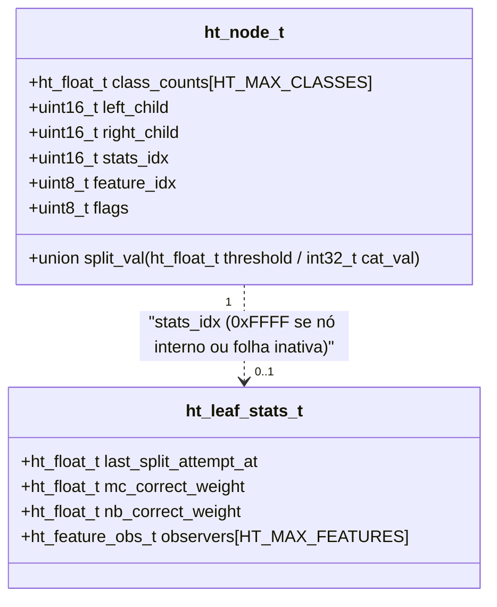

# 01 — Hoeffding Tree e Sistema VFDT (Domingos & Hulten, 2000; Hulten et al., 2001)

Este documento consolida a fundamentação teórica e matemática da **Hoeffding Tree** e do sistema **VFDT (*Very Fast Decision Tree*)**, baseada nos artigos seminais de Domingos & Hulten (2000) e Hulten, Spencer & Domingos (2001), cruzada com a implementação de referência do River ([`references/river_tree/`](file:///home/julio/Documentos/pessoal_minimal-decision-tree/references/river_tree)) e mapeada para nossa arquitetura em **C11 puro ($\le 1\text{ MB}$ de RAM)**.

---

## 1. Fundamentação Matemática

### 1.1 O Problema do Aprendizado em Streams e a Desigualdade de Hoeffding

Algoritmos clássicos de árvore de decisão em lote (*batch*), como CART, ID3 e C4.5, exigem que todos os exemplos de treinamento estejam armazenados simultaneamente na memória (ou sejam re-escaneados repetidamente em disco) para decidir qual atributo $X_i$ maximiza o ganho de informação ou a redução de impureza $G(X_i)$ em cada nó.

Em um fluxo contínuo (*data stream*), o objetivo é induzir incrementalmente uma árvore de decisão processando cada exemplo $(\mathbf{x}, y)$ **uma única vez** em tempo $O(1)$ e memória $O(1)$ por folha ativa, mantendo garantias estatísticas de que cada decisão de divisão (*split*) tomada com apenas $n$ amostras é idêntica à decisão que seria tomada se tivéssemos acesso a infinitas amostras.

Seja $r$ uma variável aleatória real cujo valor observado está estritamente contido em um intervalo de amplitude $R$. Suponha que fizemos $n$ observações independentes desta variável e calculamos sua média empírica $\bar{r}$. A **Desigualdade de Hoeffding** (1963) garante que, com probabilidade pelo menos $1 - \delta$ (onde $\delta \in (0, 1)$ é o nível de significância ou probabilidade máxima de erro tolerada), a média verdadeira $\mu_r = \mathbb{E}[r]$ satisfaz:

$$\mu_r \ge \bar{r} - \epsilon$$

onde o **Limite de Hoeffding (*Hoeffding Bound*)** $\epsilon$ é dado por (Domingos & Hulten, 2000, Seção 2, Eq. 1, p. 72):

$$\epsilon = \sqrt{\frac{R^2 \ln(1/\delta)}{2n}}$$

#### Definição das Variáveis:
- $\epsilon$: Margem de erro estatística unilateral após observar $n$ amostras (ou peso acumulado $n = W_l$).
- $R$: Amplitude (*range*) possível da função de mérito heurístico $G(\cdot)$:
  - Para **Gini Impurity** (ou probabilidade): $R = 1.0$ ([`gini_split_criterion.py#L43-L45`](file:///home/julio/Documentos/pessoal_minimal-decision-tree/references/river_tree/split_criterion/gini_split_criterion.py#L43-L45)).
  - Para **Information Gain (Entropia base 2)** com $C$ classes: $R = \log_2 C$. Na implementação do River ([`info_gain_split_criterion.py#L31-L35`](file:///home/julio/Documentos/pessoal_minimal-decision-tree/references/river_tree/split_criterion/info_gain_split_criterion.py#L31-L35)), usa-se o número de classes efetivamente observadas na folha: $R = \log_2(\max(C_{\text{obs}}, 2))$.
- $\delta$: Probabilidade máxima de escolher um atributo subótimo em um nó (ex: $\delta = 10^{-7}$ por padrão no River).
- $n$: Número de amostras (ou soma de pesos $W_l = \sum_{c=0}^{C-1} w_{l,c}$) acumuladas na folha $l$.

> [!NOTE]
> **Propriedade Fundamental:** O limite de Hoeffding $\epsilon$ é **independente da distribuição de probabilidade subjacente** geradora dos dados e decai com $O(1/\sqrt{n})$ e apenas logaritmicamente com $1/\delta$ (reduzir $\delta$ em $1000\times$ exige apenas uma fração constante adicional de amostras).

---

### 1.2 Regra de Decisão de Split ($\Delta \bar{G} > \epsilon$)

Em uma folha ativa $l$ que já acumulou $n$ exemplos, avaliamos o mérito empírico $\bar{G}(X_i)$ do melhor ponto de corte de cada atributo $X_i \in \{X_1, \dots, X_d\}$ (incluindo opcionalmente o candidato nulo $X_\emptyset$ de *pre-pruning*, que representa não dividir a folha):

1. Seja $X_a$ o atributo com o **maior** mérito observado: $\bar{G}(X_a) = \max_i \bar{G}(X_i)$.
2. Seja $X_b$ o atributo com o **segundo maior** mérito observado: $\bar{G}(X_b) = \max_{i \neq a} \bar{G}(X_i)$.
3. Definimos a variável aleatória diferença empírica:
   $$\Delta \bar{G} = \bar{G}(X_a) - \bar{G}(X_b) \ge 0$$

Aplicando o limite de Hoeffding à variável $\Delta G = G(X_a) - G(X_b)$, se verificarmos que:

$$\Delta \bar{G} > \epsilon \implies \Delta \bar{G} - \epsilon > 0$$

então, com probabilidade pelo menos $1 - \delta$, a diferença verdadeira no fluxo infinito satisfaz $\Delta G = G(X_a) - G(X_b) > 0$. Portanto, $X_a$ é comprovadamente o melhor atributo para dividir a folha $l$.

---

### 1.3 Garantia Teórica de Discordância: Teorema 1 (Domingos & Hulten, 2000)

Para quantificar o quão próxima a árvore online $HT_\delta$ (aprendida em uma única passada com parâmetro $\delta$) está da árvore assintótica em lote $DT_*$ (que teria acesso a infinitos exemplos em cada nó), Domingos & Hulten (2000, Seção 2, pp. 73–74) introduzem duas métricas sobre o espaço de exemplos $\mathcal{X}$:

1. **Discordância Extensional ($\Delta_e$):** Probabilidade de que duas árvores $DT_1$ e $DT_2$ produzam predições de classe diferentes para um exemplo aleatório $\mathbf{x}$:
   $$\Delta_e(DT_1, DT_2) = \sum_{\mathbf{x} \in \mathcal{X}} P(\mathbf{x}) \, \mathbb{I}\big[DT_1(\mathbf{x}) \neq DT_2(\mathbf{x})\big]$$
2. **Discordância Intensional ($\Delta_i$):** Probabilidade de que o caminho (*path*) percorrido por $\mathbf{x}$ desde a raiz até a folha em $DT_1$ divirja do caminho em $DT_2$ (seja em comprimento, em algum teste interno ou na predição da folha):
   $$\Delta_i(DT_1, DT_2) = \sum_{\mathbf{x} \in \mathcal{X}} P(\mathbf{x}) \, \mathbb{I}\big[\text{Path}_{DT_1}(\mathbf{x}) \neq \text{Path}_{DT_2}(\mathbf{x})\big]$$
   Como dois caminhos idênticos com a mesma folha produzem a mesma predição, vale sempre $\Delta_i(DT_1, DT_2) \ge \Delta_e(DT_1, DT_2)$.

#### Enunciado e Derivação do Teorema 1 (pp. 73–74, Eqs. 2–5):
Seja $p$ a **probabilidade de folha** (*leaf probability*), assumida constante para simplificação: a probabilidade condicional de que um exemplo que atinge o nível $i$ da árvore caia em uma folha naquele mesmo nível $i$.

1. Para um exemplo $\mathbf{x}$ cujos caminhos em $HT_\delta$ e $DT_*$ têm comprimentos $l_h$ e $l_d$, seja $l = \min(l_h, l_d)$. Pelo *Union Bound* ao longo dos níveis $j = 1, \dots, l$ condicionados ao acordo até o nível $j-1$ ($I_{j-1}$):
   $$P\big(\text{Path}_{HT_\delta}(\mathbf{x}) \neq \text{Path}_{DT_*}(\mathbf{x})\big) = \sum_{j=1}^{l} P(N_j^H \neq N_j^D \mid I_{j-1}) \le \sum_{j=1}^{l} \delta = \delta \cdot l \quad \text{(Eq. 2)}$$
2. Particionando todo o espaço $\mathcal{X}$ nos subconjuntos disjuntos $L_i$ dos exemplos que caem em uma folha de $DT_*$ exatamente no nível $i$, temos que a massa de probabilidade do nível $i$ segue uma distribuição geométrica:
   $$\sum_{\mathbf{x} \in L_i} P(\mathbf{x}) = (1 - p)^{i-1} p$$
3. Somando sobre todos os níveis possíveis $i \in \{1, 2, \dots, \infty\}$:
   $$\mathbb{E}\big[\Delta_i(HT_\delta, DT_*)\big] \le \sum_{i=1}^{\infty} (\delta i)(1 - p)^{i-1} p = \delta p \sum_{i=1}^{\infty} i (1 - p)^{i-1} \quad \text{(Eqs. 3–4)}$$
4. Usando a série aritmético-geométrica clássica $\sum_{i=1}^{\infty} i (1 - p)^{i-1} = \frac{1}{p^2}$, obtemos:
   $$\mathbb{E}\big[\Delta_e(HT_\delta, DT_*)\big] \le \mathbb{E}\big[\Delta_i(HT_\delta, DT_*)\big] \le \delta p \cdot \frac{1}{p^2} = \frac{\delta}{p} \quad \text{(Eq. 5)}$$

---

### 1.4 Refinamentos do Sistema VFDT (Domingos & Hulten, 2000, Seção 3; Hulten et al., 2001)

A Hoeffding Tree teórica pura apresenta gargalos práticos em hardware real (empates de atributos, custo de CPU a cada exemplo e limite finito de RAM). O sistema **VFDT** introduz cinco mecanismos cruciais:

#### 1. Desempate (*Tie-Breaking* com limiar $\tau$, p. 75):
Se dois atributos $X_a$ e $X_b$ tiverem méritos verdadeiros idênticos ou quase idênticos ($G(X_a) \approx G(X_b) \implies \Delta \bar{G} \approx 0$), o número de amostras exigido para $\epsilon < \Delta \bar{G}$ cresce como $O(1 / \Delta \bar{G}^2) \to \infty$, travando o crescimento da folha.
O VFDT define um limiar de empate $\tau$ (padrão $\tau = 0.05$ no River): se $\epsilon$ já encolheu abaixo de $\tau$, a diferença verdadeira entre $X_a$ e $X_b$ é no máximo $\tau$ (irrelevante na prática), e o split é disparado imediatamente:

$$\text{Condição de Split VFDT: } \quad (\Delta \bar{G} > \epsilon) \quad \lor \quad (\epsilon < \tau)$$

*Referência no River:* [`hoeffding_tree_classifier.py#L430`](file:///home/julio/Documentos/pessoal_minimal-decision-tree/references/river_tree/hoeffding_tree_classifier.py#L430) (`if best_suggestion.merit - second_best_suggestion.merit > hoeffding_bound or hoeffding_bound < self.tau:`).

#### 2. Período de Graça (*Grace Period* $n_{\min}$, p. 75):
Avaliar a CDF Gaussiana e o ganho de informação para todos os $d$ atributos a cada única amostra recebida desperdiça CPU, pois uma única amostra quase nunca altera $\Delta \bar{G}$ ou $\epsilon$ o suficiente. O VFDT acumula estatísticas silenciosamente e só executa `_attempt_to_split` quando o peso acumulado na folha desde a última tentativa atinge $n_{\min}$ (padrão `grace_period = 200`):

$$W_{\text{seen}}(l) - W_{\text{last\_split\_attempt}}(l) \ge n_{\min}$$

*Referência no River:* [`hoeffding_tree_classifier.py#L529-L535`](file:///home/julio/Documentos/pessoal_minimal-decision-tree/references/river_tree/hoeffding_tree_classifier.py#L529-L535).

#### 3. *Pre-pruning* via Atributo Nulo ($X_\emptyset$, p. 73):
Considera um candidato nulo $X_\emptyset$ (não realizar split). No River ([`nodes/leaf.py#L127-L130`](file:///home/julio/Documentos/pessoal_minimal-decision-tree/references/river_tree/nodes/leaf.py#L127-L130) e [`hoeffding_tree_classifier.py#L446-L450`](file:///home/julio/Documentos/pessoal_minimal-decision-tree/references/river_tree/hoeffding_tree_classifier.py#L446-L450)), uma sugestão nula `BranchFactory(merit=-inf, feature=None)` é inserida na lista de candidatos quando `merit_preprune=True`. Se mesmo após avaliar todos os atributos o melhor candidato selecionado for o split nulo (`best_suggestion.feature is None`), a folha é **desativada**.

#### 4. Descarte de Atributos Pouco Promissores (*Poor Attribute Dropping*, p. 75):
Durante uma tentativa de split onde ainda não houve vencedor definitivo, se a diferença de mérito entre o melhor atributo $X_a$ e um atributo qualquer $X_i$ já supera $\epsilon$:

$$\bar{G}(X_a) - \bar{G}(X_i) > \epsilon$$

então, com probabilidade $1 - \delta$, $X_i$ jamais superará $X_a$ naquela folha. O observador de $X_i$ pode ser desativado (`disable_attribute`).

> [!IMPORTANT]
> **Exceção Crítica para Folhas NB e NBA:**
> No River ([`nodes/htc_nodes.py#L132-L143`](file:///home/julio/Documentos/pessoal_minimal-decision-tree/references/river_tree/nodes/htc_nodes.py#L132-L143) e [`#L215-L226`](file:///home/julio/Documentos/pessoal_minimal-decision-tree/references/river_tree/nodes/htc_nodes.py#L215-L226)), `disable_attribute` é um **no-op** em `LeafNaiveBayes` e `LeafNaiveBayesAdaptive`, pois o classificador Naive Bayes na folha precisa das distribuições condicionais $P(x_i \mid y = c)$ de **todos** os atributos para inferência. Em nossa arquitetura C11 com *Slab Allocator* de tamanho fixo (`ht_leaf_stats_t`), manter o bloco da folha integro e reciclar o bloco inteiro na desativação/split elimina fragmentação interna e preserva paridade total com `NB`/`NBA`.

#### 5. Gerenciamento de Memória VFDT: Desativação de Folhas via Promessa ($p_l \cdot e_l$)
Em sistemas com memória finita (como o nosso orçamento de $\le 1\text{ MB}$ de RAM), o número de folhas ativas mantendo observadores pesados (`ht_leaf_stats_t`) pode atingir o limite do pool.
Domingos & Hulten (2000, p. 75) e Hulten, Spencer & Domingos (2001, Seção 2, pp. 98–99) definem a **promessa** de uma folha $l$ como o limite superior da redução de erro global que poderia ser obtida ao refinar (dividir) a folha $l$:

$$\text{Promessa Normalizada}(l) = p_l \cdot e_l$$

onde:
- $p_l = \frac{W_l}{W_{\text{total}}}$ é a fração de exemplos da stream que caem na folha $l$ (onde $W_l = \sum_c w_{l,c}$).
- $e_l = 1 - \frac{\max_c w_{l,c}}{W_l} = \frac{W_l - \max_c w_{l,c}}{W_l}$ é a taxa de erro empírica da classe majoritária na folha $l$.

Multiplicando por $W_{\text{total}}$ (constante para todas as folhas da árvore num dado instante), obtemos a fórmula exata e livre de divisões implementada em [`LeafMajorityClass.calculate_promise()`](file:///home/julio/Documentos/pessoal_minimal-decision-tree/references/river_tree/nodes/htc_nodes.py#L63-L78):

$$\text{Promise}(l) = W_{\text{total}} \cdot p_l \cdot e_l = W_l - \max_{c \in \{0, \dots, C-1\}} w_{l,c}$$

Isto é: a promessa de uma folha $l$ é simplesmente a **soma dos pesos das classes minoritárias** naquela folha!
- Quando uma folha $l$ é **desativada**: seus observadores de atributos (`ht_leaf_stats_t`) são liberados de volta para o `stats_pool`, mas seus contadores de classe `class_counts` permanecem no nó estrutural leve (`ht_node_t`). Assim, a folha inativa continua fazendo predições via *Majority Class* e atualizando sua promessa $W_l - \max_c w_{l,c}$ com custo de RAM adicional zero.

---

## 2. Casos de Borda Numéricos

Para garantir robustez em C11 (`float` 32-bit e `double` 64-bit) e paridade com o River, os seguintes casos de borda do ciclo VFDT devem ser tratados explicitamente:

1. **Folha Pura (1 única classe observada):**
   - *Condição:* Menos de 2 classes possuem $w_{l,c} > 0$ na folha ([`htc_nodes.py#L80-L94`](file:///home/julio/Documentos/pessoal_minimal-decision-tree/references/river_tree/nodes/htc_nodes.py#L80-L94), `observed_class_distribution_is_pure`).
   - *Tratamento:* Não executa `_attempt_to_split` nem avalia observadores; apenas atualiza `last_split_attempt_at = weight_seen`.
2. **Classe Majoritária Dominante (`max_share_to_split`):**
   - *Condição:* Mesmo com $\ge 2$ classes presentes, se a fração da classe majoritária excede o limiar $\frac{\max_c w_{l,c}}{W_l} > \text{max\_share\_to\_split}$ (padrão `0.99`, [`htc_nodes.py#L54-L61`](file:///home/julio/Documentos/pessoal_minimal-decision-tree/references/river_tree/nodes/htc_nodes.py#L54-L61)).
   - *Tratamento:* Pula a varredura dos observadores de atributos para economizar CPU, retornando apenas a sugestão de split nulo.
3. **Soma de Pesos Zero ($W_l \le 0$):**
   - *Condição:* Folha recém-inicializada ou ramo vazio ($W_l = 0$).
   - *Tratamento:* No cálculo do limite de Hoeffding $\epsilon = \sqrt{\frac{R^2 \ln(1/\delta)}{2 W_l}}$, proteger com `if (W_l <= (ht_float_t)0.0) return HT_INFINITY;` evitando divisão por zero (`NaN`). Em `calculate_promise()`, se $W_l \le 0$, retornar `0.0`.
4. **Valores Ausentes (`NaN` em numéricos ou `< 0` em categóricos) durante o Roteamento:**
   - *Condição:* Em um nó interno que testa o atributo $f$, a amostra possui `HT_ISNAN(x[f].num)` (para `HT_FEAT_NUMERIC`) ou `x[f].cat < 0` (para `HT_FEAT_CATEGORICAL`).
   - *Tratamento ([`hoeffding_tree_classifier.py#L549-L553`](file:///home/julio/Documentos/pessoal_minimal-decision-tree/references/river_tree/hoeffding_tree_classifier.py#L549-L553) / [`branch.py#L40-L45`](file:///home/julio/Documentos/pessoal_minimal-decision-tree/references/river_tree/nodes/branch.py#L40-L45)):* A amostra segue para o **filho mais populoso** (`most_common_path`), determinado em tempo real comparando a soma de `class_counts` do filho esquerdo ($W_{\text{left}}$) versus filho direito ($W_{\text{right}}$): vai para `left_child` se $W_{\text{left}} \ge W_{\text{right}}$, senão `right_child`. Isso exige **zero bytes extras** no `ht_node_t`.
5. **Inicialização Não-Zerada das Folhas Filhas Pós-Split:**
   - *Condição:* Quando um split é efetivado ([`hoeffding_tree_classifier.py#L455-L458`](file:///home/julio/Documentos/pessoal_minimal-decision-tree/references/river_tree/hoeffding_tree_classifier.py#L455-L458)).
   - *Tratamento:* As duas novas folhas filhas (`left_child` e `right_child`) **não** começam com `class_counts` zerados — elas herdam como distribuição inicial de classes os vetores `lhs_dist[c]` e `rhs_dist[c]` estimados pelo observador do atributo vencedor no ponto de corte! Além disso, `last_split_attempt_at` de cada nova folha deve ser inicializado com seu respectivo peso inicial ($W_{\text{left}}$ e $W_{\text{right}}$), para que o primeiro `grace_period` da filha conte $n_{\min}$ amostras *novas* após o split ([`leaf.py#L38`](file:///home/julio/Documentos/pessoal_minimal-decision-tree/references/river_tree/nodes/leaf.py#L38)).
6. **Concorrência por Bloco no `stats_pool` durante o Split:**
   - *Condição:* Um split transforma 1 folha ativa em 1 nó interno + 2 folhas filhas (saldo líquido de $+1$ bloco no `stats_pool`). Se o `stats_pool` tinha apenas 1 bloco usado disponível (o da própria folha que está sofrendo split), a primeira filha recicla o bloco da mãe, mas a segunda filha pode encontrar o `stats_pool` cheio.
   - *Tratamento:* Liberar o `stats_idx` da folha mãe **antes** de alocar os `stats_idx` das duas filhas. Se para a segunda filha o `stats_pool` estiver cheio, acionar a rotina de desativação da folha ativa de menor `Promise(l)` na árvore (ou criar a filha já em modo inativo caso seu próprio `Promise` seja menor que o de todas as folhas ativas existentes).

---

## 3. Mapeamento para Nossa Arquitetura C11 ($\le 1\text{ MB}$)

### 3.1 Separação entre Topologia (`ht_node_t`) e Estado de Aprendizado (`ht_leaf_stats_t`)

Seguindo as regras de arquitetura do projeto ([`AGENTS.md`](file:///home/julio/Documentos/pessoal_minimal-decision-tree/AGENTS.md)), eliminamos ponteiros de 64-bit e separamos os dados permanentes de roteamento/predição dos observadores temporários de treinamento:



#### Estrutura C11 de `ht_node_t` (Ordenada por Alinhamento):

```c
#define HT_INVALID_IDX ((uint16_t)0xFFFFU)

/* Flags de ht_node_t */
#define HT_NODE_IS_LEAF      (1U << 0)
#define HT_NODE_SPLIT_CAT    (1U << 1) /* 0 = numérico (<= threshold), 1 = categórico (== cat_val) */

typedef struct {
    /* 1. Campos de 4 ou 8 bytes (ht_float_t) */
    ht_float_t class_counts[HT_MAX_CLASSES]; /* Pesos por classe (usado em MC, Promise e most_common_path) */
    union {
        ht_float_t threshold;                /* Ponto de corte numérico: x[f] <= threshold vai para left */
        int32_t    cat_val;                  /* Valor categórico: x[f] == cat_val vai para left */
    } split_val;

    /* 2. Índices de 2 bytes (uint16_t) — Zero ponteiros! */
    uint16_t left_child;                     /* Índice no node_pool (HT_INVALID_IDX se folha) */
    uint16_t right_child;                    /* Índice no node_pool (HT_INVALID_IDX se folha) */
    uint16_t stats_idx;                      /* Índice no stats_pool (HT_INVALID_IDX se interno/inativo) */

    /* 3. Metadados de 1 byte (uint8_t) */
    uint8_t  feature_idx;                    /* Índice do atributo testado no split */
    uint8_t  flags;                          /* Bitmask: HT_NODE_IS_LEAF | HT_NODE_SPLIT_CAT */
} ht_node_t;
```

### 3.2 Custo Exato em Bytes (`sizeof(ht_node_t)`) — `float` vs `double`

Considerando a configuração padrão de referência com $C = \text{HT\_MAX\_CLASSES} = 4$:

| Campo em `ht_node_t` | Modo Padrão: `float` (32-bit) | Modo Paridade: `double` (64-bit, `-DHT_USE_DOUBLE`) |
| :--- | :---: | :---: |
| `class_counts[4]` | $4 \times 4\text{ B} = 16\text{ B}$ | $4 \times 8\text{ B} = 32\text{ B}$ |
| `split_val` (`union`) | $4\text{ B}$ | $8\text{ B}$ |
| `left_child`, `right_child`, `stats_idx` | $3 \times 2\text{ B} = 6\text{ B}$ | $3 \times 2\text{ B} = 6\text{ B}$ |
| `feature_idx`, `flags` | $2 \times 1\text{ B} = 2\text{ B}$ | $2 \times 1\text{ B} = 2\text{ B}$ |
| **Padding de alinhamento** | $0\text{ B}$ (múltiplo exato de 4 B) | $0\text{ B}$ (múltiplo exato de 8 B) |
| **`sizeof(ht_node_t)` Total** | **$28\text{ Bytes}$** | **$48\text{ Bytes}$** |

- **Para 4.096 nós no `node_pool`:**
  - Em `float` (32-bit): $4.096 \times 28\text{ B} = 114.688\text{ B} \approx \mathbf{112\text{ KB}}$.
  - Em `double` (64-bit): $4.096 \times 48\text{ B} = 196.608\text{ B} \approx \mathbf{192\text{ KB}}$.

Ambos deixam mais de $800\text{ KB}$ livres dentro do orçamento de $1\text{ MB}$ para o `stats_pool` das folhas ativas (detalhado em [`02_attribute_observers.md`](file:///home/julio/Documentos/pessoal_minimal-decision-tree/docs/02_attribute_observers.md)).
