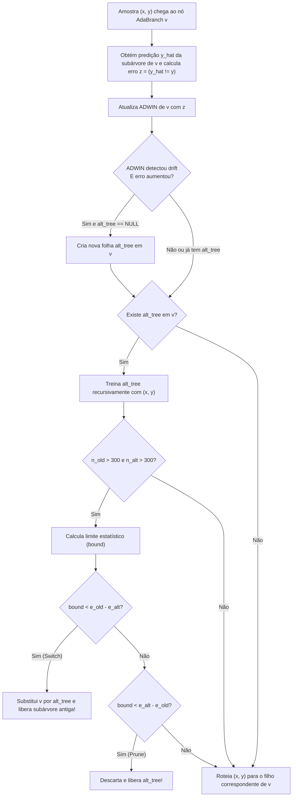

# 03 — Concept Drift: CVFDT, ADWIN e Hoeffding Adaptive Tree (Hulten et al., 2001; Bifet & Gavaldà, 2009)

Este documento estuda os mecanismos de adaptação de árvores de decisão a fluxos não-estacionários (*Concept Drift*), comparando a abordagem clássica baseada em janela fixa (**CVFDT**, Hulten, Spencer & Domingos, 2001) com a abordagem adaptativa livre de parâmetros de janela (**ADWIN + Hoeffding Adaptive Tree / HAT**, Bifet & Gavaldà, 2009), cruzada com [`references/river_tree/`](file:///home/julio/Documentos/pessoal_minimal-decision-tree/references/river_tree).

---

## 1. Fundamentação Matemática

### 1.1 O Problema do Concept Drift e a Abordagem CVFDT (Hulten et al., 2001)

A Hoeffding Tree original (VFDT) assume que o fluxo de dados é gerado por uma distribuição estacionária $P(\mathbf{x}, y)$. No mundo real (sensores embarcados, desgaste mecânico, sazonalidade), a distribuição muda ao longo do tempo (*Concept Drift* abrupto ou gradual), fazendo com que splits escolhidos no passado se tornem subótimos ou incorretos.

O algoritmo **CVFDT (*Concept-adapting Very Fast Decision Tree*, Hulten et al., 2001, Seção 3, pp. 99–102)** propôs manter uma árvore consistente com uma janela deslizante fixa $W$ dos últimos $w$ exemplos sem reconstruir a árvore do zero:

1. **Estatísticas Suficientes em Todos os Nós (`Table 3`, p. 100):** Diferente do VFDT (que descarta os observadores de atributos assim que uma folha vira nó interno), o CVFDT mantém as contagens $n_{ijk}$ permanentemente **em todos os nós internos e folhas**, atribuindo um identificador monotônico `ID` a cada nó criado.
2. **Janela Deslizante e Esquecimento (`ForgetExample`, `Table 4`, p. 101):** Guarda na memória todos os $w$ exemplos recentes $(\mathbf{x}, y, \text{ID}_{\max})$. Quando um novo exemplo chega e $|W| > w$, o exemplo mais antigo $(\mathbf{x}_{\text{old}}, y_{\text{old}}, \text{ID}_{\text{old}})$ é removido da janela e roteado pela árvore (apenas pelos nós com $\text{id} \le \text{ID}_{\text{old}}$), **decrementando** as estatísticas $n_{ijk}$ de cada nó visitado.
3. **Validação Periódica de Splits (`CheckSplitValidity`, `Table 5`, p. 101):** A cada $f$ exemplos, varre todos os nós internos $v$ (cujo atributo de split atual é $X_a$). Se um outro atributo $X_n \neq X_a$ passar a ter o maior mérito empírico e satisfizer $\bar{G}_v(X_n) - \bar{G}_v(X_b) > \epsilon$, o CVFDT instancia uma **subárvore alternativa** $T_{\text{alt}} \in \text{ALT}(v)$ enraizada em $X_n$.
4. **Fase de Teste e Substituição (p. 101):** A cada $m$ exemplos de teste, se a acurácia de $T_{\text{alt}}$ superar a do nó original $v$, $T_{\text{alt}}$ substitui a subárvore de $v$; subárvores alternativas cujo erro não melhora são podadas.

> [!WARNING]
> **Por que a HAT substitui o CVFDT em Sistemas Embarcados ($\le 1\text{ MB}$):**
> 1. **Explosão de Memória no CVFDT:** Armazenar uma janela de $w = 100.000$ amostras brutas em RAM e manter observadores pesados (`ht_leaf_stats_t`) em **todos os nós internos** consome dezenas de megabytes, inviabilizando o uso em microcontroladores.
> 2. **Hiperparâmetros Frágeis:** O CVFDT exige sintonizar manualmente 5 parâmetros ($w, f, m$, etc.) assumindo uma velocidade fixa de drift.
> 3. **Solução da HAT (Bifet & Gavaldà, 2009):** Elimina a janela de exemplos brutos $W$ e os observadores de atributos nos nós internos, acoplando um detector estatístico compacto **ADWIN** ($O(\log N)$ de memória) em cada nó para monitorar apenas a taxa de erro de classificação.

---

### 1.2 Detector de Drift ADWIN / ADWIN2 (Bifet & Gavaldà, 2007 / 2009)

O **ADWIN (*ADaptive WINdowing*)** mantém uma janela deslizante de comprimento variável $W$ de valores reais limitados $z_1, z_2, \dots, z_n \in [0, 1]$ (na HAT, $z_t = \mathbb{I}[\hat{y}_t \neq y_t] \in \{0, 1\}$ é o bit de erro 0-1 da predição).

#### 1. Critério Estatístico de Partição e Corte ($\epsilon_{\text{cut}}$):
A cada `clock` amostras (padrão `clock = 32`), o ADWIN testa partições da janela atual $W$ em duas subjanelas contíguas $W = W_0 \cdot W_1$ (onde $W_0$ contém os $n_0$ elementos mais antigos com média empírica $\hat{\mu}_{W_0}$, e $W_1$ contém os $n_1$ elementos mais recentes com média $\hat{\mu}_{W_1}$, sendo $n = n_0 + n_1$).

Se a diferença absoluta entre as médias das duas subjanelas exceder o limite de corte $\epsilon_{\text{cut}}$:

$$\left|\hat{\mu}_{W_0} - \hat{\mu}_{W_1}\right| \ge \epsilon_{\text{cut}}$$

o ADWIN declara que houve *Concept Drift* e descarta os elementos antigos de $W_0$, reduzindo a janela até que nenhuma partição viole $\epsilon_{\text{cut}}$.

Seja $m$ a **média harmônica** dos tamanhos $n_0$ e $n_1$, e $\delta' = \frac{\delta}{n}$ a correção de Bonferroni para múltiplos testes ao longo da janela de tamanho $n$:

$$m = \frac{1}{\frac{1}{n_0} + \frac{1}{n_1}} = \frac{n_0 \cdot n_1}{n_0 + n_1}, \qquad \delta' = \frac{\delta}{n}$$

Usando a desigualdade de Bernstein com a variância amostral $\sigma_W^2$ observada na janela total $W$ ([`adwin.py`](file:///home/julio/Documentos/pessoal_minimal-decision-tree/references/river_tree/drift/adwin.py)):

$$\epsilon_{\text{cut}} = \sqrt{\frac{2}{m} \, \sigma_W^2 \, \ln\left(\frac{2}{\delta'}\right)} + \frac{2}{3m} \ln\left(\frac{2}{\delta'}\right)$$

#### 2. Compressão Logarítmica via Histogramas Exponenciais (ADWIN2):
Para não armazenar todas as $n$ amostras individuais em RAM, o ADWIN2 agrupa as observações em **buckets** cujas capacidades crescem em potências de 2: $2^0, 2^1, 2^2, \dots, 2^k$.
- Para cada nível de capacidade $2^k$, mantém-se no máximo $M$ buckets (`max_buckets = 5` por padrão no River, [`adwin.py#L69-L73`](file:///home/julio/Documentos/pessoal_minimal-decision-tree/references/river_tree/drift/adwin.py#L69-L73)).
- Sempre que um $(M+1)$-ésimo bucket surge no nível $k$, os **2 buckets mais antigos** do nível $k$ são fundidos em 1 único bucket no nível $k+1$ (de capacidade $2^{k+1}$), combinando seu peso total $n$, soma/média e variância incremental de Welford:
  $$n_{A \cup B} = 2^{k+1}, \quad S_{A \cup B} = S_A + S_B, \quad M_{2, A \cup B} = M_{2,A} + M_{2,B} + \frac{(S_A - S_B)^2}{2^{k+1}}$$
- Assim, uma janela cobrindo até $N = 65.535$ exemplos exige no máximo $M \cdot \lceil \log_2(N / M) \rceil \approx 5 \times 14 = 70$ buckets!

---

### 1.3 Arquitetura da Hoeffding Adaptive Tree (HAT, Bifet & Gavaldà, 2009)

Na **HAT** ([`hoeffding_adaptive_tree_classifier.py`](file:///home/julio/Documentos/pessoal_minimal-decision-tree/references/river_tree/hoeffding_adaptive_tree_classifier.py) e [`nodes/hatc_nodes.py`](file:///home/julio/Documentos/pessoal_minimal-decision-tree/references/river_tree/nodes/hatc_nodes.py)), cada nó (`AdaBranchClassifier` e `AdaLeafClassifier`) possui um estimador de erro (ADWIN / média online $\hat{e}$) e os nós internos possuem um índice opcional para uma **subárvore alternativa** (`alt_tree_idx`):



#### 1. Filtro Unilateral de Drift ([`hatc_nodes.py#L70-L72, #L201-L204`](file:///home/julio/Documentos/pessoal_minimal-decision-tree/references/river_tree/nodes/hatc_nodes.py#L201-L204)):
O ADWIN detecta mudanças na média tanto para cima quanto para baixo. Se o ADWIN sinalizar mudança (`drift == true`), mas a nova taxa de erro for **menor** que a anterior ($\hat{e}_{\text{antigo}} > \hat{e}_{\text{atual}}$), a árvore está *melhorando* — o sinal de drift é ignorado (`error_change = False`). Uma subárvore alternativa (`_alternate_tree`) só é criada quando o erro **aumenta** significativamente.

#### 2. Regra de Substituição (`Switch`) ou Poda (`Prune`) da Subárvore Alternativa ([`hatc_nodes.py#L214-L248`](file:///home/julio/Documentos/pessoal_minimal-decision-tree/references/river_tree/nodes/hatc_nodes.py#L214-L248)):
Quando um nó interno possui uma subárvore alternativa ativa, sejam $n_{\text{old}}, \hat{e}_{\text{old}}$ o número de amostras e a taxa de erro do nó principal, e $n_{\text{alt}}, \hat{e}_{\text{alt}}$ os da subárvore alternativa.
Assim que ambos acumulam pelo menos `drift_window_threshold` amostras ($n_{\text{old}} > 300$ e $n_{\text{alt}} > 300$), calcula-se o limite de diferença de proporções de Bernstein/Hoeffding com nível de significância $\alpha = \text{switch\_significance} = 0.05$:

$$\text{bound} = \sqrt{2 \cdot \hat{e}_{\text{old}} (1 - \hat{e}_{\text{old}}) \ln\left(\frac{2}{\alpha}\right) \left(\frac{1}{n_{\text{alt}}} + \frac{1}{n_{\text{old}}}\right)}$$

- **Substituição (`Switch`):** Se $\text{bound} < \hat{e}_{\text{old}} - \hat{e}_{\text{alt}}$, a subárvore alternativa tem erro estatisticamente menor. Os filhos antigos são liberados recursivamente de volta aos pools e `alt_tree` assume o lugar do nó atual!
- **Poda da Alternativa (`Prune`):** Se $\text{bound} < \hat{e}_{\text{alt}} - \hat{e}_{\text{old}}$, a subárvore alternativa é estatisticamente pior que a atual e é imediatamente descartada (seus nós e folhas retornam aos pools).

#### 3. Amostragem Online $\text{Poisson}(1)$ e Votação Ponderada por $1/\hat{e}^2$:
- **Online Bootstrap (`bootstrap_sampling = True`, [`hatc_nodes.py#L52-L56`](file:///home/julio/Documentos/pessoal_minimal-decision-tree/references/river_tree/nodes/hatc_nodes.py#L52-L56)):** Ao chegar a uma folha adaptativa, sorteia-se $k \sim \operatorname{Poisson}(\lambda = 1)$ para diversificar o aprendizado entre a árvore principal e as subárvores alternativas.
- **Votação Ponderada na Predição ([`hatc_nodes.py#L110-L119`](file:///home/julio/Documentos/pessoal_minimal-decision-tree/references/river_tree/nodes/hatc_nodes.py#L110-L119)):** Durante a inferência (`predict_proba_one`), caso um nó interno possua uma subárvore alternativa, o exemplo consulta tanto a folha alcançada pelo ramo principal quanto a folha alcançada por `alt_tree`. As probabilidades de cada folha alcançada $l$ são ponderadas pelo **inverso do quadrado de sua taxa de erro** ($\propto \frac{1}{\hat{e}_l^2}$):

$$p'_l(c) = \frac{w_{l,c}}{W_l \cdot \hat{e}_l^2}, \qquad \hat{P}(y = c \mid \mathbf{x}) = \frac{\sum_l p'_l(c)}{\sum_{k=0}^{C-1} \sum_l p'_l(k)}$$

---

## 2. Casos de Borda Numéricos

1. **Taxa de Erro Zero na Votação Ponderada da HAT ($\hat{e}_l = 0$):**
   - *Condição:* No início do treinamento ou em folhas perfeitamente puras, a taxa de erro estimada na folha é $\hat{e}_l = 0 \implies W_l \cdot \hat{e}_l^2 = 0$.
   - *Tratamento ([`hatc_nodes.py#L112-L118`](file:///home/julio/Documentos/pessoal_minimal-decision-tree/references/river_tree/nodes/hatc_nodes.py#L112-L118)):* Evitar divisão por zero (`if (norm_factor > 0)`). Se $\hat{e}_l \le 0$, aplicar um piso numérico $\epsilon_{\text{err}} = 10^{-6}$ (ou normalizar apenas por $W_l$ quando houver uma única folha sem alternativa).
2. **Erro Extremo ($\hat{e}_{\text{old}} = 0$ ou $\hat{e}_{\text{old}} = 1$) no Cálculo do `bound` de Troca:**
   - *Condição:* Se $\hat{e}_{\text{old}} \in \{0, 1\}$, o termo de variância binomial $\hat{e}_{\text{old}}(1 - \hat{e}_{\text{old}})$ é igual a `0.0`, resultando em `bound = 0.0`.
   - *Tratamento:* Como a comparação de substituição é estrita (`bound < old_err - alt_err`), se $\hat{e}_{\text{old}} = 0$, temos $0 < 0 - \hat{e}_{\text{alt}}$ que é sempre **falso** (nunca substitui uma árvore com zero erro). Se $\hat{e}_{\text{old}} = 1.0$ e $\hat{e}_{\text{alt}} < 1.0$, temos $0 < 1 - \hat{e}_{\text{alt}}$ (**verdadeiro**, substitui imediatamente uma árvore com 100% de erro após $n > 300$). Ainda assim, em C11 deve-se aplicar `fmax(0.0, old_err * (1.0 - old_err))` antes de `HT_SQRT` para evitar argumento negativo por imprecisão de ponto flutuante.
3. **Detalhe de Paridade no Sorteio $\operatorname{Poisson}(1)$ (`k == 0`):**
   - *Condição:* Na distribuição de Poisson com $\lambda = 1$, $P(k = 0) = e^{-1} \approx 36.79\%$.
   - *Tratamento ([`hatc_nodes.py#L54-L56`](file:///home/julio/Documentos/pessoal_minimal-decision-tree/references/river_tree/nodes/hatc_nodes.py#L54-L56)):* No River, o código faz `k = stats.poisson(1, rng); if k > 0: w *= k` — ou seja, quando $k = 0$, o peso $w$ **não** é zerado (permanece $w = 1.0$)! Para paridade com o River na Fase 3, esse comportamento deve ser documentado e reproduzido.
4. **Reciclagem Recursiva de Subárvores em `Switch` ou `Prune`:**
   - Quando uma subárvore antiga é substituída ou uma subárvore alternativa é podada, ela pode conter múltiplos nós internos e folhas ativas.
   - Em C11 (sem recursão profunda na stack), a liberação da subárvore descartada deve percorrer seus nós iterativamente (usando uma pequena fila/pilha de índices em array fixo), devolvendo todos os `stats_idx` ao `stats_pool`, todos os detectores ADWIN ao `adwin_pool` e todos os `node_idx` ao `node_pool`.

---

## 3. Mapeamento para Nossa Arquitetura C11 ($\le 1\text{ MB}$)

### 3.1 Estruturas C11 para ADWIN Estático e HAT (`ht_drift.h`)

Na Fase 3, em vez de alocar listas encadeadas dinâmicas de buckets como em Python/C++, cada detector ADWIN utiliza um array circular fixo de níveis logarítmicos ($L = 12$ níveis cobrem janelas de até $5 \times (2^{12} - 1) > 20.000$ elementos por nó, com $M + 1 = 6$ slots por nível):

```c
#define HT_ADWIN_MAX_BUCKETS 5U
#define HT_ADWIN_LEVELS      12U

/* Um nível do histograma exponencial do ADWIN (capacidade dos buckets = 2^level) */
typedef struct {
    ht_float_t sum[HT_ADWIN_MAX_BUCKETS + 1];      /* Soma (total) de cada bucket no nível */
    ht_float_t variance[HT_ADWIN_MAX_BUCKETS + 1]; /* Variância interna (M2) de cada bucket */
    uint8_t    count;                              /* Número de buckets ativos neste nível (0..6) */
    uint8_t    head;                               /* Índice circular do bucket mais antigo */
} ht_adwin_row_t;

/* Instância completa do ADWIN + metadados de subárvore alternativa para um nó HAT */
typedef struct {
    ht_adwin_row_t rows[HT_ADWIN_LEVELS];
    ht_float_t     total_sum;      /* Soma total na janela W */
    ht_float_t     total_variance; /* Variância acumulada M2 na janela W */
    ht_float_t     total_width;    /* Tamanho atual n da janela W */
    ht_float_t     mean_error;     /* Estimativa de erro online do nó */
    uint32_t       mint_time;      /* Contador para disparar checagem a cada clock=32 */
    uint16_t       alt_tree_idx;   /* Índice da raiz da subárvore alternativa no node_pool (0xFFFF se nenhuma) */
    uint8_t        max_level;      /* Maior nível ativo atualmente */
    uint8_t        pad;
} ht_adwin_state_t;
```

### 3.2 Custo Exato em Bytes (`sizeof`) — `float` (32-bit) vs `double` (64-bit)

| Estrutura C11 (Fase 3 — HAT) | Cálculo de Campos ($L=12, M=5$) | `float` (32-bit) | `double` (64-bit, `-DHT_USE_DOUBLE`) |
| :--- | :--- | :---: | :---: |
| `ht_adwin_row_t` (1 nível) | $2 \times 6 \times \text{sizeof(ht\_float\_t)} + 2\text{ B} + \text{padding}$ | **$52\text{ B}$** | **$104\text{ B}$** |
| `rows[12]` (12 níveis logarítmicos) | $12 \times \text{sizeof(ht\_adwin\_row\_t)}$ | **$624\text{ B}$** | **$1.248\text{ B}$** |
| Metadados de `ht_adwin_state_t` | $4\text{ floats} + 4\text{ B} + 2\text{ B} + 2\text{ B}$ | **$24\text{ B}$** | **$40\text{ B}$** |
| **`sizeof(ht_adwin_state_t)` Total** | 1 instância ADWIN + ponteiro `alt_tree_idx` | **$648\text{ B}$** | **$1.288\text{ B}$** |

#### Orçamento Integrado de Memória (VFDT + HAT $\le 1\text{ MB}$):
- Em **`float` (32-bit):**
  - `node_pool` (2.048 nós): $2.048 \times 28\text{ B} \approx 56\text{ KB}$
  - `stats_pool` (256 folhas ativas): $256 \times 1.292\text{ B} \approx 323\text{ KB}$
  - `adwin_pool` (512 nós monitorados com ADWIN): $512 \times 648\text{ B} \approx 324\text{ KB}$
  - **Total Geral (HAT completa):** **$\approx 703\text{ KB} \le 1\text{ MB}$**!
