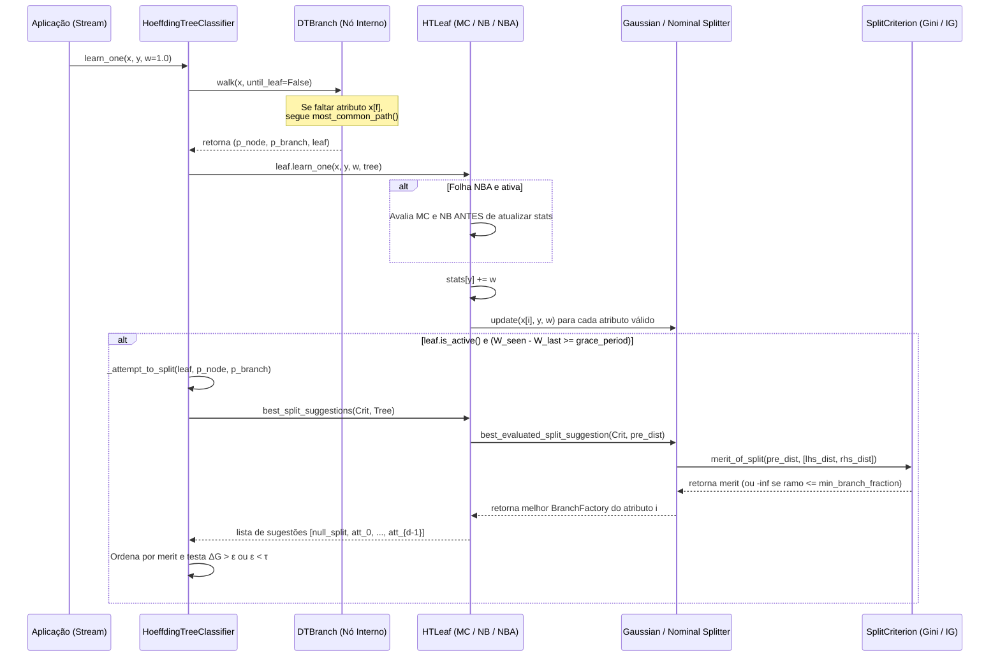

# 04 — Mapeamento Arquitetural do River (`references/river_tree/`) para C11

Este documento disseca linha por linha a implementação de referência da **Hoeffding Tree** na biblioteca Python [`online-ml/river`](file:///home/julio/Documentos/pessoal_minimal-decision-tree/references/river_tree), mapeando o fluxo de controle, estruturas de nós, ordenação de candidatos (`BranchFactory`), observadores de atributos e critérios de split para nossa implementação determinística em **C11 puro ($\le 1\text{ MB}$ de RAM)**.

---

## 1. Fundamentação Matemática e Fluxo Algorítmico no River

### 1.1 Ciclo Completo de `learn_one(x, y, w)` e `_attempt_to_split`

No River ([`hoeffding_tree_classifier.py#L474-L562`](file:///home/julio/Documentos/pessoal_minimal-decision-tree/references/river_tree/hoeffding_tree_classifier.py#L474-L562)), o treinamento incremental de uma amostra $(\mathbf{x}, y)$ com peso $w = 1.0$ segue quatro estágios determinísticos:



#### 1. Roteamento (`walk` / `traverse`, [`hoeffding_tree_classifier.py#L510-L522, #L538-L558`](file:///home/julio/Documentos/pessoal_minimal-decision-tree/references/river_tree/hoeffding_tree_classifier.py#L510-L522)):
- Em [`nodes/branch.py#L47-L120`](file:///home/julio/Documentos/pessoal_minimal-decision-tree/references/river_tree/nodes/branch.py#L47-L120), o roteamento binário aplica a convenção:
  - **`NumericBinaryBranch` (`#L54-L57`):**
    $$\text{branch\_no}(\mathbf{x}) = \begin{cases} 0 \text{ (left)}, & \text{se } x_f \le \text{threshold} \\ 1 \text{ (right)}, & \text{se } x_f > \text{threshold} \end{cases}$$
  - **`NominalBinaryBranch` (`#L91-L94`):**
    $$\text{branch\_no}(\mathbf{x}) = \begin{cases} 0 \text{ (left)}, & \text{se } x_f == v \\ 1 \text{ (right)}, & \text{se } x_f \neq v \end{cases}$$
- **Fallback em Atributo Ausente (`most_common_path`, `#L62-L67`, `#L99-L104`):**
  $$\text{most\_common\_path}() = \begin{cases} 1 \text{ (right)}, & \text{se } W_{\text{left}} < W_{\text{right}} \\ 0 \text{ (left)}, & \text{se } W_{\text{left}} \ge W_{\text{right}} \text{ (empate vai para a esquerda)} \end{cases}$$

#### 2. Atualização da Folha e Checagem do `grace_period` ([`#L523-L536`](file:///home/julio/Documentos/pessoal_minimal-decision-tree/references/river_tree/hoeffding_tree_classifier.py#L523-L536)):
- Após atualizar `leaf.learn_one(x, y, w=w, tree=self)`, verifica-se se `self._growth_allowed and leaf.is_active()`:
  - Se `leaf.depth >= self.max_depth`: desativa a folha imediatamente (`leaf.deactivate()`).
  - Caso contrário, calcula:
    $$\Delta W = W_{\text{seen}} - W_{\text{last\_split\_attempt}}$$
    Se $\Delta W \ge \text{grace\_period}$ (padrão `200`), invoca `_attempt_to_split` e atualiza $W_{\text{last\_split\_attempt}} \leftarrow W_{\text{seen}}$.

#### 3. Avaliação e Ordenação de `BranchFactory` ([`hoeffding_tree_classifier.py#L401-L472`](file:///home/julio/Documentos/pessoal_minimal-decision-tree/references/river_tree/hoeffding_tree_classifier.py#L401-L472), [`utils.py#L106-L141`](file:///home/julio/Documentos/pessoal_minimal-decision-tree/references/river_tree/utils.py#L106-L141)):
- Se a folha tiver menos de 2 classes com peso $> 0$ (`observed_class_distribution_is_pure()`, [`htc_nodes.py#L80-L94`](file:///home/julio/Documentos/pessoal_minimal-decision-tree/references/river_tree/nodes/htc_nodes.py#L80-L94)), aborta o split.
- Se a fração da classe majoritária superar `max_share_to_split` ($\frac{\max_c w_c}{W} > 0.99$, [`htc_nodes.py#L54-L60`](file:///home/julio/Documentos/pessoal_minimal-decision-tree/references/river_tree/nodes/htc_nodes.py#L54-L60)), retorna apenas `[BranchFactory()]` (split nulo com `merit = -inf`).
- Caso contrário, coleta o melhor candidato de cada atributo em `[null_split, att_0, att_1, ..., att_{d-1}]` e ordena por `merit` crescente.
- Sejam $S_{\text{best}} = \text{suggestions}[-1]$ e $S_{\text{second}} = \text{suggestions}[-2]$. Calcula o limite de Hoeffding ([`hoeffding_tree.py#L84-L112`](file:///home/julio/Documentos/pessoal_minimal-decision-tree/references/river_tree/hoeffding_tree.py#L84-L112)):
  $$\epsilon = \sqrt{\frac{R^2 \ln(1/\delta)}{2 W_{\text{leaf}}}}$$
  e efetiva o split se $(S_{\text{best}}.\text{merit} - S_{\text{second}}.\text{merit} > \epsilon) \lor (\epsilon < \tau)$.

---

### 1.2 Fórmulas Exatas dos Critérios de Split no River (`split_criterion/`)

#### 1. Filtro de Fração Mínima de Ramo (`num_subsets_greater_than_frac`, [`info_gain_split_criterion.py#L67-L79`](file:///home/julio/Documentos/pessoal_minimal-decision-tree/references/river_tree/split_criterion/info_gain_split_criterion.py#L67-L79)):
Dadas as distribuições pós-split $D_L$ (soma $W_L$) e $D_R$ (soma $W_R$) com $W_{\text{post}} = W_L + W_R$:

$$\text{Válido} \iff \left(\frac{W_L}{W_{\text{post}}} > \text{min\_branch\_fraction}\right) \land \left(\frac{W_R}{W_{\text{post}}} > \text{min\_branch\_fraction}\right)$$

Se falso (padrão `min_branch_fraction = 0.01`), `merit_of_split` retorna imediatamente $-\infty$.

#### 2. `GiniSplitCriterion` ([`gini_split_criterion.py#L8-L61`](file:///home/julio/Documentos/pessoal_minimal-decision-tree/references/river_tree/split_criterion/gini_split_criterion.py#L8-L61)):
No River, `merit_of_split` **não** subtrai de $\operatorname{Gini}(D_{\text{pre}})$; define-se diretamente como $1.0 - \operatorname{Gini}_{\text{post}}$ (pois $\operatorname{Gini}(D_{\text{pre}})$ é constante para todos os atributos na mesma folha, preservando $\Delta \bar{G}$):

$$\operatorname{Gini}(D_b) = 1.0 - \sum_{c: w_{b,c} > 0} \left(\frac{w_{b,c}}{W_b}\right)^2, \qquad \operatorname{Merit}_{\text{Gini}}(D_L, D_R) = 1.0 - \left(\frac{W_L}{W_{\text{post}}} \operatorname{Gini}(D_L) + \frac{W_R}{W_{\text{post}}} \operatorname{Gini}(D_R)\right)$$

$$\text{range\_of\_merit}_{\text{Gini}} = R = 1.0$$

#### 3. `InfoGainSplitCriterion` ([`info_gain_split_criterion.py#L8-L80`](file:///home/julio/Documentos/pessoal_minimal-decision-tree/references/river_tree/split_criterion/info_gain_split_criterion.py#L8-L80)):
Calcula a entropia em base 2 evitando divisões dentro do somatório ([`#L46-L53`](file:///home/julio/Documentos/pessoal_minimal-decision-tree/references/river_tree/split_criterion/info_gain_split_criterion.py#L46-L53)):

$$H(D) = \frac{W \log_2 W - \sum_{c: w_c > 0} w_c \log_2 w_c}{W}$$

$$\operatorname{Merit}_{\text{IG}}(D_{\text{pre}}, D_L, D_R) = H(D_{\text{pre}}) - \left(\frac{W_L}{W_{\text{post}}} H(D_L) + \frac{W_R}{W_{\text{post}}} H(D_R)\right), \qquad R = \log_2\big(\max(C_{\text{obs}}, 2)\big)$$

onde $C_{\text{obs}} = |\{c : w_{\text{pre}, c} > 0\}|$ é o número de chaves presentes no dicionário `pre_split_dist` do River.

---

### 1.3 Tabela Comparativa das Folhas: `MC` vs `NB` vs `NBA` (`nodes/htc_nodes.py` e `utils.py`)

| Comportamento | `LeafMajorityClass` (`#L11-L105`) | `LeafNaiveBayes` (`#L107-L144`) | `LeafNaiveBayesAdaptive` (`#L146-L227`) |
| :--- | :--- | :--- | :--- |
| **Atributos de Estado** | `stats` ($w_c$), `splitters` | `stats` ($w_c$), `splitters` | `stats` ($w_c$), `splitters`, `_mc_correct_weight`, `_nb_correct_weight` |
| **Ordem em `learn_one`** | 1. `stats[y] += w`<br/>2. `update_splitters(x, y, w)` | Igual a `LeafMajorityClass` | **Se ativa (`#L182-L192`):**<br/>1. Testa MC (`argmax == y` ou folha vazia $\implies \text{mc\_w} \mathrel{+}= w$)<br/>2. Testa NB (`argmax == y` $\implies \text{nb\_w} \mathrel{+}= w$)<br/>3. Chama `super().learn_one` |
| **Regra de `prediction(x)`** | $\hat{P}(c) = \frac{w_c}{W}$ | Usa NB se `is_active() and W >= nb_threshold`; senão MC | Usa NB se `is_active() and _nb_correct_weight >= _mc_correct_weight`; senão MC |
| **`disable_attribute`** | Remove splitter do dicionário (`leaf.py#L139-L150`) | **No-op (`pass`)** (`#L132-L143`) | **No-op (`pass`)** (`#L215-L226`) |

---

## 2. Casos de Borda e Sutilezas de Paridade com o River

Para que os benchmarks da Fase 2 apresentem paridade numérica com o River, mapeamos seis sutilezas críticas do código Python:

1. **Regra de Desempate de Mérito Dentro e Entre Atributos:**
   - **Dentro do mesmo atributo (`gaussian_splitter.py#L67` / `nominal_splitter_classif.py#L73`):** O River usa desigualdade estrita `if merit > best_suggestion.merit:`. Portanto, se dois thresholds $t_1 < t_2$ empatarem exatamente em mérito, vence o **primeiro** ($t_1$, menor valor).
   - **Entre atributos distintos (`hoeffding_tree_classifier.py#L416-L427`):** Como `best_split_suggestions.sort()` usa o `Timsort` estável sobre a lista `[null_split, att_0, att_1, ..., att_{d-1}]` e seleciona `best = suggestions[-1]`, em caso de empate exato de mérito entre dois atributos $i < j$, o índice `[-1]` seleciona o **último** atributo na ordem ($j$).
   - **Todos os atributos com `merit = -inf`:** Se nenhum atributo encontrar um split válido (ex: todos violam `min_branch_fraction`), tanto `best.merit` quanto `second_best.merit` valem `-inf`. Em IEEE 754, `(-inf) - (-inf)` produz `NaN`, e `NaN > hoeffding_bound` é `False`. Porém, se `hoeffding_bound < tau` for verdadeiro, `should_split` seria acionado! Em C11, se `best.merit == -HT_INFINITY`, devemos forçar `best.feature = HT_NO_FEATURE` (split nulo) para que a folha seja apenas desativada (se `merit_preprune=True`) ou ignorada, nunca criando um split inválido com threshold `0.0`.
2. **Diferença de Dicionário Esparso vs Array Fixo em `range_of_merit` e `do_naive_bayes_prediction`:**
   - No River, `leaf.stats` é um `defaultdict(int)` que só contém chaves para as classes já vistas naquela folha (ou herdadas de `lhs_dist`/`rhs_dist` com peso $> 0$).
   - Em C11, `node->class_counts[HT_MAX_CLASSES]` é um array fixo de tamanho $C$. Portanto:
     - Em `InfoGain.range_of_merit`: contar apenas quantas posições têm `class_counts[c] > 0.0` (`num_observed_classes`), nunca usar `HT_MAX_CLASSES` fixo se menos classes foram observadas na folha!
     - Em `do_naive_bayes_prediction` ([`utils.py#L77-L102`](file:///home/julio/Documentos/pessoal_minimal-decision-tree/references/river_tree/utils.py#L77-L102)): iterar e incluir no cálculo de `max_ll` e `lse` **apenas** as classes com `class_counts[c] > 0.0`. Classes com peso zero recebem probabilidade final `0.0`.
3. **Assimetria entre `GaussianSplitter` e `NominalSplitterClassif` para Probabilidade Zero no Naive Bayes:**
   - Em [`utils.py#L86-L93`](file:///home/julio/Documentos/pessoal_minimal-decision-tree/references/river_tree/utils.py#L86-L93):
     - Para `GaussianSplitter` (que implementa `cond_log_proba`), se $\sigma_c^2 = 0$ ou $n_c < 2$, `cond_log_proba` retorna `-inf`, e o `if log_p > -math.inf:` **ignora** o termo (soma `0.0`).
     - Para `NominalSplitterClassif` (que só implementa `cond_proba`), se a categoria $v$ tem contagem zero na classe $c$, `tmp = cond_proba(v, c) == 0.0`, e `math.log(tmp) if tmp > 0 else 0.0` também **ignora** o termo (soma `0.0`).
   - Em C11, nossa função unificada de Naive Bayes reproduzirá exatamente esse comportamento: se a densidade condicional de um atributo para a classe $c$ for zero/indefinida, soma `0.0` ao acumulador `log_likelihood[c]`.
4. **Roteamento com Atributo Ausente em `learn_one` (`hoeffding_tree_classifier.py#L537-L558`):**
   - No River, quando `walk(x, until_leaf=False)` falha porque falta o atributo de split de algum nó interno, o bloco `else` (`#L537-L558`) avança via `most_common_path()` até chegar a uma folha e chama `node.learn_one(x, y, w=w, tree=self)` na linha 558, mas (por uma peculiaridade de indentação do River) não executa o bloco `_attempt_to_split` naquela amostra específica.
5. **Inicialização de `last_split_attempt_at` nas Folhas Filhas (`nodes/leaf.py#L36`):**
   - Quando uma folha sofre split, suas duas filhas recebem `initial_stats = lhs_dist` e `rhs_dist`. No construtor `HTLeaf.__init__`, o River define `self._last_split_attempt_at = self.total_weight` (a soma de `initial_stats`). Em C11, ao alocar as duas folhas filhas, devemos inicializar `child_stats->last_split_attempt_at = sum(child_node->class_counts)`.
6. **Cálculo de `most_common_path()` em Subárvores (`nodes/branch.py#L19-L20, #L62-L67`):**
   - No River, `DTBranch.total_weight` soma recursivamente o `total_weight` dos filhos. Em C11, como cada `ht_node_t` (inclusive nós internos!) já possui o array `class_counts[HT_MAX_CLASSES]`, basta atualizar `node->class_counts[y] += w` também durante a descida pelos nós internos (ou manter os pesos atualizados) para que a soma de `left->class_counts` e `right->class_counts` forneça instantaneamente o peso total de cada subárvore em $O(C)$ sem qualquer recursão!

---

## 3. Mapeamento Direto River (Python) $\leftrightarrow$ Nossa Arquitetura C11 ($\le 1\text{ MB}$)

### 3.1 Tabela de Equivalência de Classes e Funções

| Componente no River (`references/river_tree/`) | Equivalente em C11 (`include/` & `src/`) | Ganho Arquitetural em C11 |
| :--- | :--- | :--- |
| `HoeffdingTreeClassifier` (`hoeffding_tree_classifier.py`) | `ht_tree_t` (`ht_tree.h` / `ht_tree.c`) | Struct estática contígua; zero objetos dinâmicos ou dicionários Python |
| `DTBranch` / `NumericBinaryBranch` / `NominalBinaryBranch` | `ht_node_t` com `flags & HT_NODE_IS_LEAF == 0` | $28\text{ B}$ (`float`) / $48\text{ B}$ (`double`) com índices `uint16_t` |
| `HTLeaf` (`LeafMajorityClass`, `LeafNaiveBayes`, `LeafNaiveBayesAdaptive`) | `ht_node_t` (leve) + `ht_leaf_stats_t` (pesado, via `stats_idx`) | Quando inativa ou pós-split, `ht_leaf_stats_t` ($1.29\text{ KB}$) volta ao `stats_pool` imediatamente |
| `BranchFactory` (`utils.py#L106-L141`) | `ht_split_candidate_t` (alocado na *stack* durante `_attempt_to_split`) | Zero alocação no heap durante a avaliação de splits |
| `GaussianSplitter` (`splitter/gaussian_splitter.py`) | `ht_gaussian_obs_t[HT_MAX_CLASSES]` (`ht_observer.h`) | Array plano de $5 \times C$ floats por atributo ($80\text{ B}$ em `float`) |
| `NominalSplitterClassif` (`splitter/nominal_splitter_classif.py`) | `ht_categorical_obs_t` (`counts[C][V]`) | Matriz plana de $C \times V$ floats ($80\text{ B}$ em `float` para $C=4, V=5$) |
| `GiniSplitCriterion` / `InfoGainSplitCriterion` | `ht_criterion_vtable_t` (`ht_criterion.h` / `ht_criterion.c`) | 1 *vtable* por árvore; zero overhead por nó |
| `_estimate_model_size` + `_enforce_size_limit` | Controle determinístico em `ht_memory.c` (`stats_pool` free-list) | Custo $O(1)$ para checar memória livre (sem `sys.getsizeof` a cada $10^6$ amostras) |

### 3.2 Estrutura `ht_split_candidate_t` (Substituta Stack-Allocated do `BranchFactory`)

No River, cada observador instancia objetos `BranchFactory` e dicionários `lhs_dist`/`rhs_dist` no heap a cada tentativa de split. Em C11, usamos uma struct leve na *stack*:

```c
typedef struct {
    ht_float_t merit;                            /* Mérito calculado pelo critério (-HT_INFINITY se inválido) */
    ht_float_t lhs_dist[HT_MAX_CLASSES];         /* Distribuição estimada para o filho esquerdo (branch 0) */
    ht_float_t rhs_dist[HT_MAX_CLASSES];         /* Distribuição estimada para o filho direito (branch 1) */
    union {
        ht_float_t threshold;                    /* Ponto de corte se numérico */
        int32_t    cat_val;                      /* Categoria de corte se nominal */
    } split_val;
    uint8_t    feature_idx;                      /* Índice do atributo (0xFF para null split) */
    uint8_t    is_categorical;                   /* 0 = numérico, 1 = categórico */
} ht_split_candidate_t;
```

#### Custo em Bytes na Stack (`sizeof(ht_split_candidate_t)` para $C = 4$):
- **`float` (32-bit):** $(1 + 4 + 4 + 1) \times 4\text{ B} + 2\text{ B} + 2\text{ B padding} = \mathbf{44\text{ Bytes}}$ (apenas 2 instâncias na stack durante o loop de avaliação: `best` e `second_best` = **$88\text{ Bytes}$ de stack**!).
- **`double` (64-bit):** $(1 + 4 + 4 + 1) \times 8\text{ B} + 2\text{ B} + 6\text{ B padding} = \mathbf{88\text{ Bytes}}$ (2 instâncias na stack = **$176\text{ Bytes}$ de stack**!).
