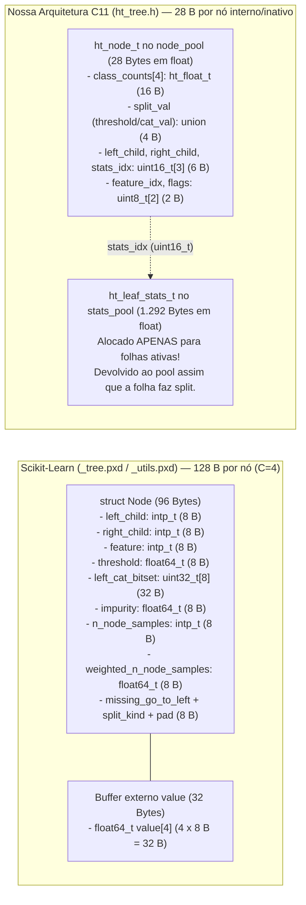

# 05 — Arquitetura em Baixo Nível do Scikit-Learn (`references/sklearn_tree/`) e Adaptação para C11

Este documento analisa as decisões de engenharia de baixo nível em Cython/C do módulo [`sklearn/tree`](file:///home/julio/Documentos/pessoal_minimal-decision-tree/references/sklearn_tree) (`_tree.pxd`, `_tree.pyx`, `_utils.pxd`, `_criterion.pxd`, `_criterion.pyx`, `_splitter.pxd`, `_partitioner.pxd`) e demonstra como adaptamos seus padrões de localidade de cache, indexação sem ponteiros e otimização numérica para nossa **Hoeffding Tree embarcada em C11 ($\le 1\text{ MB}$ de RAM)**.

---

## 1. Fundamentação Matemática e Otimizações Numéricas em Cython/C

### 1.1 Otimização de Divisão Única no Critério de Gini (`_criterion.pyx#L605-L688`)

Em uma formulação ingênua da impureza de Gini para um ramo com pesos por classe $w_0, w_1, \dots, w_{C-1}$ e soma total $W = \sum_{c=0}^{C-1} w_c$, realiza-se uma divisão de ponto flutuante para cada classe $c$ dentro do laço:

$$\operatorname{Gini}_{\text{ingênuo}}(D) = 1.0 - \sum_{c=0}^{C-1} \left(\frac{w_c}{W}\right)^2 \quad \longrightarrow \quad C \text{ divisões e } C \text{ multiplicações}$$

Em [`Gini.node_impurity`](file:///home/julio/Documentos/pessoal_minimal-decision-tree/references/sklearn_tree/_criterion.pyx#L622-L645) e [`Gini.children_impurity`](file:///home/julio/Documentos/pessoal_minimal-decision-tree/references/sklearn_tree/_criterion.pyx#L647-L688), o Scikit-Learn fatora o denominador constante $W^2$ para fora do somatório, acumulando apenas os quadrados brutos `sq_count += count_k * count_k` e executando **uma única divisão** ao final:

$$\operatorname{Gini}_{\text{otimizado}}(D) = 1.0 - \frac{\sum_{c=0}^{C-1} w_c^2}{W^2} \quad \longrightarrow \quad C \text{ multiplicações e } \mathbf{1\text{ única divisão}}$$

> [!TIP]
> **Impacto em Microcontroladores (ex: ARM Cortex-M4F / ESP32):**
> Uma instrução de multiplicação acumulada em ponto flutuante (`VFMA.F32`) leva **1 ciclo de clock**, enquanto uma divisão (`VDIV.F32`) leva **14 ciclos**. Ao avaliar 10 thresholds candidatos em 16 atributos ($160 \times 2 = 320$ ramos filhos por tentativa de split), substituir $C$ divisões por 1 divisão economiza milhares de ciclos de FPU a cada `grace_period`!

---

### 1.2 Cálculo de Entropia na Base 2 (`_criterion.pyx#L532-L603`, `_utils.pxd#L138-L139`)

Em [`_utils.pxd#L138-L139`](file:///home/julio/Documentos/pessoal_minimal-decision-tree/references/sklearn_tree/_utils.pxd#L138-L139), o Scikit-Learn define o logaritmo na base 2 a partir do logaritmo natural:

$$\operatorname{log}_2(x) = \frac{\ln(x)}{\ln(2.0)}$$

Em C11 (`<math.h>`), dispomos diretamente das funções nativas IEEE 754 `log2f(x)` (`float`) e `log2(x)` (`double`), abstraídas pela macro `HT_LOG2(x)`. Combinando a guarda `if (w_c > 0.0)` do Scikit-Learn ([`_criterion.pyx#L559`](file:///home/julio/Documentos/pessoal_minimal-decision-tree/references/sklearn_tree/_criterion.pyx#L559)) com a identidade algébrica do River ([`info_gain_split_criterion.py#L46-L53`](file:///home/julio/Documentos/pessoal_minimal-decision-tree/references/river_tree/split_criterion/info_gain_split_criterion.py#L46-L53)), eliminamos também as divisões por classe na Entropia:

$$H(D) = -\sum_{c: w_c > 0} \frac{w_c}{W} \log_2\left(\frac{w_c}{W}\right) = \frac{W \log_2(W) - \sum_{c: w_c > 0} w_c \log_2(w_c)}{W}$$

---

### 1.3 `proxy_impurity_improvement` vs `impurity_improvement` (`_criterion.pyx#L147-L200`)

No CART batch do Scikit-Learn, o ganho de impureza ponderado pela fração de amostras do nó ([`_criterion.pyx#L165-L200`](file:///home/julio/Documentos/pessoal_minimal-decision-tree/references/sklearn_tree/_criterion.pyx#L165-L200)) é dado por:

$$\Delta I = \frac{W_{\text{node}}}{W_{\text{total}}} \left( I_{\text{parent}} - \frac{W_R}{W_{\text{node}}} I_R - \frac{W_L}{W_{\text{node}}} I_L \right)$$

Como $W_{\text{total}}$, $W_{\text{node}}$ e $I_{\text{parent}}$ são constantes para todos os cortes candidatos dentro de um mesmo nó, o loop interno do `Splitter` ([`_splitter.pyx#L320`](file:///home/julio/Documentos/pessoal_minimal-decision-tree/references/sklearn_tree/_splitter.pyx#L320)) maximiza apenas a função *proxy* ([`_criterion.pyx#L147-L163`](file:///home/julio/Documentos/pessoal_minimal-decision-tree/references/sklearn_tree/_criterion.pyx#L147-L163)):

$$\operatorname{Proxy}(D_L, D_R) = - W_R I_R - W_L I_L$$

Em nossa Hoeffding Tree, para manter paridade estrita com o limite de Hoeffding $\epsilon$ no River (onde $\Delta \bar{G} = \text{Merit}(X_a) - \text{Merit}(X_b)$ é comparado diretamente com $\epsilon$ na escala normalizada $[0, R]$ e onde atributos com valores faltantes podem ter $W_{\text{post}} = W_L + W_R$ distintos), retornamos o mérito normalizado de cada atributo, mas aplicamos a fatoração algébrica em cada ramo $D_L$ e $D_R$:

$$\operatorname{Merit}_{\text{Gini}}(D_L, D_R) = \frac{1}{W_{\text{post}}} \left(\frac{\sum_c w_{L,c}^2}{W_L} + \frac{\sum_c w_{R,c}^2}{W_R}\right)$$

que calcula o mérito completo de Gini usando apenas **3 divisões** ao todo ($1/W_L$, $1/W_R$ e $1/W_{\text{post}}$), sem calcular $1.0 - \operatorname{Gini}$ intermediário!

---

### 1.4 Por que o `DensePartitioner` do CART Consome $O(N)$ de RAM vs Nossos Observadores $O(1)$

Em [`_partitioner.pxd#L102-L169`](file:///home/julio/Documentos/pessoal_minimal-decision-tree/references/sklearn_tree/_partitioner.pxd#L102-L169) e [`_partitioner.pyx#L78-L170`](file:///home/julio/Documentos/pessoal_minimal-decision-tree/references/sklearn_tree/_partitioner.pyx#L78-L170), o particionador denso do Scikit-Learn mantém em RAM durante o treinamento:
1. A matriz completa de entrada `const float32_t[:, :] X` ($N \times d \times 4\text{ B}$).
2. O vetor global de índices de amostras `intp_t[::1] samples` ($N \times 8\text{ B}$), particionado *in-place* em `samples[start:pos]` e `samples[pos:end]`.
3. O buffer auxiliar `float32_t[::1] feature_values` ($N \times 4\text{ B}$), ordenado via *Introsort* (`simultaneous_sort`, `#L147-L152`) em tempo $O(N_{\text{node}} \log N_{\text{node}})$ para cada atributo avaliado.

Para um stream de $N = 10^6$ amostras e $d = 16$ atributos, apenas esses buffers exigem **$> 76\text{ MB}$ de RAM**, tornando o algoritmo batch impossível em sistemas embarcados de $\le 1\text{ MB}$. Nossa Hoeffding Tree substitui `DensePartitioner` pelos observadores incrementais `ht_gaussian_obs_t` e `ht_categorical_obs_t` ($O(1)$ de RAM e tempo por amostra).

---

## 2. Casos de Borda Numéricos e de Baixo Nível

1. **Prevenção de Overflow no Cálculo de Pontos de Corte (`_partitioner.pxd#L49-L51`):**
   - No Scikit-Learn, o ponto médio entre dois valores em `float32` é calculado como:
     ```c
     threshold = a / 2.0f + b / 2.0f;
     ```
     em vez de `(a + b) / 2.0f`, evitando que a soma `a + b` sofra *overflow* para `+INFINITY` quando `a` e `b` são grandes ($\approx 2 \times 10^{38}$).
   - Em nosso `GaussianSplitter` em C11 (`ht_observer.c`), ao calcular `bin_size = (max_val - min_val) / (n_splits + 1)`, verificamos se `HT_ISFINITE(max_val - min_val)`; caso `max_val - min_val` exceda `FLT_MAX` em `float` 32-bit, usamos a forma segura `max_val / (k + 1) - min_val / (k + 1)`.
2. **Tolerância de Atributo Quase-Constante (`FEATURE_THRESHOLD = 1e-7`, `_partitioner.pxd#L15`):**
   - Em ponto flutuante de 32 bits (`float`), quando `max_val - min_val` é extremamente pequeno, `min_val + bin_size * (i + 1)` pode arredondar exatamente para `min_val` ou `max_val`. Nossa verificação estrita `min_val < split_val && split_val < max_val` (idêntica a [`gaussian_splitter.py#L88`](file:///home/julio/Documentos/pessoal_minimal-decision-tree/references/river_tree/splitter/gaussian_splitter.py#L88)) garante que nenhum ponto de corte degenerado na borda produza um ramo vazio.
3. **Zeramento de Bytes de Padding para Serialização Determinística (`_tree.pyx#L947-L948`):**
   - No Scikit-Learn, `_resize_c` executa `memset` com zero nos novos elementos de `self.nodes` para garantir que bytes de *padding* interno da struct C não contenham lixo de memória ao serializar o buffer em `__getstate__` ([`_tree.pyx#L871-L910`](file:///home/julio/Documentos/pessoal_minimal-decision-tree/references/sklearn_tree/_tree.pyx#L871-L910)).
   - Em nossa implementação C11 (`ht_memory.c`), toda alocação de `ht_node_t` e `ht_leaf_stats_t` nos pools executará `memset(ptr, 0, sizeof(...))`, garantindo que `ht_save` gere imagens binárias 100% reprodutíveis bit a bit.
4. **Roteamento Iterativo sem Recursão (`_apply_dense`, `_tree.pyx#L1032-L1077`):**
   - Árvores profundas em microcontroladores (stack típica de $2\text{ KB}$ a $8\text{ KB}$) causam *stack overflow* se o roteamento ou a liberação de nós usar recursão na pilha de chamadas.
   - Assim como em `_apply_dense` (`while node.left_child != _TREE_LEAF:`), todo o roteamento em `ht_predict` e `ht_learn_one` usa exclusivamente um laço `while (!(node->flags & HT_NODE_IS_LEAF))` com consumo de stack estritamente $O(1)$.

---

## 3. Mapeamento para Nossa Arquitetura C11 ($\le 1\text{ MB}$)

### 3.1 Comparação Direta: `struct Node` (Scikit-Learn) vs `ht_node_t` (Nosso C11)

Em [`_utils.pxd#L28-L48`](file:///home/julio/Documentos/pessoal_minimal-decision-tree/references/sklearn_tree/_utils.pxd#L28-L48) e [`_tree.pyx#L70-L81`](file:///home/julio/Documentos/pessoal_minimal-decision-tree/references/sklearn_tree/_tree.pyx#L70-L81), a struct `Node` do Scikit-Learn em arquiteturas de 64 bits ocupa **96 bytes por nó** (além de um array externo `float64_t* value` de $8 \times C$ bytes por nó):



### 3.2 Tabela de Adaptação das Estruturas do Scikit-Learn para C11

| Conceito no Scikit-Learn (`references/sklearn_tree/`) | Implementação no Scikit-Learn (64-bit) | Nossa Adaptação em C11 (`float` 32-bit / `double` 64-bit) | Economia de RAM |
| :--- | :--- | :--- | :--- |
| **Índices de Filhos** (`left_child`, `right_child`) | `intp_t` (`8 B` cada, `_TREE_LEAF = -1`) | `uint16_t` (`2 B` cada, `HT_INVALID_IDX = 0xFFFF`, suporta até $65.534$ nós) | **$75\%$ menor** ($4\text{ B}$ vs $16\text{ B}$) |
| **Condição de Split Categórico** | `uint32_t left_cat_bitset[8]` (`32 B` fixos em todo nó) | `union { ht_float_t threshold; int32_t cat_val; }` (`4 B` em `float` / `8 B` em `double`) | **$87.5\%$ menor** ($4\text{ B}$ vs $32\text{ B}$) |
| **Separação de Buffers** (`nodes` vs `value`) | `Node* nodes` + `float64_t* value` (alocados para **todos** os nós via `realloc`) | `node_pool` (`ht_node_t`, $28\text{ B}$) + `stats_pool` (`ht_leaf_stats_t`, alocado **apenas** para folhas ativas) | **Reciclagem imediata** de $1.29\text{ KB}$ em cada split |
| **Polimorfismo de `Criterion`** | Classe Cython `Criterion` com *vtable* C e buffers dinâmicos | `const ht_criterion_vtable_t*` estática em ROM/Flash (1 ponteiro na `ht_tree_t`) | **$0\text{ B}$ de RAM dinâmica** |
| **Registro de Candidato (`SplitRecord`)** | `cdef struct SplitRecord` na stack (`_splitter.pxd#L14-L44`) | `ht_split_candidate_t` na stack (`44 B` em `float` / `88 B` em `double`) | **Zero `malloc`** durante `_attempt_to_split` |
| **Serialização (`__getstate__` / `__setstate__`)** | `memcpy` de `nodes` e `value` para arrays NumPy | `ht_save` / `ht_load`: dump binário direto do header + `node_pool` (+ `stats_pool` opcional) | **100% relocável** para Flash/disco |
