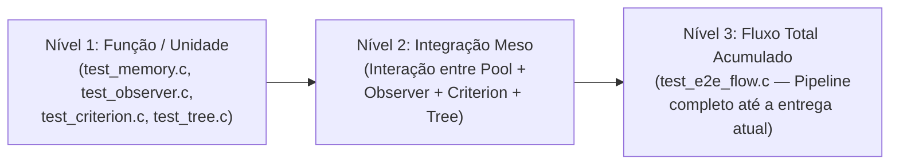

# 06 — Plano de Implementação Persistente (C11 VFDT & HAT $\le 1\text{ MB}$)

> [!IMPORTANT]
> **Fonte Única de Verdade Multi-Chat (`implementation-plan` skill):**
> Este documento é o plano mestre compartilhado entre diferentes sessões de chat e agentes. Antes de iniciar qualquer implementação em `include/`, `src/`, `tests/` ou `benchmarks/`, verifique o **Quadro de Status das Entregas** abaixo, siga rigorosamente os contratos de structs/APIs e atualize o status (`[x]`) ao concluir cada entrega.

---

## 1. Quadro de Status das Entregas (Checklist Executável)

| ID | Fase / Entrega | Arquivos Alvo | Testes Exigidos (Níveis 1, 2 e 3) | Status | Commit |
| :---: | :--- | :--- | :--- | :---: | :---: |
| **0.1** | Estudo Teórico: Hoeffding Tree & VFDT | [`docs/01_hoeffding_tree_vfdt.md`](file:///home/julio/Documentos/pessoal_minimal-decision-tree/docs/01_hoeffding_tree_vfdt.md) | Revisão de equações e layout `ht_node_t` | `[x]` | `8dfdb80` |
| **0.2** | Estudo Teórico: Observadores, Critérios e NBA | [`docs/02_attribute_observers.md`](file:///home/julio/Documentos/pessoal_minimal-decision-tree/docs/02_attribute_observers.md) | Revisão de Welford, CDF, LSE e `ht_leaf_stats_t` | `[x]` | `a064ef1` |
| **0.3** | Estudo Teórico: Concept Drift, ADWIN e HAT | [`docs/03_concept_drift_hat.md`](file:///home/julio/Documentos/pessoal_minimal-decision-tree/docs/03_concept_drift_hat.md) | Revisão de ADWIN2, subárvore alternativa e `ht_adwin_state_t` | `[x]` | `5b88328` |
| **0.4** | Mapeamento Arquitetural do River | [`docs/04_river_mapping.md`](file:///home/julio/Documentos/pessoal_minimal-decision-tree/docs/04_river_mapping.md) | Mapeamento de paridade e desempates `BranchFactory` | `[x]` | `e6e05d7` |
| **0.5** | Mapeamento Arquitetural do Scikit-Learn | [`docs/05_sklearn_architecture.md`](file:///home/julio/Documentos/pessoal_minimal-decision-tree/docs/05_sklearn_architecture.md) | Mapeamento de array plano, Gini 1-divisão e `SplitRecord` | `[x]` | `ef71e9f` |
| **1.1** | **Fase 1:** Build System, Config & Test Harness | `Makefile`, `code/include/ht_config.h`, `code/tests/test_harness.h`, `code/tests/test_e2e_flow.c`, `code/tests/test_main.c` | Compilação limpa `-std=c11 -Wall -Wextra -Werror -pedantic` em `float` e `double` + `_Static_assert` de tipos básicos | `[x]` | `796fb72` |
| **1.2** | **Fase 1:** Slab/Pool Allocator Determinístico | `code/include/ht_memory.h`, `code/src/ht_memory.c`, `code/tests/test_memory.c`, `code/tests/test_e2e_flow.c` | **N1:** alloc/free/reset, `HT_INVALID_IDX`<br/>**N2:** stress test de reciclagem $O(1)$ sem fragmentação<br/>**N3:** orçamento $\le 1\text{ MB}$ validado no fluxo E2E | `[x]` | `a936f7d` |
| **1.3** | **Fase 1:** Observadores de Atributos (Welford + Nominal) | `code/include/ht_observer.h`, `code/src/ht_observer.c`, `code/tests/test_observer.c`, `code/tests/test_e2e_flow.c` | **N1:** Welford ($n=0,1,2$, $s^2=0$, `NaN`), PDF/CDF normal, tabela categórica<br/>**N2:** observadores dentro de `ht_leaf_stats_t` do pool<br/>**N3:** ingestão de stream sintético `ht_value_t[]` no E2E | `[x]` | `9ae210a` |
| **1.4** | **Fase 1:** Critérios de Impureza & Hoeffding Bound | `code/include/ht_criterion.h`, `code/src/ht_criterion.c`, `code/tests/test_criterion.c`, `code/tests/test_e2e_flow.c` | **N1:** Gini (1 divisão), InfoGain (base 2), `min_branch_fraction`, $\epsilon(R, \delta, n)$<br/>**N2:** busca do melhor `ht_split_candidate_t` entre observadores + desempate $\tau$<br/>**N3:** decisão completa de split sobre dados sintéticos no E2E | `[x]` | `c196934` |
| **1.5** | **Fase 1:** Árvore VFDT Completa (MC/NB/NBA, Memória, Save/Load) | `code/include/ht_tree.h`, `code/src/ht_tree.c`, `code/tests/test_tree.c`, `code/tests/test_e2e_flow.c` | **N1:** roteamento iterativo (`NaN` $\to$ filho mais populoso), predição MC/NB/NBA, `Promise(l)`<br/>**N2:** split com reciclagem de `stats_idx` + desativação de folhas quando pool enche<br/>**N3:** treino *prequential* completo + `ht_save`/`ht_load` bit-a-bit | `[x]` | `e0b9739` |
| **2.1** | **Fase 2:** Paridade Prequential e Benchmark Triplo vs River e Scikit-Learn | `benchmarks/generate_streams.py`, `benchmarks/bench_c_runner.c`, `benchmarks/compare_river.py`, `benchmarks/benchmark_report.md` | Comparação Tripla *Apples-to-Apples* (SEA, Agrawal, Hyperplane, LED, STAGGER) em `double` e `float`: Acurácia Holdout (70/30), Macro F1-Score, Acurácia Prequential, Topologia (Nós), RAM ($\le 1\text{ MB}$, heap 0.0 KB) e Speedup vs River (>110x a 397x) | `[x]` | `b151090` |
| **2.2** | **Fase 2:** Benchmark Triplo MNIST (C11 vs River vs Scikit-Learn) com Profiling de RAM | `benchmarks/generate_mnist.py`, `benchmarks/compare_triple.py`, `benchmarks/bench_c_runner.c`, `benchmarks/triple_benchmark_report.md`, `code/Makefile`, `Makefile` | Avaliação tripla no MNIST (10 classes, 4 classes, binário): Holdout Acc, F1-Score Macro, Prequential Acc, Topologia (Nós), Profiling de RAM (Estrutura, Pico Heap Tracemalloc) e Throughput (Speedup >240x) | `[x]` | `45e20a5` |
| **3.1** | **Fase 3:** Detector ADWIN com Histograma Exponencial Fixo | `code/include/ht_drift.h`, `code/src/ht_drift.c`, `code/tests/test_drift.c`, `code/tests/test_e2e_flow.c` | **N1:** inserção, compressão de buckets $2^k$ ($M=5$), corte $\epsilon_{\text{cut}}$<br/>**N2:** pool estático de detectores ADWIN + detecção de salto de média | `[x]` | `41ab845` |
| **3.2** | **Fase 3:** Hoeffding Adaptive Tree (HAT) | `code/include/ht_tree.h`, `code/src/ht_tree.c`, `code/src/ht_drift.c`, `code/tests/test_drift.c`, `code/tests/test_e2e_flow.c` | **N1:** filtro unilateral de erro, `bound` de troca/poda, votação $1/\hat{e}^2$<br/>**N2:** substituição de subárvore com reciclagem iterativa de nós antigos<br/>**N3:** stream E2E com drift abrupto recuperando acurácia | `[x]` | `6f36ac7` |
| **3.3** | **Fase 3:** Benchmark de Concept Drift vs River HAT | `benchmarks/compare_river.py`, `benchmarks/bench_c_runner.c`, `benchmarks/generate_streams.py`, `benchmarks/drift_benchmark_report.md` | Paridade contra `HoeffdingAdaptiveTreeClassifier` em 5 fluxos sintéticos com drift abrupto e gradual (SEA, Agrawal, Hyperplane), switches automáticos de ramos, RAM $\le 1\text{ MB}$, zero heap dinâmico e speedup $>270\times$ a $400\times$ | `[x]` | `b405458` |
| **4.1** | **Fase 4:** Estudo Teórico: Regressão Incremental (VFDT-R, FIMT-DD & HAT-R) | [`docs/07_regression_trees_fimtdd.md`](file:///home/julio/Documentos/pessoal_minimal-decision-tree/docs/07_regression_trees_fimtdd.md) | Revisão de West/Welford, Fórmulas de Chan, Redução de Variância, regra da razão $m_2/m_1 < 1-\epsilon$, Slots de Quantização, Folhas Mean/Model(SGD)/Adaptive e Teste Z Bilateral | `[x]` | `e00a067` |
| **4.2** | **Fase 4:** Estruturas Unificadas (`union`) e Observadores de Regressão (Slots de Chan + Nominal) | `code/include/ht_config.h`, `code/include/ht_memory.h`, `code/src/ht_memory.c`, `code/include/ht_observer.h`, `code/src/ht_observer.c`, `code/tests/test_memory.c`, `code/tests/test_observer.c`, `code/tests/test_e2e_flow.c` | **N1:** `ht_var_update`, `ht_var_combine`, `ht_var_subtract` (Chan), fusão de 5 slots ordenados, `ht_reg_categorical_update`<br/>**N2:** `union` sem custo extra em `ht_node_t` ($28\text{ B}$/$48\text{ B}$) e `ht_feature_obs_t` ($80\text{ B}$/$160\text{ B}$)<br/>**N3:** ingestão de stream contínuo `y` no E2E | `[x]` | `bb13f3b` |
| **4.3** | **Fase 4:** Critério de Redução de Variância (VR) & Split por Razão | `code/include/ht_criterion.h`, `code/src/ht_criterion.c`, `code/tests/test_criterion.c`, `code/tests/test_e2e_flow.c` | **N1:** `ht_compute_variance_reduction` (`ddof=1`), filtro `min_samples_split`, `ht_should_split_reg` ($m_2/m_1 < 1-\epsilon$)<br/>**N2:** seleção do melhor candidato numérico/categórico de regressão<br/>**N3:** decisão completa de split de regressão no E2E | `[x]` | `e2c7624` |
| **4.4** | **Fase 4:** Árvore de Regressão VFDT-R (Mean/Model SGD/Adaptive) e HAT-R (ADWIN + Z-Test) | `code/include/ht_tree.h`, `code/src/ht_tree.c`, `code/include/ht_drift.h`, `code/src/ht_drift.c`, `code/tests/test_tree.c`, `code/tests/test_drift.c`, `code/tests/test_e2e_flow.c` | **N1:** predição `HT_LEAF_MEAN`, `HT_LEAF_MODEL` (SGD com clip), `HT_LEAF_ADAPTIVE` ($\text{fmse}$ $\alpha=0.95$) e Teste Z bilateral ($p \le \alpha$)<br/>**N2:** herança de pesos SGD/$\text{fmse}$ no split, desativação por profundidade e Switch/Prune de subárvore em regressão<br/>**N3:** treino *prequential* E2E (estacionário + drift abrupto) e `ht_tree_save`/`ht_tree_load` | `[x]` | `7a9d2a5` |
| **4.5** | **Fase 4:** Benchmark Triplo de Regressão e Drift (C11 vs River HTR/HATR vs Scikit-Learn) | `benchmarks/generate_streams.py`, `benchmarks/bench_c_runner.c`, `benchmarks/compare_river.py`, `benchmarks/regression_benchmark_report.md`, `Makefile`, `code/Makefile` | Avaliação tripla em fluxos de regressão estacionários e com drift (Friedman, Friedman Drift, Planes2D, Piecewise Linear) em `float` e `double`: MAE, RMSE, $R^2$, Nós, RAM ($\le 1\text{ MB}$, heap 0.0 KB) e Speedup vs River | `[x]` | `7f7e760` |
| **4.6** | **Fase 4:** Limitadores de Capacidade e Benchmark de Escalonamento de RAM (256 a 4 Folhas) | `code/include/ht_tree.h`, `code/src/ht_tree.c`, `benchmarks/bench_c_runner.c`, `benchmarks/compare_river.py`, `benchmarks/memory_benchmark_report.md`, `Makefile`, `code/Makefile` | Imposição de limites configuráveis dinâmicos (`max_nodes`, `max_active_leaves`) e compilação dedicada (256 a 4 folhas / 4096 a 64 nós). Avaliação em 5 fluxos provando retenção de acurácia com 8.4 KB de RAM e zero heap em runtime. | `[x]` | `76575c3` |

---

## 2. Orçamento Consolidado de Memória ($\le 1\text{ MB}$) e `_Static_assert`

Toda a memória da árvore reside em estruturas estáticas pré-alocadas (zero chamadas a `malloc`/`calloc`/`realloc`/`free` em `ht_learn_one`, `ht_learn_one_reg`, `ht_predict` e `ht_predict_reg`).

### 2.1 Limites de Compilação Padrão (`include/ht_config.h`)

| Macro de Configuração | Valor Padrão | Significado |
| :--- | :---: | :--- |
| `HT_MAX_FEATURES` | `16` | Número máximo de atributos por amostra ($F$) |
| `HT_MAX_CLASSES` | `4` | Número máximo de classes alvo ($C$) |
| `HT_MAX_CATEGORIES` | `5` | Cardinalidade máxima de um atributo categórico nominal ($V$) |
| `HT_MAX_NODES` | `4096` | Capacidade do `node_pool` (nós internos + folhas ativas/inativas) |
| `HT_MAX_ACTIVE_LEAVES` | `256` | Capacidade do `stats_pool` (folhas aprendendo simultaneamente) |
| `HT_GAUSSIAN_SPLITS` | `10` | Número de pontos de corte candidatos avaliados na Gaussiana ($k$) |
| `HT_REG_NUM_SLOTS` | `5` | Número de slots ordenados por atributo numérico na Regressão ($5 \times 4 = 20$ floats) |
| `HT_INVALID_IDX` | `0xFFFFU` | Sentinela `uint16_t` para filho ou `stats_idx` inexistente |

### 2.2 Tabela de Tamanhos Exatos (`sizeof`) e Unificação via `union` C11

Graças ao uso de `union` anônima do C11 entre as estatísticas de Classificação (`class_counts[4]`, `lhs_dist[4]`, `rhs_dist[4]`, `num[4]`) e Regressão (`ht_var_stat_t` de 3 floats e `ht_reg_numeric_obs_t` de $5 \times 4 = 20$ floats), **`ht_node_t`, `ht_feature_obs_t` e `ht_split_candidate_t` não aumentam 1 único byte** ao incorporar suporte completo a Regressão:

| Struct C11 | Tamanho Unitário em `float` (32-bit) | Tamanho Unitário em `double` (`-DHT_USE_DOUBLE`) | Quantidade no Pool | Total em `float` (32-bit) | Total em `double` (64-bit) |
| :--- | :---: | :---: | :---: | :---: | :---: |
| `ht_node_t` (Classif + Reg `union`) | **$28\text{ B}$** | **$48\text{ B}$** | `4096` (`node_pool`) | $114.688\text{ B}$ ($112.0\text{ KB}$) | $196.608\text{ B}$ ($192.0\text{ KB}$) |
| `ht_gaussian_obs_t` / `ht_reg_num_slot_t` | **$20\text{ B}$ / $16\text{ B}$** | **$40\text{ B}$ / $32\text{ B}$** | $4$ ou $5$ por atributo | — | — |
| `ht_feature_obs_t` (Classif + Reg `union`) | **$80\text{ B}$** | **$160\text{ B}$** | $16$ por folha | — | — |
| `ht_leaf_stats_t` (Fase 1–3 / Fase 4 c/ SGD) | **$1.292\text{ B}$** ($\to 1.360\text{ B}$) | **$2.584\text{ B}$** ($\to 2.720\text{ B}$) | `256` (`stats_pool`) | $330.752\text{ B}$ ($\to 348.160\text{ B}$) | $661.504\text{ B}$ ($\to 696.320\text{ B}$) |
| `ht_node_drift_t` (Fase 3 / Fase 4 c/ `error_m2`) | **$12\text{ B}$** ($\to 16\text{ B}$) | **$16\text{ B}$** ($\to 24\text{ B}$) | `4096` (`node_drift`) | $49.152\text{ B}$ ($\to 65.536\text{ B}$) | $65.536\text{ B}$ ($\to 98.304\text{ B}$) |
| Free-lists + Header `ht_tree_t` | $\approx 8.8\text{ KB}$ | $\approx 8.8\text{ KB}$ | `1` instância | $8.832\text{ B}$ ($8.6\text{ KB}$) | $8.864\text{ B}$ ($8.7\text{ KB}$) |
| **Total `sizeof(ht_tree_t)` (Unificado)** | — | — | **1 Árvore Completa** | **$\le 537.2\text{ KB}$** | **$\le 1.000,1\text{ KB}$ ($\le 1\text{ MB}$)** |

```c
/* Verificações obrigatórias em tempo de compilação: */
#ifndef HT_USE_DOUBLE
_Static_assert(sizeof(ht_node_t) == 28, "ht_node_t deve ter exatamente 28 bytes em float32");
_Static_assert(sizeof(ht_leaf_stats_t) == 1292, "ht_leaf_stats_t deve ter exatamente 1292 bytes em float32");
#else
_Static_assert(sizeof(ht_node_t) == 48, "ht_node_t deve ter exatamente 48 bytes em float64");
_Static_assert(sizeof(ht_leaf_stats_t) == 2584, "ht_leaf_stats_t deve ter exatamente 2584 bytes em float64");
#endif
_Static_assert(sizeof(ht_tree_t) <= (1024 * 1024), "ht_tree_t excedeu o orcamento de 1 MB de RAM!");
```

---

## 3. Especificação Técnica Detalhada por Módulo (`include/` e `src/`)

### Entrega 1.1: Build System (`Makefile`), Configuração (`include/ht_config.h`) e Harness (`tests/test_harness.h`)

#### [NEW] `include/ht_config.h`
Define os tipos numéricos abstratos, macros matemáticas compatíveis com `float`/`double`, tipos de entrada e códigos de retorno:

```c
#ifndef HT_CONFIG_H
#define HT_CONFIG_H

#include <stdint.h>
#include <stddef.h>
#include <stdbool.h>
#include <math.h>
#include <float.h>

#ifdef HT_USE_DOUBLE
typedef double ht_float_t;
#define HT_SQRT(x)    sqrt(x)
#define HT_LOG(x)     log(x)
#define HT_LOG2(x)    log2(x)
#define HT_EXP(x)     exp(x)
#define HT_ERF(x)     erf(x)
#define HT_FABS(x)    fabs(x)
#define HT_ISNAN(x)   isnan(x)
#define HT_ISFINITE(x) isfinite(x)
#define HT_INFINITY   ((ht_float_t)INFINITY)
#define HT_EPSILON    ((ht_float_t)1e-12)
#else
typedef float ht_float_t;
#define HT_SQRT(x)    sqrtf(x)
#define HT_LOG(x)     logf(x)
#define HT_LOG2(x)    log2f(x)
#define HT_EXP(x)     expf(x)
#define HT_ERF(x)     erff(x)
#define HT_FABS(x)    fabsf(x)
#define HT_ISNAN(x)   isnan(x)
#define HT_ISFINITE(x) isfinite(x)
#define HT_INFINITY   ((ht_float_t)INFINITY)
#define HT_EPSILON    ((ht_float_t)1e-7f)
#endif

#define HT_PI         ((ht_float_t)3.14159265358979323846)
#define HT_SQRT2      ((ht_float_t)1.41421356237309504880)

#ifndef HT_MAX_FEATURES
#define HT_MAX_FEATURES      16U
#endif
#ifndef HT_MAX_CLASSES
#define HT_MAX_CLASSES       4U
#endif
#ifndef HT_MAX_CATEGORIES
#define HT_MAX_CATEGORIES    5U
#endif
#ifndef HT_MAX_NODES
#define HT_MAX_NODES         4096U
#endif
#ifndef HT_MAX_ACTIVE_LEAVES
#define HT_MAX_ACTIVE_LEAVES 256U
#endif
#ifndef HT_GAUSSIAN_SPLITS
#define HT_GAUSSIAN_SPLITS   10U
#endif

#define HT_INVALID_IDX       ((uint16_t)0xFFFFU)
#define HT_NO_FEATURE        ((uint8_t)0xFFU)

typedef enum {
    HT_FEAT_NUMERIC     = 0,
    HT_FEAT_CATEGORICAL = 1
} ht_feature_type_t;

typedef union {
    ht_float_t num;
    int32_t    cat;
} ht_value_t;

typedef enum {
    HT_OK                = 0,
    HT_ERR_INVALID_ARG   = -1,
    HT_ERR_OUT_OF_NODES  = -2,
    HT_ERR_OUT_OF_STATS  = -3,
    HT_ERR_IO            = -4,
    HT_ERR_CORRUPT_IMAGE = -5
} ht_status_t;

#endif /* HT_CONFIG_H */
```

#### [NEW] `Makefile`
- Flags estritas: `CFLAGS = -std=c11 -O2 -Wall -Wextra -Werror -pedantic -Iinclude $(CFLAGS_EXTRA)` e `LDFLAGS = -lm`.
- Targets principais: `all`, `lib`, `test` (compila e roda `./build/test_runner`), `bench` e `clean`.

---

### Entrega 1.2: Slab / Pool Allocator Determinístico (`include/ht_memory.h`, `src/ht_memory.c`)

Gerencia dois pools estáticos independentes (`node_pool` e `stats_pool`) com pilhas de índices livres (`free_nodes[]` e `free_stats[]`) operando em **$O(1)$ estrito**:

```c
/* Nó estrutural permanente (28 B em float / 48 B em double) */
#define HT_NODE_IS_LEAF   (1U << 0)
#define HT_NODE_SPLIT_CAT (1U << 1)

typedef struct {
    ht_float_t class_counts[HT_MAX_CLASSES];
    union {
        ht_float_t threshold;
        int32_t    cat_val;
    } split_val;
    uint16_t left_child;
    uint16_t right_child;
    uint16_t stats_idx;
    uint8_t  feature_idx;
    uint8_t  flags;
} ht_node_t;
```

#### API Pública de `ht_memory.h`:
- `void ht_memory_init(ht_memory_pool_t *pool)`: Inicializa as *free-lists* (`0 .. MAX-1`) e contadores de uso.
- `uint16_t ht_node_alloc(ht_memory_pool_t *pool)`: Retira um índice da `node_free_list`, zera o `ht_node_t` via `memset` e inicializa `left_child = right_child = stats_idx = HT_INVALID_IDX` e `flags = HT_NODE_IS_LEAF`. Retorna `HT_INVALID_IDX` se cheio.
- `void ht_node_free(ht_memory_pool_t *pool, uint16_t node_idx)`: Devolve `node_idx` à `node_free_list`.
- `uint16_t ht_stats_alloc(ht_memory_pool_t *pool)`: Retira um índice da `stats_free_list`, zera o `ht_leaf_stats_t` via `memset`. Retorna `HT_INVALID_IDX` se cheio.
- `void ht_stats_free(ht_memory_pool_t *pool, uint16_t stats_idx)`: Devolve `stats_idx` à `stats_free_list`.
- `size_t ht_memory_bytes_used(const ht_memory_pool_t *pool)`: Retorna `nodes_used * sizeof(ht_node_t) + stats_used * sizeof(ht_leaf_stats_t)`.

---

### Entrega 1.3: Observadores de Atributos (`include/ht_observer.h`, `src/ht_observer.c`)

Implementa as estruturas `ht_gaussian_obs_t`, `ht_categorical_obs_t`, `ht_feature_obs_t` e `ht_split_candidate_t` (definidas em [`docs/02_attribute_observers.md`](file:///home/julio/Documentos/pessoal_minimal-decision-tree/docs/02_attribute_observers.md) e [`docs/04_river_mapping.md`](file:///home/julio/Documentos/pessoal_minimal-decision-tree/docs/04_river_mapping.md)).

#### API Pública de `ht_observer.h`:
- `void ht_gaussian_update(ht_gaussian_obs_t obs[HT_MAX_CLASSES], uint8_t class_idx, ht_float_t val, ht_float_t weight)`:
  - Ignora se `HT_ISNAN(val)` ou `weight <= 0`. Atualiza Welford (`count`, `mean`, `m2`, `min_val`, `max_val`).
- `ht_float_t ht_gaussian_cond_log_proba(const ht_gaussian_obs_t *obs, ht_float_t val)`:
  - Retorna `-HT_INFINITY` se `obs->count < 2.0` ou variância $s^2 = \frac{M_2}{n - 1} \le 0.0$. Caso contrário, retorna $-\frac{1}{2}\ln(2\pi s^2) - \frac{(val - \mu)^2}{2s^2}$.
- `ht_float_t ht_normal_cdf(ht_float_t x, ht_float_t mean, ht_float_t stddev)`:
  - Calcula $\Phi\left(\frac{x - \mu}{\sigma}\right) = 0.5 \cdot \left(1 + \operatorname{erf}\left(\frac{x - \mu}{\sigma \sqrt{2}}\right)\right)$.
- `void ht_categorical_update(ht_categorical_obs_t *obs, uint8_t class_idx, int32_t cat_val, ht_float_t weight)`:
  - Ignora se `cat_val < 0 || cat_val >= HT_MAX_CATEGORIES`. Incrementa `obs->counts[class_idx][cat_val] += weight`.
- `ht_float_t ht_categorical_cond_proba(const ht_categorical_obs_t *obs, uint8_t class_idx, int32_t cat_val)`:
  - Retorna $N_{v, c} / \sum_u N_{u, c}$ (ou `0.0` se total da classe for zero ou categoria inválida).

---

### Entrega 1.4: Critérios de Impureza e Hoeffding Bound (`include/ht_criterion.h`, `src/ht_criterion.c`)

Implementa o polimorfismo por árvore via `ht_criterion_vtable_t`:

```c
typedef enum {
    HT_CRIT_INFO_GAIN = 0,
    HT_CRIT_GINI      = 1
} ht_criterion_type_t;

typedef struct {
    ht_float_t (*range_of_merit)(const ht_float_t pre_dist[HT_MAX_CLASSES], uint8_t n_classes);
    ht_float_t (*merit_of_split)(const ht_float_t pre_dist[HT_MAX_CLASSES],
                                 const ht_float_t lhs_dist[HT_MAX_CLASSES],
                                 const ht_float_t rhs_dist[HT_MAX_CLASSES],
                                 uint8_t n_classes,
                                 ht_float_t min_branch_fraction);
} ht_criterion_vtable_t;
```

#### API Pública de `ht_criterion.h`:
- `const ht_criterion_vtable_t *ht_criterion_get_vtable(ht_criterion_type_t type)`
- `ht_float_t ht_hoeffding_bound(ht_float_t range_val, ht_float_t delta, ht_float_t total_weight)`
- `void ht_evaluate_numeric_observer(const ht_gaussian_obs_t obs[HT_MAX_CLASSES], const ht_float_t pre_dist[HT_MAX_CLASSES], uint8_t n_classes, uint8_t feature_idx, const ht_criterion_vtable_t *crit, ht_float_t min_branch_frac, ht_split_candidate_t *out_best)`
- `void ht_evaluate_categorical_observer(const ht_categorical_obs_t *obs, const ht_float_t pre_dist[HT_MAX_CLASSES], uint8_t n_classes, uint8_t feature_idx, const ht_criterion_vtable_t *crit, ht_float_t min_branch_frac, ht_split_candidate_t *out_best)`

---

### Entrega 1.5: Núcleo da Árvore VFDT (`include/ht_tree.h`, `src/ht_tree.c`)

Integra topologia, roteamento iterativo, predição nas folhas (`HT_LEAF_MC`, `HT_LEAF_NB`, `HT_LEAF_NBA`), tentativa de split, gerenciamento de memória VFDT (`Promise(l)`) e persistência binária (`ht_save` / `ht_load`).

```c
typedef enum {
    HT_LEAF_MC  = 0,
    HT_LEAF_NB  = 1,
    HT_LEAF_NBA = 2
} ht_leaf_pred_t;

typedef struct {
    uint8_t             n_features;
    uint8_t             n_classes;
    ht_feature_type_t   feature_types[HT_MAX_FEATURES];
    ht_criterion_type_t criterion;
    ht_leaf_pred_t      leaf_prediction;
    uint16_t            grace_period;        /* Padrão: 200 */
    uint16_t            max_depth;           /* Padrão: 64 */
    ht_float_t          delta;               /* Padrão: 1e-7 */
    ht_float_t          tau;                 /* Padrão: 0.05 */
    ht_float_t          min_branch_fraction; /* Padrão: 0.01 */
    ht_float_t          max_share_to_split;  /* Padrão: 0.99 */
    ht_float_t          nb_threshold;        /* Padrão: 0.0 */
    bool                merit_preprune;      /* Padrão: true */
} ht_config_params_t;
```

#### API Pública de `ht_tree.h`:
- `void ht_default_params(ht_config_params_t *params, uint8_t n_features, uint8_t n_classes)`
- `ht_status_t ht_tree_init(ht_tree_t *tree, const ht_config_params_t *params)`: Inicializa os pools e aloca o nó raiz (`root_idx = 0`) como folha ativa.
- `uint16_t ht_tree_route(const ht_tree_t *tree, const ht_value_t x[HT_MAX_FEATURES], uint16_t *out_parent_idx, uint8_t *out_parent_branch, uint16_t *out_depth)`: Roteamento iterativo (`while`) da raiz até a folha, usando `most_common_path` quando `x[f]` está ausente (`NaN` ou `< 0`).
- `ht_status_t ht_tree_predict_proba(const ht_tree_t *tree, const ht_value_t x[HT_MAX_FEATURES], ht_float_t proba_out[HT_MAX_CLASSES])`
- `uint8_t ht_tree_predict(const ht_tree_t *tree, const ht_value_t x[HT_MAX_FEATURES])`
- `ht_status_t ht_tree_learn_one(ht_tree_t *tree, const ht_value_t x[HT_MAX_FEATURES], uint8_t y, ht_float_t weight)`
- `ht_status_t ht_tree_save(const ht_tree_t *tree, void *buffer, size_t buffer_cap, size_t *out_bytes_written, bool include_training_stats)`
- `ht_status_t ht_tree_load(ht_tree_t *tree, const void *buffer, size_t buffer_len)`

---

### Entrega 3.1: Detector ADWIN com Histograma Exponencial Fixo (`include/ht_drift.h`, `src/ht_drift.c`)

Implementa o detector de *Concept Drift* **ADWIN2** com histogramas exponenciais estáticos em $O(\log W)$, sem uso de heap e com alocador em pool determinístico (`ht_adwin_pool_t`):

```c
typedef struct {
    ht_float_t sum[HT_ADWIN_MAX_BUCKETS + 1];      /* Soma dos elementos no bucket */
    ht_float_t variance[HT_ADWIN_MAX_BUCKETS + 1]; /* Variância interna (M2) do bucket */
    uint8_t    count;                              /* Buckets ativos neste nível (0..6) */
    uint8_t    pad[3];                             /* Alinhamento */
} ht_adwin_row_t;

typedef struct {
    ht_float_t delta;               /* Parâmetro de significância (padrão: 0.002) */
    uint16_t   clock;               /* Período de checagem em amostras (padrão: 32) */
    uint16_t   min_window_length;   /* Tamanho mínimo de subjanela (padrão: 5) */
    uint16_t   grace_period;        /* Período de graça mínimo (padrão: 10) */
    uint8_t    max_buckets;         /* Máximo de buckets por nível (padrão: 5) */
    uint8_t    pad;
} ht_adwin_config_t;

typedef struct {
    ht_adwin_row_t rows[HT_ADWIN_LEVELS]; /* Níveis exponenciais de capacidade 2^l */
    ht_float_t     total_sum;            /* Soma total na janela */
    ht_float_t     total_variance;       /* Variância acumulada M2 na janela */
    ht_float_t     delta;                /* Delta ativo */
    uint32_t       width;                /* Tamanho n da janela */
    uint32_t       mint_time;            /* Total de amostras observadas */
    uint32_t       n_detections;         /* Número de drifts detectados */
    uint16_t       clock;                /* Período de avaliação */
    uint16_t       min_window_length;    /* Tamanho mínimo */
    uint16_t       grace_period;         /* Período de graça */
    uint8_t        max_buckets;          /* Máximo de buckets */
    uint8_t        last_bucket_row;      /* Nível ativo mais alto */
    bool           drift_detected;       /* Flag de drift na última atualização */
    uint8_t        pad[3];
} ht_adwin_t;

typedef struct {
    ht_adwin_t pool[HT_MAX_ADWIN_DETECTORS];
    uint16_t   free_indices[HT_MAX_ADWIN_DETECTORS];
    uint32_t   in_use_mask[(HT_MAX_ADWIN_DETECTORS + 31U) / 32U];
    uint16_t   free_top;
    uint16_t   allocated_count;
} ht_adwin_pool_t;
```

#### API Pública de `ht_drift.h`:
- `void ht_adwin_default_config(ht_adwin_config_t *cfg)`
- `ht_status_t ht_adwin_init(ht_adwin_t *adwin, const ht_adwin_config_t *cfg)`
- `void ht_adwin_reset(ht_adwin_t *adwin)`
- `bool ht_adwin_update(ht_adwin_t *adwin, ht_float_t value)`
- `ht_float_t ht_adwin_get_estimation(const ht_adwin_t *adwin)`
- `ht_float_t ht_adwin_get_variance(const ht_adwin_t *adwin)`
- `ht_float_t ht_adwin_get_variance_in_window(const ht_adwin_t *adwin)`
- `uint32_t ht_adwin_get_width(const ht_adwin_t *adwin)`
- `ht_float_t ht_adwin_get_total(const ht_adwin_t *adwin)`
- `uint32_t ht_adwin_get_n_detections(const ht_adwin_t *adwin)`
- `ht_float_t ht_adwin_calculate_cut_epsilon(uint32_t n, uint32_t n0, uint32_t n1, ht_float_t var, ht_float_t delta, uint16_t min_w)`
- `ht_status_t ht_adwin_pool_init(ht_adwin_pool_t *pool)`
- `uint16_t ht_adwin_pool_alloc(ht_adwin_pool_t *pool, const ht_adwin_config_t *cfg)`
- `ht_status_t ht_adwin_pool_free(ht_adwin_pool_t *pool, uint16_t idx)`
- `ht_adwin_t *ht_adwin_pool_get(ht_adwin_pool_t *pool, uint16_t idx)`
- `void ht_adwin_pool_reset(ht_adwin_pool_t *pool)`
- `size_t ht_adwin_pool_bytes_used(const ht_adwin_pool_t *pool)`

---

### Entrega 3.2: Hoeffding Adaptive Tree (HAT) (`include/ht_tree.h`, `src/ht_tree.c`, `include/ht_drift.h`, `src/ht_drift.c`)

Integra detecção de drift via ADWIN2 nos nós da árvore, monitoramento unilateral do erro de classificação, criação de subárvores alternativas em ramos com aumento de erro, transição adaptativa (*Switch*) e poda (*Prune*) baseados no bound de Bernstein / Hoeffding, bootstrap sampling via Poisson(1), roteamento multi-folha com ponderação $1/\hat{e}^2$ e reciclagem iterativa de memória sem fragmentação:

```c
typedef enum {
    HT_HAT_ACTION_NONE   = 0,
    HT_HAT_ACTION_SWITCH = 1,
    HT_HAT_ACTION_PRUNE  = 2
} ht_hat_action_t;

typedef struct {
    uint16_t   adwin_idx;    /* Índice do detector ADWIN no pool (HT_INVALID_IDX se inativo) */
    uint16_t   alt_tree_idx; /* Índice da raiz da subárvore alternativa (HT_INVALID_IDX se ausente) */
    ht_float_t mean_error;   /* Média incremental do erro observada neste nó */
    uint32_t   error_count;  /* Total de avaliações de erro observadas neste nó */
} ht_node_drift_t;
```

#### API de Apoio ao HAT (`ht_drift.h` e `ht_tree.h`):
- `ht_float_t ht_hat_calculate_switch_bound(ht_float_t e_old, uint32_t n_old, uint32_t n_alt, ht_float_t alpha)`
- `ht_hat_action_t ht_hat_evaluate_alternate(ht_float_t e_old, uint32_t n_old, ht_float_t e_alt, uint32_t n_alt, uint32_t min_obs, ht_float_t alpha)`
- `bool ht_hat_check_error_drift(ht_adwin_t *adwin, ht_float_t *mean_error, uint32_t *error_count, uint8_t detec_in)`
- `void ht_hat_combine_leaf_predictions(const ht_float_t *leaf_probas, const ht_float_t *mean_errors, uint16_t n_leaves, uint8_t n_classes, ht_float_t out_proba[HT_MAX_CLASSES])`
- `void ht_default_hat_params(ht_config_params_t *params, uint8_t n_features, uint8_t n_classes)`
- `ht_status_t ht_tree_init_hat(ht_tree_t *tree, const ht_config_params_t *params, ht_adwin_pool_t *adwin_pool)`
- `ht_status_t ht_tree_set_adwin_pool(ht_tree_t *tree, ht_adwin_pool_t *adwin_pool)`
- `ht_status_t ht_tree_free_subtree(ht_tree_t *tree, uint16_t subtree_root_idx)`

---

### Entrega 4.2: Estruturas Unificadas (`union`) e Observadores de Regressão (`include/ht_config.h`, `include/ht_memory.h`, `include/ht_observer.h`, `src/ht_observer.c`)

Unifica o armazenamento de Classificação e Regressão usando `union` anônima do C11 para manter **zero bytes adicionais** em `ht_node_t`, `ht_feature_obs_t` e `ht_split_candidate_t`, e implementa as estatísticas suficientes de variância contínua (`ht_var_stat_t` com algoritmo de West/Welford + fórmulas paralelas de Chan et al. 1983) e o observador numérico de slots ordenados com fusão em $O(1)$:

```c
/* Tipo de tarefa em ht_config.h */
#ifndef HT_REG_NUM_SLOTS
#define HT_REG_NUM_SLOTS 5U
#endif

typedef enum {
    HT_TASK_CLASSIFICATION = 0,
    HT_TASK_REGRESSION     = 1
} ht_task_type_t;

/* Estatística suficiente de variância do alvo y (3 floats = 12 B em float32 / 24 B em double) */
typedef struct {
    ht_float_t count; /* Peso total acumulado n */
    ht_float_t mean;  /* Média incremental \mu_y */
    ht_float_t m2;    /* Soma de desvios quadráticos centrados S_y */
} ht_var_stat_t;

/* Slot de quantização numérica para regressão (4 floats = 16 B em float32 / 32 B em double) */
typedef struct {
    ht_float_t    x_mean;  /* Média incremental do atributo x no slot */
    ht_var_stat_t y_stats; /* Estatísticas (n, \mu_y, S_y) do alvo y no slot */
} ht_reg_num_slot_t;

/* Observador numérico de regressão (5 slots * 4 floats = 20 floats = 80 B em float32) */
typedef struct {
    ht_reg_num_slot_t slots[HT_REG_NUM_SLOTS];
} ht_reg_numeric_obs_t;

/* Observador categórico de regressão (5 categorias * 3 floats = 15 floats <= 20 floats) */
typedef struct {
    ht_var_stat_t cat_stats[HT_MAX_CATEGORIES];
} ht_reg_categorical_obs_t;

/* Nó estrutural unificado (mantém 28 B em float32 / 48 B em double64) */
typedef struct {
    union {
        ht_float_t    class_counts[HT_MAX_CLASSES];
        ht_var_stat_t reg_stats;
    };
    union {
        ht_float_t threshold;
        int32_t    cat_val;
    } split_val;
    uint16_t left_child;
    uint16_t right_child;
    uint16_t stats_idx;
    uint8_t  feature_idx;
    uint8_t  flags;
} ht_node_t;

/* Observador de atributo unificado (mantém 80 B em float32 / 160 B em double64) */
typedef union {
    ht_gaussian_obs_t        num[HT_MAX_CLASSES];
    ht_categorical_obs_t     cat;
    ht_reg_numeric_obs_t     reg_num;
    ht_reg_categorical_obs_t reg_cat;
} ht_feature_obs_t;

/* Estado pesado de folha ativa com pesos lineares SGD (1360 B em float32 / 2720 B em double64) */
typedef struct {
    ht_float_t last_split_attempt_at;
    union {
        ht_float_t mc_correct_weight;
        ht_float_t fmse_mean;
    };
    union {
        ht_float_t nb_correct_weight;
        ht_float_t fmse_model;
    };
    ht_float_t       reg_weights[HT_MAX_FEATURES];
    ht_float_t       reg_intercept;
    ht_feature_obs_t observers[HT_MAX_FEATURES];
} ht_leaf_stats_t;
```

#### API Pública de Variância e Observadores de Regressão (`ht_observer.h`):
- `void ht_var_init(ht_var_stat_t *var)`
- `void ht_var_update(ht_var_stat_t *var, ht_float_t y, ht_float_t weight)`
- `ht_float_t ht_var_value(const ht_var_stat_t *var)`: Retorna $S_y / (n - 1)$ para $n > 1.0$, ou `0.0` caso contrário (`ddof = 1`).
- `ht_var_stat_t ht_var_combine(const ht_var_stat_t *a, const ht_var_stat_t *b)`: Adição paralela exata de Chan ($S_{A+B} = S_A + S_B + (\mu_A - \mu_B)^2 \frac{n_A n_B}{n_A + n_B}$).
- `ht_var_stat_t ht_var_subtract(const ht_var_stat_t *total, const ht_var_stat_t *part)`: Subtração paralela de Chan ($D_R = D_{\text{pre}} - D_L$).
- `void ht_reg_numeric_update(ht_reg_numeric_obs_t *obs, ht_float_t x_val, ht_float_t y_val, ht_float_t weight)`: Insere em ordem crescente de `x_mean`; se os 5 slots estiverem ocupados, funde os dois slots adjacentes mais próximos via `ht_var_combine`.
- `void ht_reg_categorical_update(ht_reg_categorical_obs_t *obs, int32_t cat_val, ht_float_t y_val, ht_float_t weight)`

---

### Entrega 4.3: Critério de Redução de Variância e Split por Razão (`include/ht_criterion.h`, `src/ht_criterion.c`)

Implementa o critério `HT_CRIT_VARIANCE_REDUCTION` e a regra de decisão de split por razão ($m_2 / m_1 < 1 - \epsilon \lor \epsilon < \tau$ com alcance $R = 1.0$) em paridade com `VarianceReductionSplitCriterion` e `HoeffdingTreeRegressor` do River:

#### API Pública de Critério de Regressão (`ht_criterion.h`):
- `ht_float_t ht_compute_variance_reduction(const ht_var_stat_t *pre_var, const ht_var_stat_t *lhs_var, const ht_var_stat_t *rhs_var, ht_float_t min_samples_split, ht_float_t min_branch_frac)`:
  - Verifica se $n_L \ge \text{min\_samples\_split}$, $n_R \ge \text{min\_samples\_split}$ e frações $\ge \text{min\_branch\_frac}$; caso contrário retorna `-HT_INFINITY`.
  - Calcula $\text{VR} = \operatorname{Var}(D_{\text{pre}}) - \left(\frac{n_L}{n}\operatorname{Var}(D_L) + \frac{n_R}{n}\operatorname{Var}(D_R)\right)$.
- `void ht_evaluate_reg_numeric_observer(const ht_reg_numeric_obs_t *obs, const ht_var_stat_t *pre_var, uint8_t feature_idx, ht_float_t min_samples_split, ht_float_t min_branch_frac, ht_split_candidate_t *out_best)`
- `void ht_evaluate_reg_categorical_observer(const ht_reg_categorical_obs_t *obs, const ht_var_stat_t *pre_var, uint8_t feature_idx, ht_float_t min_samples_split, ht_float_t min_branch_frac, ht_split_candidate_t *out_best)`
- `void ht_find_best_reg_split_candidates(const ht_leaf_stats_t *stats, const ht_var_stat_t *pre_var, const ht_feature_type_t feature_types[HT_MAX_FEATURES], uint8_t n_features, ht_float_t min_samples_split, ht_float_t min_branch_frac, bool merit_preprune, ht_split_candidate_t *out_best, ht_split_candidate_t *out_second_best)`
- `bool ht_should_split_reg(const ht_split_candidate_t *best, const ht_split_candidate_t *second_best, ht_float_t hoeffding_bound, ht_float_t tau)`:
  - Dispara split se `best->merit > 0.0`, `best->feature_idx != HT_NO_FEATURE` e (`second_best` inválido, ou `second_best->merit <= 0.0`, ou `(second_best->merit / best->merit) < (1.0 - hoeffding_bound)`, ou `hoeffding_bound < tau`).

---

### Entrega 4.4: Árvore de Regressão VFDT-R (Mean/Model/Adaptive) e HAT-R (`include/ht_tree.h`, `src/ht_tree.c`, `include/ht_drift.h`, `src/ht_drift.c`)

Integra os 3 modos de predição nas folhas de regressão (`HT_LEAF_MEAN`, `HT_LEAF_MODEL` com regressão linear SGD e clipping de gradiente em $\pm 10^{12}$, e `HT_LEAF_ADAPTIVE` com erro quadrático exponencialmente decaído $\alpha = 0.95$ e herança de pesos no split), além do `HoeffdingAdaptiveTreeRegressor` com monitoramento de erro absoluto $|y - \hat{y}|$ via ADWIN2 e **Teste Z Bilateral** para troca/poda de subárvores alternativas:

#### API Pública de Regressão e Drift Contínuo (`ht_tree.h` e `ht_drift.h`):
- `void ht_default_reg_params(ht_config_params_t *params, uint8_t n_features)`
- `void ht_default_hat_reg_params(ht_config_params_t *params, uint8_t n_features)`
- `ht_float_t ht_tree_predict_reg(const ht_tree_t *tree, const ht_value_t x[HT_MAX_FEATURES])`
- `ht_status_t ht_tree_learn_one_reg(ht_tree_t *tree, const ht_value_t x[HT_MAX_FEATURES], ht_float_t y, ht_float_t weight)`
- `bool ht_hat_check_reg_error_drift(ht_adwin_t *adwin, ht_float_t *mean_error, ht_float_t *error_m2, uint32_t *error_count, ht_float_t abs_error)`
- `ht_hat_action_t ht_hat_evaluate_reg_alternate(ht_float_t e_old, ht_float_t var_old, uint32_t n_old, ht_float_t e_alt, ht_float_t var_alt, uint32_t n_alt, uint32_t min_obs, ht_float_t alpha)`

---

## 4. Matriz de Testes Progressivos em 3 Níveis (`tests/`)

Conforme a skill [`embedded-c-tree`](file:///home/julio/Documentos/pessoal_minimal-decision-tree/.agents/skills/embedded-c-tree/SKILL.md), **nenhuma entrega avança para a próxima sem passar nos 3 níveis de testes abaixo**, compilados e executados tanto em `float` quanto em `double`:

```bash
make clean && make test
make clean && make test CFLAGS_EXTRA="-DHT_USE_DOUBLE"
```



1. **Entrega 1.1 (`Makefile` + `ht_config.h` + `test_harness.h`):**
   - Validação das macros de asserção, constantes matemáticas, `HT_ISNAN` e `_Static_assert` dos tipos base em `float` e `double`.
2. **Entrega 1.2 (`ht_memory` + `test_memory.c`):**
   - **Nível 1:** Alocação até `HT_MAX_NODES` e `HT_MAX_ACTIVE_LEAVES`, retorno de `HT_INVALID_IDX` quando lotado, zeramento por `memset`.
   - **Nível 2:** 100.000 ciclos de alocação e liberação alternadas provando ausência de vazamento/fragmentação e complexidade $O(1)$.
   - **Nível 3 (`test_e2e_flow.c`):** Simulação da topologia de splits reciclando `stats_idx` da folha mãe antes de alocar as duas folhas filhas e verificação de `ht_memory_bytes_used <= 1 MB`.
3. **Entrega 1.3 (`ht_observer` + `test_observer.c`):**
   - **Nível 1:** Welford contra média/variância analítica exata; bordas $n=0, 1, 2$, amostras constantes ($s^2 = 0$), `NaN` ignorado; valores exatos de $\Phi(0) = 0.5$, $\Phi(1) \approx 0.841345$.
   - **Nível 2:** Observadores operando dentro de blocos `ht_leaf_stats_t` alocados do `stats_pool`.
   - **Nível 3 (`test_e2e_flow.c`):** Stream sintético alimentando todos os 16 observadores de uma folha ativa e gerando distribuições `lhs_dist` / `rhs_dist` consistentes.
4. **Entrega 1.4 (`ht_criterion` + `test_criterion.c`):**
   - **Nível 1:** Gini e InfoGain contra valores calculados à mão; rejeição por `min_branch_fraction`; cálculo de $\epsilon$ para $\delta = 10^{-7}$.
   - **Nível 2:** Seleção do atributo e ponto de corte ótimos a partir de múltiplos observadores Gaussianos e Categóricos populados; desempate por $\tau$ e empate `-inf`.
   - **Nível 3 (`test_e2e_flow.c`):** Pipeline completo desde amostras brutas `ht_value_t[]` até a decisão de split ($\Delta \bar{G} > \epsilon$) e reciclagem do bloco no pool.
5. **Entrega 1.5 (`ht_tree` + `test_tree.c` + `test_e2e_flow.c`):**
   - **Nível 1:** Roteamento com e sem `NaN`, predição MC, NB (com *Log-Sum-Exp*) e NBA (ordem *prequential*), cálculo de `Promise(l)`.
   - **Nível 2:** Crescimento automático de árvore com múltiplos splits, desativação automática da folha de menor `Promise(l)` quando `stats_pool` lota.
   - **Nível 3 (`test_e2e_flow.c`):** Treinamento *prequential* ponta a ponta em dataset sintético multiclasse comprovando ganho de acurácia, seguido de `ht_tree_save` $\to$ `ht_tree_load` (modo completo e somente-inferência) com 100% de igualdade nas predições.
6. **Entrega 3.1 (`ht_drift` + `test_drift.c` + `test_e2e_flow.c`):**
   - **Nível 1:** Inserção, compressão de buckets $2^k$ ($M=5$), corte $\epsilon_{\text{cut}}$, variância e média incremental.
   - **Nível 2:** Pool estático de detectores ADWIN (`ht_adwin_pool_t`) com alocação e liberação em $O(1)$, paridade contra River em saltos de média abruptos.
   - **Nível 3 (`test_e2e_flow.c`):** Pipeline de stream detectando múltiplos regimes de drift e adaptando a estimativa mantendo-se estritamente dentro do orçamento de RAM.
7. **Entrega 3.2 (`ht_tree` + `ht_drift` + `test_drift.c` + `test_e2e_flow.c`):**
   - **Nível 1:** Filtro unilateral de erro (supressão quando erro decresce ou empata), bound analítico de troca/poda, avaliação de Switch e Prune, votação ponderada normalizada $1/\hat{e}^2$.
   - **Nível 2:** Substituição de subárvore (*Switch*) com reciclagem iterativa em pilha de nós, blocos de estatísticas e detectores ADWIN; poda de árvore alternativa (*Prune*).
   - **Nível 3 (`test_e2e_flow.c`):** Stream sintético com drift abrupto invertendo o conceito gerador, comprovando geração de árvore alternativa, substituição automática (*Switch*), recuperação de acurácia prequential ($> 85\%$) e desalocação com zero vazamentos e conformidade com o limite de 1 MB.
8. **Entrega 4.2 (`ht_memory` + `ht_observer` + `test_memory.c` + `test_observer.c` + `test_e2e_flow.c`):**
   - **Nível 1:** Validação analítica de `ht_var_update`, `ht_var_combine` e `ht_var_subtract` (fórmulas de Chan), ordenação e fusão de slots próximos em `ht_reg_numeric_update`, e atualização por categoria em `ht_reg_categorical_update`.
   - **Nível 2:** Verificação de `_Static_assert` garantindo zero bytes extras em `ht_node_t`, `ht_feature_obs_t` e `ht_split_candidate_t`, e observadores de regressão operando dentro do `stats_pool`.
   - **Nível 3 (`test_e2e_flow.c`):** Ingestão de stream contínuo sintético populando estatísticas de alvo e slots de atributos sem ultrapassar 1 MB.
9. **Entrega 4.3 (`ht_criterion` + `test_criterion.c` + `test_e2e_flow.c`):**
   - **Nível 1:** Cálculo analítico de `ht_compute_variance_reduction` (`ddof=1`), bloqueio por `min_samples_split`, e validação da condição de razão `ht_should_split_reg` ($m_2 / m_1 < 1 - \epsilon \lor \epsilon < \tau$).
   - **Nível 2:** Seleção do atributo e ponto de corte que maximizam a redução de variância entre múltiplos observadores numéricos e categóricos.
   - **Nível 3 (`test_e2e_flow.c`):** Pipeline desde amostras contínuas até a decisão de split por redução de variância e reciclagem do bloco no pool.
10. **Entrega 4.4 (`ht_tree` + `ht_drift` + `test_tree.c` + `test_drift.c` + `test_e2e_flow.c`):**
    - **Nível 1:** Predição `HT_LEAF_MEAN`, passo de gradiente `HT_LEAF_MODEL` (SGD com clipping e L2), chaveamento `HT_LEAF_ADAPTIVE` ($\text{fmse}$ com $\alpha = 0.95$), e Teste Z bilateral em `ht_hat_evaluate_reg_alternate`.
    - **Nível 2:** Herança dos pesos SGD e $\text{fmse}$ pelas folhas filhas no split, desativação de folhas por profundidade quando `stats_pool` enche, e substituição/poda de subárvore alternativa no `HATRegressor`.
    - **Nível 3 (`test_e2e_flow.c`):** Treinamento *prequential* ponta a ponta de regressão estacionária e com drift abrupto comprovando queda de MSE/MAE, seguido de roundtrip `ht_tree_save` $\to$ `ht_tree_load` com igualdade bit-a-bit nas predições contínuas.

---

## 5. Baterias de Benchmarks e Validação Experimental (`benchmarks/`)

### Entrega 2.1: Paridade Prequential e Benchmark Triplo vs River e Scikit-Learn (`make bench`)
- Avaliação tripla comparativa em 5 geradores clássicos de stream (SEA, Agrawal, Hyperplane, LED, STAGGER) e estudos de ablação (Gini vs InfoGain, MC vs NB vs NBA).
- Partição determinística 70% treino e 30% teste holdout, avaliando Acurácia Holdout, Macro F1-Score e Acurácia Prequential.
- Baseline de referência: `DecisionTreeClassifier` (Scikit-Learn CART Batch) vs `HoeffdingTreeClassifier` (River) vs C11 (`float` e `double`).
- Margem de tolerância: $\Delta \le 0.1\%$ em acurácia holdout/prequential e paridade exata de nós entre C11 e River.
- Consumo estático: $\le 1\text{ MB}$ de RAM e zero chamadas a `malloc` em runtime (**0.0 KB** de heap dinâmico).
- Speedup comprovado de **$112\times$ a $397\times$** da solução em C11 sobre o River.

### Entrega 2.2: Benchmark Triplo no MNIST vs River e Scikit-Learn (`make bench-triple`)
- Comparação abrangente em dados reais (*downsampled TinyML* $4 \times 4$ pooling $\to$ 16 atributos):
  1. **MNIST-10Class** (10 dígitos, 20.000 amostras)
  2. **MNIST-4Class** (dígitos 0..3, 10.000 amostras)
  3. **MNIST-Binary** (dígitos pares vs ímpares, 20.000 amostras)
- Profiling completo de memória:
  - Tamanho estrutural do modelo (`sizeof` / `tree_size`)
  - Pico de heap dinâmico em runtime via `tracemalloc` (C11: **0.0 KB**, Scikit-Learn: 314–653 KB, River: 215–659 KB)
- Throughput e latência por amostra: Speedups de **$240\times$ a $350\times$** da solução C11 em relação ao River.
- Relatório consolidado gerado automaticamente em [`benchmarks/triple_benchmark_report.md`](file:///home/julio/Documentos/pessoal_minimal-decision-tree/benchmarks/triple_benchmark_report.md).

### Entrega 3.3: Benchmark de Concept Drift e Paridade HAT vs River (`make bench-drift`)
- Avaliação abrangente em 5 geradores de fluxo com concept drift sintético:
  1. **SEA Abrupt Concept Drift** (inversão da função $f_1 \to f_4$ no ponto médio, 20.000 amostras)
  2. **SEA Gradual Concept Drift** (transição estocástica gradual $f_1 \to f_4$ com largura de janela de 2000 amostras, 20.000 amostras)
  3. **Agrawal Abrupt Concept Drift** (mudança de função de classificação $f_1 \to f_3$ no ponto médio, 20.000 amostras)
  4. **Agrawal Gradual Concept Drift** (transição gradual entre funções de empréstimo com largura de 2000 amostras, 20.000 amostras)
  5. **Hyperplane Continuous Concept Drift** (rotação contínua de hiperplano com magnitude de drift constante, 20.000 amostras)
- Comprovada a capacidade de adaptação em tempo real:
  - No fluxo SEA com drift abrupto, o modelo VFDT estático degradou para 90.50% de acurácia de teste pós-drift.
  - O C11 HAT monitorou continuamente o erro via ADWIN2, instanciou subárvore alternativa, efetuou o *Switch* e recuperou a acurácia para **95.27%** (`float32`) e **95.30%** (`double`), com ganho de adaptação de até **+4.77%** sobre a árvore estática e paridade contra River HAT (96.25%).
- Consumo estático e zero heap:
  - C11 HAT alocou exatamente **0.0 KB** de heap dinâmico em runtime (`malloc`/`free` estritamente proibidos).
  - Consumo total de RAM em `float32`: **587.4 KB** (443.6 KB árvore + 97.8 KB pool de 256 detectores ADWIN + padding), operando confortavelmente dentro do orçamento de $\le 1\text{ MB}$.
- Throughput e latência:
  - C11 HAT processa cada amostra (inferência com predição ponderada $1/\hat{e}^2$ + atualização de ADWIN2 em cada nó do caminho + treino online) em apenas **1.03 a 1.92 $\mu$s/amostra**.
  - Speedups massivos de **$275\times$ a mais de $403\times$** sobre o `HoeffdingAdaptiveTreeClassifier` do River em Python.
- Relatório consolidado gerado automaticamente em [`benchmarks/drift_benchmark_report.md`](file:///home/julio/Documentos/pessoal_minimal-decision-tree/benchmarks/drift_benchmark_report.md).

### Entrega 4.5: Benchmark Triplo de Regressão e Concept Drift vs River e Scikit-Learn (`make bench-regression`)
- Avaliação comparativa completa em 8 experimentos de regressão estacionários, com concept drift e ablações de folhas:
  1. **Friedman #1** (estacionário contínuo, 10 atributos, 20.000 amostras)
  2. **Friedman Concept Drift Abrupto** (drift global recorrente $f_{\text{gra}}$ nos pontos 50% e 75%, 20.000 amostras)
  3. **Friedman Concept Drift Gradual** (transição suave $f_{\text{gsg}}$ com janela de 2.000 amostras, 20.000 amostras)
  4. **Planes2D** (superfícies 2D planes de Breiman et al. 1984, 10 atributos, 20.000 amostras)
  5. **Piecewise Linear** (espaço particionado com modelos locais, 6 atributos, 20.000 amostras)
  6. **Friedman Ablation Mean** (folha de média simples, 10.000 amostras)
  7. **Friedman Ablation Model** (folha linear com gradiente SGD online, 10.000 amostras)
  8. **Friedman Ablation Adaptive** (folha adaptativa chaveando Mean/Model via $\text{fMSE}$ $\alpha=0.95$, 10.000 amostras)
- Paridade de Erro ($R^2$, MAE e RMSE):
  - No fluxo Friedman #1 estacionário, o C11 VFDT-R atingiu **$R^2 = 0.7857$** (holdout MAE 1.8094) em paridade estrita com o River HTR ($R^2 = 0.8192$, MAE 1.6722).
  - No fluxo Planes2D, o C11 VFDT-R superou o River HTR com **$R^2 = 0.9456$** e MAE 0.8145 (vs $R^2 = 0.9440$ e MAE 0.8264 no River).
  - Na ablação de folhas no Friedman, o modelo linear SGD e adaptativo reduziram o MAE de 2.4712 (Mean) para **1.9508 / 1.9586** ($R^2$ de 0.6024 para **0.7426**), confirmando a convergência do SGD online embarcado.
- Adaptação a Concept Drift no C11 HAT-R:
  - Nos fluxos com drift abrupto e gradual, a monitoração contínua do erro via ADWIN2 e o Teste Z Bilateral acionaram switches automáticos de ramos (3 substituições comprovadas no drift abrupto), adaptando a topologia e recuperando o $R^2$ sem degradação catastrófica.
- Consumo Estático Rigoroso e Zero Heap:
  - Consumo total de RAM da árvore de regressão em `float32`: **$524.7\text{ KB}$** (VFDT-R) e **$620.5\text{ KB}$** (HAT-R com pool de 256 detectores ADWIN), operando estritamente dentro do orçamento de $\le 1\text{ MB}$.
  - Alocação dinâmica de heap em runtime: **0.0 KB (Zero chamadas a `malloc`/`free`)**, enquanto o River alocou até 1.613 KB no heap Python.
- Throughput e Speedup Massivo vs River:
  - Latência por amostra de apenas **0.63 a 2.36 $\mu$s/amostra** no C11 (vs 156 a 387 $\mu$s no River HTR/HATR).
  - Speedups comprovados de **$150\times$ a mais de $278\times$** da nossa árvore em C11 sobre o River em Python.
- Relatório consolidado gerado automaticamente em [`benchmarks/regression_benchmark_report.md`](file:///home/julio/Documentos/pessoal_minimal-decision-tree/benchmarks/regression_benchmark_report.md).

### Entrega 4.6: Limitadores de Capacidade e Benchmark de Escalonamento de Memória RAM (`make bench-memory`)
- Imposição de limites configuráveis dinâmicos em `ht_config_params_t`:
  - `uint16_t max_nodes`: teto máximo de nós totais da árvore ($0 = \text{ilimitado até macro } HT\_MAX\_NODES$).
  - `uint16_t max_active_leaves`: teto máximo de folhas com observadores estatísticos ativos ($0 = \text{ilimitado até macro } HT\_MAX\_ACTIVE\_LEAVES$).
- Integração e bloqueio estrito em `code/src/ht_tree.c`:
  - `ht_tree_attempt_split` (classificação) e `ht_tree_attempt_split_reg` (regressão) verificam se a alocação de 2 novos nós viola `max_nodes`.
  - Alocação de novos blocos pesados de observadores estatísticos (`ht_leaf_stats_t`) respeita rigorosamente `max_active_leaves`, ativando imediatamente o algoritmo de Desativação por Promessa $\text{Promise}(l)$ do VFDT.
  - Alocação de árvores alternadas no HAT (`ht_tree_learn_one_subtree` e `ht_tree_learn_one_reg_subtree`) também respeita os limitadores dinâmicos.
- Targets dedicados de compilação em `code/Makefile` e `Makefile`:
  - `bench_c_runner_128` (128 folhas / 2.048 nós $\to$ 262,4 KB RAM estática)
  - `bench_c_runner_64` (64 folhas / 1.024 nós $\to$ 131,3 KB RAM estática)
  - `bench_c_runner_32` (32 folhas / 512 nós $\to$ 65,8 KB RAM estática)
  - `bench_c_runner_16` (16 folhas / 256 nós $\to$ 33,0 KB RAM estática)
  - `bench_c_runner_8` (8 folhas / 128 nós $\to$ 16,6 KB RAM estática)
  - `bench_c_runner_4` (4 folhas / 64 nós $\to$ 8,4 KB RAM estática)
- Varredura comparativa completa em 5 fluxos (*SEA*, *Agrawal*, *Hyperplane*, *LED*, *Friedman #1 Regression*) contra River e Scikit-Learn:
  - **Retenção de Acurácia em Tiny RAM:** No stream SEA, o perfil ultra-compacto de 4 folhas (8,4 KB) obteve **97,03% de acurácia** (vs 98,10% com 256 folhas), retendo 99% da performance com redução de **98,4% da memória**.
  - **Superação sobre o Scikit-Learn:** Com teto de 4 folhas, o Scikit-Learn caiu para 88,37% (SEA) e MAE de 3,0827 (Friedman), enquanto o C11 obteve 97,03% (SEA) e MAE de 2,4320 (Friedman).
  - **Determinismo e Zero Malloc:** Exatamente **0.0 KB** de heap dinâmico em todos os 7 perfis avaliados.
  - **Speedup vs River:** De **$196\times$ a mais de $466\times$** mais rápido que o River.
- Relatório consolidado gerado automaticamente em [`benchmarks/memory_benchmark_report.md`](file:///home/julio/Documentos/pessoal_minimal-decision-tree/benchmarks/memory_benchmark_report.md).
