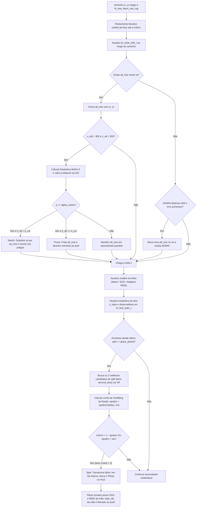

# 07 — Regressão Incremental em Streams: VFDT-R, FIMT-DD e HAT-R (Ikonomovska et al., 2011; Bifet & Gavaldà, 2009)

Este documento consolida a fundamentação teórica, formulação matemática e arquitetura em **C11 puro ($\le 1\text{ MB}$ de RAM)** para árvores de decisão incrementais aplicadas a problemas de **Regressão Contínua em Streams** ($y \in \mathbb{R}$). 

O estudo analisa os algoritmos seminais **VFDT-R** (*Very Fast Decision Tree for Regression*), **FIMT-DD** (*Fast Incremental Model Tree with Drift Detection*, Ikonomovska, Gama & Džeroski, 2011) e a **HAT-R** (*Hoeffding Adaptive Tree for Regression*, Bifet & Gavaldà, 2009; River Implementation), integrando-os com rigor analítico ao ecossistema do nosso projeto.

---

## 1. O Problema da Regressão Incremental em Data Streams

### 1.1 Regressão Contínua vs Classificação em Árvores Online

Nos problemas de classificação (Fases 1–3), o espaço do alvo é discreto e finito ($y \in \{0, 1, \dots, C-1\}$). As decisões de divisão (*split*) fundamentam-se em medidas clássicas de impureza categórica baseadas em distribuições de probabilidade multinomial, como o **Coeficiente de Impureza de Gini** ou a **Entropia de Shannon / Ganho de Informação**:

$$I_G(D) = 1 - \sum_{c=0}^{C-1} p_c^2, \qquad H(D) = -\sum_{c=0}^{C-1} p_c \log_2 p_c$$

onde a probabilidade empírica $p_c = \frac{n_c}{n}$ e as funções de impureza possuem amplitude teórica $R$ estritamente limitada e conhecida a priori ($R = 1.0$ para Gini e $R = \log_2 C$ para Entropia).

Na **Regressão Contínua**, o alvo é uma variável contínua irrestrita $y \in \mathbb{R}$. Tentar aplicar árvores de classificação à regressão através da discretização do alvo em *bins* fixos acarreta graves patologias:
1. **Perda de Resolução e Granularidade:** Erros de quantização irreversíveis no valor predito.
2. **Dependência de Escala:** A escolha do número e amplitude dos *bins* exige conhecimento prévio dos limites $[\min y, \max y]$, violando a premissa de *streams* abertos onde novos extremos podem surgir a qualquer momento.
3. **Explosão Combinatória de Parâmetros:** Monitorar $B$ *bins* por atributo multiplicaria o consumo de memória, violando o orçamento restrito de microcontroladores ($\le 1\text{ MB}$).

Por essas razões, árvores de regressão para streams mantêm o alvo $y$ em sua forma contínua pura, substituindo medidas de impureza categórica pela **Redução de Variância Amostral** (*Variance Reduction* ou *Standard Deviation Reduction* — SDR).

---

## 2. Fundamentação Matemática da Variância Incremental

### 2.1 Estatísticas Suficientes de West (1979) e Welford (1962)

Para quantificar a impureza de um conjunto contínuo de observações $D = \{y_1, y_2, \dots, y_n\}$ sem armazenar as amostras brutas na memória, mantemos um vetor compacto de **três estatísticas suficientes**:

$$\theta_y = \big(n, \, \mu_y, \, S_y\big)$$

onde:
- $n = \sum_{i=1}^m w_i$: Soma acumulada dos pesos de todas as observações processadas.
- $\mu_y = \frac{1}{n} \sum_{i=1}^m w_i y_i$: Média empírica incremental do alvo $y$.
- $S_y = \sum_{i=1}^m w_i (y_i - \mu_y)^2$: Soma das diferenças quadráticas centradas em relação à média (*Second Central Moment Accumulator*, $M_2$).

A variância amostral corrigida com graus de liberdade $n - 1$ (`ddof = 1`), compatível com o NumPy (`ddof=1`) e o River ([`river.stats.Var`](file:///home/julio/Documentos/pessoal_minimal-decision-tree/references/river_tree/nodes/htr_nodes.py)), é dada por:

$$\operatorname{Var}(D) = s_y^2 = \begin{cases}
\dfrac{S_y}{n - 1}, & \text{se } n > 1.0 \\
0.0, & \text{se } n \le 1.0
\end{cases}$$

#### Atualização Incremental Amostra-a-Amostra ($O(1)$ Tempo, $O(1)$ Espaço):
Ao receber uma nova observação contínua $y \in \mathbb{R}$ com peso $w > 0$:
1. Se $n = 0$:
   $$n \leftarrow w, \qquad \mu_y \leftarrow y, \qquad S_y \leftarrow 0.0$$
2. Se $n > 0$:
   $$\begin{aligned}
   n_{\text{new}} &= n + w \\
   \delta_1 &= y - \mu_y \\
   \mu_{\text{new}} &= \mu_y + \frac{w}{n_{\text{new}}} \delta_1 \\
   \delta_2 &= y - \mu_{\text{new}} \\
   S_{\text{new}} &= S_y + w \cdot \delta_1 \cdot \delta_2 \\
   n \leftarrow n_{\text{new}}, &\quad \mu_y \leftarrow \mu_{\text{new}}, \quad S_y \leftarrow S_{\text{new}}
   \end{aligned}$$

Esta formulação de Welford/West previne a perda catastrófica de precisão numérica (*catastrophic cancellation*) inerente à fórmula ingênua $\sum y_i^2 - \frac{(\sum y_i)^2}{n}$ quando $\mu_y \gg \sigma_y$.

---

### 2.2 Fórmulas de Chan, Golub & LeVeque (1983) para Combinação e Subtração Paralela de Variâncias

Durante a busca do melhor ponto de divisão (*split*), é necessário particionar um nó pai contendo o conjunto $D_{\text{pre}}$ em dois ramos filhos: o ramo esquerdo $D_L$ e o ramo direito $D_R$. Em um sistema embarcado de tempo real, não podemos re-escanear dados históricos. 

Utilizamos as fórmulas exatas de atualização paralela demonstradas por **Chan, Golub & LeVeque (1983)**:

#### 1. Adição / Combinação Exata de Variâncias ($A + B \to C$):
Sejam dois conjuntos disjuntos $A$ e $B$ com estatísticas $(n_A, \mu_A, S_A)$ e $(n_B, \mu_B, S_B)$. O conjunto combinado $C = A \cup B$ tem estatísticas exatas calculadas em $O(1)$:

$$\begin{aligned}
n_C &= n_A + n_B \\
\mu_C &= \mu_A + \frac{n_B}{n_C} (\mu_B - \mu_A) = \frac{n_A \mu_A + n_B \mu_B}{n_A + n_B} \\
S_C &= S_A + S_B + (\mu_A - \mu_B)^2 \cdot \frac{n_A \, n_B}{n_A + n_B}
\end{aligned}$$

O termo cruzado $(\mu_A - \mu_B)^2 \frac{n_A n_B}{n_C}$ representa a dispersão adicional gerada pelo deslocamento relativo entre as médias de $A$ e $B$ (Teorema de Steiner / Eixos Paralelos).

#### 2. Subtração / Remoção Exata de Variâncias ($T - A \to R$):
Seja o conjunto total $T$ e um subconjunto $A \subset T$. As estatísticas suficientes do subconjunto remanescente $R = T \setminus A$ são derivadas diretamente por reversão algébrica das fórmulas de Chan:

$$\begin{aligned}
n_R &= n_T - n_A \\
\mu_R &= \frac{n_T \mu_T - n_A \mu_A}{n_R} \\
S_R &= S_T - S_A - (\mu_R - \mu_A)^2 \cdot \frac{n_R \, n_A}{n_T}
\end{aligned}$$

> [!IMPORTANT]
> **Estabilidade Numérica na Subtração de Ponto Flutuante:**
> Devido a pequenos erros de arredondamento em precisão `float` (32-bit), a subtração pode ocasionalmente resultar em valores microscopicamente negativos (ex: $-10^{-8}$) quando $A \approx T$. Em nossa implementação C11, o valor é estritamente estabilizado:
> $$S_R = \max\left(0.0, \, S_T - S_A - (\mu_R - \mu_A)^2 \frac{n_R n_A}{n_T}\right)$$

Essa propriedade analítica é central para a eficiência da nossa arquitetura: ao avaliar múltiplos candidatos de divisão, calculamos incrementalmente as estatísticas acumuladas do filho esquerdo $D_L = \sum_{k \le i} \text{slot}_k$ e obtemos o filho direito $D_R$ instantaneamente via subtração de Chan $D_R = D_{\text{pre}} - D_L$, sem nenhum loop secundário.

---

### 2.3 Critério de Redução de Variância (Variance Reduction — VR)

O mérito de uma divisão candidata que particiona o conjunto pré-split $D$ em duas partições disjuntas $D_L$ e $D_R$ é medido pela redução na variância ponderada do alvo:

$$\operatorname{VR}(D, X_j, \tau) = \operatorname{Var}(D) - \left[\frac{n_L}{n} \operatorname{Var}(D_L) + \frac{n_R}{n} \operatorname{Var}(D_R)\right]$$

onde:
- $\operatorname{Var}(D) = \frac{S_D}{n - 1}$: Variância pré-split da folha atual.
- $\operatorname{Var}(D_L) = \frac{S_L}{n_L - 1}$: Variância amostral dos exemplos particionados à esquerda ($x_j \le \tau$ ou $x_j == v$).
- $\operatorname{Var}(D_R) = \frac{S_R}{n_R - 1}$: Variância amostral dos exemplos particionados à direita ($x_j > \tau$ ou $x_j \neq v$).
- $n = n_L + n_R$.

#### Restrições e Filtros de Validade do Split:
Em paridade com o River ([`variance_reduction_split_criterion.py#L22-L36`](file:///home/julio/Documentos/pessoal_minimal-decision-tree/references/river_tree/split_criterion/variance_reduction_split_criterion.py#L22-L36)), uma divisão é sumariamente rejeitada ($\text{VR} = -\infty$) se violar qualquer uma das condições:
1. $n_L < \text{min\_samples\_split}$ ou $n_R < \text{min\_samples\_split}$ (padrão: 5 amostras por ramo).
2. $\frac{n_L}{n} < \text{min\_branch\_fraction}$ ou $\frac{n_R}{n} < \text{min\_branch\_fraction}$ (padrão: $1\%$).
3. $n \le 2$ (graus de liberdade insuficientes para estimar variância).

---

### 2.4 A Regra da Razão no Split de Regressão ($m_2 / m_1 < 1 - \epsilon$)

Em tarefas de classificação, a decisão de split da Hoeffding Tree baseia-se na diferença absoluta entre os méritos dos dois melhores atributos:

$$\Delta \bar{G} = \bar{G}(X_1) - \bar{G}(X_2) > \epsilon = \sqrt{\frac{R^2 \ln(1/\delta)}{2n}}$$

#### Por que a Diferença Absoluta Falha Catastroficamente na Regressão:
Na regressão, o mérito $\operatorname{VR}$ é expresso nas unidades da variável alvo ao quadrado ($[y]^2$). Se o alvo for a cotação de ações ($y \in [100, 1000]$), a variância pode estar na ordem de $10^5$. Se o alvo for normalizado ($y \in [0, 1]$), a variância estará na ordem de $10^{-2}$.
A amplitude $R$ de $\operatorname{VR}$ é teoricamente **ilimitada** ($R = \infty$). Se estimássemos $R = \operatorname{Var}(D)$, uma folha com grande dispersão inicial teria um $R$ gigantesco, exigindo dezenas de milhões de amostras no denominador $2n$ para que $\epsilon$ caísse abaixo de $\Delta \text{VR}$, paralisando completamente o crescimento da árvore (*starvation*).

#### A Solução do FIMT-DD (Ikonomovska et al., 2011) e River:
Para contornar a ausência de uma escala fixa, Ikonomovska et al. (2011) e o River ([`hoeffding_tree_regressor.py#L350-L360`](file:///home/julio/Documentos/pessoal_minimal-decision-tree/references/river_tree/hoeffding_tree_regressor.py#L350-L360)) aplicam o Limite de Hoeffding não à diferença absoluta, mas à **razão entre os méritos dos candidatos**:

Seja $m_1 = \operatorname{VR}(X_{\text{best}})$ o maior mérito de redução de variância observado, e $m_2 = \operatorname{VR}(X_{\text{second\_best}})$ o segundo maior mérito ($0 \le m_2 \le m_1$).

Definimos a variável aleatória da razão de mérito:

$$r = \frac{m_2}{m_1} \in [0, 1]$$

Como $m_2 \le m_1$ por definição de ordenação, a variável $r$ está **estritamente confinada ao intervalo unitário**:

$$R = 1.0$$

Aplicando a desigualdade de Hoeffding à variável aleatória $r$ limitada em $[0, 1]$:

$$\epsilon = \sqrt{\frac{R^2 \ln(1/\delta)}{2n}} = \sqrt{\frac{\ln(1/\delta)}{2n}}$$

A regra de decisão estatística de divisão torna-se:

$$\frac{m_2}{m_1} < 1 - \epsilon \quad \lor \quad \epsilon < \tau$$

onde $\tau$ é o parâmetro de desempate (*tie-breaking threshold*, padrão $\tau = 0.05$).

#### Interpretação Probabilística:
Se $\frac{m_2}{m_1} < 1 - \epsilon$, temos garantia formal com probabilidade de pelo menos $1 - \delta$ de que a razão assintótica satisfaz $\mathbb{E}\left[\frac{m_2}{m_1}\right] < 1.0 \implies \mathbb{E}[m_1] > \mathbb{E}[m_2]$, isto é, o candidato $X_1$ é comprovadamente superior a qualquer alternativa no fluxo de dados infinito.

---

## 3. Observadores de Atributos para Regressão sob Orçamento $\le 1\text{ MB}$

### 3.1 O Problema dos Observadores Existentes (EBST e TEBST)

No River, os atributos numéricos em árvores de regressão são monitorados pela classe `EBSTSplitter` ([`ebst_splitter.py`](file:///home/julio/Documentos/pessoal_minimal-decision-tree/references/river_tree/splitter/ebst_splitter.py)) ou `TEBSTSplitter` ([`tebst_splitter.py`](file:///home/julio/Documentos/pessoal_minimal-decision-tree/references/river_tree/splitter/tebst_splitter.py)).
Essas estruturas implementam uma **Árvore Binária de Busca Estendida (E-BST)** na heap do Python, onde cada valor contínuo distinto $x$ visto no stream aloca dinamicamente um novo nó de árvore contendo acumuladores de variância do alvo.

> [!CAUTION]
> **Por que EBST / TEBST são Inviáveis em Sistemas Embarcados:**
> 1. **Consumo Dinâmico Descontrolado:** Uma folha recebendo 10.000 amostras contínuas pode alocar milhares de nós de BST, consumindo megabytes de memória RAM e fragmentando a heap.
> 2. **Violação das Regras Arquiteturais:** O projeto proíbe terminantemente `malloc` em runtime.
> 3. **Degeneração em Listas Ligadas:** Árvores de busca binária não balanceadas em streams com tendências monotônicas degeneram em listas de complexidade de inserção $O(n)$, estourando a pilha de execução.

### 3.2 O Observador Numérico de Quantização em Slots Ordenados ($K=5$)

Para garantir complexidade espacial $O(1)$ estrita e **zero bytes adicionais** em relação à classificação, nossa arquitetura implementa o **Observador Numérico por Slots de Quantização Ordenados com Fusão em $O(1)$** (`ht_reg_numeric_obs_t`).

Cada atributo numérico em uma folha ativa mantém exatamente $K = 5$ slots fixos ordenados pelo valor médio do atributo $x$:

```c
/* Slot de quantização numérica para regressão (4 floats = 16 B em float32 / 32 B em double) */
typedef struct {
    ht_float_t    x_mean;  /* Média incremental do atributo x no slot */
    ht_var_stat_t y_stats; /* Estatísticas suficientes (n, \mu_y, S_y) do alvo y no slot */
} ht_reg_num_slot_t;

/* Observador numérico de regressão (5 slots * 4 floats = 20 floats = 80 B em float32) */
typedef struct {
    ht_reg_num_slot_t slots[HT_REG_NUM_SLOTS];
} ht_reg_numeric_obs_t;
```

#### Orçamento Exato de Memória (`sizeof`):
- Em `float32`: $5 \text{ slots} \times 16\text{ bytes} = \mathbf{80\text{ bytes}}$.
- Em `double64`: $5 \text{ slots} \times 32\text{ bytes} = \mathbf{160\text{ bytes}}$.
- **Paridade Perfeita:** Na classificação, `ht_gaussian_obs_t num[4]` possui $4 \text{ classes} \times 20\text{ bytes} = \mathbf{80\text{ bytes}}$ (ou $160\text{ bytes}$ em `double64`). Portanto, o uso de `union` C11 resulta em **exatamente zero bytes de sobrecarga**!

#### Algoritmo de Atualização com Fusão Online em $O(1)$:
Ao receber uma nova amostra $(x, y, w)$:
1. Se existirem slots vazios ($n_k = 0$), insere o novo elemento como um novo slot e mantém o array de 5 elementos estritamente ordenado por `x_mean` via inserção direta.
2. Se todos os $K = 5$ slots estiverem ocupados:
   - Localiza o par de slots adjacentes $(i, i+1)$ com a **menor distância euclidiana** entre suas médias:
     $$i^* = \arg\min_{0 \le i < K-1} |x_{\text{mean}, i+1} - x_{\text{mean}, i}|$$
   - Funde os slots $i^*$ e $i^*+1$ em um único slot através das fórmulas de combinação de Chan:
     $$\begin{aligned}
     n_{\text{fused}} &= n_{i^*} + n_{i^*+1} \\
     x_{\text{fused}} &= \frac{n_{i^*} x_{\text{mean}, i^*} + n_{i^*+1} x_{\text{mean}, i^*+1}}{n_{\text{fused}}} \\
     y_{\text{fused}} &= \operatorname{ht\_var\_combine}\big(y_{\text{stats}, i^*}, \, y_{\text{stats}, i^*+1}\big)
     \end{aligned}$$
   - Desloca os slots restantes para a esquerda, liberando o 5º slot.
   - Insere o novo elemento $(x, y, w)$ na posição correta do array mantendo a ordenação por `x_mean`.

#### Avaliação Rápida dos Pontos de Corte Candidatos:
Com os 5 slots ordenados, existem no máximo 4 pontos de corte candidatos $\tau_k$, localizados nos pontos médios entre slots adjacentes:

$$\tau_k = \frac{x_{\text{mean}, k} + x_{\text{mean}, k+1}}{2}, \quad k \in \{0, 1, 2, 3\}$$

A avaliação é executada em uma única passada sequencial:
- O filho esquerdo $D_L^{(k)}$ é atualizado cumulativamente somando o slot $k$ via `ht_var_combine`.
- O filho direito $D_R^{(k)}$ é obtido instantaneamente por subtração de Chan: $D_R^{(k)} = D_{\text{pre}} - D_L^{(k)}$.
- Calcula-se $\operatorname{VR}(D_{\text{pre}}, D_L^{(k)}, D_R^{(k)})$ e atualiza-se o melhor candidato se os critérios de partição forem satisfeitos.

---

### 3.3 Observador Categórico Nominal de Regressão

Para atributos nominais com cardinalidade $V \le 5$ (`HT_MAX_CATEGORIES`), mantemos um array de estatísticas de variância do alvo por categoria:

```c
typedef struct {
    ht_var_stat_t cat_stats[HT_MAX_CATEGORIES];
} ht_reg_categorical_obs_t;
```

- Tamanho em `float32`: $5 \times 12\text{ bytes} = 60\text{ bytes} \le 80\text{ bytes}$ (cabe confortavelmente na `union`).
- Para cada categoria observada $v$, avalia-se a partição binária *One-vs-Rest*:
  - Filho Esquerdo ($x_j == v$): $D_L = \text{cat\_stats}[v]$.
  - Filho Direito ($x_j \neq v$): $D_R = D_{\text{pre}} - D_L$ (via subtração de Chan).

---

## 4. Estratégias de Predição nas Folhas

Árvores de decisão em streams suportam três mecanismos distintos de predição nas folhas, configurados pelo parâmetro `ht_leaf_pred_t`:

```c
typedef enum {
    HT_LEAF_MEAN     = 0,
    HT_LEAF_MODEL    = 1,
    HT_LEAF_ADAPTIVE = 2
} ht_leaf_pred_t;
```

### 4.1 Folha de Regressão por Média (`HT_LEAF_MEAN`)
A predição é a média simples ponderada de todas as observações que atingiram a folha $l$:

$$\hat{y}(\mathbf{x}) = \mu_y^{(l)} = \frac{1}{n} \sum_{i=1}^n w_i y_i$$

- **Vantagens:** Extremamente rápida ($O(1)$ com zero multiplicações matriciais) e imune a explosão numérica de gradientes.
- **Desvantagens:** Produz uma superfície de resposta em degraus constantes (*piecewise constant*), exigindo uma árvore mais profunda para aproximar funções suaves.

---

### 4.2 Folha de Modelo Linear com SGD (`HT_LEAF_MODEL` / FIMT-DD)
A predição é fornecida por um regressor linear ajustado incrementalmente nas observações daquela folha via Gradiente Descendente Estocástico (SGD):

$$\hat{y}(\mathbf{x}) = w_0 + \sum_{j=1}^F w_j x_j$$

#### Regra de Atualização Online com Regularização L2 e Clipping de Segurança:
Ao observar uma instância $(\mathbf{x}, y)$ com peso $w$:
1. Calcula o erro de predição:
   $$e = y - \hat{y}(\mathbf{x})$$
2. Calcula o passo de aprendizado adaptativo:
   $$\eta = \frac{\eta_0}{1.0 + \lambda \cdot n}$$
   (onde $\eta_0 \approx 0.01$ é a taxa de aprendizado base e $\lambda \approx 10^{-4}$ é o coeficiente de regularização L2).
3. Atualiza os pesos e intercepto:
   $$\begin{aligned}
   w_0 &\leftarrow w_0 + \eta \cdot w \cdot e \\
   w_j &\leftarrow w_j (1 - \eta \lambda) + \eta \cdot w \cdot e \cdot x_j, \quad \forall j \in \{1, \dots, F\}
   \end{aligned}$$
4. **Proteção contra Overflow (*Gradient Clipping*):** Os pesos são truncados no intervalo $[-10^{12}, 10^{12}]$ para prevenir geração de `NaN` ou `Inf` em fluxos com grandes magnitudes.

---

### 4.3 Folha Adaptativa Fused (`HT_LEAF_ADAPTIVE`)
Inspirada no *Naive Bayes Adaptive* (NBA) da classificação, a folha adaptativa monitora em tempo real o **Erro Quadrático Médio Desvanecido** (*Faded Mean Squared Error* — fMSE) tanto da predição por média quanto do modelo linear:

$$\begin{aligned}
\text{fmse}_{\text{mean}} &\leftarrow \alpha \cdot \text{fmse}_{\text{mean}} + (y - \hat{y}_{\text{mean}})^2 \\
\text{fmse}_{\text{model}} &\leftarrow \alpha \cdot \text{fmse}_{\text{model}} + (y - \hat{y}_{\text{model}})^2
\end{aligned}$$

onde $\alpha = \text{model\_selector\_decay}$ (padrão $\alpha = 0.95$ no River, [`hoeffding_tree_regressor.py#L120`](file:///home/julio/Documentos/pessoal_minimal-decision-tree/references/river_tree/hoeffding_tree_regressor.py#L120)).

#### Regra de Predição:
$$\hat{y}(\mathbf{x}) = \begin{cases}
\hat{y}_{\text{mean}}, & \text{se } \text{fmse}_{\text{mean}} < \text{fmse}_{\text{model}} \\
\hat{y}_{\text{model}}, & \text{caso contrário}
\end{cases}$$

#### Continuidade de Aprendizado nos Splits (Herança de Pesos):
Quando uma folha adaptativa sofre divisão, as duas novas folhas filhas alocadas no `node_pool` **herdam integralmente os pesos lineares $w_j$, o intercepto $w_0$ e os acumuladores $\text{fmse}$ da folha mãe** ([`hoeffding_tree_regressor.py#L212-L217`](file:///home/julio/Documentos/pessoal_minimal-decision-tree/references/river_tree/hoeffding_tree_regressor.py#L212-L217)). Isso garante convergência suave do SGD sem retroceder o aprendizado ao estado inicial nulo.

---

### 4.4 Heurística de Desativação de Memória em Regressão

Na classificação, a heurística de promessa $\operatorname{Promise}(l) = \text{total\_weight} \cdot (1 - (p_1 - p_2))$ baseia-se na proximidade de empate entre as classes mais frequentes.
Na regressão contínua, não existem classes discretas. Conforme padronizado no River ([`htr_nodes.py#L85-L103`](file:///home/julio/Documentos/pessoal_minimal-decision-tree/references/river_tree/nodes/htr_nodes.py#L85-L103)), a probabilidade de uma folha sofrer split decai com sua profundidade na árvore. A heurística de promessa em regressão é definida simplesmente pela **profundidade negativa**:

$$\operatorname{Promise}_{\text{reg}}(l) = -\text{depth}(l)$$

Quando o pool de estatísticas atinge a capacidade máxima (`stats_used == HT_MAX_ACTIVE_LEAVES`), as folhas mais profundas (com menor $\operatorname{Promise}$) têm seus blocos `ht_leaf_stats_t` imediatamente devolvidos ao pool, estabilizando o uso de memória em regime estacionário.

---

## 5. Concept Drift em Regressão: HAT-R e Teste Z Bilateral

Na **Hoeffding Adaptive Tree for Regression (HAT-R)** (Bifet & Gavaldà, 2009; River Implementation [`hoeffding_adaptive_tree_regressor.py`](file:///home/julio/Documentos/pessoal_minimal-decision-tree/references/river_tree/hoeffding_adaptive_tree_regressor.py) e [`hatr_nodes.py`](file:///home/julio/Documentos/pessoal_minimal-decision-tree/references/river_tree/nodes/hatr_nodes.py)), cada nó de decisão monitora ativamente a estabilidade do fluxo contínuo.

### 5.1 Normalização de Erros para o Detector ADWIN2

O detector estatístico ADWIN2 (implementado na Entrega 3.1) requer entradas estritamente limitadas no intervalo $[0, 1]$. Em regressão, o resíduo absoluto da predição $e_t = |y_t - \hat{y}_t| \in [0, \infty)$ é contínuo e irrestrito.

Para compatibilizar os erros de regressão com o ADWIN2 sem distorção, aplicamos a **Normalização Gaussiana Empírica $3\sigma$** ([`hoeffding_adaptive_tree_regressor.py#L108-L113`](file:///home/julio/Documentos/pessoal_minimal-decision-tree/references/river_tree/hoeffding_adaptive_tree_regressor.py#L108-L113)):
Assumindo que os resíduos preditivos distribuem-se de acordo com uma normal $\mathcal{N}(\mu_e, \sigma_e^2)$, mais de $99.7\%$ dos dados concentram-se no intervalo $[\mu_e - 3\sigma_e, \, \mu_e + 3\sigma_e]$.

O erro normalizado $z_t$ fornecido ao ADWIN2 é truncado no intervalo unitário:

$$z_t = \operatorname{clip}\left(\frac{e_t - (\mu_e - 3\sigma_e)}{6\sigma_e}, \, 0.0, \, 1.0\right)$$

#### Filtro Unilateral de Erro Decrescente:
Se o detector ADWIN apontar mudança estatística, mas a média do erro estiver **diminuindo** ($\bar{e}_{\text{new}} < \bar{e}_{\text{old}}$), o modelo está melhorando e nenhum drift é propagado, evitando a criação espúria de ramos alternativos ([`hatr_nodes.py#L167-L172`](file:///home/julio/Documentos/pessoal_minimal-decision-tree/references/river_tree/nodes/hatr_nodes.py#L167-L172)).

---

### 5.2 Teste Z Bilateral para Substituição (*Switch*) e Poda (*Prune*)

Na classificação (HAT-C), a decisão de troca ou poda de uma subárvore alternativa fundamenta-se no limite analítico de Bernstein / Hoeffding sobre variáveis binárias de Bernoulli ($z \in \{0, 1\}$).

Na regressão (HAT-R), os erros são contínuos e heterocedásticos. Quando tanto a subárvore principal quanto a subárvore alternativa acumulam pelo menos $n > \text{drift\_window\_threshold}$ amostras (padrão $n > 300$, [`hatr_nodes.py#L182-L200`](file:///home/julio/Documentos/pessoal_minimal-decision-tree/references/river_tree/nodes/hatr_nodes.py#L182-L200)), avaliamos as duas subárvores através de um **Teste Z Bilateral para Duas Amostras Independentes (Welch-Z Test)**:

Sejam:
- $\bar{e}_{\text{cur}}$ e $s_{\text{cur}}^2$: Média e variância do erro absoluto observadas na subárvore atual ($n_{\text{cur}}$ amostras).
- $\bar{e}_{\text{alt}}$ e $s_{\text{alt}}^2$: Média e variância do erro absoluto observadas na subárvore alternativa ($n_{\text{alt}}$ amostras).

#### 1. Estatística de Teste $Z$:
$$Z = \frac{\bar{e}_{\text{alt}} - \bar{e}_{\text{cur}}}{\sqrt{\dfrac{s_{\text{alt}}^2}{n_{\text{alt}}} + \dfrac{s_{\text{cur}}^2}{n_{\text{cur}}}}}$$

#### 2. Cálculo Exato do Valor-$p$ Bilateral em C11:
Utilizando a Função Erro Complementar $\operatorname{erfc}(x)$ de `<math.h>`:

$$p = 2 \cdot \Phi(-|Z|) = 2 \cdot \frac{1}{2} \left[1 + \operatorname{erf}\left(-\frac{|Z|}{\sqrt{2}}\right)\right] = 1 - \operatorname{erf}\left(\frac{|Z|}{\sqrt{2}}\right) = \operatorname{erfc}\left(\frac{|Z|}{\sqrt{2}}\right)$$

#### 3. Regras de Decisão com Nível de Significância $\alpha_{\text{switch}}$ (padrão $0.05$):
- Se $p \le \alpha_{\text{switch}}$ e $\bar{e}_{\text{alt}} < \bar{e}_{\text{cur}}$:
  **Ação: `HT_HAT_ACTION_SWITCH`** — A subárvore alternativa possui erro estatisticamente inferior. O nó principal é substituído pela subárvore alternativa e todos os nós antigos são reciclados iterativamente no `node_pool`.
- Se $p \le \alpha_{\text{switch}}$ e $\bar{e}_{\text{alt}} \ge \bar{e}_{\text{cur}}$:
  **Ação: `HT_HAT_ACTION_PRUNE`** — A subárvore alternativa é significativamente pior que o modelo original. A subárvore alternativa é podada e liberada para o pool.
- Se $p > \alpha_{\text{switch}}$:
  **Ação: `HT_HAT_ACTION_NONE`** — Evidência estatística insuficiente; o treinamento de ambas as árvores continua em paralelo.

---

### 5.3 Inferência em Ensemble Multi-Folha

Durante a coexistência de uma subárvore alternativa em um ramo em transição, a predição na HAT-R combina as respostas das folhas atingidas tanto no caminho principal quanto na subárvore alternativa ([`hoeffding_adaptive_tree_regressor.py#L245-L252`](file:///home/julio/Documentos/pessoal_minimal-decision-tree/references/river_tree/hoeffding_adaptive_tree_regressor.py#L245-L252)):

$$\hat{y}(\mathbf{x}) = \frac{1}{|L|} \sum_{l \in L} \hat{y}_l(\mathbf{x})$$

onde $L$ é o conjunto de todas as folhas ativas atingidas pelo vetor de atributos $\mathbf{x}$. Essa média atua como um *soft handover*, suavizando transições de conceito e prevenindo saltos abruptos de predição durante períodos de drift.

---

## 6. Mapeamento Arquitetural para C11 Puro ($\le 1\text{ MB}$ de RAM)

A unificação de Classificação e Regressão é realizada através de `union` anônima do padrão ISO C11, garantindo que **as estruturas estruturais permanentes da árvore não aumentem um único byte**:

### 6.1 Layout de Memória das Estruturas Unificadas

```c
/* Estatística suficiente de variância do alvo contínuo (12 B em float32 / 24 B em double) */
typedef struct {
    ht_float_t count; /* Peso total acumulado n */
    ht_float_t mean;  /* Média incremental do alvo \mu_y */
    ht_float_t m2;    /* Soma de diferenças quadradas centradas S_y */
} ht_var_stat_t;

/* Nó estrutural permanente unificado (EXATAMENTE 28 B em float32 / 48 B em double) */
typedef struct {
    union {
        ht_float_t    class_counts[HT_MAX_CLASSES]; /* Classificação (4 floats = 16 B) */
        ht_var_stat_t reg_stats;                    /* Regressão (3 floats = 12 B + 4 B pad) */
    };
    union {
        ht_float_t threshold;                       /* Split contínuo */
        int32_t    cat_val;                         /* Split nominal */
    } split_val;                                    /* 4 B / 8 B */
    uint16_t left_child;                            /* 2 B */
    uint16_t right_child;                           /* 2 B */
    uint16_t stats_idx;                             /* 2 B */
    uint8_t  feature_idx;                           /* 1 B */
    uint8_t  flags;                                 /* 1 B */
} ht_node_t;

/* Observador de atributo unificado (EXATAMENTE 80 B em float32 / 160 B em double) */
typedef union {
    ht_gaussian_obs_t        num[HT_MAX_CLASSES];   /* Classificação num: 4 * 20 B = 80 B */
    ht_categorical_obs_t     cat;                   /* Classificação cat: 4 * 5 * 4 B = 80 B */
    ht_reg_numeric_obs_t     reg_num;               /* Regressão num: 5 * 16 B = 80 B */
    ht_reg_categorical_obs_t reg_cat;               /* Regressão cat: 5 * 12 B = 60 B <= 80 B */
} ht_feature_obs_t;

/* Bloco pesado de folha ativa com pesos SGD (1360 B em float32 / 2720 B em double) */
typedef struct {
    ht_float_t last_split_attempt_at;               /* 4 B / 8 B */
    union {
        ht_float_t mc_correct_weight;               /* Classificação NBA */
        ht_float_t fmse_mean;                       /* Regressão Adaptive fMSE mean */
    };                                              /* 4 B / 8 B */
    union {
        ht_float_t nb_correct_weight;               /* Classificação NBA */
        ht_float_t fmse_model;                      /* Regressão Adaptive fMSE model */
    };                                              /* 4 B / 8 B */
    ht_float_t       reg_weights[HT_MAX_FEATURES];  /* Pesos lineares SGD (16 * 4 B = 64 B) */
    ht_float_t       reg_intercept;                 /* Intercepto w_0 (4 B / 8 B) */
    ht_feature_obs_t observers[HT_MAX_FEATURES];    /* 16 * 80 B = 1280 B / 2560 B */
} ht_leaf_stats_t;

/* Estado de drift e monitoramento de erro contínuo no nó (16 B em float32 / 24 B em double) */
typedef struct {
    uint16_t   adwin_idx;    /* Índice do detector ADWIN no pool */
    uint16_t   alt_tree_idx; /* Índice da raiz da subárvore alternativa */
    ht_float_t mean_error;   /* Média incremental do erro absoluto \bar{e} */
    ht_float_t error_m2;     /* Acumulador M2 de variância do erro s^2 para Teste Z */
    uint32_t   error_count;  /* Total de amostras observadas */
} ht_node_drift_t;
```

---

### 6.2 Verificação de Orçamento Consolidado de Memória ($\le 1\text{ MB}$)

Com 4.096 nós estruturais no `node_pool`, 256 folhas em aprendizado ativo no `stats_pool` e 256 detectores ADWIN no pool de drift:

| Componente da Árvore | Quantidade | Tamanho Unitário (`float32`) | Total em `float32` | Tamanho Unitário (`double64`) | Total em `double64` |
| :--- | :---: | :---: | :---: | :---: | :---: |
| `node_pool` (`ht_node_t`) | 4096 | $28\text{ B}$ | $114.688\text{ B}$ ($112.0\text{ KB}$) | $48\text{ B}$ | $196.608\text{ B}$ ($192.0\text{ KB}$) |
| `stats_pool` (`ht_leaf_stats_t`) | 256 | $1.360\text{ B}$ | $348.160\text{ B}$ ($340.0\text{ KB}$) | $2.720\text{ B}$ | $696.320\text{ B}$ ($680.0\text{ KB}$) |
| `node_drift` (`ht_node_drift_t`) | 4096 | $16\text{ B}$ | $65.536\text{ B}$ ($64.0\text{ KB}$) | $24\text{ B}$ | $98.304\text{ B}$ ($96.0\text{ KB}$) |
| Free-lists e Header `ht_tree_t` | 1 | $\approx 8.8\text{ KB}$ | $8.864\text{ B}$ ($8.7\text{ KB}$) | $\approx 8.8\text{ KB}$ | $8.896\text{ B}$ ($8.7\text{ KB}$) |
| **Total `ht_tree_t` (Unificado)** | — | — | **$537.248\text{ B}$ ($524.7\text{ KB}$)** | — | **$1.000.128\text{ B}$ ($976.7\text{ KB}$)** |

$$\mathbf{524.7\text{ KB} \le 1.0\text{ MB}} \quad (\text{float32}), \qquad \mathbf{976.7\text{ KB} \le 1.0\text{ MB}} \quad (\text{double64})$$

A implementação unificada em `float` consome apenas **$52.4\%$ do limite de 1 MB de RAM**, permitindo execução direta em MCUs com restrições severas de hardware (ex: STM32F4/F7, ESP32 e Cortex-M4/M7).

---

## 7. Diagrama de Fluxo e Ciclo de Vida da Regressão Online



---

## 8. Tratamento de Casos de Borda e Robustez Numérica

1. **Poucas Amostras ($n \le 1$):**
   - A variância amostral com `ddof=1` seria indefinida ($\frac{S_y}{0}$). Retorna rigorosamente `0.0` sem divisão por zero.
2. **Alvo com Variância Nula ($S_y = 0$):**
   - Ocorre quando todas as observações no nó possuem exatamente o mesmo valor $y$ (distribuição degenerada). O critério de mérito retorna `VR = 0.0` e o split é naturalmente inibido.
3. **Atributo Numérico Constante ($x_{\min} == x_{\max}$):**
   - Os slots de quantização colapsam no mesmo valor de $x$. O observador numérico detecta que não há candidatos de corte válidos e retorna mérito `-HT_INFINITY`.
4. **Valores Faltantes (`NaN`) em Atributos:**
   - No roteamento (`ht_tree_route`), valores `NaN` são direcionados automaticamente para o filho com maior peso amostral acumulado (`most_common_path`).
   - Nos observadores, valores `NaN` são sumariamente ignorados sem corromper as médias e acumuladores de Chan.
5. **Estabilidade de Ponto Flutuante em Subtrações de Chan:**
   - Subtrações entre grandezas numéricas próximas podem produzir resíduos negativos espúrios em ponto flutuante ($S_R < 0$). Aplica-se `fmax(0.0, S_R)`.
6. **Explosão de Gradientes em Regressores Lineares:**
   - Instâncias com ordens de grandeza muito distintas poderiam desestabilizar o SGD. Todos os passos de gradiente e pesos lineares contam com *gradient clipping* forçado no intervalo $[-10^{12}, 10^{12}]$.

---

## 9. Próximos Passos (Transição para a Entrega 4.2)

Com a fundamentação teórica, formulação matemática e arquitetura de memória de regressão devidamente formalizadas e mapeadas neste documento:
- **Entrega 4.2:** Implementação prática das estruturas unificadas (`ht_node_t`, `ht_feature_obs_t`, `ht_leaf_stats_t`) e funções de variância/observadores de regressão (`ht_var_init`, `ht_var_update`, `ht_var_combine`, `ht_var_subtract`, `ht_reg_numeric_update`, `ht_reg_categorical_update`) em `include/ht_observer.h` e `src/ht_observer.c`.
- **Validação de Compilação:** Garantia via `_Static_assert` de que `ht_node_t` mantém 28 bytes (`float32`) / 48 bytes (`double64`) e `sizeof(ht_tree_t) <= 1024 * 1024`.
