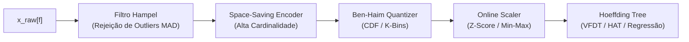
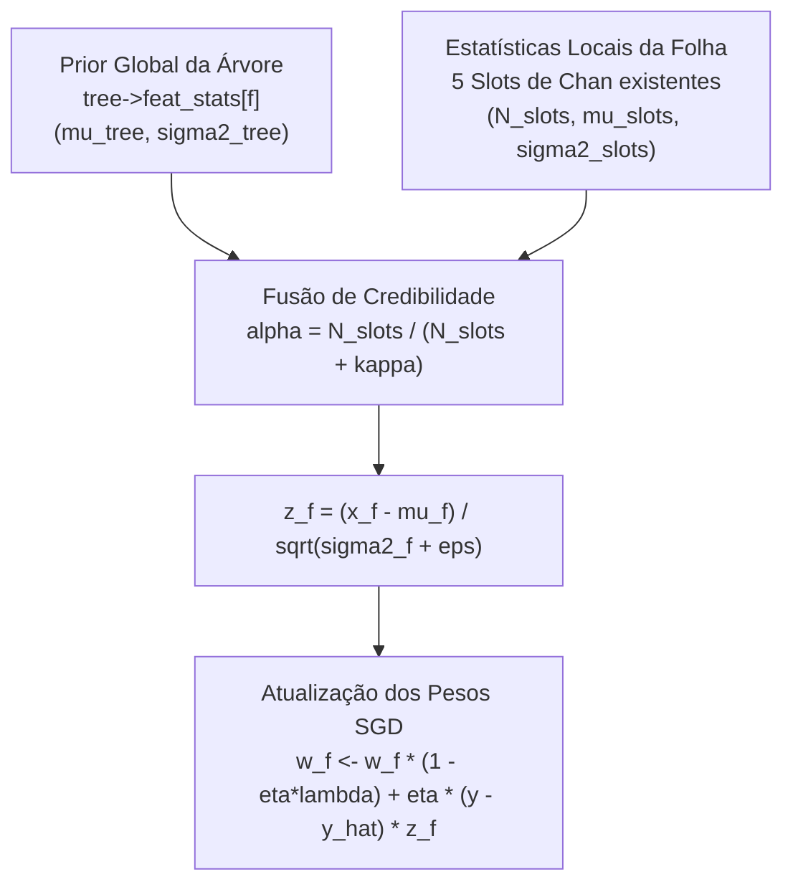

# 08 — Pré-Processamento Embarcado (`libht_prep`), Normalização Online nas Folhas e Discretizadores Não-Paramétricos

> **Módulos Abrangidos:**
> - **Item 19:** Micro-Pipelines de Pré-Processamento Zero-Malloc (`libht_prep` em `ht_prep.h` / `ht_prep.c`)
> - **Item 16:** Discretizadores e Observadores Não-Paramétricos Estáticos (Ben-Haim & Tom-Tov em `ht_prep.h` e `ht_observer.h`)
> - **Item 8:** Normalização Online Integrada nas Folhas para Regressão SGD (`VFDT-R` / `HAT-R` em `ht_tree.h` e `ht_tree.c`)
> - **Versionamento Semântico:** Atualização da versão da biblioteca para `0.2.0` (SemVer 2.0.0)

---

## 1. Motivação e Desafios de Streaming Embarcado para Dados Crús

Em cenários industriais de borda (*Edge Computing*, IoT e microcontroladores), os sinais provenientes de sensores físicos chegam em fluxos contínuos e frequentemente violam as premissas ideais de modelos de aprendizado de máquina:

1. **Espículas e *Outliers* Físicos:** Falhas temporárias de leitura em sensores analógicos (ADC), ruídos eletromagnéticos ou interferências transientes produzem picos espúrios de alta amplitude que corrompem observadores de split e desestabilizam modelos preditivos.
2. **Disparidade de Escalas (Heterogeneidade):** Conforme observado no benchmark empírico do dataset *Bikes*, variáveis de entrada em ordens de grandeza completamente distintas (ex: temperatura normalizada em $[0, 1]$, hora do dia em $[0, 23]$ e umidade em $[0, 100]$) degradam severamente a convergência do algoritmo de Descida de Gradiente Estocástico (SGD) linear nas folhas, induzindo oscilações transversais e necessitando de *gradient clipping* forçado.
3. **Atributos Categóricos de Alta Cardinalidade:** Variáveis nominais com dezenas ou centenas de categorias distintas (ex: códigos de erro, IDs de dispositivos ou endereços IP) não cabem em matrizes fixas $C \times V$ de observadores categóricos sem esgotar o orçamento estrito de memória SRAM.
4. **Distribuições Contínuas Não-Gaussianas e Multimodais:** O observador numérico padrão baseado no algoritmo de Welford modela a distribuição condicional $P(x \mid y)$ através de uma única Gaussiana unimodal $\mathcal{N}(\mu, \sigma^2)$. Quando a distribuição real apresenta múltiplas modas, assimetrias acentuadas ou caudas pesadas, o corte sugerido por divisões gaussianas pode perder o ponto de separação ótimo.

Em sistemas embarcados com **$\le 1\text{ MB}$ de RAM** e **zero alocação dinâmica (`malloc`/`free`)**, métodos convencionais de bibliotecas desktop (como Scikit-Learn ou Pandas, que acumulam matrizes no heap ou utilizam ordenação completa em RAM) são inviáveis. É mandatória a existência de algoritmos determinísticos em $O(1)$ temporal e espacial.

---

## 2. Fundamentação Matemática do Micro-Pipeline (`libht_prep`)

O módulo `libht_prep` introduz quatro componentes de transformação online em streaming, implementados sobre buffers circulares e arrays contíguos estáticos.



---

### 2.1 Filtro Mediano Móvel de Hampel com MAD (`ht_filter_hampel_t`)

O identificador de Hampel é um estimador robusto que substitui valores espúrios com base no Desvio Absoluto Mediano (*Median Absolute Deviation* — MAD), exibindo ponto de ruptura de $50\%$ contra contaminação por *outliers*.

Para cada atributo configurado, mantém-se uma janela circular estática de tamanho ímpar $W = \text{HT\_HAMPEL\_WINDOW\_SIZE}$ (padrão: $W = 7$ amostras):

$$\mathcal{W}_t = \big(x_{t - W + 1}, \, \dots, \, x_{t - 1}, \, x_t\big)$$

#### 1. Mediana Amostral da Janela:
Ordenando a janela estática de $W$ elementos em $O(W \log W)$ (via *insertion sort* em array local na stack, sem alocação):

$$\tilde{x}_t = \operatorname{median}(\mathcal{W}_t)$$

#### 2. Desvio Absoluto Mediano Normalizado ($\operatorname{MAD}$):
Calcula-se a distância absoluta de cada elemento da janela até a mediana local, e extrai-se a mediana dessas distâncias:

$$r_i = |x_i - \tilde{x}_t|, \quad \forall x_i \in \mathcal{W}_t$$
$$\operatorname{MAD}_t = 1{,}4826 \cdot \operatorname{median}\big(\{r_1, r_2, \dots, r_W\}\big)$$

O fator de escala $1{,}4826 \approx \frac{1}{\Phi^{-1}(0{,}75)}$ assegura que o $\operatorname{MAD}$ seja um estimador assintoticamente não-enviesado do desvio-padrão $\sigma$ para distribuições Gaussianas normais.

#### 3. Critério de Decisão e Substituição:
Dado o limiar de sensibilidade configurável $n_\sigma$ (padrão: $3{,}0$):

$$x_t^* = \begin{cases}
\tilde{x}_t, & \text{se } |x_t - \tilde{x}_t| > n_\sigma \cdot \max(\operatorname{MAD}_t, \, \varepsilon_{\text{mad}}) \\
x_t, & \text{caso contrário}
\end{cases}$$

onde $\varepsilon_{\text{mad}} = 10^{-6}$ é um piso numérico para prevenir divisão por zero ou hipersensibilidade em sinais constantes. Quando um *outlier* é detectado, o valor bruto na janela é substituído pela mediana $\tilde{x}_t$, expurgando o efeito cascata nas amostras subsequentes.

---

### 2.2 Padronizadores Online Determinísticos (`ht_scaler_t`)

O módulo `ht_scaler_t` oferece duas modalidades de normalização online em $O(1)$ de tempo e $O(1)$ de memória:

#### 1. Padronizador Z-Score Online (StandardScaler):
Mantém incrementalmente o número de amostras $n$, média empírica $\mu$ e acumulador $M_2$ via algoritmo de Welford:

$$\begin{aligned}
n_{t} &= n_{t-1} + w_t \\
\mu_t &= \mu_{t-1} + \frac{w_t}{n_t}(x_t - \mu_{t-1}) \\
M_{2,t} &= M_{2,t-1} + w_t (x_t - \mu_{t-1})(x_t - \mu_t) \\
\sigma_t^2 &= \begin{cases} \frac{M_{2,t}}{n_t - 1}, & \text{se } n_t > 1 \\ 0{,}0, & \text{se } n_t \le 1 \end{cases}
\end{aligned}$$

O valor transformado é dado por:

$$z_t = \frac{x_t - \mu_t}{\sqrt{\sigma_t^2 + \varepsilon_s}}$$

com $\varepsilon_s = 10^{-6}$.

#### 2. Normalizador Min-Max Online (MinMaxScaler):
Rastreia os limites observados no fluxo $[x_{\min}, x_{\max}]$:

$$x_{\min, t} = \min(x_{\min, t-1}, x_t), \qquad x_{\max, t} = \max(x_{\max, t-1}, x_t)$$

$$z_t = \frac{x_t - x_{\min, t}}{\max(x_{\max, t} - x_{\min, t}, \, \varepsilon_s)} \in [0, 1]$$

---

### 2.3 Codificador para Alta Cardinalidade Space-Saving (`ht_encoder_freq_t`)

Para variáveis categóricas onde o número de rótulos possíveis $V$ ultrapassa a capacidade estática da árvore ($\text{HT\_MAX\_CATEGORIES} = 5$), o algoritmo *Space-Saving* de Metwally, Agrawal & El Abbadi (2005) identifica os elementos mais frequentes (*Heavy Hitters*) mantendo apenas $K$ slots estáticos ($\text{HT\_PREP\_MAX\_CAT\_SLOTS} = 16$):

Cada slot armazena uma tupla $(\text{key}_i, \text{count}_i, \text{occupied}_i)$.

```text
Entrada: Categoria nominal k com peso w
1. Se k já existe em algum slot ativo i:
     count_i <- count_i + w
2. Senão, se existe um slot livre j:
     key_j <- k, count_j <- w, occupied_j <- 1
3. Senão (todos os K slots estão ocupados):
     Seja m o índice do slot com menor contagem: count_m = min_j(count_j)
     key_m <- k
     count_m <- count_m + w
```

O erro máximo estimado na contagem de qualquer categoria é rigorosamente limitado por $\frac{N_{\text{total}}}{K}$.

#### Modos de Codificação de Saída:
1. **Frequência Relativa Contínua (`HT_ENC_FREQ_RATIO`):** Converte a categoria no índice de frequência empírica $f(k) = \frac{\text{count}_k}{N_{\text{total}}} \in [0, 1]$, permitindo que a árvore processe o atributo como numérico contínuo.
2. **Top-$K$ Ranking Categórico (`HT_ENC_TOP_K_CAT`):** Mapeia os $K_{\text{target}}-1$ itens mais frequentes para índices nominais inteiros de $0$ até $K_{\text{target}}-2$, e todas as demais categorias residuais para a categoria sentinela $K_{\text{target}}-1$ (bucket *"Outros"*), compatibilizando qualquer stream com `HT_MAX_CATEGORIES`.

---

## 3. Discretizadores e Observadores Não-Paramétricos de Ben-Haim & Tom-Tov

### 3.1 Fundamentação Algorítmica do Histograma Dinâmico

O algoritmo de **Ben-Haim & Tom-Tov (2010)** constrói uma aproximação contínua e compacta da função densidade e distribuição acumulada ($F(x)$) em streaming mantendo um número fixo de centróides $B$:

$$\mathcal{H} = \big\{(p_1, m_1), \, (p_2, m_2), \, \dots, \, (p_k, m_k)\big\}, \quad p_1 < p_2 < \dots < p_k, \quad k \le B$$

onde $p_i \in \mathbb{R}$ representa a posição central do centróide e $m_i \in \mathbb{R}^+$ representa o peso acumulado em torno desse ponto.

#### Inserção e Fusão em $O(B)$ com Zero Alocação:
Ao receber um novo ponto $x$ com peso $w$:
1. Localiza-se a posição de inserção ordenada em $\mathcal{H}$ mantendo $p_1 \le p_2 \le \dots \le p_{k+1}$.
2. Se $k+1 \le B$, o novo centróide $(x, w)$ é mantido e $k \leftarrow k+1$.
3. Se $k+1 > B$, identifica-se o par de centróides adjacentes com menor distância euclidiana:
   $$i^* = \arg\min_{i} (p_{i+1} - p_i)$$
4. Os dois centróides $i^*$ e $i^*+1$ são colapsados em um único centróide $(\bar{p}, \bar{m})$ via média ponderada:
   $$\bar{m} = m_{i^*} + m_{i^*+1}, \qquad \bar{p} = \frac{p_{i^*} m_{i^*} + p_{i^*+1} m_{i^*+1}}{\bar{m}}$$
5. Os elementos restantes são deslocados à esquerda, restaurando $k = B$.

#### Estimativa de CDF Contínua via Interpolação Linear Trapezoidal:
Dada uma consulta $x$, estima-se a massa acumulada de dados $\le x$:
- Se $x < p_1$: $\hat{F}(x) = 0$.
- Se $x \ge p_k$: $\hat{F}(x) = 1$.
- Se $p_i \le x < p_{i+1}$:
  $$\alpha = \frac{x - p_i}{p_{i+1} - p_i}, \qquad \text{massa}(x) = \sum_{j=1}^{i-1} m_j + \frac{m_i}{2} + \alpha \cdot \frac{m_i + m_{i+1}}{2}$$
  $$\hat{F}(x) = \frac{\text{massa}(x)}{\sum_{j=1}^k m_j} \in [0, 1]$$

---

### 3.2 Aplicação no Pipeline `libht_prep` (`ht_quantizer_t`)

No módulo `ht_prep`, o quantizador utiliza até $B = 16$ centróides por atributo, suportando:
1. **Transformação de Quantis Contínua (`HT_QUANT_CDF_UNIFORM`):** Mapeia $x \mapsto \hat{F}(x) \in [0, 1]$, linearizando distribuições multimodais ou caudas assimétricas para distribuições aproximadamente uniformes (estilo *QuantileTransformer* do Scikit-Learn).
2. **Discretização em Bins Ordenados (`HT_QUANT_KBINS_ORDINAL` e `HT_QUANT_KBINS_CAT`):** Divide a densidade estimada em $K$ partições de probabilidade uniforme ($\Delta F = 1/K$), emitindo a categoria inteira de $0$ até $K-1$.

---

### 3.3 Observador Numérico de Histograma na Árvore (`ht_hist_obs_t`)

Para permitir splits não-paramétricos diretamente nas folhas da Hoeffding Tree, implementa-se o observador `ht_hist_obs_t` que se acomoda **estritamente dentro da union existente `ht_feature_obs_t` de 80 bytes (`float32`) / 160 bytes (`double64`)**:

Cada bin de histograma acomoda a posição central e a distribuição de todas as classes:

```c
typedef struct {
    ht_float_t center;                  /* Posição central do bin (4 B / 8 B) */
    ht_float_t counts[HT_MAX_CLASSES];  /* Frequência por classe (4 * 4 B = 16 B / 32 B) */
} ht_hist_bin_t;

typedef struct {
    ht_hist_bin_t bins[HT_HIST_MAX_BINS]; /* 4 bins * 20 B = 80 B (float32) / 160 B (float64) */
} ht_hist_obs_t;
```

Com $B = 4$ bins multi-classe por atributo em cada folha, o observador consome exatamente o mesmo espaço físico que o observador Gaussiano (`ht_gaussian_obs_t` para 4 classes), **não aumentando um único byte no tamanho de `ht_leaf_stats_t`** ($1.360\text{ B}$ em `float32` / $2.720\text{ B}$ em `double64`).

---

## 4. Normalização Online Integrada nas Folhas para Regressão SGD (Item 8)

### 4.1 O Dilema da Herança de Pesos Pós-Split

Na regressão contínua com modelos lineares nas folhas (`HT_LEAF_MODEL` e `HT_LEAF_ADAPTIVE`), o regressor linear prediz o alvo via produto escalar:

$$\hat{y}(\mathbf{x}) = w_0 + \sum_{f=0}^{F-1} w_f x_f$$

Durante o split de uma folha ativa mãe $l$, seus nós filhos $l_{\text{left}}$ e $l_{\text{right}}$ **herdam integralmente os coeficientes lineares $\mathbf{w}$ e o intercepto $w_0$ da mãe** para garantir continuidade de predição e evitar degradação de erro logo após a divisão.

Se a normalização fosse calculada exclusivamente com estatísticas da folha recém-criada, no instante do split as filhas teriam $N = 0$ amostras, gerando $\mu = 0$ e $\sigma^2 = 0$. Assim que a primeira amostra chegasse, a escala saltaria abruptamente de $x$ para $\frac{x - x_1}{\epsilon}$, destruindo a calibragem dos pesos herdados da mãe.

### 4.2 Formulação do Z-Score Híbrido com Credibilidade

Para solucionar esse problema com **zero overhead de memória nas folhas**, desenvolveu-se a normalização híbrida em duas camadas:



1. **Camada Global de Warm-Start (`tree->feat_stats[HT_MAX_FEATURES]`):**
   - A árvore mantém um acumulador de Welford por atributo no nível global da struct `ht_tree_t`.
   - Custo adicional na árvore inteira: apenas $16 \times 12\text{ B} = 192\text{ B}$ em `float32` ($384\text{ B}$ em `double64`), mantendo `sizeof(ht_tree_t) <= 1 MB`.
2. **Camada Local das Folhas (Suficiência sem Custo Extra):**
   - A folha já monitora a distribuição de cada atributo numérico através de seus 5 slots de quantização de Chan (`ht_reg_num_slot_t slots[5]`).
   - A média local $\mu_{\text{slots}}$ e a variância local $\sigma_{\text{slots}}^2$ são extraídas em $O(1)$ a partir desses mesmos slots já residentes em `ht_leaf_stats_t`!
3. **Ponderação de Credibilidade $\alpha$:**
   $$\alpha = \frac{N_{\text{slots}}}{N_{\text{slots}} + \kappa}, \qquad \kappa = 10{,}0$$
   $$\mu_f = \alpha \cdot \mu_{\text{slots}} + (1 - \alpha) \cdot \mu_{\text{tree}}$$
   $$\sigma_f^2 = \alpha \cdot \sigma_{\text{slots}}^2 + (1 - \alpha) \cdot \sigma_{\text{tree}}^2$$
   $$z_f = \frac{x_f - \mu_f}{\sqrt{\sigma_f^2 + 10^{-6}}}$$

#### Benefícios Matemáticos:
- **No Split ($N_{\text{slots}} = 0$):** $\alpha = 0 \implies (\mu_f, \sigma_f^2) = (\mu_{\text{tree}}, \sigma_{\text{tree}}^2)$. O espaço de coordenadas é $100\%$ contínuo e idêntico ao da mãe, preservando a validade exata dos pesos $\mathbf{w}$ herdados.
- **Folha Madura ($N_{\text{slots}} \gg \kappa$):** $\alpha \to 1 \implies (\mu_f, \sigma_f^2) \to (\mu_{\text{slots}}, \sigma_{\text{slots}}^2)$. O modelo adapta-se à distribuição localizada do particionamento daquela folha específica.
- **Zero Malloc e Zero Bytes Extras no Pool de Folhas:** $256$ folhas consom rigorosamente os mesmos $348.160\text{ B}$ de SRAM.

---

## 5. Arquitetura do Módulo `ht_prep` e Anexação à Árvore

O micro-pipeline de pré-processamento é encapsulado na struct `ht_prep_pipeline_t`, alocada pelo usuário em memória estática (`.bss`) ou stack, sem chamadas a heap:

```c
typedef struct ht_prep_pipeline {
    uint8_t            n_features;
    ht_feature_type_t  feature_types_in[HT_MAX_FEATURES];
    ht_feature_type_t  feature_types_out[HT_MAX_FEATURES];
    ht_filter_hampel_t hampel;
    ht_encoder_freq_t  encoder;
    ht_quantizer_t     quantizer;
    ht_scaler_t        scaler;
} ht_prep_pipeline_t;
```

### Tamanho Exato em Memória:
- `sizeof(ht_filter_hampel_t)`: $16 \times 7 \times 4\text{ B} + \text{metadados} \approx 512\text{ B}$ ($960\text{ B}$ em `double64`).
- `sizeof(ht_encoder_freq_t)`: $16 \times 16 \times 12\text{ B} \approx 3.100\text{ B}$ ($4.100\text{ B}$ em `double64`).
- `sizeof(ht_quantizer_t)`: $16 \times 16 \times 8\text{ B} \approx 2.100\text{ B}$ ($4.150\text{ B}$ em `double64`).
- `sizeof(ht_scaler_t)`: $16 \times 20\text{ B} \approx 320\text{ B}$ ($640\text{ B}$ em `double64`).
- **Total `sizeof(ht_prep_pipeline_t)`:** $\approx 4{,}6\text{ KB}$ em `float32` e $\approx 8{,}4\text{ KB}$ em `double64`.

A conexão com a árvore ocorre via ponteiro opcional `tree->prep_pipeline`:

```c
ht_tree_t tree;
ht_prep_pipeline_t pipe;

ht_prep_pipeline_init(&pipe, n_features, feature_types);
/* Configura estágios desejados em pipe... */

ht_tree_init(&tree, &params);
ht_tree_set_prep_pipeline(&tree, &pipe);

/* Agora ht_tree_learn_one e ht_tree_predict executam o pré-processamento de forma transparente! */
ht_tree_learn_one(&tree, x_raw, y, 1.0f);
```

---

## 6. Sincronização do Versionamento Semântico (`0.2.0`)

Conforme estipulado no padrão SemVer 2.0.0 adotado pelo projeto:
- A adição de novas funcionalidades na API pública (`ht_prep.h`, novos parâmetros opcionais e suporte a múltiplos observadores) representa uma evolução **MINOR**.
- A versão da biblioteca é promovida de `0.1.0` para **`0.2.0`** simultaneamente em:
  1. [`VERSION`](file:///home/julio/Documentos/pessoal_minimal-decision-tree/VERSION): `0.2.0`
  2. [`code/include/ht_config.h`](file:///home/julio/Documentos/pessoal_minimal-decision-tree/code/include/ht_config.h): `HT_VERSION_MINOR = 2U`, `HT_VERSION_STRING = "0.2.0"`
  3. [`code/tests/test_main.c`](file:///home/julio/Documentos/pessoal_minimal-decision-tree/code/tests/test_main.c): `HT_ASSERT(HT_VERSION_CHECK(0, 2, 0))`
