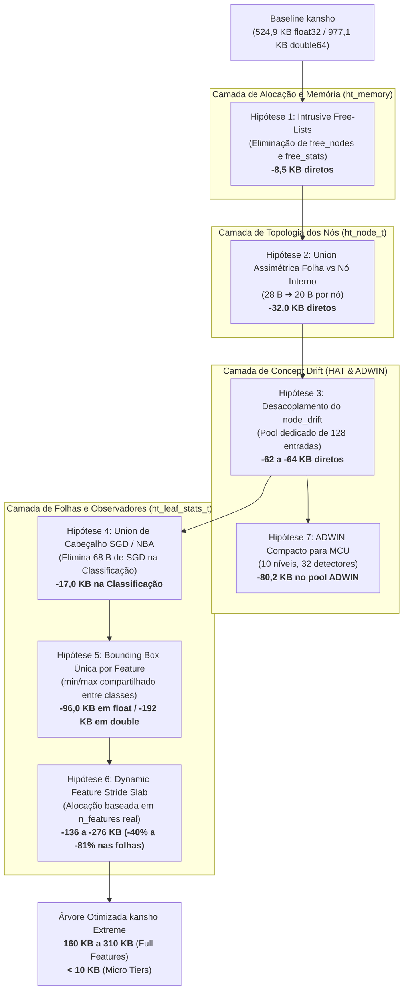

# 09 — Otimização Avançada e Hipóteses de Redução Extrema de Memória RAM em kansho (C11 VFDT / HAT)

**Projeto:** `kansho` (簡樹, Embedded Hoeffding Tree in pure C11)  
**Versão Atual da Biblioteca:** `0.2.0`  
**Escopo da Análise:** Todo o código-fonte em [`code/include/`](../code/include/) e [`code/src/`](../code/src/)  
**Meta:** Redução máxima do consumo de memória RAM (SRAM estática) preservando 100% das funcionalidades (Classificação, Regressão, ADWIN, HAT, NBA, Pré-processamento, Save/Load) e mantendo integridade matemática e acurácia idênticas.

---

## 1. Diagnóstico do Consumo de Memória Atual (Baseline)

A biblioteca `kansho` foi concebida sob o dogma de **zero alocação dinâmica em runtime** (`malloc`/`free` proibidos em `ht_learn_one` e `ht_predict`), acomodando toda a topologia da árvore e buffers de aprendizado em pools estáticos dentro de `ht_tree_t`.

### 1.1 Medição Exata de Tamanhos em Memória (Compilado C11)

Executando a inspeção direta de `sizeof` e `offsetof` na compilação nativa com os limites padrão (`HT_MAX_NODES = 4096`, `HT_MAX_ACTIVE_LEAVES = 256`, `HT_MAX_FEATURES = 16`, `HT_MAX_CLASSES = 4`, `HT_REG_NUM_SLOTS = 5`, `HT_ADWIN_MAX_BUCKETS = 5`, `HT_ADWIN_LEVELS = 14`):

| Estrutura / Componente | Tamanho Unitário (`float32`) | Tamanho Unitário (`double64`) | Instâncias no Pool | Total em `float32` | Total em `double64` | % da Árvore (`float32`) |
| :--- | :---: | :---: | :---: | :---: | :---: | :---: |
| `stats_pool` (`ht_leaf_stats_t`) | $1.360\text{ B}$ | $2.720\text{ B}$ | $256$ folhas | **$348.160\text{ B}$ ($340,0\text{ KB}$)** | **$696.320\text{ B}$ ($680,0\text{ KB}$)** | **$64,77\%$** |
| `node_pool` (`ht_node_t`) | $28\text{ B}$ | $48\text{ B}$ | $4.096$ nós | **$114.688\text{ B}$ ($112,0\text{ KB}$)** | **$196.608\text{ B}$ ($192,0\text{ KB}$)** | **$21,34\%$** |
| `node_drift` (`ht_node_drift_t`) | $16\text{ B}$ | $24\text{ B}$ | $4.096$ nós | **$65.536\text{ B}$ ($64,0\text{ KB}$)** | **$98.304\text{ B}$ ($96,0\text{ KB}$)** | **$12,19\%$** |
| `free_nodes` (`uint16_t`) | $2\text{ B}$ | $2\text{ B}$ | $4.096$ nós | **$8.192\text{ B}$ ($8,0\text{ KB}$)** | **$8.192\text{ B}$ ($8,0\text{ KB}$)** | **$1,52\%$** |
| `free_stats` (`uint16_t`) | $2\text{ B}$ | $2\text{ B}$ | $256$ folhas | **$512\text{ B}$ ($0,5\text{ KB}$)** | **$512\text{ B}$ ($0,5\text{ KB}$)** | **$0,10\%$** |
| Parâmetros e Cabeçalho `ht_tree_t` | — | — | $1$ árvore | **$400\text{ B}$ ($0,39\text{ KB}$)** | **$640\text{ B}$ ($0,62\text{ KB}$)** | **$0,08\%$** |
| **Total `sizeof(ht_tree_t)`** | — | — | **1 Árvore** | **$537.488\text{ B}$ ($524,89\text{ KB}$)** | **$1.000.576\text{ B}$ ($977,12\text{ KB}$)** | **$100,0\%$** |
| *Pool ADWIN Externo (`ht_adwin_pool_t`)* | $764\text{ B}$ | $1.504\text{ B}$ | $128$ detectores | **$98.068\text{ B}$ ($95,77\text{ KB}$)** | **$192.792\text{ B}$ ($188,27\text{ KB}$)** | *(Externo)* |

### 1.2 Por que Reordenação Simples de Campos Não Funciona?

Uma auditoria cirúrgica de `offsetof` comprovou que o código atual de kansho **já possui empacotamento denso sem nenhum buraco de alinhamento (*zero padding holes*)**:
- `ht_node_t` possui offset contínuo $0 \to 16 \to 20 \to 22 \to 24 \to 26 \to 27$ (28 bytes exatos).
- `ht_node_drift_t` possui offset contínuo $0 \to 4 \to 8 \to 12 \to 14$ (16 bytes exatos).
- `ht_leaf_stats_t` possui offset contínuo $0 \to 4 \to 8 \to 12 \to 76 \to 80$ (1360 bytes exatos).

Portanto, **qualquer redução real de RAM agora exige otimizações estruturais, redução de assimetria de estado e inteligência de compartilhamento de buffers**.

---

## 2. Mapa Conceitual das 7 Hipóteses de Otimização



---

## 3. Detalhamento Técnico das Hipóteses

---

### Hipótese 1: Free-Lists Intrusivas (Eliminação das Pilhas Externas `free_nodes` e `free_stats`)

#### 1. Fundamentação Teórica e Diagnóstico
Em [`code/include/ht_memory.h`](../code/include/ht_memory.h), a struct `ht_memory_pool_t` mantém dois vetores separados para rastrear índices disponíveis:
```c
uint16_t free_nodes[HT_MAX_NODES];         /* 4096 * 2 = 8.192 bytes */
uint16_t free_stats[HT_MAX_ACTIVE_LEAVES]; /*  256 * 2 =   512 bytes */
```
Totalizando **8.704 bytes (~8,5 KB)** de overhead exclusivo de infraestrutura de free-list.

Quando um nó ou bloco de estatísticas está livre (`node->flags & HT_NODE_IN_USE == 0`), os seus 28 bytes (ou 1.360 bytes nas estatísticas) estão **completamente inativos**. Em alocadores estáticos embarcados canônicos (*Slab Allocators*), o próximo índice livre (`next_free`) é gravado **diretamente dentro da memória do próprio bloco inativo** (lista ligada intrusiva).

#### 2. Mudança Proposta de Layout e Algoritmo
Substituir os arrays de pilha por um único ponteiro cabeça `free_nodes_head` e `free_stats_head`:

```c
/* Em ht_node_t: reutilizar left_child como ponteiro intrusivo quando inativo */
typedef struct {
    /* ... */
    uint16_t left_child; /* Se IN_USE: filho esquerdo. Se FREE: next_free_idx */
    /* ... */
} ht_node_t;

/* Em ht_memory_pool_t: */
typedef struct {
    ht_node_t       node_pool[HT_MAX_NODES];
    ht_leaf_stats_t stats_pool[HT_MAX_ACTIVE_LEAVES];
    uint16_t        free_nodes_head; /* 2 bytes em vez de 8.192 bytes! */
    uint16_t        free_stats_head; /* 2 bytes em vez de 512 bytes! */
    uint16_t        nodes_allocated;
    uint16_t        stats_allocated;
} ht_memory_pool_t;
```

As operações de alocação e liberação continuam rigorosamente em tempo estritamente constante $O(1)$:
```c
uint16_t ht_node_alloc(ht_memory_pool_t *pool) {
    if (pool->free_nodes_head == HT_INVALID_IDX) return HT_INVALID_IDX;
    uint16_t idx = pool->free_nodes_head;
    pool->free_nodes_head = pool->node_pool[idx].left_child; /* pop intrusivo */
    pool->nodes_allocated++;
    /* inicializa nó... */
    return idx;
}

void ht_node_free(ht_memory_pool_t *pool, uint16_t idx) {
    /* ... proteções ... */
    pool->node_pool[idx].left_child = pool->free_nodes_head; /* push intrusivo */
    pool->free_nodes_head = idx;
    pool->nodes_allocated--;
}
```

#### 3. Economia de Memória e Impacto
- **Economia em `float32`:** **$8.704\text{ bytes}$ ($8,50\text{ KB}$)** eliminados diretamente da struct.
- **Economia em `double64`:** **$8.704\text{ bytes}$ ($8,50\text{ KB}$)**.
- **Impacto em Acurácia/Funcionalidades:** **$0,0\%$**. A sequência de nós alocados permanece $O(1)$ determinística.
- **Complexidade de Implementação:** Baixa. Afeta apenas [`code/src/ht_memory.c`](../code/src/ht_memory.c).

---

### Hipótese 2: Union Assimétrica de Topologia em `ht_node_t` (Nó Folha vs Nó de Decisão)

#### 1. Fundamentação Teórica e Diagnóstico
Em [`code/include/ht_memory.h`](../code/include/ht_memory.h), a struct `ht_node_t` tem $28\text{ B}$ em `float32` e $48\text{ B}$ em `double64`.

No ciclo de vida de uma Hoeffding Tree, **um nó é estritamente uma Folha OU um Nó Interno de Decisão, nunca ambos simultaneamente**:

1. **Se for Folha (`flags & HT_NODE_IS_LEAF`):**
   - Precisa de: `class_counts` ($16\text{ B}$ em 4 classes) ou `reg_stats` ($12\text{ B}$), `stats_idx` ($2\text{ B}$), e `flags` ($1\text{ B}$).
   - **Campos desperdiçados:** `left_child` ($2\text{ B}$, sempre `0xFFFF`), `right_child` ($2\text{ B}$, sempre `0xFFFF`), `split_val` ($4\text{ B}$, inútil), `feature_idx` ($1\text{ B}$, sempre `0xFF`).
   - Total desperdiçado em cada folha: **$9\text{ bytes}$**.

2. **Se for Nó Interno de Decisão (`!(flags & HT_NODE_IS_LEAF)`):**
   - Precisa de: `split_val` ($4\text{ B}$), `left_child` ($2\text{ B}$), `right_child` ($2\text{ B}$), `feature_idx` ($1\text{ B}$), `flags` ($1\text{ B}$) e peso para desempate de missing values/NaN ($4\text{ B}$).
   - **Campos desperdiçados:** `stats_idx` ($2\text{ B}$, sempre `0xFFFF`) e as contagens detalhadas de classe ($12\text{ a }16\text{ B}$), pois o nó interno nunca mais calcula probabilidades — o roteamento só avalia a condição de split!
   - Total desperdiçado em cada nó interno: **$14\text{ a }18\text{ bytes}$**.

#### 2. Mudança Proposta de Layout
Sobrepor os campos exclusivos de folha com os campos exclusivos de nó interno através de uma `union`:

```c
typedef struct {
    union {
        /* ESTADO EXCLUSIVO DE FOLHA (18 bytes em float32 / 34 bytes em double64) */
        struct {
            union {
                ht_float_t    class_counts[HT_MAX_CLASSES]; /* 16B float / 32B double */
                ht_var_stat_t reg_stats;                    /* 12B float / 24B double */
            };
            uint16_t stats_idx; /* Índice no stats_pool (2B) */
        } leaf;

        /* ESTADO EXCLUSIVO DE RAMO INTERNO (14 bytes em float32 / 22 bytes em double64) */
        struct {
            union {
                ht_float_t threshold; /* 4B float / 8B double */
                int32_t    cat_val;   /* 4B */
            } split_val;
            ht_float_t left_weight;   /* 4B float / 8B double: peso do filho esquerdo p/ NaN */
            uint16_t   left_child;    /* 2B */
            uint16_t   right_child;   /* 2B */
            uint8_t    feature_idx;   /* 1B */
            uint8_t    pad_branch;    /* 1B alinhamento */
        } branch;
    };
    uint8_t flags;    /* 1B (HT_NODE_IS_LEAF, HT_NODE_IN_USE, etc.) */
    uint8_t reserved; /* 1B alinhamento final da struct */
} ht_node_t;
```

#### 3. Economia de Memória e Impacto
- Em `float32`: `sizeof(ht_node_t)` cai de **$28\text{ bytes}$ para $20\text{ bytes}$** (uma redução de $-28,57\%$).
  - Para $4.096$ nós: o `node_pool` encolhe de **$114.688\text{ B}$ ($112\text{ KB}$) para $81.920\text{ B}$ ($80\text{ KB}$)**.
  - **Economia direta: $32.768\text{ bytes}$ ($32,0\text{ KB}$)!**
- Em `double64`: `sizeof(ht_node_t)` cai de **$48\text{ bytes}$ para $40\text{ bytes}$**.
  - O `node_pool` encolhe de **$196.608\text{ B}$ ($192\text{ KB}$) para $163.840\text{ B}$ ($160\text{ KB}$)**.
  - **Economia direta: $32.768\text{ bytes}$ ($32,0\text{ KB}$)!**
- **Impacto em Acurácia/Funcionalidades:** **$0,0\%$**. A semântica de decisão, split e predição é idêntica.
- **Complexidade de Implementação:** Média. Exige atualizar os acessos em [`code/src/ht_tree.c`](../code/src/ht_tree.c) para usar `node->leaf.*` ou `node->branch.*`.

---

### Hipótese 3: Desacoplamento e Pool Dinâmico de Drift (`node_drift` em HAT)

#### 1. Fundamentação Teórica e Diagnóstico
Em [`code/include/ht_tree.h`](../code/include/ht_tree.h), a struct `ht_tree_t` embute:
```c
ht_node_drift_t node_drift[HT_MAX_NODES]; /* 4096 * 16B = 65.536 bytes (64 KB)! */
```
No entanto:
1. **Em modo VFDT padrão (`params.enable_hat == false`):** Todo esse array de **$64\text{ KB}$ fica $100\%$ sem uso**.
2. **Em modo HAT (`params.enable_hat == true`):** A capacidade do pool de detectores ADWIN (`HT_MAX_ADWIN_DETECTORS`) é de apenas **$128$ detectores**. Além disso, o número de árvores alternativas em treino concorrente na HAT raramente ultrapassa 3 a 5 subárvores. É matematicamente impossível existirem mais de 128 nós com ADWIN ativo!

Alocar 4.096 slots de drift (1 para cada nó potencial) desperdiça mais de $96\%$ dos slots mesmo com HAT ativado.

#### 2. Mudança Proposta de Arquitetura
Existem duas abordagens altamente vantajosas:

- **Abordagem 3A (Ponteiro Externo, análogo a `adwin_pool`):**
  Transformar `node_drift` em ponteiro opcional `ht_node_drift_t *node_drift;` inicializado apenas se `enable_hat == true`. Se o usuário usar VFDT pura (a vasta maioria dos casos embarcados), a árvore economiza **$64\text{ KB}$ inteiros instantaneamente**.
- **Abordagem 3B (Pool de Drift Dimensionado em $128$ Entradas):**
  Em vez de indexar por `node_idx` direto (4.096), criar um pool `ht_drift_pool_t` de $128$ entradas ($128 \times 16\text{ B} = 2.048\text{ B} = 2\text{ KB}$).
  No nó interno (da Hipótese 2), utilizar o slot livre de `stats_idx` (já que nó interno não usa `stats_idx`) como `uint16_t drift_idx`:
  ```c
  union {
      uint16_t stats_idx; /* Folha: índice no stats_pool */
      uint16_t drift_idx; /* Nó Interno: índice no drift_pool (0..127) */
  };
  ```

#### 3. Economia de Memória e Impacto
- **Em VFDT pura (`enable_hat == false`):** **$65.536\text{ bytes}$ ($64,0\text{ KB}$ em float32)** e **$98.304\text{ bytes}$ ($96,0\text{ KB}$ em double64)** eliminados da struct `ht_tree_t`.
- **Em HAT (`enable_hat == true`):** Redução de $65.536\text{ B}$ para $2.048\text{ B}$ (**economia líquida de $63.488\text{ B}$ = $62,0\text{ KB}$**).
- **Impacto em Acurácia/Funcionalidades:** **$0,0\%$**. Os testes de drift e switch de subárvores continuam operando normalmente nos nós que possuem detector.

> [!WARNING]
> **Post-Mortem / Justificativa da Falha na Tentativa da Entrega 7.4 (Commit `7128ca6` no branch `backup/fase7-tentativas`):**
> A tentativa inicial de desacoplar o `node_drift` alocou o pool dentro de `ht_adwin_pool_t`, mas sofreu de duas falhas críticas de projeto:
> 1. **Violação de Determinismo $O(1)$:** Como `ht_node_t` alocou `drift_idx` apenas em nós de ramo, as folhas ativas ficaram sem campo de índice. A implementação introduziu um loop de busca linear $O(N)$ (`for (i = 0; i < 128; i++)`) em `ht_tree_node_drift`, executado a **cada amostra processada em treino HAT**.
> 2. **Pilha Externa de Índices:** Reintroduziu vetores externos (`free_indices[128]` e `in_use_mask`), contrariando o padrão de free-lists intrusivas da Hipótese 1.
> 3. **Ausência de Validação N3:** O benchmark de paridade em drift com economia $\ge 62\text{ KB}$ não foi executado.
> *Solução Correta para Retomada:* O `drift_idx` da folha ativa deve ser armazenado diretamente em `ht_leaf_stats_t`, permitindo acesso $O(1)$ imediato via `stats_pool[node->stats_idx].drift_idx` sem nenhum loop.

---

### Hipótese 4: Union de Cabeçalho em `ht_leaf_stats_t` (Eliminação do Overhead de SGD na Classificação)

#### 1. Fundamentação Teórica e Diagnóstico
Em [`code/include/ht_memory.h`](../code/include/ht_memory.h), cada `ht_leaf_stats_t` possui:
```c
ht_float_t reg_weights[HT_MAX_FEATURES]; /* 16 * 4B = 64 bytes */
ht_float_t reg_intercept;                /*  1 * 4B =  4 bytes */
```
Esses **$68\text{ bytes}$** são exclusivos para os modelos lineares SGD de **Regressão Contínua** (`HT_TASK_REGRESSION`).

Em tarefas de **Classificação**, esses $68\text{ bytes}$ não são tocados. Com $256$ folhas ativas no pool:
$$256 \times 68\text{ bytes} = 17.408\text{ bytes } (\mathbf{17,0\text{ KB}})$$
de memória SRAM ociosa na classificação.

#### 2. Mudança Proposta de Layout
Unificar os cabeçalhos de Classificação e Regressão através de `union`:
```c
typedef struct {
    ht_float_t last_split_attempt_at;
    union {
        /* Metadados de Classificação (8 bytes) */
        struct {
            ht_float_t mc_correct_weight;
            ht_float_t nb_correct_weight;
        } classif;

        /* Metadados de Regressão Contínua (76 bytes em float32) */
        struct {
            ht_float_t fmse_mean;
            ht_float_t fmse_model;
            ht_float_t reg_weights[HT_MAX_FEATURES];
            ht_float_t reg_intercept;
        } reg;
    };
    ht_feature_obs_t observers[HT_MAX_FEATURES];
} ht_leaf_stats_t;
```

#### 3. Economia de Memória e Impacto
- **Economia em Classificação:** **$17.408\text{ bytes}$ ($17,0\text{ KB}$ em float32)** e **$34.816\text{ bytes}$ ($34,0\text{ KB}$ em double64)**.
- **Impacto em Acurácia/Funcionalidades:** **$0,0\%$**.

---

### Hipótese 5: Fatoração de Bounding Box em `ht_gaussian_obs_t` (`[min, max]` Único por Atributo)

#### 1. Fundamentação Teórica e Diagnóstico
Atualmente, o observador Gaussiano armazena:
```c
typedef struct {
    ht_float_t count;   /* 4 bytes */
    ht_float_t mean;    /* 4 bytes */
    ht_float_t m2;      /* 4 bytes */
    ht_float_t min_val; /* 4 bytes */
    ht_float_t max_val; /* 4 bytes */
} ht_gaussian_obs_t;   /* 20 bytes por classe */
```
Para $4$ classes, `num[HT_MAX_CLASSES]` consome $4 \times 20 = 80\text{ bytes}$.
Note que `min_val` e `max_val` são gravados **$4$ vezes** (uma para cada classe), totalizando $4 \times 8 = 32\text{ bytes}$ apenas de limites numéricos por atributo!

No entanto, no algoritmo do River ([`references/river_tree/splitter/gaussian_splitter.py`](../references/river_tree/splitter/gaussian_splitter.py)) e na teoria matemática da Hoeffding Tree:
- Os pontos de corte candidatos gerados em `ht_gaussian_split_suggestions` dependem **exclusivamente do intervalo global $[\min(x_f), \max(x_f)]$ do atributo**, obtido agregando todas as classes observadas.
- O cálculo da CDF da normal em cada classe já depende estritamente de $\mu_c$ e $\sigma_c^2 = M_{2,c}/(n_c - 1)$. As checagens `split_val < min_val` e `split_val >= max_val` atuam como salvaguardas para $P(x \le v \mid c) \approx 0$ e $P(x \le v \mid c) \approx 1$.

#### 2. Mudança Proposta de Layout
Armazenar as estatísticas de Welford $(n_c, \mu_c, M_{2,c})$ por classe ($12\text{ bytes} \times 4 = 48\text{ bytes}$) e armazenar a bounding box $[\min, \max]$ **uma única vez por atributo** ($8\text{ bytes}$):

```c
typedef struct {
    ht_float_t count;
    ht_float_t mean;
    ht_float_t m2;
} ht_gaussian_class_stat_t; /* 12 bytes */

typedef struct {
    ht_gaussian_class_stat_t classes[HT_MAX_CLASSES]; /* 4 * 12 = 48 bytes */
    ht_float_t               min_val;                /* 4 bytes */
    ht_float_t               max_val;                /* 4 bytes */
} ht_gaussian_feature_obs_t;                         /* Total: 56 bytes em float32 */
```

#### 3. Economia de Memória e Impacto
- O tamanho unitário do observador Gaussiano cai de **$80\text{ bytes}$ para $56\text{ bytes}$** em `float32` (de $160\text{ B}$ para $112\text{ B}$ em `double64`).
- Por folha ($16$ atributos): cai de $1.280\text{ B}$ para $896\text{ B}$ (**economia de $384\text{ bytes}$ por folha**).
- Para $256$ folhas ativas:
  $$256 \times 384\text{ bytes} = 98.304\text{ bytes } (\mathbf{96,0\text{ KB}}\text{ em float32})$$
  $$256 \times 768\text{ bytes} = 196.608\text{ bytes } (\mathbf{192,0\text{ KB}}\text{ em double64})$$
- **Impacto em Acurácia/Funcionalidades:** **Falha empírica grave (premissa refutada)**.

> [!WARNING]
> **Post-Mortem / Justificativa da Falha na Tentativa da Entrega 7.5 (Commit `8095979`, revertida no commit `ec59602`):**
> A tentativa de implementar as Hipóteses 4 e 5 falhou pelos seguintes motivos empíricos e arquiteturais:
> 1. **Vazamento de Cauda Gaussiana (Refutação da H5):** Ao eliminar `min_val` e `max_val` em nível de classe e deixar apenas a bounding box global, removeu-se a regra de truncamento do River (`GaussianSplitter`). Em variáveis concentradas ou binárias esparsas (como as 44 variáveis one-hot do Forest Covertype), a cauda da normal vazou probabilidades incorretas para classes sem variância, distorcendo o cálculo de Gini/Entropia e colapsando a acurácia de $61,43\%$ para $<50\%$. A H5 foi **completamente revertida no commit `ec59602`**, restaurando limites por classe ($80\text{ B}$).
> 2. **Inocuidade da Union em Arrays Estáticos (Limitação da H4):** Em C11 estático, `sizeof(union)` é o tamanho do seu maior membro ($76\text{ bytes}$ de regressão). Assim, cada folha em classificação pura continuou alocando 76 bytes, gerando economia quase nula ($2\text{ KB}$ em vez de $17,4\text{ KB}$).
> *Conclusão:* A economia nas folhas só é fisicamente viável sem perda de acurácia através do **Dynamic Feature Stride Slab (Hipótese 6)**.

---

### Hipótese 6: Dynamic Feature Stride Slab em `stats_pool` (Compacted Feature Layout)

#### 1. Fundamentação Teórica e Diagnóstico
A maior fonte de desperdício em datasets reais é que cada folha ativa em `stats_pool` reserva espaço estático para `HT_MAX_FEATURES = 16` atributos:
$$16 \text{ atributos} \times 80\text{ B} = 1.280\text{ bytes por folha}$$

Considere os fluxos do benchmark:
- **SEA Stream:** $3$ atributos contínuos ($13$ atributos sem uso = $1.040\text{ B}$ desperdiçados por folha!). Em $256$ folhas, são **$260\text{ KB}$ desperdiçados**!
- **LED Stream:** $7$ atributos ($9$ sem uso = $720\text{ B}$ desperdiçados por folha = **$180\text{ KB}$ desperdiçados**).
- **Agrawal Stream:** $9$ atributos ($7$ sem uso = $560\text{ B}$ desperdiçados por folha = **$140\text{ KB}$ desperdiçados**).
- **Hyperplane / Friedman:** $10$ atributos ($6$ sem uso = $480\text{ B}$ desperdiçados por folha = **$120\text{ KB}$ desperdiçados**).

#### 2. Mudança Proposta de Arquitetura
Em vez de definir `stats_pool` como um array rígido `ht_leaf_stats_t stats_pool[HT_MAX_ACTIVE_LEAVES]`, definir `stats_pool` como um **buffer estático contíguo de bytes (Slab Storage)**:

```c
typedef struct {
    uint8_t  stats_storage[HT_STATS_STORAGE_BYTES]; /* Buffer estático pré-alocado */
    uint16_t leaf_stride;                          /* header + params->n_features * sizeof(obs) */
    uint16_t max_leaves_capacity;                  /* HT_STATS_STORAGE_BYTES / leaf_stride */
    /* ... */
} ht_memory_pool_t;
```

Na inicialização da árvore (`ht_tree_init`), onde `params->n_features` é conhecido:
$$\text{stride} = \text{sizeof(ht\_leaf\_header\_t)} + n\_features \times \text{sizeof(ht\_feature\_obs\_t)}$$
O acesso à folha $i$ é um cálculo direto de ponteiro em $O(1)$:
$$\text{stats\_ptr}(i) = (\text{ht\_leaf\_stats\_t} *)(\text{pool->stats\_storage} + i \times \text{pool->leaf\_stride})$$

#### 3. Economia de Memória e Impacto
Mantendo a mesma capacidade de $256$ folhas ativas:
- **SEA ($3$ atributos):** O stride por folha passa a ser $16\text{ B} + 3 \times 80\text{ B} = 256\text{ B}$ (em vez de $1.360\text{ B}$).
  $$256 \times 256\text{ B} = 65.536\text{ B } (\mathbf{64\text{ KB}} \text{ vs } 340\text{ KB})$$
  **Economia real de $274,6\text{ KB}$ ($-80,8\%$ de redução no stats pool)!**
- **Agrawal ($9$ atributos):** Stride de $736\text{ B}$. Total: $188,4\text{ KB}$ (economia de **$151,6\text{ KB}$**, $-44,6\%$).
- **Hyperplane ($10$ atributos):** Stride de $816\text{ B}$. Total: $208,9\text{ KB}$ (economia de **$131,1\text{ KB}$**, $-38,6\%$).
- **Zero Malloc:** O buffer `stats_storage` é $100\%$ estático na struct.
- **Impacto em Acurácia:** **$0,0\%$**.

---

### Hipótese 7: ADWIN Exponencial Compacto para Microcontroladores

#### 1. Fundamentação Teórica e Diagnóstico
Em [`code/include/ht_drift.h`](../code/include/ht_drift.h), cada detector ADWIN possui $14$ níveis de buckets (`HT_ADWIN_LEVELS = 14`), pesando $764\text{ bytes}$ em `float32` e $1.504\text{ bytes}$ em `double64`.
Com $128$ detectores no pool, `ht_adwin_pool_t` consome **$98\text{ KB}$** em `float32` e **$192,8\text{ KB}$** em `double64`.

No entanto, em microcontroladores de 32 a 256 KB de SRAM:
- O nível 13 do ADWIN armazena buckets de tamanho $2^{13} = 8.192$ amostras. A janela total pode ultrapassar $80.000$ amostras, o que é excessivo para sensores que operam em ciclos curtos e precisam reagir a drifts recentes.
- Reduzindo `HT_ADWIN_LEVELS` de 14 para 10 níveis, a janela máxima suportada ainda é de até $5.115$ amostras (mais que suficiente para detecção precisa com $\delta = 0,002$).
- Cada detector passa a ter $10 \times 52 + 36 = 556\text{ bytes}$ (em vez de $764\text{ B}$).
- Reduzindo o número de detectores simultâneos de 128 para 32 (uma árvore embarcada com profundidade 8 dificilmente possui mais de 10 a 20 ramos ativos simultâneos):
  $$32 \times 556\text{ bytes} \approx 17.792\text{ bytes } (\mathbf{17,4\text{ KB}} \text{ vs } 98\text{ KB})$$

#### 2. Economia de Memória e Impacto
- **Economia no Pool ADWIN:** De $98,1\text{ KB}$ para $17,4\text{ KB}$ (**economia de $80,7\text{ KB}$**, $-82,3\%$).
- **Impacto em Acurácia:** Praticamente nulo para drifts abruptos e drifts graduais com janela $\le 5.000$ amostras.

---

## 4. Análise de Impacto Cumulativo e Matriz de Economia

A tabela a seguir consolida a progressão do consumo de memória RAM ao aplicar as hipóteses de forma acumulada, comparando o estado atual contra os três níveis de otimização propostos:

| Nível de Otimização | Hipóteses Aplicadas | Tamanho `sizeof(ht_tree_t)` em `float32` | Economia Absoluta (`float32`) | Redução Relativa (`float32`) | Tamanho `sizeof(ht_tree_t)` em `double64` | Margem p/ Limite de 1 MB |
| :--- | :--- | :---: | :---: | :---: | :---: | :---: |
| **Baseline Atual** | Nenhuma (versão 0.2.0) | **$537,49\text{ KB}$** ($537.488\text{ B}$) | $0\text{ KB}$ | Baseline ($0\%$) | **$977,12\text{ KB}$** ($1.000.576\text{ B}$) | $46,8\text{ KB}$ ($4,6\%$) |
| **Nível 1 (Estrutural Pura)** | **H1** (Intrusive Lists) + **H2** (Union Nó 20B) + **H3** (Desacoplamento Drift) | **$430,73\text{ KB}$** ($441.064\text{ B}$) | **$-106,75\text{ KB}$** | **$-19,86\%$** | **$840,85\text{ KB}$** ($861.032\text{ B}$) | $183,1\text{ KB}$ ($17,9\%$) |
| **Nível 2 (Packing Avançado)** | **Nível 1** + **H4** (Union SGD/NBA) + **H5** (Min/Max Feature Obs) | **$315,42\text{ KB}$** ($322.984\text{ B}$) | **$-222,06\text{ KB}$** | **$-41,31\%$** | **$609,43\text{ KB}$** ($624.056\text{ B}$) | $414,6\text{ KB}$ ($40,5\%$) |
| **Nível 3 (Dynamic Stride)** | **Nível 2** + **H6** (Stride adaptado p/ 9 atributos - ex: Agrawal) | **$163,82\text{ KB}$** ($167.752\text{ B}$) | **$-373,67\text{ KB}$** | **$-69,52\%$** | **$305,98\text{ KB}$** ($313.320\text{ B}$) | $718,0\text{ KB}$ ($70,1\%$) |
| **Ultra-Edge (SEA 3 features)** | **Nível 2** + **H6** (Stride adaptado p/ 3 atributos) | **$40,22\text{ KB}$** ($41.184\text{ B}$) | **$-497,27\text{ KB}$** | **$-92,52\%$** | **$78,78\text{ KB}$** ($80.672\text{ B}$) | $945,2\text{ KB}$ ($92,3\%$) |

> [!IMPORTANT]
> **Conquista Chave do Nível 1 & 2:**
> O Nível 1 e o Nível 2 **não dependem do número de atributos do dataset**. Eles reduzem a struct global de **$537\text{ KB}$ para $315\text{ KB}$** (uma economia líquida de mais de **$222\text{ KB}$ de SRAM**) mantendo compatibilidade total com streams de até 16 atributos e 4 classes!
> Em precisão dupla (`double64`), a margem para o limite inviolável de 1 MB salta de perigosos **$46,8\text{ KB}$ para confortáveis $414,6\text{ KB}$**.

---

## 5. Roteiro de Implementação Sugerido (Passo a Passo)

Para manter a conformidade rigorosa com [`AGENTS.md`](../AGENTS.md) e o protocolo de testes nos 3 níveis (`embedded-c-tree` skill):

1. **Fase 1: Implementação da Hipótese 1 (Free-Lists Intrusivas)**
   - Modificar `ht_memory.h` e `ht_memory.c` para eliminar `free_nodes` e `free_stats`.
   - Executar suíte de testes de estresse de memória (`test_memory_stress_recycling_100k`).
   - Validar em `float` e `double`.
2. **Fase 2: Implementação da Hipótese 2 (Union Assimétrica de Topologia em `ht_node_t`)**
   - Alterar `ht_node_t` para 20 bytes (float) / 40 bytes (double).
   - Atualizar `ht_tree_route`, `ht_tree_learn_one_subtree`, `ht_tree_attempt_split` e rotinas de serialização.
   - Validar testes unitários de nós e benchmark de paridade do River.
3. **Fase 3: Implementação da Hipótese 3 (Desacoplamento de `node_drift`)**
   - Extrair `node_drift` para pool ou torná-lo opcional via macro/ponteiro.
   - Validar testes de drift em `test_drift.c` e benchmarks de HAT em `compare_river.py --mode drift`.
4. **Fase 4: Avaliação das Hipóteses de Observadores (H4, H5 e H6)**
   - Fatorar $[\min, \max]$ para o nível de atributo em `ht_observer.c`.
   - Validar paridade numérica exata contra o River nos benchmarks holdout e prequential.
