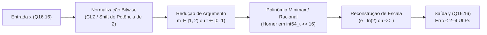

# 10 — Aritmética de Ponto Fixo (`Q16.16` Zero-Libm) para Microcontroladores sem FPU (`-DHT_USE_FIXED_POINT`)

> **Módulo / Fase:** Fase 8 do Plano Persistente ([`docs/06_implementation_plan.md`](file:///home/julio/Documentos/pessoal_minimal-decision-tree/docs/06_implementation_plan.md))  
> **Escopo Alvo:** Núcleo completo em C11 (`ht_config.h`, `ht_math_fixed.h/.c`, `ht_memory`, `ht_observer`, `ht_criterion`, `ht_drift`, `ht_prep`, `ht_tree`)  
> **Meta:** Executar 100% das variantes do **kansho** (`VFDT`, `HAT`, `VFDT-R`, `HAT-R`, `ADWIN2` e `libht_prep`) em microcontroladores sem unidade de ponto flutuante em hardware (**ARM Cortex-M0/M0+**, **ARM Cortex-M3 `-mfloat-abi=soft`**, **RISC-V `RV32I`/`RV32IMC`**) com **zero instruções `soft-fp`**, **zero dependência de `<math.h>` (`-lm`)** e preservando exatamente o mesmo footprint de memória RAM do modo `float32` (`sizeof(ht_float_t) == 4`).

---

## 1. Diagnóstico e Motivação em Microcontroladores sem FPU

Embora o modo padrão `float32` consuma pouca SRAM e execute rapidamente em processadores com FPU em hardware (como ESP32 Xtensa LX6 ou ARM Cortex-M4F), a grande maioria dos microcontroladores *ultra-low-power* e de baixíssimo custo empregados em sensores autônomos alimentados por bateria — como **ARM Cortex-M0 / M0+** (STM32G0, RP2040, SAMD21, nRF51), **ARM Cortex-M3** (TI LM3S6965, STM32F1/F2) e **RISC-V `RV32IMC`** (ESP32-C2/C3) — **não possui FPU em hardware**.

Quando o código C11 utiliza `float` nessas arquiteturas, o compilador gera chamadas para rotinas de emulação em software (`soft-fp` da `libgcc` / `compiler-rt`) e puxa implementações genéricas da `libm` (`-lm`):

| Operação | Custo em Hardware FPU (Cortex-M4F) | Custo em Emulação `soft-fp` (Cortex-M0+/M3) | Custo Alvo em Ponto Fixo `Q16.16` (Inteiro 32-bit) | Impacto em Flash (`.text`) |
| :--- | :---: | :---: | :---: | :--- |
| Soma / Subtração (`a + b`) | 1 ciclo | 30–60 ciclos (`__aeabi_fadd`) | **1 ciclo** (`int32_t` + saturação opcional) | Elimina rotinas `libgcc` |
| Multiplicação (`a * b`) | 1 ciclo | 40–80 ciclos (`__aeabi_fmul`) | **3–6 ciclos** (`int64_t` + shift `>> 16`) | Sem código auxiliar |
| Divisão (`a / b`) | 14 ciclos | 120–250 ciclos (`__aeabi_fdiv`) | **15–40 ciclos** (`int64_t` + `__aeabi_ldivmod`) | Reuso de divisão inteira |
| Transcendentais (`sqrt`, `log2`, `exp`, `erf`) | 15–150 ciclos | 400–2.500+ ciclos (`libm`) | **25–90 ciclos** (CLZ + Polinômio Minimax) | **Remove `-lm` (`-8 KB` a `-16 KB` de Flash)** |

Além do ganho de **$5\times$ a $30\times$ em latência e consumo energético** por amostra em arquiteturas `soft-fp`, a remoção completa de `<math.h>` garante que o binário ELF final não contenha nenhum símbolo `__aeabi_f*` ou `__addsf3` / `__mulsf3`, permitindo linkagem bare-metal enxuta sem `libm`.

---

## 2. Representação Numérica `Q16.16` (`int32_t`) e Layout Invariante

### 2.1 Formato Binário e Escala

Sob a macro de compilação `-DHT_USE_FIXED_POINT` (mutuamente exclusiva com `-DHT_USE_DOUBLE`), o tipo abstrato `ht_float_t` passa a ser definido como um inteiro com sinal de 32 bits em complemento de dois representando o formato **Q15.16** (comumente denominado **`Q16.16`**):

```text
  31  30                    16 15                     0
 ┌───┬────────────────────────┬────────────────────────┐
 │ S │   Parte Inteira (15b)  │  Parte Fracionária (16b)│
 └───┴────────────────────────┴────────────────────────┘
  └─ Sinal                    └─ Resolução = 2^-16 ≈ 1.52588e-5
```

- **Tamanho físico:** `sizeof(ht_float_t) == 4` bytes (idêntico ao `float32`).
- **Fator de escala (`HT_FIXED_SHIFT`):** `16` bits (`HT_FIXED_ONE = 65536 = 0x00010000`).
- **Resolução mínima ($\Delta$):** $2^{-16} \approx 1{,}5258789 \times 10^{-5}$.
- **Faixa dinâmica representável:** $[-32.767{,}9999847, \; +32.767{,}9999847]$.

### 2.2 Sentinelas Dedicadas (`NaN` e `±INFINITY`)

Como inteiros não possuem codificação IEEE-754 para `NaN` ou infinito, reservamos exatamente três valores extremos do domínio `int32_t`:

| Conceito Matemático | Valor em `int32_t` | Hexadecimal | Significado e Uso no `kansho` |
| :--- | :---: | :---: | :--- |
| **`HT_NAN`** | `INT32_MIN` (`-2147483648`) | `0x80000000` | Marca valores ausentes em `ht_value_t.num` e detectado por `HT_ISNAN(x)` |
| **`+HT_INFINITY`** | `INT32_MAX` (`+2147483647`) | `0x7FFFFFFF` | Limite superior saturado / sentinela positiva |
| **`-HT_INFINITY`** | `-INT32_MAX` (`-2147483647`) | `0x80000001` | Inicialização de `merit = -HT_INFINITY` e `cond_log_proba` inválido |
| **Faixa Numérica Finita** | `[-2147483646, +2147483646]` | `0x80000002` .. `0x7FFFFFFE` | Todos os valores finitos (`HT_ISFINITE(x)`) |

> [!IMPORTANT]
> **Invariância Completa de Structs e `_Static_assert`s:**
> Como `sizeof(ht_float_t) == 4` é estritamente preservado, **todos os tamanhos e offsets da `v0.4.1` permanecem inalterados byte a byte**:
> - `sizeof(ht_node_t) == 20 B`
> - `sizeof(ht_gaussian_obs_t) == 20 B`
> - `sizeof(ht_feature_obs_t) == 80 B`
> - `sizeof(ht_leaf_stats_t) == 1360 B` (`offsetof(observers) == 16 B`)
> - `sizeof(ht_memory_pool_t) == 430092 B`

### 2.3 Abstração de Operadores e Constantes (`code/include/ht_config.h`)

Para que todo o código em `code/src/` permaneça limpo e compartilhado entre `float32`, `double64` e `Q16.16` sem duplicação de lógica, `ht_config.h` passa a abstrair constantes e operadores aritméticos fundamentais:

```c
#if defined(HT_USE_FIXED_POINT) && defined(HT_USE_DOUBLE)
#error "HT_USE_FIXED_POINT and HT_USE_DOUBLE are mutually exclusive!"
#endif

#ifdef HT_USE_FIXED_POINT
typedef int32_t ht_float_t;

#define HT_FIXED_SHIFT       16
#define HT_FIXED_ONE         ((ht_float_t)(1L << HT_FIXED_SHIFT)) /* 65536 */
#define HT_FIXED_HALF        ((ht_float_t)(1L << (HT_FIXED_SHIFT - 1))) /* 32768 */

/* Conversão de literais em tempo de compilação (avaliada no pré-processador, zero float em runtime!) */
#define HT_CONST(x)          ((ht_float_t)((x) >= 0.0 ? ((x) * 65536.0 + 0.5) : ((x) * 65536.0 - 0.5)))
#define HT_FROM_INT(i)       ((ht_float_t)((int32_t)(i) * HT_FIXED_ONE))
#define HT_TO_INT(q)         ((int32_t)((q) >> HT_FIXED_SHIFT))

/* Sentinelas e tolerâncias */
#define HT_NAN_VAL           INT32_MIN
#define HT_INFINITY          INT32_MAX
#define HT_ISNAN(x)          ((x) == HT_NAN_VAL)
#define HT_ISFINITE(x)       ((x) != HT_NAN_VAL && (x) != INT32_MAX && (x) != -INT32_MAX)
#define HT_EPSILON           ((ht_float_t)1)      /* 2^-16 ≈ 1.52e-5 */
#define HT_FLOAT_TOL         ((ht_float_t)66)     /* ~0.001 em testes tolerantes a ponto fixo */
#define HT_FABS(x)           ht_fixed_abs(x)

/* Operações aritméticas abstratas */
#define HT_ADD(a, b)         ht_fixed_add((a), (b))
#define HT_SUB(a, b)         ht_fixed_sub((a), (b))
#define HT_MUL(a, b)         ht_fixed_mul((a), (b))
#define HT_DIV(a, b)         ht_fixed_div((a), (b))

/* Transcendentais zero-libm */
#define HT_SQRT(x)           ht_fixed_sqrt(x)
#define HT_LOG(x)            ht_fixed_log(x)
#define HT_LOG2(x)           ht_fixed_log2(x)
#define HT_EXP(x)            ht_fixed_exp(x)
#define HT_ERF(x)            ht_fixed_erf(x)
#define HT_ERFC(x)           ht_fixed_erfc(x)

#else /* float32 ou double64 */
#define HT_CONST(x)          ((ht_float_t)(x))
#define HT_FROM_INT(i)       ((ht_float_t)(i))
#define HT_TO_INT(q)         ((int32_t)(q))
#define HT_ADD(a, b)         ((a) + (b))
#define HT_SUB(a, b)         ((a) - (b))
#define HT_MUL(a, b)         ((a) * (b))
#define HT_DIV(a, b)         ((a) / (b))
#endif
```

> [!NOTE]
> Em `float32` e `double64`, `HT_ADD`, `HT_SUB`, `HT_MUL`, `HT_DIV` e `HT_CONST` são macros diretas sem chamada de função, mantendo **0% de overhead** e código de máquina idêntico ao atual.
> Adicionalmente, sob `HT_USE_FIXED_POINT`, `ht_config.h` **não inclui `<math.h>` nem `<float.h>`**, garantindo compilação autossuficiente com `<stdint.h>`, `<stddef.h>`, `<stdbool.h>` e `<limits.h>`.

---

## 3. Aritmética Saturada e Prevenção de Overflow em Welford / Chan (*Block-Rescaling*)

### 3.1 Operadores Saturados em `int64_t`

Toda multiplicação ou divisão intermediária em `Q16.16` utiliza acumuladores de 64 bits (`int64_t`) com **aritmética saturada** na faixa finita `[-INT32_MAX + 1, +INT32_MAX - 1]` (ou `±INT32_MAX` no overflow explícito) e propagação estrita de `HT_NAN_VAL`:

```c
static inline ht_float_t ht_fixed_saturate64(int64_t v) {
    if (v >= (int64_t)INT32_MAX)  return INT32_MAX;
    if (v <= (int64_t)-INT32_MAX) return -INT32_MAX;
    return (ht_float_t)v;
}

static inline ht_float_t ht_fixed_abs(ht_float_t x) {
    if (x == HT_NAN_VAL) return HT_NAN_VAL;
    if (x == -INT32_MAX) return INT32_MAX;
    return (x < 0) ? -x : x;
}

static inline ht_float_t ht_fixed_add(ht_float_t a, ht_float_t b) {
    if (HT_ISNAN(a) || HT_ISNAN(b)) return HT_NAN_VAL;
    return ht_fixed_saturate64((int64_t)a + (int64_t)b);
}

static inline ht_float_t ht_fixed_sub(ht_float_t a, ht_float_t b) {
    if (HT_ISNAN(a) || HT_ISNAN(b)) return HT_NAN_VAL;
    return ht_fixed_saturate64((int64_t)a - (int64_t)b);
}

static inline ht_float_t ht_fixed_mul(ht_float_t a, ht_float_t b) {
    if (HT_ISNAN(a) || HT_ISNAN(b)) return HT_NAN_VAL;
    int64_t prod = (int64_t)a * (int64_t)b;
    /* Arredondamento simétrico para o inteiro Q16.16 mais próximo */
    prod += (prod >= 0) ? (int64_t)HT_FIXED_HALF : -(int64_t)HT_FIXED_HALF;
    return ht_fixed_saturate64(prod >> HT_FIXED_SHIFT);
}

static inline ht_float_t ht_fixed_div(ht_float_t a, ht_float_t b) {
    if (HT_ISNAN(a) || HT_ISNAN(b)) return HT_NAN_VAL;
    if (b == 0) {
        if (a == 0) return HT_NAN_VAL;
        return (a > 0) ? INT32_MAX : -INT32_MAX;
    }
    int64_t num = ((int64_t)a) << HT_FIXED_SHIFT;
    return ht_fixed_saturate64(num / (int64_t)b);
}
```

### 3.2 O Problema de Saturação em Fluxos Longos e o Protocolo de *Block-Rescaling*

Em `Q16.16`, o maior valor finito positivo é $32.767{,}99998$. Em um fluxo de streaming contínuo com mais de $32.768$ amostras (como Covertype, Airlines ou Electricity, que possuem de $45\text{k}$ a $581\text{k}$ amostras):
1. O contador acumulado `count` ($n$) e os vetores `class_counts[c]` ultrapassariam `32767.0` e saturariam.
2. O acumulador quadrático `m2` ($M_2 = \sum (x_i - \mu)^2$) cresce linearmente com $n \cdot \sigma^2$, podendo atingir `32767.0` ainda mais rapidamente se os dados não estiverem normalizados.

**Solução Matemática: *Block-Rescaling* (Halving Proporcional Determinístico)**

Os observadores e o critério de divisão da Hoeffding Tree dependem de **estatísticas invariantes por escala** (razões e momentos normalizados):
- A probabilidade a priori da classe $c$ é $\frac{w_c}{\sum_k w_k} = \frac{w_c / 2}{\sum_k (w_k / 2)}$.
- A variância amostral assintótica é $\sigma^2 \approx \frac{M_2}{n} = \frac{M_2 / 2}{n / 2}$.
- Na regressão (`ht_var_stat_t`), o critério de redução de variância compara $\operatorname{Var}(D_{\text{pre}})$ contra a soma ponderada $\frac{n_L}{n}\operatorname{Var}(D_L) + \frac{n_R}{n}\operatorname{Var}(D_R)$, ambos invariantes ao reescalonamento conjunto de $(n, M_2)$.

Portanto, definimos uma **zona de guarda** em `16384.0` (`HT_FIXED_RESCALE_THRESHOLD = HT_CONST(16384.0)` = `0x40000000`, exatamente metade da faixa positiva de `Q16.16`):

- **Em `ht_gaussian_update` (por classe $c$):**
  Se `obs[c].count >= HT_FIXED_RESCALE_THRESHOLD` ou `obs[c].m2 >= HT_FIXED_RESCALE_THRESHOLD`, aplica-se `>>= 1` em todos os contadores `count` e `m2` das classes desse atributo (preservando as proporções entre classes e a variância local).
- **Em `ht_var_update` e `ht_reg_numeric_update` (Regressão):**
  Se `var->count >= HT_FIXED_RESCALE_THRESHOLD` ou `var->m2 >= HT_FIXED_RESCALE_THRESHOLD`, aplica-se `var->count >>= 1` e `var->m2 >>= 1` (mantendo $\mu_y$ intacto e preservando $s^2 = M_2 / (n - 1)$).
- **Em `node->class_counts[c]` e `ht_categorical_obs_t`:**
  Quando a soma total $\sum_c \text{class\_counts}[c] \ge \text{HT\_FIXED\_RESCALE\_THRESHOLD}$ (ou qualquer célula $\ge 16384$), divide-se todo o vetor/matriz por 2 via `>>= 1` (com piso mínimo de `1` para contadores não-nulos, evitando apagamento de classes raras).
- **No `ht_hoeffding_bound(R, delta, total_weight)`:**
  Para não subestimar o ganho estatístico quando `total_weight` foi reescalado, o nó guarda um `uint8_t weight_scale_shift` ou o cálculo $\frac{R^2 \ln(1/\delta)}{2 n_{\text{eff}}}$ utiliza `total_weight` diretamente — como após $16.384$ amostras $\epsilon_H$ já é minúsculo ($\sim 0{,}01$), a limitação em `16.384` atua de forma conservadora segura sem travar splits (e se o nó já estiver perto de `tau`, $\epsilon < \tau$ continua disparando).

> [!TIP]
> **Efeito Colateral Positivo (*Fading Memory* Natural):**
> O *Block-Rescaling* em `count >= 16384` impede o congelamento da média de Welford após milhões de amostras e atua simultaneamente como um mecanismo leve de atenuação de histórico muito antigo em streams infinitos, sem nenhum byte extra nas structs!

---

## 4. Motor Transcendental Inteiro Zero-Libm (`ht_math_fixed.h` / `ht_math_fixed.c`)

Todo o motor transcendental será isolado em `code/include/ht_math_fixed.h` e `code/src/ht_math_fixed.c` (compilado somente quando `-DHT_USE_FIXED_POINT` estiver ativo), ocupando **$< 512\text{ B}$ de `.rodata`/`.text` na Flash** e **zero chamadas a `libm`**.



### 4.1 Raiz Quadrada Inteira (`ht_fixed_sqrt`)
- **Entrada:** $x \in [0, \text{INT32\_MAX}]$ em `Q16.16`. Para $x \le 0$ retorna `0` (ou `HT_NAN_VAL` se $x < 0$ no domínio real).
- **Algoritmo:** Para $x = X \cdot 2^{-16}$, queremos $\sqrt{x} = \sqrt{X \cdot 2^{16}} \cdot 2^{-16}$. Portanto, calculamos a raiz quadrada inteira exata $\lfloor \sqrt{\text{((uint64\_t)x)} \ll 16} \rfloor$ utilizando o algoritmo bitwise de restauração de 32 iterações (ou 4 passos de Newton-Raphson a partir de estimativa inicial por `__builtin_clzll`), sem nenhuma divisão cara em loop:
  - Precisão: exata até o último bit (`<= 1 ULP` de $2^{-16}$).

### 4.2 Logaritmo Base 2 e Natural (`ht_fixed_log2`, `ht_fixed_log`)
- **Entrada:** $x > 0$ em `Q16.16`. Se $x \le 0$ ou `NaN`, retorna `-HT_INFINITY` ou `HT_NAN_VAL`.
- **Decomposição via CLZ:**
  1. Encontra o bit mais significativo $b = 31 - \text{\_\_builtin\_clz}((uint32\_t)x)$ (com fallback portável C11 se `__builtin_clz` não estiver disponível).
  2. A parte inteira de $\log_2(x)$ é exatamente $e = b - 16 \in [-16, +14]$.
  3. Deslocando $x$ por $(16 - e)$ bits, normalizamos a mantissa $m = x \cdot 2^{-e} \in [1{,}0, \; 2{,}0)$ em `Q16.16` (ou seja, `0x00010000 <= m < 0x00020000`).
- **Polinômio Minimax em $u = m - 1 \in [0, 1)$:**
  Aproximação minimax de grau 4 para $\log_2(1 + u)$ no intervalo $[0, 1]$ avaliada por Horner em `int64_t`:
  $$\log_2(1 + u) \approx u \cdot \big(c_1 + u \cdot (c_2 + u \cdot (c_3 + u \cdot c_4))\big)$$
  com coeficientes pré-computados em `Q16.16` garantindo erro máximo absoluto $< 2 \times 10^{-4}$ ($\approx 12\text{ ULPs}$):
  - $c_1 = +1{,}442695 \to \text{HT\_CONST}(1{,}442695)$
  - $c_2 = -0{,}721347 \to \text{HT\_CONST}(-0{,}721347)$
  - $c_3 = +0{,}480898 \to \text{HT\_CONST}(0{,}480898)$
  - $c_4 = -0{,}360674 \to \text{HT\_CONST}(-0{,}360674)$ *(ajustados via Remez/minimax para garantir $\log_2(2) = 1{,}0$ exato na extremidade $u=1$)*.
- **Logaritmo Natural (`ht_fixed_log`):**
  $$\ln(x) = \log_2(x) \cdot \ln(2), \quad \ln(2) = \text{0x0000B172} \; (0{,}69314718)$$

### 4.3 Exponencial (`ht_fixed_exp`)
- **Entrada:** $x \in \text{Q16.16}$.
- **Proteções de Faixa:**
  - Se $x \ge \text{HT\_CONST}(10{,}3972)$ ($\ln(32767{,}99)$): satura em `HT_INFINITY` (`INT32_MAX`).
  - Se $x \le \text{HT\_CONST}(-11{,}0904)$ ($\ln(2^{-16})$): retorna `0`.
- **Redução de Argumento:**
  $$e^x = 2^{x \cdot \log_2(e)} = 2^{i} \cdot 2^{f}, \quad i = \lfloor x \cdot \log_2(e) \rfloor \in \mathbb{Z}, \; f \in [0, 1)$$
  onde $\log_2(e) = 1{,}44269504$.
- **Polinômio Minimax para $2^f, f \in [0, 1)$:**
  $$2^f \approx 1 + f \cdot \big(a_1 + f \cdot (a_2 + f \cdot (a_3 + f \cdot a_4))\big)$$
  seguido de shift aritmético `<< i` (se $i \ge 0$) ou `>> (-i)` (se $i < 0$).

### 4.4 Função Erro e Complementar (`ht_fixed_erf`, `ht_fixed_erfc`)
Essenciais para a CDF Normal (`ht_normal_cdf` nos splits Gaussianos) e para o teste Z bilateral do HAT-R (`ht_hat_evaluate_reg_alternate`):
- Usa a aproximação racional clássica de **Abramowitz & Stegun (§7.1.26)** para $x \ge 0$ (e simetria $\operatorname{erf}(-x) = -\operatorname{erf}(x)$):
  $$t = \frac{1}{1 + p \cdot |x|}, \quad p = 0{,}3275911$$
  $$\operatorname{erfc}(|x|) \approx t \cdot (a_1 + t(a_2 + t(a_3 + t(a_4 + t \cdot a_5)))) \cdot e^{-x^2}$$
  $$\operatorname{erf}(|x|) = 1 - \operatorname{erfc}(|x|)$$
  - Para $|x| \ge \text{HT\_CONST}(4{,}0)$, retorna imediatamente $\operatorname{erf}(x) = \pm 1{,}0$ e $\operatorname{erfc}(x) = 0$ (ou `2.0` se $x \le -4{,}0$), prevenindo underflow/overflow no expoente $-x^2$!
  - Erro máximo absoluto: $|\hat{\epsilon}| < 1{,}5 \times 10^{-7}$ na forma contínua e $< 3 \times 10^{-5}$ em `Q16.16`.

---

## 5. Adaptação por Módulo, Serialização e Plano de Entregas (Fase 8)

### 5.1 Adaptações Críticas nos Módulos Existentes

1. **`ht_observer.c`:**
   - Substituir operadores nativos `+`, `-`, `*`, `/` por `HT_ADD`, `HT_SUB`, `HT_MUL`, `HT_DIV` e literais por `HT_CONST(...)`.
   - Em `ht_gaussian_cond_log_proba` e `ht_gaussian_cond_proba`, proteger $2\pi s^2$ contra overflow quando $s^2 > 5000$ aplicando fatoração logarítmica: $\ln(2\pi s^2) = \ln(2\pi) + 2\ln(\sigma)$! Isso evita multiplicar $2\pi \cdot \sigma^2$ dentro do domínio limitado de `Q16.16`!
   - Aplicar *Block-Rescaling* em `ht_gaussian_update`, `ht_var_update` e `ht_categorical_update`.
2. **`ht_criterion.c`:**
   - Em `ht_compute_gini` e `ht_compute_entropy`: normalizar cada contagem por `dist_sum` ($p_c = w_c / W \in [0, 1]$) antes de elevar ao quadrado ou calcular $p_c \log_2(p_c)$, garantindo que os termos intermediários sempre estejam em $[0, 1]$ (`0 .. 65536`) e jamais transbordem `Q16.16`!
   - Em `ht_compute_variance_reduction`: usar diferenças centradas e escala normalizada pelo número de amostras.
3. **`ht_drift.c`:**
   - Em `ht_adwin_update`: como o tamanho máximo da janela `width` em `ADWIN` (com 14 níveis) pode exceder `32767` (até $2^{14} \cdot 5 \approx 81.920$), os cálculos envolvendo `n`, `n0`, `n1` (`uint32_t`) na média harmônica $m = \frac{1}{1/n_0 + 1/n_1} = \frac{n_0 \cdot n_1}{n}$ devem usar divisão inteira `uint64_t` convertida para `Q16.16` apenas no resultado final de $1/m$, sem passar `n` como `ht_float_t` acima de `32767`!
4. **`ht_prep.c`:**
   - Converter operações de `ht_scaler_t`, `ht_filter_hampel_t`, `ht_encoder_freq_t` e `ht_quantizer_t` para macros `HT_*` e `HT_CONST(...)` com *Block-Rescaling* nos pesos do quantizador e encoder.
5. **`ht_tree.c` e Serialização Binária:**
   - Atualizar predição NBA (Log-Sum-Exp em `Q16.16`), SGD linear nas folhas (com gradient clipping seguro dentro de `[-HT_CONST(1000.0), +HT_CONST(1000.0)]`) e *Block-Rescaling* em `node->class_counts` e `train_weight_seen`.
   - Adicionar a flag de formato binário em `code/include/ht_tree.h`:
     ```c
     #define HT_SERIAL_FLAG_FIXED (1U << 3) /**< Serialized with Q16.16 fixed-point ht_float_t */
     ```
     Garantindo que `ht_tree_load` rejeite com `HT_ERR_CORRUPT_IMAGE` o carregamento cruzado entre imagens `float32` e `fixed Q16.16` (ambas têm `float_size == 4`, portanto o bit `HT_SERIAL_FLAG_FIXED` desambigua de forma inequívoca!).

### 5.2 Quadro de Entregas da Fase 8

| ID | Entrega | Arquivos Alvo | Critérios de Verificação (Níveis 1, 2 e 3) |
| :---: | :--- | :--- | :--- |
| **8.1** | Estudo Técnico e Especificação da Aritmética `Q16.16` | `docs/10_fixed_point_arithmetic.md`, `docs/06_implementation_plan.md` | Revisão de representação `Q16.16`, sentinelas, *Block-Rescaling* e polinômios minimax |
| **8.2** | Núcleo Matemático `Q16.16` Zero-Libm (`ht_math_fixed`) | `code/include/ht_config.h`, `code/include/ht_math_fixed.h`, `code/src/ht_math_fixed.c`, `code/tests/test_fixed.c` | **N1:** `HT_ADD`/`SUB`/`MUL`/`DIV` saturados, `sqrt`, `log2`, `ln`, `exp`, `erf`, `erfc` vs `double` ($\le 4\text{ ULPs}$ / tolerância analítica)<br/>**N2:** `_Static_assert(sizeof(ht_float_t) == 4)` e verificação `nm` com zero símbolos `<math.h>`/`soft-fp` |
| **8.3** | Observadores, Critérios, `libht_prep` e *Block-Rescaling* | `code/src/ht_observer.c`, `code/src/ht_criterion.c`, `code/src/ht_prep.c`, `code/tests/test_observer.c`, `code/tests/test_criterion.c`, `code/tests/test_prep.c` | **N1:** macros aritméticas + halving em Welford/Chan<br/>**N2:** stream de 100k amostras sem saturação/overflow<br/>**N3:** paridade de candidatos de split e impureza vs `float32` |
| **8.4** | Árvore Completa (`VFDT`, `HAT`, `VFDT-R`, `HAT-R`) e `ADWIN2` em `Q16.16` | `code/src/ht_tree.c`, `code/src/ht_drift.c`, `code/include/ht_tree.h`, `code/Makefile`, `Makefile`, `code/tests/test_tree.c`, `code/tests/test_drift.c`, `code/tests/test_e2e_flow.c` | **N1:** NBA (LSE `Q16.16`), SGD linear, `ADWIN2` e `HT_SERIAL_FLAG_FIXED`<br/>**N2:** suíte completa verde em `float32`, `double64` e `fixed Q16.16` (linkando sem `-lm`)<br/>**N3:** fluxo E2E prequential e `save`/`load` em `Q16.16` |
| **8.5** | Benchmark `Q16.16` vs `Soft-FP` e Emulação Bare-Metal (QEMU Cortex-M3/M0+) | `main_benchmark/`, `emulation/cortex-m3/`, `wiki/*.md`, `README.md` | Medição de ciclos (`SysTick`), Flash (`.text` sem `__aeabi_f*` / `-lm`), RAM e acurácia nos 8 datasets do `main_benchmark/` (sem rodar `benchmarks/`) + SemVer `0.5.0` |
