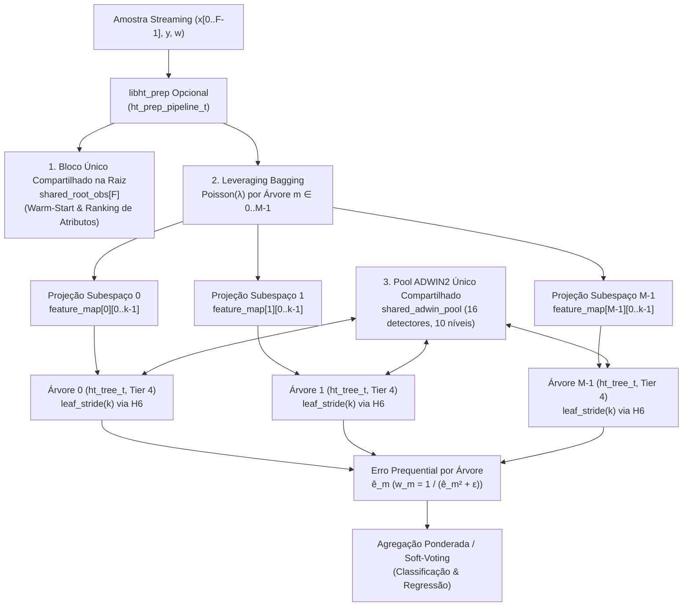

# 11 — Micro-Ensembles Embarcados com Observadores Compartilhados e Subespaços (`< 100 KB` SRAM)

> **Módulo / Fase:** Fase 9 do Plano Persistente ([`docs/06_implementation_plan.md`](file:///home/julio/Documentos/pessoal_minimal-decision-tree/docs/06_implementation_plan.md))  
> **Escopo Alvo:** Novo módulo de comitê estático em C11 (`code/include/ht_ensemble.h`, `code/src/ht_ensemble.c`, `code/tests/test_ensemble.c`)  
> **Meta:** Elevar expressivamente a acurácia / Macro F1 em alta dimensionalidade multiclasse (ex: *Forest Covertype*) e o $R^2$ em regressões não-lineares mantendo **100% de alocação estática zero-heap** e orçamento total estritamente **$\le 100\text{ KB}$ de SRAM**.

---

## 1. Motivação Teórica e o Gargalo de Árvore Única

Conforme documentado nos relatórios experimentais do **Main Benchmark** ([`main_benchmark/main_benchmark_report.md`](file:///home/julio/Documentos/pessoal_minimal-decision-tree/main_benchmark/main_benchmark_report.md)), uma única Hoeffding Tree apresenta duas limitações estruturais clássicas em cenários de alta complexidade tabular:

1. **Estagnação por Conservadorismo em Alta Dimensionalidade e Muitas Classes (*Forest Covertype*, $F=54, C=7$):** Com muitas classes, a faixa teórica de mérito $R = \log_2(7) \approx 2{,}81$ infla o Limite de Hoeffding $\epsilon_H$, e os candidatos competidores frequentemente possuem ganhos próximos, exigindo milhares de amostras na raiz antes do primeiro split.
2. **Viés e Variância em Regressões Não-Lineares (*Friedman #1*, *Bikes*, *Appliances Energy*):** Árvores únicas muito rasas (ex: Tier 4 com 4 folhas ativas) têm capacidade limitada para particionar superfícies suaves sem aumentar o número de nós além do orçamento de microcontroladores compactos.

Em aprendizado em streaming desktop, a solução canônica é o **Adaptive Random Forest (ARF)** ou **Leveraging Bagging**. Contudo, uma ARF ingênua que instancie $M = 10$ árvores completas independentes com $F=54$ atributos e $C=8$ classes multiplicaria o consumo de `stats_pool` e `ht_adwin_pool_t` por $10\times$, consumindo **$350\text{ KB}$ a $> 1\text{ MB}$ de SRAM** — inviável para microcontroladores de médio/pequeno porte (como STM32F4, nRF52840, RP2040 ou ESP32).

A **Arquitetura Híbrida Dual** do `kansho` resolve esse dilema combinando **projeção de subespaços sobre o `leaf_stride` dinâmico (`v0.4.0`)**, **compartilhamento de observadores globais na raiz** e **reuso de um único pool ADWIN**.

---

## 2. Arquitetura Híbrida Dual (`ht_ensemble_t`)

O comitê `ht_ensemble_t` organiza $M$ árvores leves ($M \le \text{HT\_ENSEMBLE\_MAX\_TREES}$, padrão `5`) operando sob três pilares de economia de SRAM:



### Pilar 1: Projeção de Subespaços (`feature_map[M][k]`) com `leaf_stride` Dinâmico
Em vez de cada uma das $M$ árvores alocar observadores para todos os $F$ atributos do dataset (ex: $F = 54$ no Covertype), cada árvore $m$ enxerga um **subespaço densamente empacotado de dimensão $k \le \text{HT\_ENSEMBLE\_MAX\_SUBSPACE}$** (padrão `16`):
- O array `uint8_t feature_map[HT_ENSEMBLE_MAX_TREES][HT_ENSEMBLE_MAX_SUBSPACE]` mapeia o índice local `j` ($0 \le j < k$) da árvore $m$ para o índice global `g = feature_map[m][j]` ($0 \le g < F$) do vetor de entrada `x`.
- Ao inicializar cada árvore $m$, `ht_tree_init` configura `n_features = k`, fazendo com que `ht_memory_init_stride(&ens->trees[m].memory, k, task_type)` calcule um **`leaf_stride` reduzido proporcional a $k/F$**!
  - Exemplo no *Forest Covertype* ($F = 54, k = 16$): cada folha ativa cai de **$8.656\text{ B}$ para $2.576\text{ B}$** (**$-70{,}2\%$ por folha!**).
- **Garantia de Cobertura Global:** Na inicialização, o algoritmo de sorteio (*stratified/round-robin Fisher-Yates*) garante que cada atributo global $g \in \{0 \dots F-1\}$ apareça em pelo menos uma árvore sempre que $M \cdot k \ge F$, evitando que atributos informativos fiquem órfãos.

### Pilar 2: Bloco Único de Observadores Globais Compartilhados na Raiz (`shared_root_obs[F]`)
Um único vetor `ht_feature_obs_t shared_root_obs[HT_MAX_FEATURES]` e um tracker global `shared_pre_dist` (classificação) / `shared_pre_var` (regressão) residem no nível de `ht_ensemble_t` e são atualizados **uma única vez por amostra**:
1. **Ranking Global de Mérito (*Feature Importance* Online):** Periodicamente (a cada `grace_period` amostras), o ensemble avalia o ganho de impureza/redução de variância de cada atributo em `shared_root_obs[0..F-1]`, mantendo um escore incremental `feat_importance[F]`.
2. **Renovação Guiada de Subespaços em Reset / Drift:** Quando uma árvore membro sofre substituição completa ou degradação persistente (erro prequential relativo acima de limiar), seu `feature_map[m]` é re-sorteado dando maior probabilidade aos atributos com maior `feat_importance[g]` (inspirado em *Feature Importance Selection* para ensembles embarcados), sem desperdiçar RAM replicando todos os $F$ observadores dentro das folhas das $M$ árvores!
3. ***Warm-Start* na Raiz:** Ao inicializar ou resetar uma árvore $m$, suas folhas iniciais podem copiar diretamente os $k$ observadores correspondentes de `shared_root_obs[feature_map[m][j]]`, evitando um período frio de coleta antes do primeiro split.

### Pilar 3: Pool `ADWIN2` Único Compartilhado (`shared_adwin_pool`)
Em vez de alocar $M$ pools independentes (`5 * 17,4 KB = 87 KB`), todas as árvores do comitê apontam (`ht_tree_set_adwin_pool`) para um **único `ht_adwin_pool_t shared_adwin_pool`** com perfil compacto (`HT_ADWIN_LEVELS=10`, `HT_MAX_ADWIN_DETECTORS=16`, totalizando apenas $\approx 8{,}7\text{ KB}$).

---

## 3. Orçamento Analítico de Memória (`< 100 KB` SRAM) e `_Static_assert`

O dimensionamento abaixo comprova matematicamente que o comitê completo cabe abaixo do teto de **$100\text{ KB}$ de SRAM** mesmo no perfil mais pesado (**5 árvores, Tier 4, suporte universal até $F=64$ features globais, $C=8$ classes, subespaço $k=16$**):

| Componente dentro de `ht_ensemble_t` | Fórmula / Configuração | Tamanho (`float32` / `Q16.16`) | Participação |
| :--- | :--- | :---: | :---: |
| **5 Árvores (`trees[5]`, Tier 4, $k=16$)** | `4` folhas (`2.576 B` classif / `2.640 B` reg) + `64` nós (`36 B`) + `node_drift` (`16 B`) + params | **$67{,}5\text{ KB}$** (Classif)<br/>**$75{,}2\text{ KB}$** (Unificado) | $76{,}7\%$–$79{,}6\%$ |
| **Observadores Globais na Raiz (`shared_root_obs[64]`)** | $64 \times 160\text{ B}$ (`ht_feature_obs_t` p/ $C=8$) | **$10{,}00\text{ KB}$** ($10.240\text{ B}$) | $10{,}6\%$–$11{,}4\%$ |
| **Pool ADWIN Compartilhado (`shared_adwin_pool`)** | `16` detectores $\times 556\text{ B}$ (`HT_ADWIN_LEVELS=10`) | **$8{,}73\text{ KB}$** ($8.936\text{ B}$) | $9{,}2\%$–$9{,}9\%$ |
| **Metadados (`feature_map`, erros, `rng_state`)** | `5*16 B` + `64*4 B` + contadores | **$0{,}45\text{ KB}$** ($\approx 460\text{ B}$) | $< 0{,}5\%$ |
| **Total Geral `sizeof(ht_ensemble_t)`** | **Meta Estrita: `<= 100 * 1024` ($102.400\text{ B}$)** | **$\approx 86{,}7\text{ KB}$** (Classif)<br/>**$\approx 94{,}4\text{ KB}$** (Unificado) | **100%** |

> [!NOTE]
> **Perfis Compactos para MCUs Menores (32–64 KB SRAM):**
> No perfil padrão de 16 features globais e 4 classes ($k=8, M=3$ ou $M=5$ árvores Tier 4, `10` detectores ADWIN), `sizeof(ht_ensemble_t)` reduz-se para apenas **$\approx 19{,}8\text{ KB}$ a $26{,}5\text{ KB}$ de SRAM**!
>
> **Nota de Layout C11:** Para evitar que `trees[M]` reserve `HT_MAX_FEATURES` (64) dentro do `stats_storage` de cada árvore quando cada árvore usa apenas `k = HT_ENSEMBLE_MAX_SUBSPACE` (16), define-se uma macro dedicada `HT_ENSEMBLE_STATS_STORAGE_BYTES` (ou parametriza-se `HT_STATS_STORAGE_BYTES` no perfil de compilação do ensemble) e valida-se com:
> ```c
> _Static_assert(sizeof(ht_ensemble_t) <= (100U * 1024U),
>                "ht_ensemble_t exceeded 100 KB SRAM budget!");
> ```

---

## 4. Diversificação (*Leveraging Bagging*) e Votação Ponderada

### 4.1 Amostragem Online $\text{Poisson}(\lambda)$ (Algoritmo de Knuth)

Para reproduzir o comportamento do *Online Bagging* ($\lambda = 1{,}0$) e do *Leveraging Bagging* / *ARF* ($\lambda = 6{,}0$, que multiplica a diversidade e acelera a coleta estatística para destravar splits no *Forest Covertype*):
1. A cada nova amostra $(\mathbf{x}, y, w)$ recebida por `ht_ensemble_learn_one`, para cada árvore $m \in \{0 \dots M-1\}$:
   - Sorteia-se $k_m \sim \text{Poisson}(\lambda)$ pelo algoritmo exato de Knuth usando `ens->rng_state` (Xorshift32 determinístico):
     ```c
     /* exp(-lambda) pré-calculado na inicialização do ensemble (ht_ensemble_init) */
     uint16_t k_poisson = 0;
     ht_float_t p = HT_CONST(1.0);
     do {
         k_poisson++;
         p = HT_MUL(p, ht_ensemble_rand_uniform(&ens->rng_state));
     } while (p > ens->exp_neg_lambda && k_poisson < 20U);
     k_poisson--;
     ```
   - Se $k_m > 0$, projeta-se `x` para o subespaço `x_sub[0..k-1]` onde `x_sub[j] = x[ens->feature_map[m][j]]` e invoca-se `ht_tree_learn_one(&ens->trees[m], x_sub, y, HT_MUL(w, HT_FROM_INT(k_m)))` (multiplicando o peso pela contagem de Poisson em uma única chamada $O(1)$ em vez de repetir o loop $k_m$ vezes!).

### 4.2 Rastreamento Prequential de Erro e Estratégias de Votação

Cada árvore $m$ mantém um estimador exponencial móvel (*faded error*) $\hat{e}_m$ atualizado no passo **Test** do ciclo *Test-Then-Train* (antes do treino da amostra):
- **Em Classificação:** $e_{t, m} = \mathbb{I}(\hat{y}_{t, m} \ne y_t) \in \{0, 1\}$, atualizado via $\hat{e}_m \leftarrow \alpha_{\text{err}} \hat{e}_m + (1 - \alpha_{\text{err}}) e_{t, m}$ (com $\alpha_{\text{err}} = 0{,}99$ padrão).
- **Em Regressão Contínua:** $e_{t, m} = \frac{|y_t - \hat{y}_{t, m}|}{\max(\sigma_y, \, \epsilon)}$ ou erro quadrático exponencial $\text{fMSE}_m \leftarrow \alpha_{\text{err}} \text{fMSE}_m + (1 - \alpha_{\text{err}}) (y_t - \hat{y}_{t, m})^2$.

Modos suportados em `ht_ensemble_voting_t`:
1. **`HT_ENSEMBLE_VOTE_UNIFORM` (Soft-Voting / Média Simples):**
   $$\bar{P}(c \mid \mathbf{x}) = \frac{1}{M}\sum_{m=0}^{M-1} P_m(c \mid \mathbf{x}_{\text{sub}, m}), \qquad \hat{y}(\mathbf{x}) = \frac{1}{M}\sum_{m=0}^{M-1} \hat{y}_m(\mathbf{x}_{\text{sub}, m})$$
2. **`HT_ENSEMBLE_VOTE_WEIGHTED` (Ponderado pelo Inverso do Erro Quadrático — Padrão):**
   $$w_m = \frac{1}{\hat{e}_m^2 + \varepsilon_{\text{vote}}} \quad (\text{Classif}) \quad \text{ou} \quad w_m = \frac{1}{\text{fMSE}_m + \varepsilon_{\text{vote}}} \quad (\text{Reg})$$
   $$\bar{P}(c \mid \mathbf{x}) = \frac{\sum_{m=0}^{M-1} w_m \, P_m(c \mid \mathbf{x}_{\text{sub}, m})}{\sum_{m=0}^{M-1} w_m}, \qquad \hat{y}(\mathbf{x}) = \frac{\sum_{m=0}^{M-1} w_m \, \hat{y}_m(\mathbf{x}_{\text{sub}, m})}{\sum_{m=0}^{M-1} w_m}$$

---

## 5. Contratos de API C11 (`code/include/ht_ensemble.h`) e Mapa de Entregas

### 5.1 Macros de Compilação e Assinaturas Públicas

```c
#ifndef HT_ENSEMBLE_MAX_TREES
#define HT_ENSEMBLE_MAX_TREES    5U
#endif

#ifndef HT_ENSEMBLE_MAX_SUBSPACE
#define HT_ENSEMBLE_MAX_SUBSPACE 16U
#endif

typedef enum {
    HT_ENSEMBLE_VOTE_WEIGHTED = 0, /**< 1 / (error_m^2 + eps) prequential weighting */
    HT_ENSEMBLE_VOTE_UNIFORM  = 1  /**< Equal weights 1 / M soft-voting */
} ht_ensemble_voting_t;

typedef struct {
    ht_config_params_t   base_params;     /**< Base hyperparameters per tree (n_features = global F) */
    uint8_t              n_trees;         /**< Number of trees M (1 .. HT_ENSEMBLE_MAX_TREES) */
    uint8_t              subspace_size;   /**< Subspace k per tree (1 .. min(F, HT_ENSEMBLE_MAX_SUBSPACE)) */
    ht_ensemble_voting_t voting;          /**< Voting strategy */
    ht_float_t           poisson_lambda;  /**< Bagging lambda (6.0 = Leveraging Bagging, 1.0 = Online Bagging, 0.0 = no bagging) */
    ht_float_t           error_decay;     /**< Exponential decay alpha for prequential tree error (default: 0.99) */
    bool                 enable_warm_start;/**< Copy shared root observers into newly initialized/reset trees */
    uint32_t             seed;            /**< Deterministic PRNG seed */
} ht_ensemble_params_t;

typedef struct {
    ht_tree_t               trees[HT_ENSEMBLE_MAX_TREES];
    ht_adwin_pool_t         shared_adwin_pool;
    ht_feature_obs_t        shared_root_obs[HT_MAX_FEATURES];
    union {
        ht_float_t          shared_class_counts[HT_MAX_CLASSES];
        ht_var_stat_t       shared_reg_stats;
    };
    ht_float_t              feat_importance[HT_MAX_FEATURES];
    ht_float_t              tree_faded_error[HT_ENSEMBLE_MAX_TREES];
    ht_float_t              exp_neg_lambda;
    ht_ensemble_params_t    params;
    struct ht_prep_pipeline *prep_pipeline;
    uint32_t                rng_state;
    uint32_t                samples_seen;
    uint8_t                 feature_map[HT_ENSEMBLE_MAX_TREES][HT_ENSEMBLE_MAX_SUBSPACE];
} ht_ensemble_t;

/* API Pública de ht_ensemble.h */
void        ht_default_ensemble_params(ht_ensemble_params_t *params, uint8_t n_features, uint8_t n_classes);
void        ht_default_ensemble_reg_params(ht_ensemble_params_t *params, uint8_t n_features);
ht_status_t ht_ensemble_init(ht_ensemble_t *ens, const ht_ensemble_params_t *params);
ht_status_t ht_ensemble_set_prep_pipeline(ht_ensemble_t *ens, struct ht_prep_pipeline *prep);

ht_status_t ht_ensemble_predict_proba(const ht_ensemble_t *ens, const ht_value_t x[HT_MAX_FEATURES], ht_float_t proba_out[HT_MAX_CLASSES]);
uint8_t     ht_ensemble_predict(const ht_ensemble_t *ens, const ht_value_t x[HT_MAX_FEATURES]);
ht_status_t ht_ensemble_learn_one(ht_ensemble_t *ens, const ht_value_t x[HT_MAX_FEATURES], uint8_t y, ht_float_t weight);

ht_float_t  ht_ensemble_predict_reg(const ht_ensemble_t *ens, const ht_value_t x[HT_MAX_FEATURES]);
ht_status_t ht_ensemble_learn_one_reg(ht_ensemble_t *ens, const ht_value_t x[HT_MAX_FEATURES], ht_float_t y, ht_float_t weight);

ht_status_t ht_ensemble_save(const ht_ensemble_t *ens, void *buffer, size_t buffer_cap, size_t *out_bytes_written, bool include_training_stats);
ht_status_t ht_ensemble_load(ht_ensemble_t *ens, const void *buffer, size_t buffer_len);
size_t      ht_ensemble_bytes_used(const ht_ensemble_t *ens);
```

### 5.2 Quadro de Entregas da Fase 9

| ID | Entrega | Arquivos Alvo | Critérios de Verificação (Níveis 1, 2 e 3) |
| :---: | :--- | :--- | :--- |
| **9.1** | Estudo Técnico e Arquitetura de Micro-Ensembles (`< 100 KB`) | `docs/11_embedded_micro_ensembles.md`, `docs/06_implementation_plan.md` | Definição da Arquitetura Híbrida Dual, orçamento $< 100\text{ KB}$ e contratos `ht_ensemble.h` |
| **9.2** | Estruturas `ht_ensemble_t`, Subespaços e Observador Compartilhado | `code/include/ht_config.h`, `code/include/ht_ensemble.h`, `code/src/ht_ensemble.c`, `code/tests/test_ensemble.c` | **N1:** sorteio determinístico de subespaços `feature_map[M][k]` com garantia de cobertura, `leaf_stride` reduzido e atualização de `shared_root_obs`<br/>**N2:** `_Static_assert(sizeof(ht_ensemble_t) <= 100 * 1024)` e *Warm-Start* na raiz |
| **9.3** | Treino *Leveraging Bagging* ($\text{Poisson}(\lambda)$), Votação e Persistência | `code/src/ht_ensemble.c`, `code/Makefile`, `code/tests/test_ensemble.c`, `code/tests/test_e2e_flow.c` | **N1:** gerador $\text{Poisson}(\lambda)$, atualização de $\hat{e}_m$ e votação $1/(\hat{e}_m^2 + \epsilon)$ / Uniforme (Classif + Reg)<br/>**N2:** adaptação com `shared_adwin_pool` e renovação guiada por `feat_importance`<br/>**N3:** fluxo E2E completo (incluindo modo `-DHT_USE_FIXED_POINT`) e `ht_ensemble_save`/`load` |
| **9.4** | Benchmark de Micro-Ensembles nos 8 Datasets e Emulação QEMU | `benchmarks/`, `main_benchmark/`, `emulation/`, `wiki/*.md`, `README.md` | Ganho experimental de Macro F1 no *Forest Covertype* e $R^2$ nas regressões com SRAM $< 100\text{ KB}$ e zero heap + SemVer `0.6.0` |
