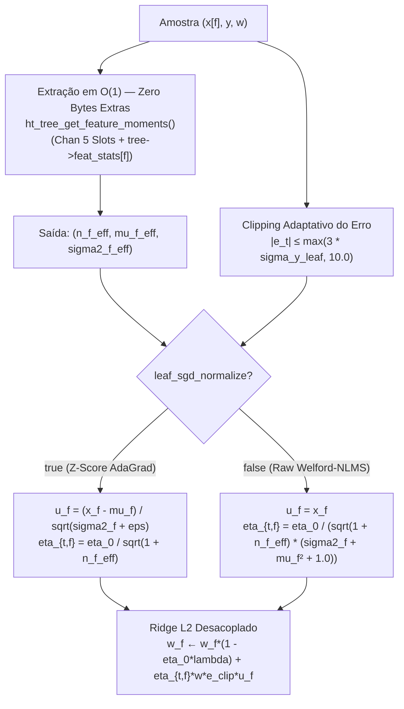

# 12 — Taxa de Aprendizado Adaptativa por Atributo (Welford-Adaptive SGD / AdaGrad Embarcado)

> **Módulo / Fase:** Fase 10 do Plano Persistente ([`docs/06_implementation_plan.md`](file:///home/julio/Documentos/pessoal_minimal-decision-tree/docs/06_implementation_plan.md))  
> **Escopo Alvo:** Regressor linear nas folhas de regressão contínua (`code/include/ht_tree.h`, `code/src/ht_tree.c`, `code/tests/test_tree.c`, `code/tests/test_e2e_flow.c`)  
> **Meta:** Introduzir pré-condicionamento diagonal e decaimento adaptativo individual por atributo (`HT_SGD_WELFORD_ADAGRAD`) no SGD das folhas (`HT_LEAF_MODEL` e `HT_LEAF_ADAPTIVE`) com **0 bytes adicionais em `ht_leaf_stats_t`** (`1.360 B` em `float32` / `Q16.16`), desacoplando a regularização Ridge ($\ell_2$) do agendamento da taxa de aprendizado e estabilizando fluxos multiescala em regressão contínua.

---

## 1. Diagnóstico e Limitações do SGD Escalar Atual (`ht_tree.c`)

Na implementação atual do regressor linear nas folhas ([`code/src/ht_tree.c`](file:///home/julio/Documentos/pessoal_minimal-decision-tree/code/src/ht_tree.c#L1883-L1909)), todas as coordenadas $f \in \{0 \dots F-1\}$ compartilham o mesmo escalar de taxa de aprendizado:

$$\eta = \frac{\eta_0}{1 + \lambda_{\text{reg}} \cdot n}$$

onde $n = \text{leaf}\to\text{reg\_stats.count}$ é a contagem total de amostras da folha e $\lambda_{\text{reg}} = \text{l2\_regularization}$. Esse esquema apresenta **quatro gargalos estruturais** observados em fluxos reais como *Bikes* e *NYC Taxi*:

1. **Decaimento Uniforme Ignorando Esparsidade e `NaN`:** Um atributo raro ou frequentemente ausente (`NaN`) sofre o mesmo decaimento $\frac{1}{1 + \lambda n}$ que um atributo denso, congelando seu peso $w_f$ antes de convergir se o atributo só aparecer tardiamente no fluxo.
2. **Acoplamento Indesejado entre $\ell_2$ e Learning Rate Schedule:** Aumentar `l2_regularization` para conter *overfitting* dos pesos reduz simultaneamente o denominador de $\eta$, desacelerando o aprendizado de forma agressiva; inversamente, zerar $\lambda_{\text{reg}}$ desativa por completo qualquer decaimento temporal de $\eta$.
3. **Deslocamento de Coordenadas (*Coordinate Drift*) em `leaf_sgd_normalize`:** Quando `leaf_sgd_normalize == true`, `ht_tree_normalize_feature_for_sgd` transforma $x_f \mapsto z_f = \frac{x_f - \mu_{f,\text{eff}}}{\sqrt{\sigma_{f,\text{eff}}^2 + 10^{-6}}}$ tanto no treino quanto na inferência (`ht_leaf_predict_linear_model`). À medida que os 5 slots locais de Chan (`reg_num.slots`) acumulam amostras, $(\mu_{f,\text{eff}}, \sigma_{f,\text{eff}})$ evoluem e deslocam a base de coordenadas sobre a qual os pesos antigos $w_f$ foram treinados, gerando erro transiente caso o passo de ajuste não acompanhe a maturidade local $n_{f,\text{slots}}$.
4. **Clipping Fixo Tardio ($\pm 10^{12}$):** A proteção atual satura `reg_intercept` e `weights[f]` apenas em $\pm 10^{12}$. Antes de atingir esse teto, um único pico ou erro residual anômalo já corrompe irreversivelmente o acumulador exponencial `stats->fmse_model` no seletor `HT_LEAF_ADAPTIVE`.

---

## 2. Formulação Matemática do Welford-Adaptive SGD (Zero Bytes Extras)

Um otimizador AdaGrad ou RMSProp convencional exigiria um novo vetor `ht_float_t grad_sq[HT_MAX_FEATURES]` dentro de `ht_leaf_stats_t` ($+64\text{ B}$ a $+256\text{ B}$ por folha ativa). Entretanto, para regressão linear nas folhas com perda quadrática $\ell(w) = \frac{1}{2}(y - \hat{y})^2$, a magnitude do gradiente por coordenada é $g_f = (\hat{y} - y) \cdot u_f$, cujo segundo momento esperado fatoriza exatamente nos **momentos marginais do atributo $f$**, os quais **já residem em memória em $O(1)$** nos 5 slots de Chan da folha (`stats->observers[f].reg_num.slots`) e no prior global da árvore (`tree->feat_stats[f]`):



### 2.1 Extração Unificada de Momentos por Atributo (`ht_tree_get_feature_moments`)

Unifica e estende a lógica já existente em [`ht_tree_normalize_feature_for_sgd`](file:///home/julio/Documentos/pessoal_minimal-decision-tree/code/src/ht_tree.c#L67-L126) para devolver $(n_{f,\text{eff}}, \mu_{f,\text{eff}}, \sigma_{f,\text{eff}}^2)$ em $O(1)$ sem alocar memória adicional:

1. **Prior Global (`tree->feat_stats[f]`):**
   $$n_{\text{tree}} = \text{feat\_stats}[f].\text{count}, \quad \mu_{\text{tree}} = \text{feat\_stats}[f].\text{mean}, \quad \sigma_{\text{tree}}^2 = \max\left(\frac{\text{feat\_stats}[f].\text{m2}}{\max(n_{\text{tree}}, 1)}, \; 10^{-6}\right)$$
2. **Estatística Local da Folha (5 Slots de Chan):**
   $$n_{f,\text{slots}} = \sum_{s=0}^{S-1} w_{f,s}, \quad \mu_{f,\text{slots}} = \frac{1}{n_{f,\text{slots}}}\sum_{s=0}^{S-1} w_{f,s}\,\bar{x}_{f,s}, \quad \sigma_{f,\text{slots}}^2 = \frac{1}{n_{f,\text{slots}}}\sum_{s=0}^{S-1} w_{f,s}(\bar{x}_{f,s} - \mu_{f,\text{slots}})^2$$
3. **Fusão Bayesiana de Credibilidade ($\kappa = 10{,}0$):**
   $$\alpha_f = \frac{n_{f,\text{slots}}}{n_{f,\text{slots}} + 10{,}0}$$
   $$\mu_{f,\text{eff}} = \alpha_f\,\mu_{f,\text{slots}} + (1 - \alpha_f)\,\mu_{\text{tree}}, \qquad \sigma_{f,\text{eff}}^2 = \max\!\left(\alpha_f\,\sigma_{f,\text{slots}}^2 + (1 - \alpha_f)\,\sigma_{\text{tree}}^2, \; 10^{-6}\right)$$
   $$n_{f,\text{eff}} = n_{f,\text{slots}} + n_{\text{tree}} \cdot (1 - \alpha_f)$$
   *(Note que $n_{f,\text{eff}}$ reflete apenas as observações válidas não-`NaN` do atributo $f$, mantendo continuidade suave no instante do split quando $n_{f,\text{slots}} = 0$.)*

### 2.2 Os Dois Regimes de Passo Adaptativo (`HT_SGD_WELFORD_ADAGRAD`)

- **Regime A — Z-Score Adaptive AdaGrad (`leaf_sgd_normalize == true`):**
  Como a coordenada já entra normalizada com variância unitária ($u_f = z_f = \frac{x_f - \mu_{f,\text{eff}}}{\sqrt{\sigma_{f,\text{eff}}^2 + 10^{-6}}}$), a escala do gradiente depende principalmente da contagem efetiva $n_{f,\text{eff}}$ do atributo:
  $$\eta_{t, f} = \frac{\eta_0}{\sqrt{1 + n_{f,\text{eff}}}}$$
  Enquanto atributos densos decaem progressivamente em $\mathcal{O}(1/\sqrt{n_f})$ (taxa sublinear clássica do AdaGrad), atributos raros ou recém-ativados mantêm passo próximo a $\eta_0$.

- **Regime B — Raw-Coordinate Welford-NLMS (`leaf_sgd_normalize == false`):**
  Para eliminar o *coordinate drift* durante a inferência (`ht_leaf_predict_linear_model` avalia $\hat{y} = w_0 + \sum_f w_f x_f$ diretamente em coordenadas brutas sem chamar `HT_SQRT`), o pré-condicionamento é aplicado **exclusivamente no denominador do passo de treino** pelo segundo momento não-centrado $\mathbb{E}[x_f^2] = \sigma_{f,\text{eff}}^2 + \mu_{f,\text{eff}}^2$:
  $$\eta_{t, f} = \frac{\eta_0}{\sqrt{1 + n_{f,\text{eff}}} \cdot \left(\sigma_{f,\text{eff}}^2 + \mu_{f,\text{eff}}^2 + 1{,}0\right)}$$
  Para o intercepto $w_0$, onde $u_0 = 1$, utiliza-se $\eta_{t, 0} = \frac{\eta_0}{\sqrt{1 + n_{\text{leaf}}}}$.

### 2.3 Regularização Ridge $\ell_2$ Desacoplada e Clipping Adaptativo por $\hat{\sigma}_y$

1. **Regularização Ridge $\ell_2$ Desacoplada (*Decoupled Weight Decay*):**
   O fator de encolhimento depende exclusivamente de $\eta_0 \cdot \lambda_{\text{reg}}$, independente da escala local de cada feature:
   $$d_{\ell_2} = \max\left(0, \; 1 - \eta_0 \cdot \lambda_{\text{reg}}\right)$$
   $$w_f \leftarrow w_f \cdot d_{\ell_2} + \eta_{t, f} \cdot w_{\text{sample}} \cdot e_{\text{clip}} \cdot u_f$$

2. **Clipping Adaptativo de Erro Residual por $\hat{\sigma}_y$ da Folha:**
   A folha já armazena a variância do alvo $y$ em `leaf->reg_stats` (`count`, `mean`, `m2`). Antes de atualizar os pesos (e apenas quando `leaf->reg_stats.count >= 10.0`), calcula-se o desvio-padrão local $\hat{\sigma}_y = \sqrt{\max(\text{ht\_var\_value}(\&\text{leaf}\to\text{reg\_stats}), \; 1{,}0)}$ e limita-se o erro residual:
   $$M_{\text{clip}} = \max(3{,}0 \cdot \hat{\sigma}_y, \; 10{,}0), \qquad e_{\text{clip}} = \operatorname{clamp}(y - \hat{y}, \; -M_{\text{clip}}, \; +M_{\text{clip}})$$
   Isso protege imediatamente `weights[]` e `reg_intercept` contra picos espúrios de escala sem esperar pela saturação tardia de $\pm 10^{12}$, mantendo intacto o mecanismo *hard-switch* `fmse_mean < fmse_model` do `HT_LEAF_ADAPTIVE` para preservar paridade com o `FIMT-DD`.

---

## 3. Contratos de API C11, Invariância de Memória e Compatibilidade `Q16.16`

### 3.1 Extensão de `ht_config_params_t` (`code/include/ht_tree.h`)

```c
/**
 * @brief Leaf linear regression optimizer strategy (HT_LEAF_MODEL / HT_LEAF_ADAPTIVE).
 */
typedef enum {
    HT_SGD_STANDARD        = 0, /**< Classic scalar step eta_0 / (1 + l2 * n) [default] */
    HT_SGD_WELFORD_ADAGRAD = 1  /**< Per-feature Welford-Adaptive SGD / NLMS (zero extra RAM) */
} ht_sgd_type_t;
```

Adiciona-se o campo `ht_sgd_type_t sgd_type;` ao final de `ht_config_params_t`, inicializado por padrão como `HT_SGD_STANDARD` em `ht_default_reg_params()` e `ht_default_hat_reg_params()` para **100% de retrocompatibilidade** com todos os testes e benchmarks existentes.

> [!IMPORTANT]
> **Garantia de Zero Bytes Extras nas Estruturas Críticas:**
> - `sizeof(ht_leaf_stats_t)` permanece **rigorosamente igual a `1.360 B`** (`float32` / `Q16.16`) e **`2.720 B`** (`double64`).
> - `sizeof(ht_node_t)` permanece **rigorosamente igual a `20 B`** (`float32` / `Q16.16`) e **`40 B`** (`double64`).
> - Quando `-DHT_CLASSIF_ONLY` está definido, `ht_tree_get_feature_moments` e os caminhos de regressão são omitidos limpidamente sem custo de RAM ou Flash.

### 3.2 Segurança Numérica em Ponto Fixo `Q16.16` (Integração com a Fase 8)

Quando compilado sob `-DHT_USE_FIXED_POINT` (Fase 8, faixa máxima $\pm 32.767{,}99$):
- Em atributos brutos com $|\mu_f| > 180$, o quadrado $\mu_f^2$ excederia o teto de `Q16.16` ($32.767$).
- Para impedir saturação prematura no denominador do modo Raw-NLMS, o cálculo deve normalizar a soma de desvios evitando elevar $\mu_f$ diretamente ao quadrado acima do limite: utiliza-se o limite seguro $|\sigma_f| + |\mu_f|$ via norma $\ell_1$ escalonada ou avalia-se a magnitude $\sigma_{f,\text{eff}}^2 + \mu_{f,\text{eff}}^2$ em `int64_t` antes da divisão por $\eta_0$, reduzindo a divisão final para `Q16.16`.
- Além disso, sob `HT_USE_FIXED_POINT`, o teto de clipping dos pesos é reduzido de `1e12` para `HT_CONST(1000.0)` conforme especificado em [`docs/10_fixed_point_arithmetic.md`](file:///home/julio/Documentos/pessoal_minimal-decision-tree/docs/10_fixed_point_arithmetic.md).

---

## 4. Quadro de Entregas e Plano de Verificação (Fase 10)

| ID | Entrega | Arquivos Alvo | Critérios de Verificação (Níveis 1, 2 e 3) |
| :---: | :--- | :--- | :--- |
| **10.1** | Estudo Técnico e Especificação do Welford-Adaptive SGD | `docs/12_welford_adaptive_sgd.md`, `docs/06_implementation_plan.md` | Revisão das equações de momentos combinados, modos Z-Score AdaGrad / Raw Welford-NLMS, Ridge desacoplado e clipping por $3\hat{\sigma}_y$ |
| **10.2** | Implementação `HT_SGD_WELFORD_ADAGRAD` e Testes em 3 Níveis | `code/include/ht_tree.h`, `code/src/ht_tree.c`, `code/tests/test_tree.c`, `code/tests/test_e2e_flow.c` | **N1:** `ht_tree_get_feature_moments`, $\eta_{t,f}$ diferenciado por atributo esparso vs denso, clipping $3\hat{\sigma}_y$ e `sizeof(ht_leaf_stats_t) == 1360`<br/>**N2:** herança de pesos mãe $\to$ filhas sem descontinuidade e paridade `HT_SGD_STANDARD` intacta<br/>**N3:** E2E em regressão multiescala (`float` e `double`) convergindo em MAE/RMSE com `NaN` |
| **10.3** | Benchmark Experimental em Regressão Contínua e Atualização da Wiki | `benchmarks/`, `main_benchmark/`, `wiki/*.md`, `README.md` | Comparativo `HT_SGD_STANDARD` vs `HT_SGD_WELFORD_ADAGRAD` (Z-Score e Raw NLMS) em *Bikes*, *NYC Taxi*, *Friedman #1* e *Appliances Energy*; avaliação SemVer (`0.7.0` ou `MINOR` conforme ordem de execução) |
