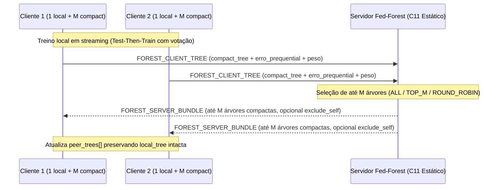

# 13 — Aprendizado Federado Embarcado (`Fed-Forest` & `Fed-VFDT` em C11 Zero-Malloc)

> **Módulo / Fase:** Fase 11 do Plano Persistente ([`docs/06_implementation_plan.md`](file:///home/julio/Documentos/pessoal_minimal-decision-tree/docs/06_implementation_plan.md))  
> **Escopo Alvo:** Reestruturação modular de `code/` (`core/`, `ensemble/`, `federated/`), módulos `code/include/ensemble/ht_{compact_tree,voting}.h`, `code/include/federated/ht_fed_{proto,forest,vfdt}.h` e simulador multi-cliente em `benchmarks/fed_simulator.c`  
> **Meta:** Permitir aprendizado colaborativo em redes de dispositivos embarcados com privacidade de dados (sem transmissão de amostras brutas), alocação 100% estática (*zero-malloc* tanto no cliente quanto no servidor) e total compatibilidade com Classificação, Regressão e a Arquitetura de Micro-Ensembles da Fase 9.

---

## 1. Motivação e Os Dois Paradigmas Federados no `kansho`

Em cenários de IoT / Edge AI (redes de sensores industriais, wearables, nós ESP32/Cortex-M3), os dados de fluxo contínuo nascem distribuídos entre $K$ clientes e frequentemente apresentam **heterogeneidade estatística (*Non-IID*)**, restrições severas de **privacidade** e **largura de banda limitada** (LoRa, BLE, MQTT, Wi-Fi).

A arquitetura do `kansho` (índices `uint16_t` livres de ponteiros, pools estáticos determinísticos, serialização binária enxuta e observadores baseados em estatísticas suficientes de Welford/Chan/Ben-Haim) viabiliza nativamente **dois paradigmas complementares de Aprendizado Federado**, ambos agnósticos de transporte (operando exclusivamente sobre buffers binários contíguos):

1. **Modo 1 — `Fed-Forest` (Agregação de Árvores em Floresta):**
   - Cada cliente treina **1 árvore local completa** (`ht_tree_t` — VFDT, HAT, VFDT-R ou HAT-R).
   - Periodicamente, o cliente compacta sua árvore em uma representação somente-inferência ultra-leve (`ht_compact_tree_t`, sem `stats_pool` nem `node_drift`, $\approx 1{,}3\text{ KB}$ para 64 nós) e a envia ao servidor.
   - O servidor seleciona/agrega até $M$ árvores de pares e devolve a floresta aos clientes.
   - Cada cliente realiza inferência combinando **sua árvore local treinável + até $M$ árvores remotas compactas** por votação ponderada pelo inverso do erro prequential local ($w_m = 1 / (\hat{e}_m^2 + \varepsilon)$), adaptando-se automaticamente a *Non-IID* e *Concept Drift*.

2. **Modo 2 — `Fed-VFDT` (Árvore Única Global Sincronizada):**
   - Todos os clientes e o servidor compartilham **uma única topologia sincronizada** (índices `node_idx` idênticos em toda a federação, protegidos por `topology_version` e recuperação de *stragglers*).
   - Suporta duas estratégias configuráveis sob o mesmo protocolo de sincronização:
     - **2A. `HT_FED_VFDT_COORDINATED` (Fed-VFDT Canônico — Silva, Vinagre & Gama, IEEE ICTAI):** Clientes mantêm splits locais diferidos (`HT_TREE_FLAG_DEFER_SPLITS`), enviam apenas propostas compactas de split (dezenas de bytes por folha) e o servidor decide o split global por **Quorum**, **Voto Majoritário** ou **Mérito Ponderado**.
     - **2B. `HT_FED_VFDT_STATS_MERGE` (Fusão Exata de Estatísticas Suficientes):** Clientes enviam o estado das folhas ativas por rodada; o servidor zera um acumulador *stateless* da rodada (evitando contagem dupla sem exigir memória de delta no cliente), funde matematicamente os observadores de todos os clientes via fórmulas exatas (Chan/Welford, soma categórica, fusão Ben-Haim e FedAvg ponderado para SGD) e avalia o **Hoeffding Bound global sobre $N_{\text{global}} = \sum_k N_k$**.

---

## 2. Reestruturação Modular de `code/`

Para manter clara a fronteira entre o núcleo da árvore, as estruturas compartilhadas de floresta/votação (Fase 9 + Fase 11) e os protocolos federados, `code/` adota subpastas simétricas em `include/`, `src/` e `tests/`:

```text
code/
├── Makefile
├── include/
│   ├── core/        # Núcleo VFDT/HAT/VFDT-R/HAT-R + libht_prep
│   │   ├── ht_config.h
│   │   ├── ht_memory.h
│   │   ├── ht_observer.h
│   │   ├── ht_criterion.h
│   │   ├── ht_tree.h
│   │   ├── ht_drift.h
│   │   └── ht_prep.h
│   ├── ensemble/    # Primitivas compartilhadas (Fase 9 + Fase 11)
│   │   ├── ht_compact_tree.h
│   │   ├── ht_voting.h
│   │   └── [ht_ensemble.h na Fase 9]
│   └── federated/   # Protocolos e agentes federados (zero-malloc)
│       ├── ht_fed_proto.h
│       ├── ht_fed_forest.h
│       └── ht_fed_vfdt.h
├── src/
│   ├── core/
│   ├── ensemble/
│   └── federated/
└── tests/
    ├── test_harness.h
    ├── test_main.c
    ├── core/
    ├── ensemble/
    └── federated/
```

---

## 3. Fundação Compartilhada (`ensemble/`): `ht_compact_tree_t` e `ht_voting`

### 3.1 Compactação BFS Densa (`ht_compact_tree_t`)
Ao exportar uma `ht_tree_t` (que pode ter `HT_MAX_NODES = 4096` com buracos no pool e subárvores alternadas da HAT) para um par remoto:
1. Um percurso **BFS iterativo** (sem recursão na pilha) parte de `src->root_idx` e remapeia apenas os nós ativos alcançáveis da árvore principal para índices densos `0 .. num_nodes - 1`.
2. Blocos pesados (`ht_leaf_stats_t`, `ht_node_drift_t`, `ht_adwin_pool_t`) são descartados: cada nó folha já carrega `class_counts[HT_MAX_CLASSES]` (Classificação `MC` / soft-voting) ou `reg_stats` (`count, mean, m2` para Regressão `MEAN`) em apenas $20\text{ B}$ (`float32`).
3. Uma árvore de 64 nós ocupa apenas **$64 \times 20\text{ B} + \text{header} \approx 1{,}32\text{ KB}$**, permitindo que um cliente embarcado carregue 8 a 10 árvores remotas com todas as $F$ features gastando apenas **$\sim 10{,}6\text{–}13{,}2\text{ KB}$ de SRAM**.

### 3.2 Motor de Votação Compartilhado (`ht_voting.h`)
Extraído para ser compartilhado entre o `Fed-Forest` (Fase 11) e o `ht_ensemble_t` local (Fase 9):
- **Rastreamento Prequential:** Atualiza $\hat{e}_m \leftarrow \alpha \hat{e}_m + (1 - \alpha) e_{t,m}$ (classificação: erro $0/1$; regressão: erro quadrático $(y - \hat{y}_m)^2$) antes do passo de treino local.
- **Modos de Agregação:**
  - `HT_VOTE_WEIGHTED`: $w_m = \frac{1}{\hat{e}_m^2 + \varepsilon}$ (classificação) ou $w_m = \frac{1}{\text{fMSE}_m + \varepsilon}$ (regressão).
  - `HT_VOTE_UNIFORM`: pesos iguais $w_m = 1$.

---

## 4. Modo 1: Floresta Federada (`ht_fed_forest.h`)



### Políticas de Agregação no Servidor (`ht_fed_forest_agg_t`)
Quando o número de clientes ativos excede a capacidade de pares do cliente ($K > M$):
1. **`HT_FED_FOREST_AGG_ALL`:** Inclui todas as árvores disponíveis até o limite $M$ (ideal quando $K \le M$).
2. **`HT_FED_FOREST_AGG_TOP_M`:** Ordena de forma determinística pelo menor erro prequential reportado (`reported_error`, desempate por maior `train_weight_seen`).
3. **`HT_FED_FOREST_AGG_ROUND_ROBIN`:** Rotaciona a janela de seleção a cada rodada usando um cursor persistente para maximizar diversidade em cenários *Non-IID* severos.
- Em todas as políticas, a flag `exclude_self = true` evita enviar ao cliente $i$ a sua própria árvore (economizando banda e liberando 1 slot extra para um par remoto).

---

## 5. Modo 2: `Fed-VFDT` Global Sincronizado (`ht_fed_vfdt.h`)

### 5.1 Extensões Cirúrgicas no Núcleo (`core/`)
- **`HT_TREE_FLAG_DEFER_SPLITS` com zero bytes extras:** Reaproveita o campo `uint16_t pad;` já existente em `ht_tree_t` (renomeado para `uint16_t tree_flags;`). Quando ativo, `ht_tree_learn_one` e `ht_tree_learn_one_reg` atualizam todas as estatísticas normalmente sem disparar splits locais autônomos.
- **Primitivas de controle externo:**
  - `ht_tree_evaluate_leaf_split(...)`: avalia os 2 melhores candidatos e o Hoeffding Bound de uma folha sem mutar a árvore.
  - `ht_tree_apply_split(...)`: aplica deterministicamente um candidato de split na folha `leaf_idx`, garantindo que todos os clientes aloquem exatamente os mesmos `left_child` e `right_child` na mesma ordem!
  - `ht_tree_reset_subtree_to_leaf(...)`: poda os filhos de um nó interno e o restaura para folha ativa limpa (usado em resets coordenados de drift).

### 5.2 Estratégia 2A: Fed-VFDT Canônico (*Coordinated Splitting*)
Seguindo Silva, Vinagre & Gama (*Fed-VFDT*, IEEE ICTAI):
1. Ao final de cada janela/rodada local, o cliente percorre suas folhas ativas com `ht_tree_evaluate_leaf_split`.
2. Para folhas com proposta válida (`locally_ready == true` ou peso mínimo atingido), empacota um `ht_fed_split_proposal_t` compacto (`leaf_idx`, `depth`, `total_weight`, `feature_idx`, `is_categorical`, `split_val`, `merit`, `lhs`/`rhs`, `locally_ready`).
3. O servidor agrupa as propostas por `leaf_idx` (exigindo `locally_ready == 1` por padrão via `require_locally_ready = true`, fiel ao paper) e aplica a estratégia de consenso configurada:
   - **`HT_FED_CONSENSUS_QUORUM`:** Exige suporte mínimo **por atributo** (`feat_votes[f] >= min_quorum`); entre os atributos qualificados, escolhe o de maior soma de mérito (`sum(merit)`), desempatando pelo maior mérito individual.
   - **`HT_FED_CONSENSUS_MAJORITY` (Pluralidade):** Escolhe o atributo mais votado entre os proponentes (`>= min_quorum` participantes), desempatando pelo maior mérito individual.
   - **`HT_FED_CONSENSUS_MERIT` (Best-Merit):** Escolhe o atributo da proposta com maior mérito individual `max(G_k)` entre `>= min_quorum` proponentes.
   - **`HT_FED_CONSENSUS_WEIGHTED_MERIT` (Extensão Híbrida):** Escolhe o atributo com maior soma ponderada de mérito $\sum_k w_k \cdot G_k(A)$ entre `>= min_quorum` proponentes.
   - **Agregação de Threshold (`ht_fed_vfdt_thresh_agg_t`):** `HT_FED_THRESH_MAX_MERIT` (padrão fiel ao paper: threshold exato da proposta de maior mérito no grupo vencedor) ou `HT_FED_THRESH_WEIGHTED_MEAN` (média ponderada pelo peso amostral).
   - **Splits por Rodada:** Suporta múltiplos splits simultâneos de folhas independentes (`max_splits_per_round = 0`, padrão para economizar rodadas em IoT) ou limite configurável (`max_splits_per_round = 1` para reproduzir exatamente o ritmo do paper).
4. O servidor executa `ht_tree_apply_split` em sua `global_tree`, grava o comando no ring-buffer `split_log[HT_FED_SPLIT_LOG_CAP]` e incrementa `topology_version`.

### 5.3 Estratégia 2B: Fusão Exata de Estatísticas Suficientes (*Stats-Merge*)
Fórmulas exatas implementadas em `code/src/core/ht_observer.c` (associativas, comutativas e zero dados brutos):
- **Gaussiano (Welford $\to$ Chan et al., 1983):**
  $$n_C = n_A + n_B, \quad \mu_C = \mu_A + \frac{n_B}{n_C}(\mu_B - \mu_A), \quad M_{2,C} = M_{2,A} + M_{2,B} + (\mu_B - \mu_A)^2 \frac{n_A n_B}{n_C}$$
  $$\min_C = \min(\min_A, \min_B), \quad \max_C = \max(\max_A, \max_B)$$
- **Categórico Nominal (Classificação):** $N_{c,v}^{(C)} = N_{c,v}^{(A)} + N_{c,v}^{(B)}$.
- **Histograma Dinâmico (Ben-Haim & Tom-Tov):** Inserção ordenada dos bins de `src` em `dst` com fusão gulosa dos pares adjacentes mais próximos mantendo $\le \text{HT\_HIST\_MAX\_BINS}$.
- **Regressão Numérica (Slots de Chan) e Categórica:** Inserção/fusão de slots ordenados por `x_mean` via `ht_var_combine` mantendo $\le \text{HT\_REG\_NUM\_SLOTS}$, e `ht_var_combine` por categoria.
- **Modelos Lineares SGD em Regressão (FedAvg Ponderado):**
  $$\mathbf{w}_C = \frac{n_A \mathbf{w}_A + n_B \mathbf{w}_B}{n_A + n_B}, \quad b_C = \frac{n_A b_A + n_B b_B}{n_A + n_B}$$

**Prevenção de Contagem Dupla (*Stateless Round Re-Merge*):**
No início de cada rodada (`ht_fed_vfdt_server_begin_round`), o servidor limpa apenas as estatísticas das folhas ativas de seu acumulador de rodada e funde os estados atuais recebidos dos clientes sincronizados naquela rodada. Assim:
- Clientes **não** precisam manter buffers de delta em SRAM.
- Clientes preservam suas estatísticas acumuladas locais entre rodadas (mantendo NBA e SGD precisos).
- Clientes que pulam rodadas nunca causam contagem dupla ao retornar.

### 5.4 Protocolo Binário (`ht_fed_proto.h`), *Stragglers* e Drift Coordenado
- Todo pacote usa cabeçalho fixo `ht_fed_header_t` com magic `0x44454648U` (`"HFED"`), versão de protocolo, flags (`DOUBLE`, `REG`), `client_id`, `round_id`, `topology_version`, `payload_len` e checksum `crc32`.
- **Recuperação de *Stragglers*:**
  - Se um cliente solicita/envia com `client_ver < server->topology_version`:
    - Se `server->topology_version - client_ver <= HT_FED_SPLIT_LOG_CAP`, o servidor envia um `SPLIT_BROADCAST` contendo exatamente os comandos faltantes do `split_log` (*catch-up* em poucos bytes).
    - Caso contrário (ou se houve reset que invalidou o histórico), o servidor envia `HT_FED_MSG_VFDT_FULL_SNAPSHOT` contendo a árvore global via `ht_tree_save`.
- **Drift Coordenado:** Clientes sinalizam `drift_alert_node` no uplink; atingido o quorum de alertas para um nó (ou raiz), o servidor emite `HT_FED_CMD_RESET_SUBTREE` no broadcast de splits, mantendo toda a federação sincronizada.

---

## 6. Orçamento de Memória e Validação

| Estrutura | Perfil Compacto MCU (`float32`) | Observação |
| :--- | :---: | :--- |
| `ht_compact_tree_t` (`64` nós) | **$\approx 1{,}32\text{ KB}$** | Zero `stats_pool`, zero `node_drift` |
| `ht_fed_forest_client_t` (Tier 4, 16 feat, $M=8$ pares de 64 nós) | **$\approx 32\text{ KB}$** | Muito abaixo do teto de $100\text{ KB}$ SRAM |
| `ht_fed_vfdt_client_t` (Tier 4, 16 feat) | **$\approx 21\text{ KB}$** | Overhead federado $< 100\text{ B}$ |
| `ht_fed_vfdt_server_t` (Tier 4, 16 feat, log 64 splits) | **$\approx 29\text{ KB}$** | 100% estático/*zero-malloc* (roda em MCU gateway ou desktop) |

A validação experimental é conduzida pelo simulador multi-cliente em C11 puro ([`benchmarks/fed_simulator.c`](file:///home/julio/Documentos/pessoal_minimal-decision-tree/benchmarks/fed_simulator.c)), comparando **Local-Only**, **Centralized Oracle**, **Fed-Forest**, **Fed-VFDT (Coordinated)** e **Fed-VFDT (Stats-Merge)** sob streams IID, Non-IID, Regressão e Concept Drift, reportando Acurácia/RMSE, Bytes Transmitidos (Uplink + Downlink) e SRAM estática.

---

## 7. Auditoria de Paridade contra o Artigo e Código de Referência (`Fed-VFDT`)

### 7.1 Referências Bibliográficas Oficiais
1. **Fed-VFDT (Classificação — Paper Principal):**
   - **Título:** *Fed-VFDT: Federated Very Fast Decision Trees with Coordinated Splitting Over Data Streams*
   - **Autores:** Paula Raissa Silva, João Vinagre e João Gama (INESC TEC / Universidade do Porto)
   - **Publicação:** *2025 IEEE 37th International Conference on Tools with Artificial Intelligence (ICTAI)*, pp. 653–660, DOI [`10.1109/ICTAI66417.2025.00094`](https://doi.org/10.1109/ICTAI66417.2025.00094)
   - **Repositório Oficial Auditado:** [`paularaissa/project-vfdt`](https://github.com/paularaissa/project-vfdt) (`client_app/fht.py`, `client_app/client_app.py`, `server_app/server_app.py`, `server_app/my_server.py` — protótipo em Python usando Flower + River).
2. **FHT-R (Extensão para Regressão):**
   - **Título:** *FHT-R: Federated Online Regression with Coordinated Hoeffding Trees for Air Quality Prediction*
   - **Autores:** Daniela Menezes, Douglas Vidal, André Riker e Glauco Gonçalves
   - **Publicação:** *XLIV Simpósio Brasileiro de Telecomunicações e Processamento de Sinais (SBrT 2026)*.

### 7.2 O Que Bate 100% com o Fed-VFDT Oficial
- **Coordenação de splits sem dados brutos:** Clientes acumulam estatísticas suficientes localmente com splits bloqueados (`HT_TREE_FLAG_DEFER_SPLITS`), avaliam o *Hoeffding Bound* localmente e enviam apenas propostas de split ao servidor (`fht.py` L75–125 $\leftrightarrow$ `ht_fed_vfdt.c`).
- **Três estratégias de consenso no servidor:** `quorum`, `majority-vote` e `best-merit` (`server_app.py` L361–455 $\leftrightarrow$ `HT_FED_CONSENSUS_QUORUM`, `HT_FED_CONSENSUS_MAJORITY`, `HT_FED_CONSENSUS_MERIT`).
- **Threshold global único na aplicação do split:** Na implementação ativa oficial (`fht.py` L150–250, `apply_aggregated_split`), todos os clientes aplicam o `feature` e o `threshold`/`value` broadcastados pelo servidor, garantindo sincronia estrutural.
- **Injeção das estatísticas agregadas dos filhos (`children_stats`):** O servidor soma `lhs_dist` e `rhs_dist` dos clientes concordantes (`server_app.py` L379–398) e inicializa os novos filhos em todos os clientes ajustando `last_split_attempt_at = total_weight` (`fht.py` L201–210 $\leftrightarrow$ `ht_tree.c` `ht_tree_apply_split`).

### 7.3 Divergências Identificadas, Resoluções Aplicadas (`a976b13`) e Justificativas Técnicas

| # | Aspecto | Fed-VFDT Oficial (`paularaissa/project-vfdt`) | `kansho` (`ht_fed_vfdt.c` após `a976b13`) | Status / Justificativa |
| :-: | :--- | :--- | :--- | :--- |
| **1** | **Congelamento (`_frozen`), `_instance_buffer` e `locally_ready`** | Congela o cliente (`_frozen = True`) ao disparar 1 proposta de split (apenas quando passa no Hoeffding Bound), mantém `_instance_buffer` dinâmico (`fht.py` L58) e reaplica `last_instance` pós-split (L278). | Cliente **não congela** o stream nem aloca buffers dinâmicos, mas o servidor filtra `require_locally_ready = true` por padrão em todos os modos coordenados (somente propostas que satisfizeram o Hoeffding Bound votam). | **Resolvido + Intencional (Embarcado):** Mantém operação não-bloqueante zero-malloc em sensores tempo-real e evita splits prematuros sem garantia de Hoeffding. |
| **2** | **Endereçamento de Nós e Recuperação de *Stragglers*** | Endereça folhas por `path = ["left", "right", ...]` + `uuid4()` sem versionamento (`fht.py` L170 falha criticamente se um cliente perder um split). | Usa `uint16_t node_idx` (2 B), `topology_version`, log circular `split_log[64]` (*catch-up* incremental) e fallback automático via `FULL_SNAPSHOT`. | **Intencional (Melhoria de Engenharia):** Reduz overhead de rede para 2 bytes e corrige a fragilidade de dessincronização em redes IoT sujeitas a perda de pacotes. |
| **3** | **Seleção do Threshold Numérico Vencedor** | Escolhe o `threshold` exato da proposta individual com **maior mérito (`gini_index`)** dentro do grupo vencedor (`server_app.py` L377, L409, L452). | Configurável via `threshold_agg`: **`HT_FED_THRESH_MAX_MERIT`** (padrão fiel ao paper) e **`HT_FED_THRESH_WEIGHTED_MEAN`** (opcional para redução de variância IID). | **Alinhado ao Paper (`a976b13`):** Paridade exata por padrão, mantendo a opção de média ponderada para experimentos comparativos. |
| **4** | **Regras Exatas de `QUORUM`, `BEST-MERIT`, `MAJORITY-VOTE` e Splits/Rodada** | • `quorum`: exige suporte mínimo **por atributo** (`len(group[f]) >= ceil(support_percent * min_fit_clients)`), escolhe a feature de maior soma de mérito (`sum(gini)`).<br>• `best-merit`: escolhe **1 proposta** com maior mérito individual `max(gini)` (`len(splits) >= min_fit_clients`).<br>• `majority-vote`: **pluralidade**, desempate por maior mérito e 1 split por rodada. | • `HT_FED_CONSENSUS_QUORUM`: exige `feat_votes[f] >= min_quorum` **por atributo** e escolhe maior `sum(merit)`.<br>• `HT_FED_CONSENSUS_MERIT`: escolhe `max(merit)` individual (`eligible >= min_quorum`); `HT_FED_CONSENSUS_WEIGHTED_MERIT` disponível como 4ª estratégia híbrida.<br>• `HT_FED_CONSENSUS_MAJORITY`: **pluralidade** + desempate por maior mérito; `max_splits_per_round = 0` (múltiplas folhas independentes, padrão IoT) ou `1` (ritmo 1-split/rodada do paper). | **Alinhado ao Paper (`a976b13`):** Todas as 3 regras oficiais validadas em `test_fed_vfdt_paper_exact_consensus_and_thresholds`, preservando extensões configuráveis para IoT. |
| **5** | **Escala de `local_grace_period`** | Servidor calcula `local_grace = global_grace_period / n_clients` em `configure_fit` (`server_app.py` L495). | Definido via `tree_params.grace_period` na inicialização dos clientes. | **Intencional (Agnóstico de Transporte):** Em redes embarcadas dinâmicas, o integrador define `grace_period = G / K` na configuração inicial sem acoplamento ao transporte. |
| **6** | **Extensões Exclusivas do `kansho`** | Apenas classificação, modo *Coordinated Splitting* via Flower/JSON/Pickle/Base64, sem regressão, sem `Stats-Merge`, sem `Fed-Forest`, sem drift reset. | Inclui Regressão (`VFDT-R`/`FHT-R`), Modo 2B `STATS_MERGE` (resolve *Non-IID* extremo com clientes 100% puros), Modo 1 `Fed-Forest`, protocolo binário `HFED` com CRC32 e reset coordenado por drift. | **Intencional (Escopo do Projeto):** Atende aos dois modos solicitados (`Fed-Forest` + `Fed-VFDT`), classificação + regressão e restrições de SRAM/banda em MCUs. |

---

## 8. Validação Experimental em 8 Datasets Reais (`main_benchmark/`)

A suíte reproduzível `make bench-main-federated` (`main_benchmark/federated_benchmark.py` + `main_benchmark/fed_c_runner.c`) avaliou todos os **8 datasets reais** do repositório ($K=10$ clientes, $R=20$ rodadas, perfil MCU Tier 8 $\le 100\text{ KB}$, `float32`, zero-malloc) sob particionamento **Non-IID (`Dirichlet α=0.3`)** e **IID**. O relatório completo está em [`main_benchmark/federated_benchmark_report.md`](file:///home/julio/Documentos/pessoal_minimal-decision-tree/main_benchmark/federated_benchmark_report.md).

### 8.1 Síntese sob Non-IID (`Dirichlet α=0.3`)

| Dataset | Tarefa | Local-Only | Melhor Fed-Forest | Melhor Fed-VFDT (Coord.) | Fed-VFDT (`Stats-Merge`) | Central Oracle (T8) | Pico SRAM Cliente |
| :--- | :--- | :---: | :---: | :---: | :---: | :---: | :---: |
| **SEA** | Classif. | 76.41% | 95.06% (`TOP_M`) | 93.68% (`MAJ`/`MERIT`) | **96.78%** | 99.02% | 13.12 KB |
| **Electricity** | Classif. | 50.65% | 54.78% (`TOP_M`) | 57.61% (`QUORUM`) | **60.37%** | 64.37% | 16.38 KB |
| **Forest Covertype** (54 feat, 7 cls) | Classif. | 30.91% | 25.83% (`RR`) | 35.00% (`MERIT`) | **65.52%** | 67.28% | **77.01 KB** |
| **Airlines** | Classif. | 49.60% | **76.39%** (`TOP_M`) | 56.78% (`MAJ`/`MERIT`) | 61.43% | 76.09% | 15.89 KB |
| **Friedman #1** | Regr. (MAE) | 2.8288 | 2.8813 (`TOP_M`) | **2.4963** (`QUORUM`) | 2.7318 | 2.1537 | 32.11 KB |
| **Bikes** | Regr. (MAE) | 61.6123 | **41.7974** (`RR`) | 73.6779 (`MAJ`) | 46.6150 | 40.4648 | 60.29 KB |
| **Appliances Energy** (28 feat) | Regr. (MAE) | 78.5876 | **35.4504** (`TOP_M`) | 59.1440 (`MAJ`) | 50.5366 | 29.7630 | 41.15 KB |
| **NYC Taxi** | Regr. (MAE) | 397.0585 | **351.5022** (`RR`) | 381.5276 (`QUORUM`) | 372.1993 | 339.2442 | 18.81 KB |

### 8.2 Complementaridade Comprovada entre os Dois Modos
- **Orçamento Embarcado Comprovado ($\le 100\text{ KB}$):** Mesmo no cenário mais pesado (*Forest Covertype* com 54 features e 7 classes), a SRAM estática por cliente ficou em **77.01 KB** (`Fed-Forest`, $M=5$) e **65.56 KB** (`Fed-VFDT`).
- **Classificação Multi-Classe Non-IID Severo → `Fed-VFDT (STATS-MERGE)`:** No *Forest Covertype* (7 classes fortemente enviesadas por cliente), o `Stats-Merge` saltou de **30.91% (F1 17.52%)** no `Local-Only` para **65.52% (F1 63.04%)** — a apenas 1.76 pp do Oráculo Centralizado (67.28%).
- **Regressão Contínua Non-IID → `Fed-Forest`:** Dominou 3 dos 4 datasets de regressão (*Bikes* -32.2% MAE, *Appliances Energy* -54.9% MAE, *NYC Taxi* -11.5% MAE), beneficiando-se da redução de variância e cancelamento de viés ao combinar árvores especialistas compactas ($M=5$).
- **Links de Banda Ultrabaixa (LPWAN/LoRa/BLE) → `Fed-VFDT Coordenado`:** Opera entre **114 e 564 bytes/cliente/rodada** (até $90\times$ menos tráfego que `Stats-Merge`), confirmando também empiricamente a necessidade da estratégia `MAJORITY` (pluralidade) e `BEST-MERIT` em alta dimensionalidade (*Covertype* 54 features, onde `QUORUM` estrito por atributo atingiu 0 splits sob `min_quorum=3`).

---

## 9. Validação de Compilação Cruzada 32-Bit e Emulação QEMU (`11.11`)

Validado integralmente em **32-bit** (zero warnings sob `-std=c11 -Wall -Wextra -Werror -pedantic -Os`) nos dois alvos embarcados do repositório:

| Alvo / Toolchain | Firmware Existente (`emulation/`) | Sanidade QEMU (`SEA`, 200 treino + 6.000 teste) | Flash `ensemble/` + `federated/` (`.text`) | Flash Total 11 Módulos (`.text`) | `.data` / `.bss` da Lib |
| :--- | :--- | :---: | :---: | :---: | :---: |
| **ARM Cortex-M3** (`arm-none-eabi-gcc 14.2.1`, Thumb-2 `soft-fp`) | `65.832 B` Flash / `57.468 B` RAM (`56,12 KB` $\le 64\text{ KB}$) | **PASSED** (`~345 samp/s`, `lm3s6965evb`) | **11.342 B (11,08 KB)** | **40.614 B (39,66 KB)** | `0 B` / `0 B` |
| **ESP32 Xtensa LX6** (ESP-IDF `v5.1.2`, `xtensa-esp32-elf-gcc 12.2.0`) | `186.263 B` Flash / `148.904 B` DRAM (`77%` partição livre) | **PASSED** (`~167 samp/s`, `qemu-system-xtensa`) | **12.119 B (11,83 KB)** | **41.582 B (40,61 KB)** | `0 B` / `0 B` |

Detalhamento de tamanho de código (`.text`) dos novos módulos em `-Os`:
- `ht_compact_tree.o`: `1.852 B` (Cortex-M3) / `1.991 B` (ESP32)
- `ht_voting.o`: `560 B` (Cortex-M3) / `558 B` (ESP32)
- `ht_fed_proto.o`: `496 B` (Cortex-M3) / `460 B` (ESP32)
- `ht_fed_forest.o`: `2.476 B` (Cortex-M3) / `2.481 B` (ESP32)
- `ht_fed_vfdt.o`: `5.958 B` (Cortex-M3) / `6.629 B` (ESP32)

---

## 10. Validação de Transporte de Rede Real via Sockets TCP POSIX (`11.10`)

Implementada em [`benchmarks/fed_net/`](file:///home/julio/Documentos/pessoal_minimal-decision-tree/benchmarks/fed_net/) (`fed_net_server.c`, `fed_net_client.c`, `fed_net_common.h`, `run_fed_net_tests.py`, executável via `make bench-fed-net`) com **1 processo servidor C11** e **$K=4$ processos clientes OS independentes** (sem memória compartilhada) trocando frames binários `HFED` puros sobre TCP loopback:

| # | Cenário Real Multi-Processo TCP | Fragmentação TCP | Injeção / Falha Real | Resultado | Métrica Global | Tráfego Wire |
| :-: | :--- | :---: | :--- | :---: | :---: | :---: |
| **1** | `Fed-Forest` (4-Class Non-IID) | `17 B/write` | Bit-flip em payload → `CRC32` rejeitado (`HT_ERR_CORRUPT_IMAGE`) + retransmissão | **PASS** | **98,50% Acc** | `16,8 KB` |
| **2** | `Fed-VFDT Coordenado` (4-Class Non-IID) | `13 B/write` | Bit-flip em payload → `CRC32` rejeitado + retransmissão | **PASS** | **94,25% Acc** (`Splits=3`, `TopoV=3`) | `5,4 KB` |
| **3** | `Fed-VFDT Stats-Merge` (Non-IID 100% puro, 1 classe/processo) | `19 B/write` | Zero splits locais possíveis | **PASS** | **97,50% Acc** (`Splits=5`, `TopoV=5`) | `36,1 KB` |
| **4** | *Straggler* Desconectado (`client 4` offline R2..R6, reconecta R7) | `11 B/write` | `HT_ERR_STALE_VERSION` + catch-up automático via `split_log` | **PASS** | **96,75% Acc** (`TopoV=3/3`, `Catchups=7`) | `28,4 KB` |
| **5** | `Fed-VFDT Stats-Merge` Regressão Contínua (Non-IID) | `23 B/write` | Alvo contínuo segmentado (`HT_FED_FLAG_REG`) | **PASS** | **RMSE 3,493** (`Splits=21`, `TopoV=21`) | `59,0 KB` |

Todos os **5/5 cenários** concluíram em **0,33 s** com zero warnings sob `-std=c11 -O2 -Wall -Wextra -Werror -pedantic`.

---

## 11. Status dos Requisitos Obrigatórios (Release Gates) para Upgrade de Versão (`0.4.1 -> 0.5.0`)

1. **Gate A — Transporte de Rede Real (Entrega `11.10` `[x]` — Concluído em `d069f75`):**
   - Protocolo binário `HFED` validado ponta a ponta sobre sockets TCP POSIX em múltiplos processos independentes (`make bench-fed-net`, Seção 10).
2. **Gate B — Compilação Cruzada nos Firmwares de Emulação (Entrega `11.11` `[x]` — Concluído em `fa9452f`):**
   - Compilação cruzada e sanidade funcional em `emulation/esp32/` (ESP-IDF / Xtensa) e `emulation/cortex-m3/` (`arm-none-eabi-gcc` + QEMU) validadas com zero warnings e zero regressão (Seção 9).

> **Item Dispensado:** A validação de paridade numérica direta em Python contra `paularaissa/project-vfdt` (Flower + River) no mesmo CSV **não é requerida** para o upgrade de versão. Ambos os gates estão concluídos, liberando a proposta de bump SemVer (`0.4.1 -> 0.5.0`) sujeita à aprovação explícita do usuário.

