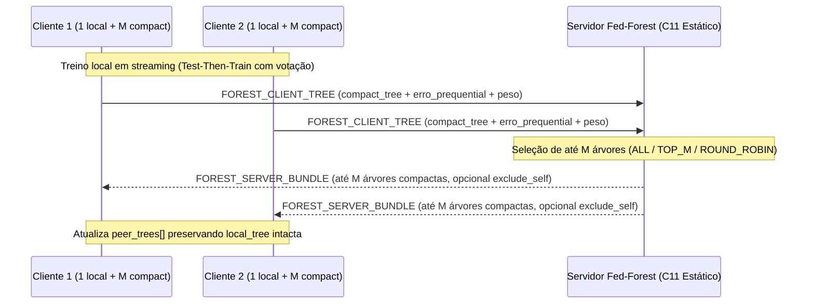

# 13 — Aprendizado Federado Embarcado (`Fed-Forest` & `Fed-VFDT` em C11 Zero-Malloc)

> **Módulo / Fase:** Fase 11 do Plano Persistente ([`docs/06_implementation_plan.md`](file:///home/julio/Documentos/pessoal_minimal-decision-tree/docs/06_implementation_plan.md))  
> **Escopo Alvo:** Reestruturação modular de `code/` (`core/`, `ensemble/`, `federated/`), módulos `code/include/ensemble/ht_{compact_tree,voting}.h`, `code/include/federated/ht_fed_{proto,forest,vfdt}.h` e simulador multi-cliente em `benchmarks/fed_simulator.c`  
> **Meta:** Permitir aprendizado colaborativo em redes de dispositivos embarcados com privacidade de dados (sem transmissão de amostras brutas), alocação 100% estática (*zero-malloc* tanto no cliente quanto no servidor) e total compatibilidade com Classificação, Regressão e a Arquitetura de Micro-Ensembles da Fase 9.

---

## 1. Motivação e Os Dois Paradigmas Federados no `kansho`

Em cenários de IoT / Edge AI (redes de sensores industriais, wearables, nós ESP32/Cortex-M3), os dados de fluxo contínuo nascem distribuídos entre $K$ clientes e frequentemente apresentam **heterogeneidade estatística (*Non-IID*)**, restrições severas de **privacidade** e **largura de banda limitada** (LoRa, BLE, MQTT, Wi-Fi).

A arquitetura do `kansho` (índices `uint16_t` livres de ponteiros, pools estáticos determinísticos, serialização binária enxuta e observadores baseados em estatísticas suficientes de Welford/Chan/Ben-Haim) viabiliza nativamente **dois paradigmas complementares de Aprendizado Federado**, ambos agnósticos de transporte (operando exclusivamente sobre buffers binários contíguos):

1. **Modo 1 — `Fed-Forest` (Agregação de Árvores em Floresta):**
   - Cada cliente treina **1 árvore local completa** (`ht_tree_t` — VFDT, HAT, VFDT-R ou HAT-R).
   - Periodicamente, o cliente compacta sua árvore em uma representação somente-inferência ultra-leve (`ht_compact_tree_t`, sem `stats_pool` nem `node_drift`, $\approx 1{,}3\text{ KB}$ para 64 nós) e a envia ao servidor.
   - O servidor seleciona/agrega até $M$ árvores de pares e devolve a floresta aos clientes.
   - Cada cliente realiza inferência combinando **sua árvore local treinável + até $M$ árvores remotas compactas** por votação ponderada pelo inverso do erro prequential local ($w_m = 1 / (\hat{e}_m^2 + \varepsilon)$), adaptando-se automaticamente a *Non-IID* e *Concept Drift*.

2. **Modo 2 — `Fed-VFDT` (Árvore Única Global Sincronizada):**
   - Todos os clientes e o servidor compartilham **uma única topologia sincronizada** (índices `node_idx` idênticos em toda a federação, protegidos por `topology_version` e recuperação de *stragglers*).
   - Suporta duas estratégias configuráveis sob o mesmo protocolo de sincronização:
     - **2A. `HT_FED_VFDT_COORDINATED` (Fed-VFDT Canônico — Silva, Vinagre & Gama, IEEE ICTAI):** Clientes mantêm splits locais diferidos (`HT_TREE_FLAG_DEFER_SPLITS`), enviam apenas propostas compactas de split (dezenas de bytes por folha) e o servidor decide o split global por **Quorum**, **Voto Majoritário** ou **Mérito Ponderado**.
     - **2B. `HT_FED_VFDT_STATS_MERGE` (Fusão Exata de Estatísticas Suficientes):** Clientes enviam o estado das folhas ativas por rodada; o servidor zera um acumulador *stateless* da rodada (evitando contagem dupla sem exigir memória de delta no cliente), funde matematicamente os observadores de todos os clientes via fórmulas exatas (Chan/Welford, soma categórica, fusão Ben-Haim e FedAvg ponderado para SGD) e avalia o **Hoeffding Bound global sobre $N_{\text{global}} = \sum_k N_k$**.

---

## 2. Reestruturação Modular de `code/`

Para manter clara a fronteira entre o núcleo da árvore, as estruturas compartilhadas de floresta/votação (Fase 9 + Fase 11) e os protocolos federados, `code/` adota subpastas simétricas em `include/`, `src/` e `tests/`:

```text
code/
├── Makefile
├── include/
│   ├── core/        # Núcleo VFDT/HAT/VFDT-R/HAT-R + libht_prep
│   │   ├── ht_config.h
│   │   ├── ht_memory.h
│   │   ├── ht_observer.h
│   │   ├── ht_criterion.h
│   │   ├── ht_tree.h
│   │   ├── ht_drift.h
│   │   └── ht_prep.h
│   ├── ensemble/    # Primitivas compartilhadas (Fase 9 + Fase 11)
│   │   ├── ht_compact_tree.h
│   │   ├── ht_voting.h
│   │   └── [ht_ensemble.h na Fase 9]
│   └── federated/   # Protocolos e agentes federados (zero-malloc)
│       ├── ht_fed_proto.h
│       ├── ht_fed_forest.h
│       └── ht_fed_vfdt.h
├── src/
│   ├── core/
│   ├── ensemble/
│   └── federated/
└── tests/
    ├── test_harness.h
    ├── test_main.c
    ├── core/
    ├── ensemble/
    └── federated/
```

---

## 3. Fundação Compartilhada (`ensemble/`): `ht_compact_tree_t` e `ht_voting`

### 3.1 Compactação BFS Densa (`ht_compact_tree_t`)
Ao exportar uma `ht_tree_t` (que pode ter `HT_MAX_NODES = 4096` com buracos no pool e subárvores alternadas da HAT) para um par remoto:
1. Um percurso **BFS iterativo** (sem recursão na pilha) parte de `src->root_idx` e remapeia apenas os nós ativos alcançáveis da árvore principal para índices densos `0 .. num_nodes - 1`.
2. Blocos pesados (`ht_leaf_stats_t`, `ht_node_drift_t`, `ht_adwin_pool_t`) são descartados: cada nó folha já carrega `class_counts[HT_MAX_CLASSES]` (Classificação `MC` / soft-voting) ou `reg_stats` (`count, mean, m2` para Regressão `MEAN`) em apenas $20\text{ B}$ (`float32`).
3. Uma árvore de 64 nós ocupa apenas **$64 \times 20\text{ B} + \text{header} \approx 1{,}32\text{ KB}$**, permitindo que um cliente embarcado carregue 8 a 10 árvores remotas com todas as $F$ features gastando apenas **$\sim 10{,}6\text{–}13{,}2\text{ KB}$ de SRAM**.

### 3.2 Motor de Votação Compartilhado (`ht_voting.h`)
Extraído para ser compartilhado entre o `Fed-Forest` (Fase 11) e o `ht_ensemble_t` local (Fase 9):
- **Rastreamento Prequential:** Atualiza $\hat{e}_m \leftarrow \alpha \hat{e}_m + (1 - \alpha) e_{t,m}$ (classificação: erro $0/1$; regressão: erro quadrático $(y - \hat{y}_m)^2$) antes do passo de treino local.
- **Modos de Agregação:**
  - `HT_VOTE_WEIGHTED`: $w_m = \frac{1}{\hat{e}_m^2 + \varepsilon}$ (classificação) ou $w_m = \frac{1}{\text{fMSE}_m + \varepsilon}$ (regressão).
  - `HT_VOTE_UNIFORM`: pesos iguais $w_m = 1$.

---

## 4. Modo 1: Floresta Federada (`ht_fed_forest.h`)



### Políticas de Agregação no Servidor (`ht_fed_forest_agg_t`)
Quando o número de clientes ativos excede a capacidade de pares do cliente ($K > M$):
1. **`HT_FED_FOREST_AGG_ALL`:** Inclui todas as árvores disponíveis até o limite $M$ (ideal quando $K \le M$).
2. **`HT_FED_FOREST_AGG_TOP_M`:** Ordena de forma determinística pelo menor erro prequential reportado (`reported_error`, desempate por maior `train_weight_seen`).
3. **`HT_FED_FOREST_AGG_ROUND_ROBIN`:** Rotaciona a janela de seleção a cada rodada usando um cursor persistente para maximizar diversidade em cenários *Non-IID* severos.
- Em todas as políticas, a flag `exclude_self = true` evita enviar ao cliente $i$ a sua própria árvore (economizando banda e liberando 1 slot extra para um par remoto).

---

## 5. Modo 2: `Fed-VFDT` Global Sincronizado (`ht_fed_vfdt.h`)

### 5.1 Extensões Cirúrgicas no Núcleo (`core/`)
- **`HT_TREE_FLAG_DEFER_SPLITS` com zero bytes extras:** Reaproveita o campo `uint16_t pad;` já existente em `ht_tree_t` (renomeado para `uint16_t tree_flags;`). Quando ativo, `ht_tree_learn_one` e `ht_tree_learn_one_reg` atualizam todas as estatísticas normalmente sem disparar splits locais autônomos.
- **Primitivas de controle externo:**
  - `ht_tree_evaluate_leaf_split(...)`: avalia os 2 melhores candidatos e o Hoeffding Bound de uma folha sem mutar a árvore.
  - `ht_tree_apply_split(...)`: aplica deterministicamente um candidato de split na folha `leaf_idx`, garantindo que todos os clientes aloquem exatamente os mesmos `left_child` e `right_child` na mesma ordem!
  - `ht_tree_reset_subtree_to_leaf(...)`: poda os filhos de um nó interno e o restaura para folha ativa limpa (usado em resets coordenados de drift).

### 5.2 Estratégia 2A: Fed-VFDT Canônico (*Coordinated Splitting*)
Seguindo Silva, Vinagre & Gama (*Fed-VFDT*, IEEE ICTAI):
1. Ao final de cada janela/rodada local, o cliente percorre suas folhas ativas com `ht_tree_evaluate_leaf_split`.
2. Para folhas com proposta válida (`locally_ready == true` ou peso mínimo atingido), empacota um `ht_fed_split_proposal_t` compacto (`leaf_idx`, `depth`, `total_weight`, `feature_idx`, `is_categorical`, `split_val`, `merit`, `lhs`/`rhs`, `locally_ready`).
3. O servidor agrupa as propostas por `leaf_idx` e aplica a estratégia de consenso configurada:
   - **`HT_FED_CONSENSUS_QUORUM`:** Exige pelo menos `min_quorum` clientes com `locally_ready == true` concordando no atributo (ou propondo split), escolhendo o atributo mais votado com threshold ponderado pelo peso amostral.
   - **`HT_FED_CONSENSUS_MAJORITY`:** Escolhe o atributo mais votado entre os proponentes (exigindo $> 50\%$ ou `min_quorum`), com threshold médio ponderado.
   - **`HT_FED_CONSENSUS_MERIT`:** Escolhe o atributo com maior soma ponderada de mérito $\sum_k w_k \cdot G_k(A)$ entre as propostas recebidas.
4. O servidor executa `ht_tree_apply_split` em sua `global_tree`, grava o comando no ring-buffer `split_log[HT_FED_SPLIT_LOG_CAP]` e incrementa `topology_version`.

### 5.3 Estratégia 2B: Fusão Exata de Estatísticas Suficientes (*Stats-Merge*)
Fórmulas exatas implementadas em `code/src/core/ht_observer.c` (associativas, comutativas e zero dados brutos):
- **Gaussiano (Welford $\to$ Chan et al., 1983):**
  $$n_C = n_A + n_B, \quad \mu_C = \mu_A + \frac{n_B}{n_C}(\mu_B - \mu_A), \quad M_{2,C} = M_{2,A} + M_{2,B} + (\mu_B - \mu_A)^2 \frac{n_A n_B}{n_C}$$
  $$\min_C = \min(\min_A, \min_B), \quad \max_C = \max(\max_A, \max_B)$$
- **Categórico Nominal (Classificação):** $N_{c,v}^{(C)} = N_{c,v}^{(A)} + N_{c,v}^{(B)}$.
- **Histograma Dinâmico (Ben-Haim & Tom-Tov):** Inserção ordenada dos bins de `src` em `dst` com fusão gulosa dos pares adjacentes mais próximos mantendo $\le \text{HT\_HIST\_MAX\_BINS}$.
- **Regressão Numérica (Slots de Chan) e Categórica:** Inserção/fusão de slots ordenados por `x_mean` via `ht_var_combine` mantendo $\le \text{HT\_REG\_NUM\_SLOTS}$, e `ht_var_combine` por categoria.
- **Modelos Lineares SGD em Regressão (FedAvg Ponderado):**
  $$\mathbf{w}_C = \frac{n_A \mathbf{w}_A + n_B \mathbf{w}_B}{n_A + n_B}, \quad b_C = \frac{n_A b_A + n_B b_B}{n_A + n_B}$$

**Prevenção de Contagem Dupla (*Stateless Round Re-Merge*):**
No início de cada rodada (`ht_fed_vfdt_server_begin_round`), o servidor limpa apenas as estatísticas das folhas ativas de seu acumulador de rodada e funde os estados atuais recebidos dos clientes sincronizados naquela rodada. Assim:
- Clientes **não** precisam manter buffers de delta em SRAM.
- Clientes preservam suas estatísticas acumuladas locais entre rodadas (mantendo NBA e SGD precisos).
- Clientes que pulam rodadas nunca causam contagem dupla ao retornar.

### 5.4 Protocolo Binário (`ht_fed_proto.h`), *Stragglers* e Drift Coordenado
- Todo pacote usa cabeçalho fixo `ht_fed_header_t` com magic `0x44454648U` (`"HFED"`), versão de protocolo, flags (`DOUBLE`, `REG`), `client_id`, `round_id`, `topology_version`, `payload_len` e checksum `crc32`.
- **Recuperação de *Stragglers*:**
  - Se um cliente solicita/envia com `client_ver < server->topology_version`:
    - Se `server->topology_version - client_ver <= HT_FED_SPLIT_LOG_CAP`, o servidor envia um `SPLIT_BROADCAST` contendo exatamente os comandos faltantes do `split_log` (*catch-up* em poucos bytes).
    - Caso contrário (ou se houve reset que invalidou o histórico), o servidor envia `HT_FED_MSG_VFDT_FULL_SNAPSHOT` contendo a árvore global via `ht_tree_save`.
- **Drift Coordenado:** Clientes sinalizam `drift_alert_node` no uplink; atingido o quorum de alertas para um nó (ou raiz), o servidor emite `HT_FED_CMD_RESET_SUBTREE` no broadcast de splits, mantendo toda a federação sincronizada.

---

## 6. Orçamento de Memória e Validação

| Estrutura | Perfil Compacto MCU (`float32`) | Observação |
| :--- | :---: | :--- |
| `ht_compact_tree_t` (`64` nós) | **$\approx 1{,}32\text{ KB}$** | Zero `stats_pool`, zero `node_drift` |
| `ht_fed_forest_client_t` (Tier 4, 16 feat, $M=8$ pares de 64 nós) | **$\approx 32\text{ KB}$** | Muito abaixo do teto de $100\text{ KB}$ SRAM |
| `ht_fed_vfdt_client_t` (Tier 4, 16 feat) | **$\approx 21\text{ KB}$** | Overhead federado $< 100\text{ B}$ |
| `ht_fed_vfdt_server_t` (Tier 4, 16 feat, log 64 splits) | **$\approx 29\text{ KB}$** | 100% estático/*zero-malloc* (roda em MCU gateway ou desktop) |

A validação experimental é conduzida pelo simulador multi-cliente em C11 puro ([`benchmarks/fed_simulator.c`](file:///home/julio/Documentos/pessoal_minimal-decision-tree/benchmarks/fed_simulator.c)), comparando **Local-Only**, **Centralized Oracle**, **Fed-Forest**, **Fed-VFDT (Coordinated)** e **Fed-VFDT (Stats-Merge)** sob streams IID, Non-IID, Regressão e Concept Drift, reportando Acurácia/RMSE, Bytes Transmitidos (Uplink + Downlink) e SRAM estática.
