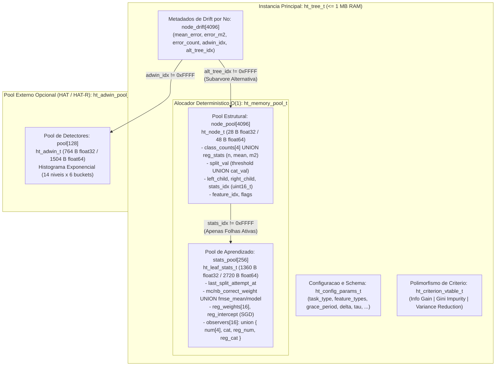
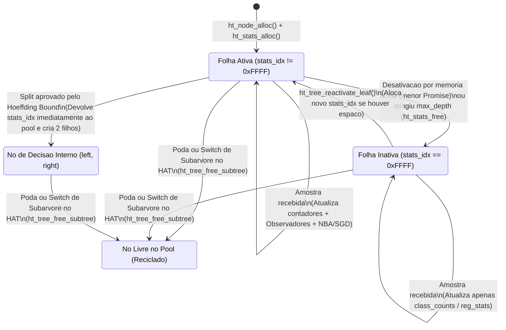
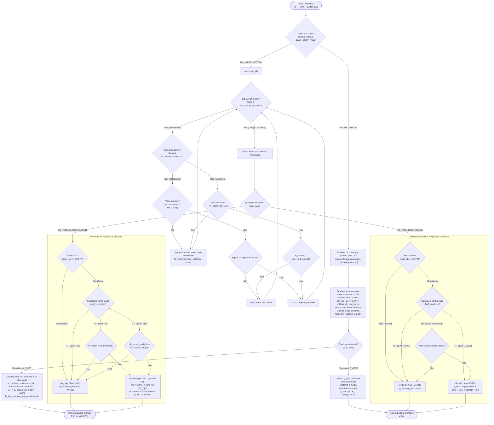
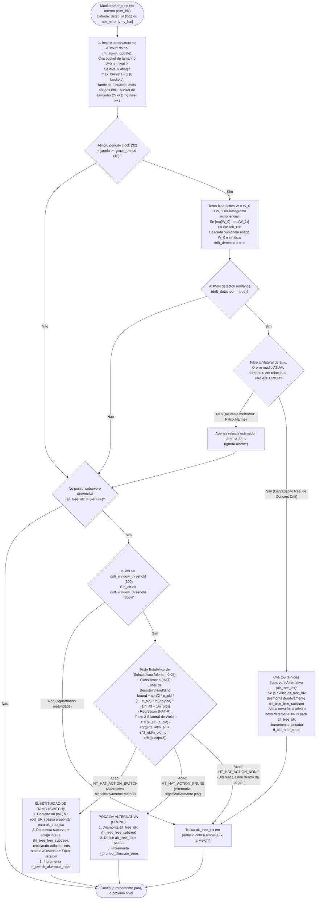
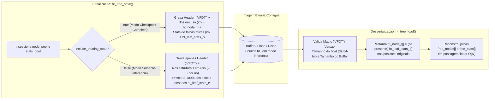

# Arquitetura, Design e Fluxogramas Completos (VFDT, HAT, VFDT-R e HAT-R)

Este documento consolida a fundamentação arquitetural, as decisões de engenharia em **C11 puro** e todos os fluxogramas visuais da biblioteca **Minimal Decision Tree** ([`code/include/`](../code/include) e [`code/src/`](../code/src)). Todos os fluxos operam com **zero alocação dinâmica (`malloc`/`free`) em runtime**, utilizando exclusivamente *Slab/Pool Allocators* estáticos indexados por `uint16_t` dentro de um orçamento estrito de **$\le 1\text{ MB}$ de RAM**.

---

## 1. Por que Hoeffding Tree no lugar do CART?

Algoritmos batch tradicionais como o **CART** exigem que todo o dataset esteja carregado em RAM (ou seja re-escaneado múltiplas vezes) para ordenar atributos e encontrar pontos de corte. Já a **Hoeffding Tree (VFDT)** processa cada amostra $O(1)$ única vez (*stream learning*), mantendo apenas estatísticas suficientes nas folhas e usando a **Desigualdade de Hoeffding** para garantir matematicamente (com probabilidade $1 - \delta$) que o split escolhido com $n$ amostras é o mesmo que seria escolhido com infinitas amostras:

$$\epsilon = \sqrt{\frac{R^2 \ln(1/\delta)}{2n}}$$

---

## 2. Decisões de Arquitetura e Design em C11

1. **Escopo de ML (Classificação e Regressão Unificadas):**
   - **Classificação Multiclasse e Regressão Contínua Incremental** (*on-device training + inference* no estilo *prequential*: testa primeiro, treina depois).
   - **Predição nas Folhas:** Suporte a *Majority Class* (MC), *Naive Bayes* (NB) e *Naive Bayes Adaptive* (NBA) na classificação; e *Target Mean* (MEAN), *Linear Model via SGD* (MODEL) e *Adaptive fMSE* (ADAPTIVE) na regressão.
   - **Critérios de Split:** *Gini Impurity*, *Information Gain (Entropia)* e *Variance Reduction* selecionáveis por configuração.
   - **Topologia:** Splits **estritamente binários** para todos os tipos de atributos:
     - Numéricos: $x_i \le \text{threshold}$ vs $x_i > \text{threshold}$
     - Categóricos: $x_i == \text{categoria}$ vs $x_i \neq \text{categoria}$
     - *Vantagem:* Todos os nós da árvore possuem tamanho fixo (`left` e `right`), eliminando arrays de ponteiros dinâmicos.

2. **API de Entrada (`ht_value_t`) e Schema Fixo:**
   - Em vez de dicionários dinâmicos (como no Python/River), a árvore registra no `init` um schema fixo de tipos por coluna (`HT_FEAT_NUMERIC` ou `HT_FEAT_CATEGORICAL`).
   - Cada amostra é passada como um array contíguo de `union ht_value_t { ht_float_t num; int32_t cat; }`, garantindo zero overhead de parsing e excelente localidade de cache.

3. **Tratamento de Valores Ausentes (`NaN` / Categoria Desconhecida) com Custo Zero de RAM:**
   - **No Roteamento (Inferência/Treino):** Se o atributo de split de um nó interno estiver ausente (`isnan(x)` ou `cat < 0`), a amostra segue para o **filho mais populoso** comparando em tempo real o peso acumulado dos filhos `left` e `right` (zero bytes extras no nó).
   - **No Aprendizado da Folha:** Atualiza normalmente a estatística do alvo na folha e os observadores dos demais atributos válidos, ignorando apenas o observador do atributo ausente.

4. **Representação de Atributos ($O(1)$ por Atributo):**
   - **Numéricos (Classificação):** Aproximação Gaussiana incremental via **Algoritmo de Welford** (`count`, `mean`, `M2`, `min`, `max` por classe), avaliando $k$ pontos candidatos (10 bins entre `min` e `max`) na hora de testar o split.
   - **Numéricos (Regressão):** Quantização dinâmica em **5 slots ordenados** combinados via **Fórmulas Paralelas de Chan** (`ht_var_combine` / `ht_var_subtract`), ocupando exatamente os mesmos $80\text{ B}$ em `float32`.
   - **Categóricos Nominais:** Tabela de frequência ou estatísticas de variância limitada pela cardinalidade máxima configurada (`HT_MAX_CATEGORIES`).

5. **Polimorfismo Híbrido (Inspirado em `sklearn/tree` + Data-Oriented Design):**
   - **Nível da Árvore:** Polimorfismo via *function pointers* (`ht_criterion_vtable_t`) para o critério de impureza, já que há apenas 1 instância por árvore.
   - **Nível dos Nós e Observadores:** Uso direto de `enum` e `union` (sem *vtable* por folha ou atributo), economizando 4 a 8 bytes de ponteiro por observador e permitindo *inlining* agressivo pelo compilador C.

6. **Precisão Numérica Configurável (`ht_float_t`):**
   - Padrão em **`float` (32-bit)** para cortar o consumo de RAM das estatísticas pela metade e aproveitar a FPU nativa de microcontroladores (ARM Cortex-M4F/M7, ESP32, RP2350).
   - Flag de compilação `-DHT_USE_DOUBLE` para alternar para `double` (64-bit) em testes de paridade numérica com o River.

7. **Gerenciamento de Memória Determinístico e Indexação Livre de Ponteiros (`uint16_t`):**
   - **Índices em vez de Ponteiros:** Inspirado no `sklearn/tree/_tree.pxd`, todas as referências entre nós (`left_child`, `right_child`, `stats_idx`) usam índices inteiros (`uint16_t`, com `HT_INVALID_IDX = 0xFFFF`) em arrays contíguos. Isso economiza RAM em arquiteturas 32/64-bit e torna a estrutura **100% relocável para serialização binária direta**.
   - **Separação entre Topologia e Estado de Aprendizado:**
     - `ht_node_t` (**Nó da Árvore - Leve**): Guarda apenas índices dos filhos (`left`, `right`), índice do estado (`stats_idx`), condição de split (`feature_idx`, `threshold`/`cat_val`) e contadores de classe (`class_counts`) ou variância do alvo (`reg_stats`).
     - `ht_leaf_stats_t` (**Estado de Aprendizado da Folha - Pesado**): Guarda os observadores de atributos, acumuladores do NBA / fMSE e pesos lineares do SGD.
   - **Slab / Pool Allocator Estático:** Dois pools de blocos de tamanho fixo (`node_pool` e `stats_pool` com *free-list* em $O(1)$) dentro do buffer de RAM de $\le 1\text{ MB}$:
     - Quando uma folha faz um split, ela vira um nó interno e **devolve imediatamente seu `ht_leaf_stats_t` para o `stats_pool`**.
     - **Desativação de Folhas (VFDT Memory Management):** Quando o `stats_pool` atinge o limite, as folhas menos promissoras são **desativadas** — liberando seu `ht_leaf_stats_t` de volta ao pool, mas mantendo `class_counts` / `reg_stats` no `ht_node_t` para continuar fazendo predições.

---

## 3. Visão Geral da Arquitetura de Memória e Estruturas (`ht_tree_t`)

O design separa estritamente a **topologia permanente** da árvore (`ht_node_t`, $28\text{ B}$ em `float32`) do **estado pesado de aprendizado** (`ht_leaf_stats_t`, $1.360\text{ B}$ em `float32`), que só existe enquanto uma folha está ativa. Além disso, o uso de `union` anônimas do C11 unifica Classificação e Regressão Contínua sem adicionar 1 único byte de sobrecarga.

### Ciclo de Vida de um Nó e seu Bloco de Estatísticas (`stateDiagram-v2`)

---

## 4. Como Funcionam os Nós de Split e os Nós Folha

Na arquitetura C11 da biblioteca, tanto os **Nós de Split** (nós de decisão internos) quanto os **Nós Folha** (nós terminais) utilizam exatamente a mesma estrutura base leve [`ht_node_t`](../code/include/ht_memory.h) ($28\text{ B}$ em `float32`) armazenada no `node_pool`. O que diferencia o papel do nó na árvore são seus bits de `flags` e a presença (ou ausência) do bloco pesado de aprendizado [`ht_leaf_stats_t`](../code/include/ht_memory.h) ($1.360\text{ B}$ em `float32`) apontado por `stats_idx`.

```mermaid
flowchart LR
    subgraph SPLIT_NODE["1. No de Split (Interno) — Custo: 28 B"]
        direction TB
        SN_HEAD["ht_node_t (node_pool[idx])\nflags: HT_NODE_IN_USE (HT_NODE_IS_LEAF = 0)"]
        SN_RULE["Condicao de Teste:\n- feature_idx = f\n- split_val: threshold (float) OU cat_val (int32)"]
        SN_CH["Roteamento Binario:\n- left_child (Ramo Verdadeiro)\n- right_child (Ramo Falso)"]
        SN_W["Pesos Acumulados:\nclass_counts[C] UNION reg_stats\n(Usado p/ resolver NaN pelo caminho mais comum)"]
        SN_ST["stats_idx = 0xFFFF (Sem bloco pesado!)"]
        SN_HEAD --> SN_RULE --> SN_CH --> SN_W --> SN_ST
    end

    subgraph INACTIVE_LEAF["2. No Folha Inativa — Custo: 28 B"]
        direction TB
        IL_HEAD["ht_node_t (node_pool[idx])\nflags: HT_NODE_IN_USE | HT_NODE_IS_LEAF"]
        IL_CH["Filhos:\nleft_child = 0xFFFF, right_child = 0xFFFF"]
        IL_W["Predicao e Contagem Leve:\nclass_counts[C] (Majority Class)\nUNION reg_stats (Target Mean)"]
        IL_ST["stats_idx = 0xFFFF (Desativada p/ economizar RAM)"]
        IL_HEAD --> IL_CH --> IL_W --> IL_ST
    end

    subgraph ACTIVE_LEAF["3. No Folha Ativa — Custo: 28 B + 1.360 B"]
        direction TB
        AL_HEAD["ht_node_t (node_pool[idx])\nflags: HT_NODE_IN_USE | HT_NODE_IS_LEAF"]
        AL_W["Acumuladores Base:\nclass_counts[C] UNION reg_stats"]
        AL_ST["stats_idx = k (Aponta para stats_pool[k])"]
        AL_HEAVY["ht_leaf_stats_t (stats_pool[k] — 1.360 B):\n- Observadores dos F atributos (observers[F])\n- Pesos Lineares SGD (reg_weights[F], reg_intercept)\n- Seletores Adaptativos (NBA mc/nb_correct OU fmse_mean/model)\n- Timestamp de split (last_split_attempt_at)"]
        AL_HEAD --> AL_W --> AL_ST --> AL_HEAVY
    end
```

### 4.1 Funcionamento dos Nós de Split (Nós de Decisão Internos)

Um **Nó de Split** é um nó que já acumulou amostras suficientes no passado, passou no teste estatístico do *Hoeffding Bound* e dividiu o espaço de decisão em dois ramos filhos.

#### A) Estrutura e Campos Ativos no Nó de Split
- **Identificação (`flags`):** O bit `HT_NODE_IS_LEAF` vale `0`. O índice `stats_idx` vale `HT_INVALID_IDX` (`0xFFFF`), pois um nó de split **nunca retém observadores de atributos**.
- **Atributo Testado (`feature_idx`):** Guarda o índice da coluna $f \in [0, \text{HT\_MAX\_FEATURES}-1]$ que será inspecionada em cada amostra `x[f]`.
- **Regra de Decisão Binária (`split_val` e `HT_NODE_SPLIT_CAT`):**
  1. **Split Numérico Contínuo (`(flags & HT_NODE_SPLIT_CAT) == 0`):**
     - Compara o valor ponto flutuante do atributo com o limiar `node->split_val.threshold`:
     - Se **`x[f].num <= threshold`** $\longrightarrow$ segue para **`left_child`** (ramo esquerdo, branch `0`).
     - Se **`x[f].num > threshold`** $\longrightarrow$ segue para **`right_child`** (ramo direito, branch `1`).
  2. **Split Categórico Nominal (`(flags & HT_NODE_SPLIT_CAT) != 0`):**
     - Realiza um teste de igualdade *One-vs-Rest* contra a categoria `node->split_val.cat_val`:
     - Se **`x[f].cat == cat_val`** $\longrightarrow$ segue para **`left_child`** (ramo esquerdo, branch `0`).
     - Se **`x[f].cat != cat_val`** $\longrightarrow$ segue para **`right_child`** (ramo direito, branch `1`).

#### B) Tratamento de Valores Ausentes (`NaN` ou Categoria `< 0`) no Nó de Split
Mesmo depois de se tornar um nó interno, ele continua atualizando `class_counts[y]` (na classificação) ou `reg_stats.count` (na regressão) toda vez que uma amostra passa por ele durante o treinamento.
- Quando uma amostra chega com `x[f]` ausente (`HT_ISNAN(x[f].num)` ou `x[f].cat < 0`), o nó de split não pode avaliar a desigualdade do `split_val`.
- Em vez de abortar, ele chama `ht_most_common_child(tree, node)` em [`ht_tree.c`](../code/src/ht_tree.c), que consulta a soma de pesos de `left_child` e `right_child` em $O(1)$ e roteia a amostra pelo **filho mais populoso** (*most common path*).

#### C) Papel do Nó de Split na Adaptação a *Concept Drift* (HAT / HAT-R)
Quando `enable_hat = true`, cada nó de split atua como uma sentinela da subárvore abaixo dele através de `tree->node_drift[node_idx]`:
1. **Monitoramento com ADWIN2:** A cada amostra que passa pelo nó de split, o erro prequential da subárvore alimenta o detector ADWIN daquele nó (`adwin_idx`).
2. **Cultivo de Subárvore Alternativa (`alt_tree_idx`):** Se o ADWIN detectar que o erro da subárvore subiu (passando pelo filtro unilateral de erro), o nó de split aloca uma nova folha em `alt_tree_idx` e passa a treiná-la em paralelo (em *background*) com todas as amostras que cruzam este nó.
3. **Troca (`SWITCH`) ou Poda (`PRUNE`):** Quando tanto o nó de split atual quanto sua subárvore alternativa acumulam pelo menos `drift_window_threshold` ($300$) amostras, um teste de hipótese (Hoeffding na classificação; Teste Z de Welch na regressão) verifica se a alternativa já supera significativamente o ramo antigo. Se vencer (`SWITCH`), o nó de split antigo e todos os seus descendentes são reciclados iterativamente (`ht_tree_free_subtree`) e a alternativa assume seu lugar na árvore principal.

---

### 4.2 Funcionamento dos Nós Folha (Folhas Ativas e Folhas Inativas)

Um **Nó Folha** é identificado pelo bit `(node->flags & HT_NODE_IS_LEAF) != 0` e não possui filhos (`left_child == right_child == 0xFFFF`). Ele acumula duas funções essenciais: **emitir a predição final** quando uma amostra chega ao fim do roteamento e **aprender incrementalmente** com os dados para descobrir novos splits.

#### A) Diferença entre Folha Ativa e Folha Inativa

| Característica | Folha Ativa (`stats_idx != 0xFFFF`) | Folha Inativa (`stats_idx == 0xFFFF`) |
| :--- | :--- | :--- |
| **Consumo de Memória (`float32`)** | **$1.388\text{ B}$** ($28\text{ B}$ no `node_pool` + $1.360\text{ B}$ no `stats_pool`) | **Apenas $28\text{ B}$** (somente `ht_node_t` no `node_pool`) |
| **Observadores de Atributos (`observers[F]`)** | **Ativos:** atualiza as distribuições de todos os $F$ atributos a cada amostra. | **Desativados:** não mantém observadores de atributos. |
| **Tentativa de Split (`grace_period`)** | **Sim:** avalia candidatos de split e o *Hoeffding Bound* a cada `grace_period` amostras. | **Não:** permanece como folha terminal (a menos que seja reativada). |
| **Aprendizado do Alvo no `learn_one`** | Atualiza `class_counts` / `reg_stats`, observadores, pesos SGD e contadores NBA/fMSE. | Atualiza **apenas** `class_counts[y]` (classificação) ou `reg_stats` (regressão). |
| **Capacidade de Predição (`predict`)** | Suporta todas as estratégias: **MC, NB, NBA** (classificação) e **MEAN, MODEL (SGD), ADAPTIVE** (regressão). | Prediz usando **MC (*Majority Class*)** na classificação ou **MEAN (*Média*)** na regressão. |
| **Quando Surge?** | Estado inicial da raiz e de todo filho recém-criado em um split (enquanto houver vaga no `stats_pool`). | Quando atinge `max_depth`, quando o `stats_pool` enche (desativação por menor *Promise*), ou ao carregar um modelo em modo somente-inferência (`ht_tree_load`). |

#### B) Como os Observadores da Folha Ativa Aprendem com Cada Atributo (`observers[f]`)
Sempre que `learn_one` chega a uma folha ativa, ela percorre os atributos válidos $f = 0 \dots n_{\text{features}}-1$ e atualiza o observador correspondente em `stats->observers[f]` ($80\text{ B}$ por atributo):

1. **Classificação — Atributo Numérico (`ht_gaussian_obs_t num[HT_MAX_CLASSES]`):**
   - Mantém $C$ estimadores Gaussianos independentes (um para cada classe $c$).
   - Quando chega $(x_f, y)$, atualiza apenas a Gaussiana da classe verdadeira $y$ usando o **Algoritmo Incremental de Welford Ponderado**: atualiza `count`, a média móvel `mean`, a soma centrada de quadrados `m2` (de onde sai a variância $\sigma^2 = m_2 / (n - 1)$) e os limites `[min_val, max_val]`.
   - Na hora de tentar um split, divide o intervalo `[min_val, max_val]` em `HT_GAUSSIAN_SPLITS` ($10$) pontos de corte candidatos e usa a **CDF Normal ($\Phi$)** para estimar instantaneamente quantas amostras de cada classe cairiam à esquerda ($\le t$) e à direita ($> t$).
2. **Classificação — Atributo Categórico (`ht_categorical_obs_t cat`):**
   - Soma o peso da amostra diretamente na célula `counts[y][x_f.cat] += weight`.
   - Na hora do split, avalia partições binárias *One-vs-Rest* (`x_f == k` vs. `x_f != k`) somando as colunas da matriz.
3. **Regressão Contínua — Atributo Numérico (`ht_reg_numeric_obs_t reg_num`):**
   - Como o alvo $y \in \mathbb{R}$ é contínuo, não existem classes discretas para separar Gaussianas. O observador mantém **`HT_REG_NUM_SLOTS` ($5$) slots ordenados** por `x_mean`, onde cada slot guarda as estatísticas de variância do alvo `y_stats = (count, mean, m2)`.
   - Quando os 5 slots estão ocupados e chega um novo valor $x_f$, o observador funde os dois slots adjacentes mais próximos usando a **Fórmula Paralela de Chan** (`ht_var_combine`), mantendo um resumo fiel da relação entre $x_f$ e a variância de $y$ em apenas $80\text{ B}$!
4. **Regressão Contínua — Atributo Categórico (`ht_reg_categorical_obs_t reg_cat`):**
   - Atualiza `ht_var_update(&cat_stats[x_f.cat], y, weight)` para a categoria observada e testa splits *One-vs-Rest* usando subtração analítica de variância (`ht_var_subtract`).

#### C) Como a Folha Calcula suas Predições (Modos de Inferência na Folha)

- **Na Classificação (`ht_tree_predict_proba`):**
  1. **MC (*Majority Class*):** Calcula a proporção direta dos contadores do nó: $P(y = c) = \frac{\text{class\_counts}[c]}{\sum_k \text{class\_counts}[k]}$. É ultrarrápido ($O(C)$) e funciona tanto em folhas ativas quanto inativas.
  2. **NB (*Naive Bayes*):** Usa o Teorema de Bayes combinando os observadores de todos os atributos da folha em escala logarítmica:
     $$\ell_c = \ln P(y = c) + \sum_{f=0}^{F-1} \ln P(x_f \mid y = c)$$
     Em seguida, converte os log-likelihoods $\ell_c$ em probabilidades normalizadas usando o truque numérico **Log-Sum-Exp (LSE)** ($\max_c \ell_c$), prevenindo *underflow* de ponto flutuante.
  3. **NBA (*Naive Bayes Adaptive* — Padrão):** No início da vida de uma folha (poucas amostras), *Majority Class* costuma ser mais estável; conforme a folha acumula dados, *Naive Bayes* passa a ser mais preciso. O modo **NBA** monitora no treino (antes de atualizar a folha) se MC e NB acertariam a amostra atual, somando o peso em `mc_correct_weight` e `nb_correct_weight`. Na predição, a folha escolhe automaticamente **NB** se `nb_correct_weight >= mc_correct_weight`, ou **MC** caso contrário!

- **Na Regressão Contínua (`ht_tree_predict_reg`):**
  1. **MEAN (*Média do Alvo*):** Retorna diretamente a média acumulada na folha (`node->reg_stats.mean`).
  2. **MODEL (*Regressão Linear Online via SGD*):** Cada folha ativa treina um hiperplano linear local via *Stochastic Gradient Descent* com regularização $L_2$ e *clipping* de segurança:
     $$\hat{y} = w_0 + \sum_{f=0}^{F-1} w_f \cdot x_f$$
  3. **ADAPTIVE (*Seletor por Faded MSE* — Padrão):** Mantém a média móvel exponencial do erro quadrático (`fmse_mean` e `fmse_model`, com fator de esquecimento $\alpha = 0.95$) das duas abordagens. Na inferência, a folha prediz automaticamente com **MEAN** se `fmse_mean < fmse_model`, ou com **MODEL (SGD)** caso contrário!

#### D) A Metamorfose *In-Place*: Como uma Folha Ativa se Transforma em um Nó de Split

Quando uma folha ativa completa um ciclo de `grace_period` amostras e o melhor candidato $(f^*, v^*)$ vence o segundo colocado pelo **Limite de Hoeffding** ($\Delta G > \epsilon$ ou $\epsilon < \tau$):

1. **Reciclagem Imediata do Bloco Pesado:** O índice `stats_idx` da folha mãe é **imediatamente devolvido ao `stats_pool`** (`ht_stats_free`), liberando seus $1.360\text{ B}$ antes mesmo de alocar as estatísticas dos filhos (em regressão, os pesos lineares `reg_weights[]` são salvos temporariamente na stack para herança).
2. **Criação dos Dois Nós Filhos (`left_idx` e `right_idx`):**
   - Dois novos blocos `ht_node_t` são alocados no `node_pool` e marcados com `HT_NODE_IS_LEAF`.
   - Suas estatísticas iniciais (`class_counts` ou `reg_stats`) são preenchidas com as distribuições pós-split esquerda (`lhs`) e direita (`rhs`) estimadas pelo observador vencedor.
   - Cada filho solicita um bloco `ht_leaf_stats_t` ao `stats_pool` (se o pool estiver cheio, a árvore desativa automaticamente a folha ativa menos promissora para ceder a vaga ao novo filho).
3. **Mutação *In-Place* da Antiga Folha:**
   - O próprio nó `node_pool[leaf_idx]` apaga o bit `HT_NODE_IS_LEAF`, grava `feature_idx = f*`, `split_val = v*`, `left_child = left_idx`, `right_child = right_idx` e `stats_idx = 0xFFFF`.
   - Como a transformação ocorre **no mesmo índice `leaf_idx`**, o nó pai que apontava para `leaf_idx` não precisa ser atualizado!

---

## 5. Fluxograma Completo de Inferência (`predict`, `predict_proba` e `predict_reg`)

O caminho de inferência em [`ht_tree.c`](../code/src/ht_tree.c) é **100% iterativo** (zero recursão na stack) e trata valores ausentes (`NaN` ou categoria `< 0`) roteando para o filho mais populoso em tempo real.

---

## 6. Fluxograma Completo de Treinamento Incremental (`learn_one` e `learn_one_reg`)

Cada amostra `(x, y, weight)` é processada uma única vez em complexidade $O(\text{profundidade} \times F)$. O diagrama abaixo detalha o ciclo completo de aprendizado incremental (`ht_tree_learn_one` e `ht_tree_learn_one_reg`), incluindo adaptação a *Concept Drift* (HAT/HAT-R) e atualização nas folhas.

```mermaid
flowchart TD
    START(["Inicio: Amostra (x, y, weight)"]) --> VALIDATE{"Argumentos validos e\nweight > 0?"}
    VALIDATE -- "Nao" --> RET_EARLY(["Retorna HT_ERR_INVALID_ARG ou HT_OK"])
    VALIDATE -- "Sim" --> BOOTSTRAP{"enable_hat && bootstrap_sampling?"}

    BOOTSTRAP -- "Sim" --> POISSON["Amostra k ~ Poisson(1)\nSe k > 0: weight = weight * k"]
    BOOTSTRAP -- "Nao" --> SUBTREE_START["Inicia aprendizado na raiz:\nht_tree_learn_one_subtree(root_idx)"]
    POISSON --> SUBTREE_START

    SUBTREE_START --> PREQ_ERR{"HAT Ativo?\n(enable_hat && adwin_pool)"}
    PREQ_ERR -- "Sim" --> CALC_ERR["Roteia x ate a folha atual da subarvore e calcula erro prequential:\n- Classificacao: detec_in = (y_pred == y) ? 0 : 1\n- Regressao: abs_error = |y - y_pred|"]
    PREQ_ERR -- "Nao" --> LOOP_NODE
    CALC_ERR --> LOOP_NODE{"No atual curr eh Folha?\n(flags & HT_NODE_IS_LEAF)"}

    %% Caminho nos Nos Internos
    LOOP_NODE -- "Nao (No Interno)" --> UPD_INTERNAL["Atualiza estatistica do no interno:\n- Classificacao: class_counts[y] += weight\n- Regressao: ht_var_update(&reg_stats, y, weight)"]
    UPD_INTERNAL --> INTERNAL_HAT{"HAT Ativo neste no?"}
    
    INTERNAL_HAT -- "Sim" --> ADWIN_STEP["Executa Bloco de Monitoramento ADWIN e Subarvore Alternativa\n(Ver Secao 8 para detalhes de Drift / Switch / Prune)\nSe alt_tree_idx != 0xFFFF: treina alt_tree_idx recursivamente"]
    INTERNAL_HAT -- "Nao" --> ROUTE_NEXT["Avalia condicao de split do no interno\n(ou ht_most_common_child se x[f] for NaN/ausente)\ncurr = next_idx; depth++"]
    ADWIN_STEP --> ROUTE_NEXT
    ROUTE_NEXT --> LOOP_NODE

    %% Chegada na Folha Destino
    LOOP_NODE -- "Sim (Chegou na Folha)" --> LEAF_ADWIN{"HAT Ativo?"}
    LEAF_ADWIN -- "Sim" --> UPD_LEAF_ADWIN["Atualiza ADWIN e erro medio da folha"]
    LEAF_ADWIN -- "Nao" --> CHECK_ACTIVE
    UPD_LEAF_ADWIN --> CHECK_ACTIVE{"Folha Ativa?\n(stats_idx != 0xFFFF)"}

    CHECK_ACTIVE -- "Nao (Folha Inativa)" --> INACTIVE_UPD["Atualiza apenas estatistica leve do no:\nclass_counts[y] += weight OU ht_var_update(&reg_stats, y, weight)"]
    INACTIVE_UPD --> END_LEARN(["Fim do Passo Incremental (HT_OK)"])

    %% Aprendizado na Folha Ativa
    CHECK_ACTIVE -- "Sim (Folha Ativa)" --> ACTIVE_PREQ["1. Avaliacao Prequential ANTES de atualizar observadores:\n- Classificacao (NBA): testa MC e NB com x; soma weight em mc_correct_weight / nb_correct_weight\n- Regressao (ADAPTIVE): atualiza fmse_mean e fmse_model (decay alpha = 0.95)\n- Regressao (MODEL/ADAPTIVE): passo online SGD nos pesos reg_weights[] e reg_intercept com L2"]

    ACTIVE_PREQ --> ACTIVE_TARGET["2. Atualiza alvo na folha:\nclass_counts[y] += weight OU ht_var_update(&reg_stats, y, weight)"]

    ACTIVE_TARGET --> ACTIVE_OBS["3. Para cada atributo f = 0 .. n_features - 1 (se x[f] nao for ausente):\n- Classif Numerico: ht_gaussian_update() (Welford: count, mean, m2, min, max da classe y)\n- Classif Categorico: ht_categorical_update() (counts[y][cat] += weight)\n- Regressao Numerico: ht_reg_numeric_update() (Insere/funde nos 5 slots de Chan ordenados por x_mean)\n- Regressao Categorico: ht_reg_categorical_update() (ht_var_update em cat_stats[cat])"]

    ACTIVE_OBS --> CHECK_DEPTH{"4. depth >= max_depth?"}
    CHECK_DEPTH -- "Sim" --> DEACT_DEPTH["Desativa folha (ht_tree_deactivate_leaf)\ne devolve stats_idx ao pool"]
    DEACT_DEPTH --> END_LEARN

    CHECK_DEPTH -- "Nao" --> CHECK_GRACE{"5. Atingiu grace_period?\n(weight_seen - last_split_attempt_at >= grace_period)"}
    CHECK_GRACE -- "Nao" --> END_LEARN
    CHECK_GRACE -- "Sim" --> ATTEMPT_SPLIT["Atualiza last_split_attempt_at = weight_seen\nChama Avaliacao de Split e Hoeffding Bound (Secao 7)"]
    ATTEMPT_SPLIT --> END_LEARN
```

---

## 7. Fluxograma de Avaliação de Split, Hoeffding Bound e Gerenciamento de Memória

Quando uma folha ativa acumula `grace_period` unidades de peso desde a última tentativa, ela avalia todos os observadores de atributos para decidir se deve dividir-se em dois novos filhos (`ht_tree_attempt_split` e `ht_tree_attempt_split_reg`).

```mermaid
flowchart TD
    SPLIT_START(["Inicio: Tentativa de Split na Folha (leaf_idx, depth)"]) --> TASK_SPLIT{"Qual tipo de tarefa?"}

    %% Pre-checks
    TASK_SPLIT -- "Classificacao" --> CLS_PRE{"1. Classes ativas >= 2?\n2. (max_c w_c / W) <= max_share_to_split (0.99)?"}
    CLS_PRE -- "Nao (Folha pura ou quase pura)" --> NO_SPLIT(["Aborta Split (Mantem Folha)"])

    TASK_SPLIT -- "Regressao" --> REG_PRE{"count > 2.0 e m2 > 0.0?"}
    REG_PRE -- "Nao (Variancia zero/insuficiente)" --> NO_SPLIT

    %% Busca de Candidatos
    CLS_PRE -- "Sim" --> GEN_CAND_CLS["Avalia todos os atributos f = 0 .. n_features - 1:\n- Se merit_preprune: inclui candidato Null Split (merit = 0)\n- Numerico (Gaussiano): gera ate 10 thresholds entre [min, max],\n  estima dists esquerda/direita via CDF Normal\n- Categorico: avalia splits binarios One-vs-Rest (x == c vs x != c)\n- Filtra por min_branch_fraction e calcula merito via Vtable (Info Gain ou Gini)"]

    REG_PRE -- "Sim" --> GEN_CAND_REG["Avalia todos os atributos f = 0 .. n_features - 1:\n- Se merit_preprune: inclui candidato Null Split (merit = -inf)\n- Numerico (5 Slots): testa os 4 pontos medios entre slots adjacentes,\n  acumula esquerda com ht_var_combine e direita com ht_var_subtract (Chan)\n- Categorico: testa One-vs-Rest usando ht_var_subtract\n- Filtra por min_samples_split e min_branch_fraction\n- Calcula Reducao de Variancia (VR com ddof=1)"]

    GEN_CAND_CLS --> SORT_CAND["Ordena candidatos de forma estavel (paridade Timsort do River)\ne seleciona os 2 melhores: best (X_a) e second_best (X_b)"]
    GEN_CAND_REG --> SORT_CAND

    SORT_CAND --> CALC_BOUND["Calcula o Limite de Hoeffding:\nepsilon = sqrt( (R^2 * ln(1 / delta)) / (2 * W) )\n- Info Gain: R = log2(max(C_obs, 2))\n- Gini e Regressao: R = 1.0"]

    CALC_BOUND --> TEST_BOUND{"Regra de Decisao de Split:\n- Classif: (best.merit - second_best.merit > epsilon) OU (epsilon < tau)\n- Regressao: (second_best.merit / best.merit < 1 - epsilon) OU (epsilon < tau)"}

    TEST_BOUND -- "Nao" --> NO_SPLIT
    TEST_BOUND -- "Sim" --> CHECK_NULL{"best.feature_idx == HT_NO_FEATURE?\n(Pre-poda venceu)"}
    CHECK_NULL -- "Sim" --> NO_SPLIT

    CHECK_NULL -- "Nao" --> CHECK_NODES{"Existem >= 2 nos livres\nno node_pool?"}
    CHECK_NODES -- "Nao" --> ERR_NODES(["Retorna HT_ERR_OUT_OF_NODES"])

    %% Split In-Place e Reciclagem Imediata
    CHECK_NODES -- "Sim" --> RECYCLE_PARENT["1. RECICLAGEM IMEDIATA:\nEnvia stats_idx da folha mae de volta para stats_pool (ht_stats_free)\n(Em regressao, salva copia dos pesos SGD na stack antes de liberar)"]

    RECYCLE_PARENT --> ALLOC_CHILDREN["2. Aloca left_idx e right_idx no node_pool (ht_node_alloc)\nConverte no pai em No de Decisao Interno\nInicializa class_counts / reg_stats dos filhos com lhs e rhs estimados"]

    ALLOC_CHILDREN --> ALLOC_CHILD_STATS["3. Para cada filho (left_idx e right_idx):\nTenta alocar bloco de aprendizado: s_idx = ht_stats_alloc()"]

    ALLOC_CHILD_STATS --> POOL_FULL{"stats_pool cheio?\n(s_idx == 0xFFFF)"}
    POOL_FULL -- "Sim" --> DEACT_LEAST["Gerenciamento de Memoria VFDT:\nBusca em toda a arvore a folha ativa menos promissora:\n- Classificacao: menor Promise(l) = W_l - max_c(w_l,c)\n- Regressao: folha mais profunda (-depth)\nDesativa essa folha (libera seu stats_idx) e aloca para o novo filho!"]
    POOL_FULL -- "Nao" --> INIT_CHILD_STATS["Conecta stats_idx no filho (Folha Ativa)\nEm regressao, herda pesos SGD e fmse do no pai"]
    DEACT_LEAST --> INIT_CHILD_STATS

    INIT_CHILD_STATS --> SPLIT_DONE(["Split Concluido com Sucesso (HT_OK)"])
```

---

## 8. Fluxograma de Detecção de Concept Drift (ADWIN2) e Adaptação (HAT / HAT-R)

Quando `enable_hat = true`, cada nó interno e folha mantém um detector **ADWIN2** baseado em histograma exponencial estático ([`ht_drift.h`](../code/include/ht_drift.h)) e pode cultivar uma **subárvore alternativa** (`alt_tree_idx`) em background até que ela prove ser estatisticamente superior ao ramo principal.

---

## 9. Fluxograma de Serialização e Deploy (`ht_tree_save` e `ht_tree_load`)

Como toda a topologia usa índices inteiros `uint16_t` em vez de ponteiros de memória, a árvore pode ser gravada diretamente em Flash, EEPROM ou arquivo binário e recarregada em qualquer endereço de memória.

---

## 10. Mapa de Módulos e Fontes de Referência

### 10.1 Módulos do Código-Fonte (`code/`)

| Módulo | Header Público | Implementação | Responsabilidade Principal |
| :--- | :--- | :--- | :--- |
| **Configuração & Tipos** | [`ht_config.h`](../code/include/ht_config.h) | — | Macros de precisão (`ht_float_t`), limites estáticos (`HT_MAX_*`), `ht_value_t` e códigos `ht_status_t`. |
| **Gerenciador de Memória** | [`ht_memory.h`](../code/include/ht_memory.h) | [`ht_memory.c`](../code/src/ht_memory.c) | *Slab/Pool Allocator* $O(1)$ (`node_pool` e `stats_pool`), definições de `ht_node_t` e `ht_leaf_stats_t`. |
| **Observadores de Atributos** | [`ht_observer.h`](../code/include/ht_observer.h) | [`ht_observer.c`](../code/src/ht_observer.c) | Welford Gaussiano (`ht_gaussian_*`), matriz nominal (`ht_categorical_*`), variância paralela de Chan (`ht_var_*`) e 5 slots de regressão (`ht_reg_*`). |
| **Critérios de Split & Bound** | [`ht_criterion.h`](../code/include/ht_criterion.h) | [`ht_criterion.c`](../code/src/ht_criterion.c) | *Gini Impurity*, *Information Gain*, *Variance Reduction*, *Hoeffding Bound* e seleção estável dos 2 melhores candidatos (`ht_split_candidate_t`). |
| **Concept Drift (ADWIN & HAT)** | [`ht_drift.h`](../code/include/ht_drift.h) | [`ht_drift.c`](../code/src/ht_drift.c) | Histograma exponencial ADWIN2 (`ht_adwin_t`), pool de detectores, filtro unilateral de erro e testes estatísticos de troca/poda (Hoeffding e Welch Z-test). |
| **Árvore de Decisão (Core API)** | [`ht_tree.h`](../code/include/ht_tree.h) | [`ht_tree.c`](../code/src/ht_tree.c) | Inicialização, roteamento iterativo, predição (MC/NB/NBA e Mean/Model SGD/Adaptive), ciclo `learn_one`, desativação por `Promise` e `save`/`load`. |

### 10.2 Fontes e Referências no Repositório (`references/`)

Para embasar a matemática e a arquitetura em baixo nível, o repositório armazena cópias locais de referência em [`references/`](../references):

1. **River (`references/river_tree/`):**
   - **Origem:** Repositório oficial [`online-ml/river`](https://github.com/online-ml/river) (branch `main`, commit `4768de0579f977315e65cd23ee658534c1d62c26`, licença *BSD-3-Clause*).
   - **Módulos extraídos:** `river/tree/` e `river/drift/`.
   - **Objetivo no projeto:** Referência algorítmica direta para a *Hoeffding Tree Classifier*, folhas MC/NB/NBA, aproximação Gaussiana, critérios de impureza (*Gini*, *Info Gain*, *Variance Reduction*), regressão incremental (*FIMT-DD* / *HAT-R*) e *Concept Drift* (*HAT* e *ADWIN*).

2. **Scikit-Learn (`references/sklearn_tree/`):**
   - **Origem:** Repositório oficial [`scikit-learn/scikit-learn`](https://github.com/scikit-learn/scikit-learn) (branch `main`, commit `6e37063f7ab7ef7a7e257b9d44bc3ec6ee1b1bcd`, licença *BSD-3-Clause*).
   - **Módulo extraído:** `sklearn/tree/` (implementado em Cython/C).
   - **Objetivo no projeto:** Referência arquitetural de dados contíguos e baixo nível — especialmente o layout de array plano de structs `Node` sem ponteiros (`_tree.pxd`, `_utils.pxd`) e a separação modular de `Criterion` e `Splitter`.

3. **Artigos Científicos (`references/papers/`):**
   - PDFs dos artigos fundamentais de Domingos, Hulten, Spencer, Bifet, Gavaldà e Ikonomovska.
