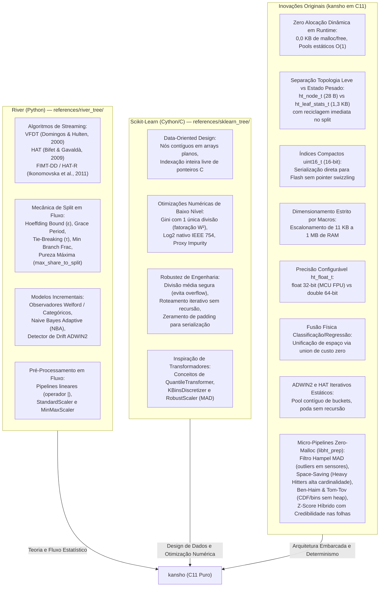
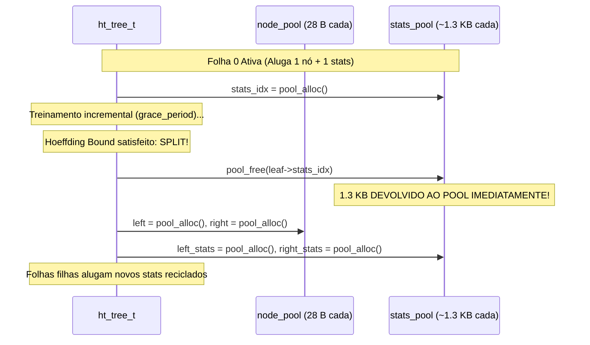
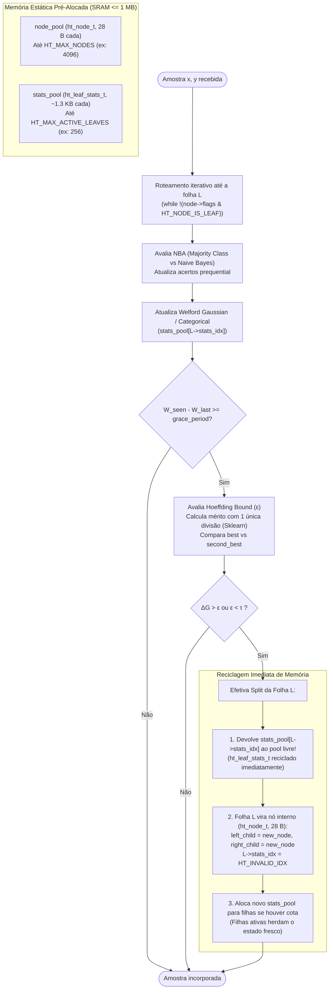

# Linhagem Arquitetural: O que Veio do River, do Scikit-Learn e o que é Original

Esta página detalha a genealogia técnica e as decisões de engenharia do **kansho**. O projeto não é uma simples tradução linha por linha de uma biblioteca existente nem uma reimplementação do zero: trata-se da **síntese arquitetural** entre os algoritmos de aprendizado em fluxo (*stream learning*) do **River**, os padrões de localidade de cache e otimização numérica em baixo nível do **Scikit-Learn**, e um conjunto substancial de **inovações originais** projetadas para viabilizar inferência e treinamento incremental em microcontroladores bare-metal com **$\le 1\text{ MB}$ de RAM** e **zero alocação dinâmica (`malloc`/`free`)**.

---

## 1. Visão Geral da Tríplice Herança



---

## 2. O que foi Extraído do River (`online-ml/river`)

O [`online-ml/river`](https://github.com/online-ml/river) é a principal referência moderna em aprendizado de máquina em fluxo (*online/streaming machine learning*) em Python. Nossa implementação extraiu do River os **fundamentos matemáticos**, o **fluxo estatístico incremental** e as **regras de decisão de split** para manter paridade algorítmica estrita.

### 2.1 Paradigma Algorítmico e Ciclo de Vida
- **Paradigma *Test-Then-Train* (*Prequential*):** Avaliação contínua da amostra antes de incorporá-la ao estado de treinamento (`ht_predict` seguido de `ht_learn_one`), padrão adotado nas classes [`HoeffdingTreeClassifier`](../references/river_tree/hoeffding_tree_classifier.py) e [`HoeffdingTreeRegressor`](../references/river_tree/hoeffding_tree_regressor.py).
- **Limite de Hoeffding (*Hoeffding Bound*):** Cálculo do limiar estatístico $\epsilon = \sqrt{\frac{R^2 \ln(1/\delta)}{2n}}$ para garantir com confiança $1 - \delta$ que a melhor divisão observada localmente converge para a divisão assintótica de infinitas amostras ([`hoeffding_tree.py#L84-L112`](../references/river_tree/hoeffding_tree.py#L84-L112)).
- **Período de Carência (`grace_period`):** Verificação de split a cada $N$ amostras acumuladas na folha (padrão $200$), evitando recalcular critérios de divisão a cada amostra individual ([`hoeffding_tree_classifier.py#L523-L536`](../references/river_tree/hoeffding_tree_classifier.py#L523-L536)).
- **Critério de Desempate ($\tau$ / `tie_threshold`):** Mecanismo de desempate quando dois atributos apresentam méritos quase idênticos ($\Delta \bar{G} \le \epsilon$): se $\epsilon < \tau$ (padrão $0.05$), o split é efetivado com o melhor atributo para não estagnar o aprendizado.

### 2.2 Heurísticas de Divisão e Formulação de Critérios
- **Filtro de Fração Mínima de Ramo (`min_branch_fraction = 0.01`):** Se a distribuição de peso em qualquer ramo filho resultar em $\frac{W_{\text{child}}}{W_{\text{post}}} \le 0.01$, o corte é descartado com mérito $-\infty$ ([`info_gain_split_criterion.py#L67-L79`](../references/river_tree/split_criterion/info_gain_split_criterion.py#L67-L79)).
- **Filtro de Pureza Máxima (`max_share_to_split = 0.99`):** Se a fração da classe majoritária na folha superar $99\%$, nenhum split é tentado, poupando ciclos de CPU ([`htc_nodes.py#L54-L60`](../references/river_tree/nodes/htc_nodes.py#L54-L60)).
- **Formulação de Mérito no Critério de Gini:** No River, o mérito é definido diretamente como $1.0 - \operatorname{Gini}_{\text{post}}$ (sem subtrair $\operatorname{Gini}_{\text{pre}}$), pois a impureza do nó pai é idêntica para todos os atributos avaliados na mesma folha ([`gini_split_criterion.py#L8-L61`](../references/river_tree/split_criterion/gini_split_criterion.py#L8-L61)).
- **Faixa de Mérito no Ganho de Informação ($R$):** No River, $R = \log_2(\max(C_{\text{obs}}, 2))$, onde $C_{\text{obs}}$ é a quantidade de classes já observadas na folha com peso $> 0$ ([`info_gain_split_criterion.py#L32-L34`](../references/river_tree/split_criterion/info_gain_split_criterion.py#L32-L34)).

### 2.3 Observadores de Atributos (`Splitters`)
- **Observador Gaussiano Contínuo:** Manutenção de estatísticas Gaussianas por classe usando o Algoritmo de Welford ($\text{count}, \mu, M_2, \min, \max$). Avaliação de $k$ pontos de corte equiprováveis calculados via CDF Normal ([`gaussian_splitter.py`](../references/river_tree/splitter/gaussian_splitter.py)).
- **Observador Categórico/Nominal:** Manutenção de matrizes de contingência classe $\times$ categoria para atributos nominais ([`nominal_splitter_classif.py`](../references/river_tree/splitter/nominal_splitter_classif.py)).

### 2.4 Predição nas Folhas e Adaptação a Concept Drift
- **Classificadores de Folha (MC, NB, NBA):**
  - *Majority Class* (MC): Predição proporcional às probabilidades a priori das classes.
  - *Naive Bayes* (NB): Predição pela regra de Bayes com verossimilhanças Gaussianas e categóricas.
  - *Naive Bayes Adaptive* (NBA): Chaveamento automático entre MC e NB com base no rastreamento contínuo de acertos cumulativos (`_mc_correct_weight` e `_nb_correct_weight`). Crucialmente, **os acertos são testados antes de atualizar o estado da folha com a nova amostra** ([`htc_nodes.py#L182-L192`](../references/river_tree/nodes/htc_nodes.py#L182-L192)).
- **Detector de Mudança de Conceito (`ADWIN2`):** Algoritmo de janelas adaptativas baseado em histogramas exponenciais de baldes com capacidades crescentes em potências de 2 ($2^m$), corte estatístico de médias com o limite de Hoeffding e compressão em $O(\log W)$ ([Bifet & Gavaldà, 2007](../references/papers/bifet2007learning.pdf)).
- **Hoeffding Adaptive Tree (`HAT` / `HAT-R`):** Monitoramento contínuo do erro em cada nó com instâncias de ADWIN2. Ao detectar drift, cria-se uma subárvore alternativa na raiz do ramo obsoleto; se a árvore alternativa atingir acurácia superior comprovada por um segundo ADWIN, ela substitui o ramo antigo ([`hatc_nodes.py`](../references/river_tree/nodes/hatc_nodes.py)).

### 2.5 Tratamento de Valores Ausentes (`NaN`)
- **Roteamento pelo Caminho Mais Comum (`most_common_path`):** Em caso de valor ausente no atributo de corte de um nó interno, a amostra é direcionada ao filho mais populoso com base na comparação imediata de peso $W_{\text{left}}$ vs $W_{\text{right}}$ ([`branch.py#L62-L67`](../references/river_tree/nodes/branch.py#L62-L67)).

### 2.6 Pré-Processamento em Fluxo e Pipelines de Streaming
- **Pipelines de Composição Amostra a Amostra (`river.compose.Pipeline`):** O River consagrou o encadeamento funcional em streaming utilizando o operador `|` (ex: `preprocessing.StandardScaler() | tree.HoeffdingTreeClassifier()`), onde cada transformador atualiza seu estado estatístico incremental a cada tupla antes de alimentar o estimador.
- **Normalização Online no Fluxo:** O River disponibiliza classes como `preprocessing.StandardScaler` (baseado no algoritmo de Welford) e `preprocessing.MinMaxScaler` (rastreando extremos em fluxo). Inspirados por esse fluxo contínuo, adaptamos os algoritmos de padronização para execução direta e determinística em microcontroladores.

---

## 3. O que foi Extraído do Scikit-Learn (`references/sklearn_tree/`)

O [`scikit-learn`](https://github.com/scikit-learn/scikit-learn) (`sklearn/tree`) implementa árvores em lote (CART) em **Cython/C**. Embora o algoritmo do CART (batch) seja incompatível com fluxos contínuos em microcontroladores devido ao custo de memória $O(N)$ do `DensePartitioner` ([`docs/05_sklearn_architecture.md`](../docs/05_sklearn_architecture.md)), extraímos do código Cython do Scikit-Learn os **padrões de projeto orientados a dados**, a **localidade de cache** e as **otimizações aritméticas de baixo nível**.

### 3.1 Data-Oriented Design e Nós em Arrays Contíguos
- **Eliminação de Ponteiros C Dispersos:** Em árvores clássicas de livros didáticos em C++, nós são instâncias individuais alocadas no heap (`new Node`) com ponteiros `Node* left, *right`. O Scikit-Learn rejeita esse modelo e armazena todos os nós em um array contíguo plano (`Node* nodes` em [`_tree.pxd#L28-L48`](../references/sklearn_tree/_tree.pxd#L28-L48)), referenciando filhos por índices inteiros (`intp_t left_child, right_child`). Adaptamos essa filosofia para C11 puro com alocadores de pool estático e índices compactos.

### 3.2 Otimizações Numéricas de FPU e Álgebra de Divisão Única
- **Fatoração do Denominador no Critério de Gini:** Em [`_criterion.pyx#L605-L688`](../references/sklearn_tree/_criterion.pyx#L605-L688), o Scikit-Learn fatora o denominador constante $W^2$ para fora do somatório de impureza:
  $$\operatorname{Gini}(D) = 1.0 - \frac{\sum_{c=0}^{C-1} w_c^2}{W^2}$$
  Em vez de executar $C$ divisões de ponto flutuante por ramo, acumulam-se multiplicações simples $\sum w_c^2$ e executa-se **apenas 1 única divisão ao final**. Em microcontroladores ARM Cortex-M4F/ESP32, onde cada divisão leva cerca de 14 ciclos de clock e cada multiplicação acumulada (`VFMA.F32`) leva 1 ciclo, essa técnica economiza milhares de ciclos de clock a cada período de carência.
- **Logaritmo na Base 2 com Funções Nativas IEEE 754:** O Scikit-Learn define $\log_2(x) = \frac{\ln(x)}{\ln(2.0)}$ com guardas para classes vazias ([`_utils.pxd#L138-L139`](../references/sklearn_tree/_utils.pxd#L138-L139) e [`_criterion.pyx#L559`](../references/sklearn_tree/_criterion.pyx#L559)). Em nosso C11, combinamos essa álgebra com as instruções intrínsecas `log2f` / `log2` de `<math.h>`, eliminando divisões por classe no cálculo de Entropia.
- **Conceito de *Proxy Impurity Improvement*:** Em [`_criterion.pyx#L147-L200`](../references/sklearn_tree/_criterion.pyx#L147-L200), o Scikit-Learn otimiza a comparação de candidatos cancelando os termos invariantes do nó pai antes do loop de busca do corte.

### 3.3 Robustez Aritmética e Casos de Borda
- **Prevenção de Overflow no Ponto Médio:** Em [`_partitioner.pxd#L49-L51`](../references/sklearn_tree/_partitioner.pxd#L49-L51), o cálculo do threshold entre dois valores $a$ e $b$ é feito via:
  ```c
  threshold = a / 2.0f + b / 2.0f;
  ```
  em vez de `(a + b) / 2.0f`. Isso previne que a soma transitória estoure para `+INFINITY` quando ambos os valores estão próximos do limite de representação de `float32` ($\approx 3.4 \times 10^{38}$).
- **Tolerância contra Atributos Quase-Constantes (`FEATURE_THRESHOLD`):** Em [`_partitioner.pxd#L15`](../references/sklearn_tree/_partitioner.pxd#L15), se a dispersão do atributo for inferior a $10^{-7}$, a busca é abortada, evitando criar ramos degenerados por imprecisão de arredondamento.
- **Zeramento Explícito de Padding para Serialização Determinística:** Em [`_tree.pyx#L947-L948`](../references/sklearn_tree/_tree.pyx#L947-L948), o Scikit-Learn aplica `memset` zerando structs recém-alocadas para garantir que bytes de alinhamento (*padding*) não contenham lixo de memória na serialização em disco. Adotamos o mesmo rigor em `ht_memory.c`.

### 3.4 Roteamento Iterativo sem Recursão
- **Navegação não-recursiva:** O método `_apply_dense` do Scikit-Learn ([`_tree.pyx#L1032-L1077`](../references/sklearn_tree/_tree.pyx#L1032-L1077)) utiliza um laço `while (node->left_child != _TREE_LEAF)`. Essa abordagem foi estendida no kansho para todo o ciclo de vida (predição, treino, poda e liberação de memória), blindando a pilha de chamadas (*stack*) de microcontroladores contra *stack overflow*.

### 3.5 Registro de Candidatos na Stack
- **`SplitRecord` Alocado na Pilha:** O Scikit-Learn define uma struct leve na stack ([`_splitter.pxd#L14-L44`](../references/sklearn_tree/_splitter.pxd#L14-L44)) para rastrear o melhor corte durante a iteração. Inspirados nisso, criamos `ht_split_candidate_t` (apenas $44\text{ B}$ em `float32`), dispensando qualquer alocação dinâmica durante a avaliação do limite de Hoeffding.

### 3.6 Inspiração em Transformadores Não-Paramétricos e Estimadores Robustos
- **Discretização e Transformação de Quantis (`QuantileTransformer` e `KBinsDiscretizer`):** No Scikit-Learn, transformadores como `KBinsDiscretizer` e `QuantileTransformer` mapeiam distribuições complexas, caudas longas ou multimodais para representações uniformes através do cálculo de percentis empíricos. Embora a abordagem do Scikit-Learn exija matrizes densas em lote e ordenação em memória de custo $O(N \log N)$, sua utilidade estatística inspirou a implementação do histograma streaming de Ben-Haim & Tom-Tov no kansho em $O(1)$ de RAM.
- **Estimativa Robusta de Dispersão via MAD (`RobustScaler`):** O Scikit-Learn utiliza a mediana e o Desvio Absoluto Mediano ($\operatorname{MAD}$) no `RobustScaler` para mitigar o impacto de *outliers* extremos em dados numéricos. Adaptamos a robustez do MAD com o fator assintótico $1{,}4826$ para o contexto de filtragem de espículas em tempo real sobre janelas móveis circulares no módulo `ht_prep`.

---

## 4. O que é Original no kansho

Embora o River forneça a teoria de streaming e o Scikit-Learn inspire a engenharia de dados, **nenhuma das duas bibliotecas é capaz de rodar em microcontroladores bare-metal ou RTOS com $\le 1\text{ MB}$ de RAM**:
- O River depende de centenas de objetos dinâmicos Python, dicionários esparsos (`defaultdict`), chamadas contínuas ao Garbage Collector e alocação dinâmica intensiva no heap.
- O Scikit-Learn consome dezenas de megabytes de RAM em buffers de ordenação $O(N)$ (`DensePartitioner`), compila em Cython com dependências pesadas do NumPy e foi arquitetado exclusivamente para treinamento offline em lote.

As inovações originais do **kansho** resolvem esse abismo de arquitetura:

### 4.1 Zero Alocação Dinâmica em Runtime (0,0 KB de Heap)
- É **estritamente proibido** o uso de `malloc`, `calloc`, `realloc` ou `free` durante o aprendizado (`ht_learn_one`), inferência (`ht_predict`) ou atualização de drift (`ht_adwin_update`).
- Toda a memória necessária para a árvore, nós, observadores, detectores ADWIN2 e árvores alternativas é pré-alocada em **Slab / Pool Allocators estáticos** gerenciados por `ht_memory.c`. O consumo de RAM é $100\%$ determinístico e imune a fragmentação de heap.

### 4.2 Desacoplamento Físico: Topologia Leve (`ht_node_t`) vs Estado Pesado (`ht_leaf_stats_t`) com Reciclagem Imediata
No River, uma folha mantém seus observadores permanentemente associados. No Scikit-Learn, cada nó da struct `Node` (96 bytes) carrega buffers fixos para a vida toda.
- **Nossa Inovação:** Separamos o nó em duas entidades físicas completamente distintas:
  1. `ht_node_t` (**Topologia - Leve**): Ocupa apenas **$28\text{ Bytes}$** (em `float32`). Contém apenas os índices dos filhos, índice do estado, regra de corte binário e contadores de classe/regressão. Permanece em memória após o split.
  2. `ht_leaf_stats_t` (**Estado de Aprendizado - Pesado**): Ocupa **$\approx 1.360\text{ Bytes}$** (em `float32`). Contém os observadores de Welford, matrizes categóricas e estatísticas do Naive Bayes / fMSE.
- **Reciclagem Imediata no Split:** O estado pesado é **alugado temporariamente** do `stats_pool` apenas enquanto a folha está ativa. No exato instante em que a folha sofre split e se transforma em nó interno de decisão, seu `ht_leaf_stats_t` é **imediatamente devolvido à free-list do pool**. Isso permite que o modelo crie milhares de nós internos de árvore mantendo apenas um pequeno pool de folhas ativas simultâneas!
- **Desativação de Folhas (VFDT Memory Management):** Quando o pool de estatísticas se esgota, as folhas menos promissoras têm seu `ht_leaf_stats_t` devolvido ao pool, mantendo as contagens no `ht_node_t` para continuar predizendo com zero perda de estrutura.



### 4.3 Indexação Compacta em 16-bit (`uint16_t`) e Relocabilidade Binária
- Em arquiteturas de 32 e 64 bits, ponteiros C ocupam 4 ou 8 bytes por referência.
- Substituímos todos os ponteiros entre nós (`left_child`, `right_child`, `stats_idx`) por inteiros de 16 bits (`uint16_t` com sentinela `HT_INVALID_IDX = 0xFFFF`).
- **Ganhos:**
  - Redução de $75\%$ no tamanho dos índices topológicos ($6\text{ B}$ vs $24\text{ B}$ no Scikit-Learn 64-bit).
  - Capacidade de endereçar até $65.534$ nós.
  - **Relocabilidade binária direta:** O modelo pode ser gravado diretamente em Flash, EEPROM ou cartão SD via `ht_tree_save` (`fwrite` contíguo) e carregado via `ht_tree_load` em qualquer outro dispositivo ou endereço de memória sem necessidade de *pointer swizzling* ou reconstrução de grafos.

### 4.4 Dimensionamento Estritamente Estático por Macros de Compilação
- Ao contrário do River e Scikit-Learn, que exigem alocadores dinâmicos para dimensionar matrizes em runtime, o kansho define todas as capacidades máximas em tempo de compilação (`ht_config.h` ou flags `-D` no Makefile):
  `HT_MAX_NODES`, `HT_MAX_ACTIVE_LEAVES`, `HT_MAX_FEATURES`, `HT_MAX_CLASSES`, `HT_MAX_CATEGORIES`.
- Isso elimina campos de controle dinâmico na struct `ht_tree_t` e permite ajustar o modelo fisicamente para qualquer microcontrolador:
  - **Tier 256 (~750 KB de RAM):** Linux Embarcado, ESP32, STM32F7.
  - **Tier 32 (~40 KB de RAM):** Microcontroladores intermediários (ARM Cortex-M4F com 64 KB de RAM).
  - **Tier 8 (~11 KB de RAM):** Microcontroladores ultracompactos (Blue Pill STM32F103, Arduino Nano 33 BLE com apenas 20 KB de SRAM).

### 4.5 Precisão Configurável via Tipo Unificado (`ht_float_t`)
- Macro de abstração unificada `ht_float_t`:
  - **Padrão em `float` (32-bit):** Corta o consumo de RAM de todos os pools pela metade e aproveita a FPU single-precision de microcontroladores (ARM Cortex-M4F/M7, ESP32, RP2350).
  - **Flag `-DHT_USE_DOUBLE` (64-bit):** Converte instantaneamente todos os cálculos para `double` para testes de paridade exata bit a bit com os testes em Python do River.

### 4.6 Unificação Física de Classificação e Regressão via `union` C11
- Em bibliotecas Python convencionais, classificação (`HoeffdingTreeClassifier`) e regressão (`HoeffdingTreeRegressor`) vivem em arquivos e estruturas separadas.
- No kansho, unificamos tarefas de Classificação Multiclasse e Regressão Contínua (`VFDT-R` / `FIMT-DD` e `HAT-R`) na mesma estrutura `ht_tree_t` e `ht_node_t` usando *unions* anônimas do C11:
  - `class_counts[HT_MAX_CLASSES]` compartilha fisicamente os mesmos bytes de `reg_stats` (variância do alvo calculada por Welford).
  - Os observadores de atributos compartilham o mesmo buffer para densidade Gaussiana (classificação) e quantização em 5 slots com mesclagem de Chan (regressão).
  - **Custo adicional em RAM da unificação:** **0 bytes**.

### 4.7 Detector ADWIN2 Determinístico em Array Estático de Baldes
- A implementação original do ADWIN2 no River utiliza uma lista duplamente encadeada de baldes (*buckets*) alocados no heap, chamando `malloc`/`free` a cada adição de elemento ou compressão de janela.
- Criamos uma versão determinística em C11 (`ht_adwin_t` em `ht_drift.c`):
  - Baldes organizados em um array estático contíguo (`ht_bucket_t buckets[HT_ADWIN_MAX_BUCKETS]`).
  - Compressão e mesclagem de baldes em tempo $O(\log W)$ usando índices inteiros.
  - Alocador global estático de instâncias ADWIN2 (`adwin_pool`), eliminando fragmentação ao instanciar detectores para nós da árvore adaptativa (`HAT`).

### 4.8 Algoritmo de Poda e Substituição de Subárvores no HAT sem Recursão
- No River, a substituição de uma subárvore obsoleta quando ocorre *concept drift* delega a liberação da árvore descartada ao coletor de lixo do Python.
- Em C11 bare-metal, desenvolvemos um algoritmo iterativo de liberação de subárvores (`ht_tree_prune_subtree_iterative`):
  - Utiliza uma pilha/fila estática interna dimensionada para a profundidade máxima da árvore.
  - Percorre e devolve todos os nós e estatísticas da subárvore obsoleta para seus respectivos pools em tempo $O(K)$, sem executar nenhuma chamada recursiva na stack do microcontrolador.

### 4.9 Observador de Regressão Contínua com Fórmulas Paralelas de Chan
- Para regressão contínua em streaming (`VFDT-R` / `FIMT-DD`), adaptamos a quantização incremental em 5 slots ordenados e implementamos as fórmulas exatas de combinação e subtração paralela de variâncias de **Chan, Golub & LeVeque (1983)** (`ht_var_combine` e `ht_var_subtract` em `ht_observer.c`).
- Isso viabiliza o cálculo de redução de variância (*SDR - Standard Deviation Reduction*) em $O(1)$ de RAM sem exigir buffers de histórico ou re-escaneamento de amostras.

### 4.10 Independência Absoluta de Terceiros e C11 Puro
- Zero dependência de runtimes C++, bibliotecas BLAS/LAPACK, frameworks externos ou chamadas de sistema POSIX.
- Código restrito a 5 cabeçalhos padrão da ISO C11: `<stdint.h>`, `<stddef.h>`, `<stdbool.h>`, `<math.h>`, `<string.h>`.
- Total portabilidade para compiladores cruzados como `arm-none-eabi-gcc`, `xtensa-esp32-elf-gcc`, `riscv-none-embed-gcc`, Clang e MSVC.

### 4.11 Micro-Pipelines de Pré-Processamento Zero-Malloc (`libht_prep` e `ht_prep_pipeline_t`)
No River, pipelines de streaming (`pipe = scaler | model`) instanciam múltiplos objetos encadeados no heap de Python gerenciados pelo Garbage Collector. No Scikit-Learn, transformadores alocam matrizes intermediárias completas em cada chamada a `fit_transform()`.
- **Inovação no kansho:** Desenvolvemos a biblioteca embarcada `libht_prep` ([`code/include/ht_prep.h`](../code/include/ht_prep.h)), um micro-pipeline contíguo de pré-processamento alocado inteiramente na memória estática (`.bss`) ou stack via struct `ht_prep_pipeline_t`:
  - **Pegada Física Estática Ultracompacta:** Ocupa apenas **$\approx 4{,}6\text{ KB}$ em `float32`** ($\approx 8{,}4\text{ KB}$ em `double64`), mesmo configurado com todos os 4 estágios ativos para até 16 atributos.
  - **Anexação Transparente à Árvore:** Pode ser acoplado à árvore via `ht_tree_set_prep_pipeline(&tree, &pipe)`. Com isso, tanto `ht_tree_learn_one` quanto `ht_tree_predict` realizam o pré-processamento dos atributos de forma nativa e transparente antes de alimentar o roteamento ou os observadores de divisão, com **zero chamadas a `malloc`** e **zero cópias extras de dados**.

### 4.12 Filtro Mediano Móvel de Hampel com MAD para Sensores Físicos (`ht_filter_hampel_t`)
Em ambientes embarcados (sensores industriais, ADCs de microcontroladores e telemetria automotiva), leituras espúrias, ruídos transientes e espículas temporárias frequentemente corrompem observadores de split e desestabilizam regressores.
- **Nossa Inovação:** Implementação de um identificador de Hampel totalmente estático sobre buffer circular de tamanho ímpar $W = 7$ amostras por atributo:
  - **Cálculo da Mediana e MAD em Stack:** Utiliza *insertion sort* em array temporário na pilha ($7$ elementos, ordenação em $\le 21$ comparações em $O(W \log W)$), eliminando qualquer buffer dinâmico.
  - **Ponto de Ruptura de $50\%$:** O Desvio Absoluto Mediano ($\operatorname{MAD}$) multiplicado pelo fator assintótico $1{,}4826 \approx \frac{1}{\Phi^{-1}(0{,}75)}$ garante que até metade da janela possa estar contaminada por ruído severo sem corromper a estimativa da dispersão.
  - **Substituição In-Place Anticascata:** Quando $|x_t - \tilde{x}_t| > 3{,}0 \cdot \max(\operatorname{MAD}_t, 10^{-6})$, o valor espúrio é substituído pela mediana local $\tilde{x}_t$ tanto na emissão quanto no buffer circular, expurgando o efeito propagador do ruído nas predições seguintes.

### 4.13 Codificador Categórico para Alta Cardinalidade Space-Saving (`ht_encoder_freq_t`)
Atributos nominais de alta cardinalidade (ex: identificadores de dispositivos, códigos de erro, IPs ou strings categóricas infinitas) são proibitivos em microcontroladores, pois observadores categóricos padrão exigem matrizes $C \times V$ que esgotariam a SRAM.
- **Nossa Inovação:** Adaptamos o algoritmo de *Heavy Hitters* **Space-Saving** de **Metwally, Agrawal & El Abbadi (2005)** para uma tabela estática de $K = 16$ slots (`ht_encoder_freq_t`):
  - **Garantia Teórica de Erro Mínimo:** A contagem acumulada dos elementos mais frequentes possui erro máximo rigorosamente limitado por $\frac{N_{\text{total}}}{K}$.
  - **Modo Razão de Frequência Contínua (`HT_ENC_FREQ_RATIO`):** Converte a categoria de entrada em sua frequência empírica $f(k) = \frac{\text{count}_k}{N_{\text{total}}} \in [0, 1]$, permitindo que a Hoeffding Tree trate atributos nominais de cardinalidade arbitrária como variáveis contínuas suaves.
  - **Modo Top-$K$ com Bucket Sentinela (`HT_ENC_TOP_K_CAT`):** Mapeia os $K_{\text{target}}-1$ itens dominantes para rótulos compactos ($0 \dots K-2$) e reúne toda a cauda residual no bucket sentinela *"Outros"* ($K-1$), garantindo compatibilidade estrita com `HT_MAX_CATEGORIES = 5`.

### 4.14 Discretização Não-Paramétrica e Observador de Histograma de Ben-Haim & Tom-Tov (`ht_quantizer_t` e `ht_hist_obs_t`)
O observador numérico tradicional baseado na aproximação Gaussiana de Welford assume que cada atributo contínuo se comporta de forma unimodal $P(x \mid y) \sim \mathcal{N}(\mu, \sigma^2)$. Em distribuições multimodais, assimétricas ou com caudas pesadas, pontos de corte ótimos são facilmente mascarados.
- **Nossa Inovação:** Implementamos o algoritmo de histograma dinâmico streaming de **Ben-Haim & Tom-Tov (2010)** em duas frentes complementares:
  1. **Quantizador Não-Paramétrico no Micro-Pipeline (`ht_quantizer_t`):** Mantém até $B = 16$ centróides ordenados com fusão gulosa em $O(B)$ e estima a densidade acumulada contínua $\hat{F}(x) \in [0, 1]$ via interpolação linear trapezoidal. Suporta transformação uniforme (estilo *QuantileTransformer*) e discretização equi-provável em $K$ bins (estilo *KBinsDiscretizer*).
  2. **Observador de Histograma nas Folhas (`ht_hist_obs_t`):** Projetado com precisão cirúrgica de memória para caber **rigorosamente dentro da union existente `ht_feature_obs_t` de 80 bytes em `float32`** (4 bins $\times$ 20 bytes). Isso viabiliza divisões não-paramétricas multi-classe diretamente na Hoeffding Tree com **zero acréscimo de memória** no estado de aprendizado (`sizeof(ht_leaf_stats_t) = 1.360\text{ B}` inalterado).

### 4.15 Normalização Online Híbrida com Credibilidade nas Folhas SGD (Regressão Contínua)
Em regressão em streaming com regressores lineares nas folhas (`HT_LEAF_MODEL` e `HT_LEAF_ADAPTIVE`), variáveis em escalas heterogêneas (ex: temperaturas em $[0, 1]$ versus horas em $[0, 23]$ e vazões em $[0, 1000]$) degradam a taxa de convergência da Descida de Gradiente Estocástico (SGD).
- **O Dilema da Herança Pós-Split:** Quando uma folha mãe sofre split, os filhos herdam seus pesos lineares $\mathbf{w}$ para evitar descontinuidade de predição. Se a normalização fosse calculada exclusivamente com amostras da folha recém-nascida ($N=0$), a primeira amostra geraria um salto abrupto de escala, corrompendo imediatamente os pesos herdados da mãe.
- **Nossa Inovação:** Desenvolvemos uma normalização Z-score híbrida em duas camadas com fusão de credibilidade:
  - **Prior Global da Árvore:** Acumulador de Welford global mantido na struct `ht_tree_t` (custo insignificante de apenas $192\text{ B}$ para 16 atributos).
  - **Suficiência Local das Folhas sem Custo de Memória:** A média e variância locais da folha são derivadas em tempo $O(1)$ a partir dos 5 slots de quantização de Chan já residentes em `ht_leaf_stats_t`.
  - **Ponderação por Credibilidade ($\kappa = 10{,}0$):**
    $$\alpha = \frac{N_{\text{slots}}}{N_{\text{slots}} + \kappa}, \qquad \mu_f = \alpha \mu_{\text{slots}} + (1 - \alpha) \mu_{\text{tree}}, \qquad \sigma_f^2 = \alpha \sigma_{\text{slots}}^2 + (1 - \alpha) \sigma_{\text{tree}}^2$$
  - **Resultado:** No instante do split ($N_{\text{slots}} = 0$), $\alpha = 0$, garantindo continuidade matemática perfeita de escala com a mãe. Conforme a folha amadurece ($N_{\text{slots}} \gg \kappa$), o Z-score especializa-se gradualmente no hiperplano local da folha. **Custo adicional em RAM no pool de folhas: exatamente 0 bytes.**

---

## 5. Matriz Comparativa Tripla: River vs Scikit-Learn vs kansho

| Característica / Métrica | River (`online-ml/river`) | Scikit-Learn (`sklearn.tree`) | kansho (C11) | Origem / Inspiração |
| :--- | :--- | :--- | :--- | :--- |
| **Linguagem Principal** | Python 3 + Cython esparso | Cython + C | **C11 Puro Estrito** | Autoral |
| **Paradigma de Aprendizado** | *Online / Streaming* (amostra a amostra) | *Batch / Offline* (re-escaneia dataset) | ***Online / Streaming* (amostra a amostra)** | **River** |
| **Orçamento de RAM Típico** | $> 100\text{ MB}$ (Python VM + heap) | $> 50\text{ MB}$ ($O(N)$ em amostras) | **$\le 1\text{ MB}$ (escalável até $11\text{ KB}$)** | Autoral |
| **Alocação Dinâmica (`malloc`)** | Contínua (Python GC e objetos) | Dinâmica via `realloc` e NumPy | **ZERO (0,0 KB em runtime)** | Autoral |
| **Indexação entre Nós** | Referências a objetos no heap | Inteiros 64-bit (`intp_t`, 8 B) | **Inteiros 16-bit (`uint16_t`, 2 B)** | **Sklearn** (conceito) + Autoral (16-bit) |
| **Separação Topologia vs Estado** | Não (nó carrega observadores) | Não (nó carrega buffers) | **Sim (`ht_node_t` 28 B / `stats_t` 1,3 KB reciclado)** | Autoral |
| **Critério de Divisão** | Hoeffding Bound ($\epsilon$) + $\tau$ | CART Impurity Decrease ($\Delta I$) | **Hoeffding Bound ($\epsilon$) + $\tau$** | **River** |
| **Otimização de Gini (FPU)** | Fórmula clássica com divisões | Divisão única fatorando $W^2$ | **Divisão única fatorando $W^2$** | **Scikit-Learn** |
| **Navegação na Árvore** | Recursiva / laços de objetos | Iterativa `while` em `_apply_dense` | **Iterativa `while` estrita (zero recursão)** | **Scikit-Learn** |
| **Predição na Folha** | MC, NB, NBA, Linear Model | Média / Contagem de classes | **MC, NB, NBA (Classif.) / Mean, SGD (Reg.)** | **River** |
| **Adaptação a Drift** | HAT + ADWIN2 dinâmico | Nenhuma (estático) | **HAT + ADWIN2 determinístico em pool** | **River** (teoria) + Autoral (pool estático) |
| **Atributos Ausentes (`NaN`)** | `most_common_path()` | Missing-go-to-left / bitmasks | **`most_common_path()` sem bytes extras** | **River** |
| **Precisão de Ponto Flutuante** | `double` (64-bit padrão Python) | `double` (64-bit) / `float32` | **Configurável via `ht_float_t` (32 ou 64-bit)** | Autoral |
| **Serialização de Modelo** | `pickle` (opaco, dependente de Python) | `pickle` / `__getstate__` | **Binária direta (`fwrite`/`fread` Flash/disco)** | Autoral + **Sklearn** (padding zero) |
| **Classificação e Regressão** | Classes separadas (`HTC` vs `HTR`) | Classes separadas (`DTC` vs `DTR`) | **Unificação por `union` C11 (zero sobrecarga)** | Autoral |
| **Pré-Processamento em Streaming** | Encadeamento via `Pipeline` (`\|`) no heap | Em lote via `Pipeline` e NumPy ($O(N)$) | **Micro-pipeline integrado `libht_prep` zero-malloc ($\approx 4{,}6\text{ KB}$ em `.bss`)** | **River** (streaming) + Autoral (zero-malloc) |
| **Filtragem de Outliers em Sensores** | Inexistente na árvore (requer módulos externos) | `RobustScaler` / filtros em lote offline | **Filtro Hampel MAD circular estático ($W=7$, ordenação na stack)** | **Scikit-Learn** (conceito MAD) + Autoral (estático) |
| **Alta Cardinalidade Categórica** | Dicionários dinâmicos de tamanho variável | `OneHotEncoder` / matrizes esparsas batch | **Space-Saving determinístico ($K=16$ slots Heavy Hitters)** | Autoral (Metwally et al. adaptado para MCU) |
| **Observadores Numéricos de Split** | Gaussiano Welford unimodal contínuo | Histogramas exatos em batch (`HistGradientBoosting`) | **Gaussiano Welford + Histograma Ben-Haim & Tom-Tov em 80 B** | **River** (Gaussiano) + Autoral (Ben-Haim em union) |
| **Normalização Local para Regressão SGD** | Normalização apenas a montante via scaler global | Pré-processamento global offline | **Z-Score Híbrido com Credibilidade (fusão árvore/slots sem custo)** | Autoral (herança suave de pesos pós-split) |

---

## 6. Diagrama de Ciclo de Vida da Memória

O diagrama abaixo ilustra graficamente a principal inovação de engenharia que permitiu ao **kansho** rodar em $\le 1\text{ MB}$ de RAM: a reciclagem imediata do estado pesado de aprendizado (`ht_leaf_stats_t`) e o crescimento contínuo da árvore topológica (`ht_node_t`):



---

## 7. Licenciamento e Conformidade de Direitos Autorais

O **kansho** é distribuído sob a licença de código aberto **[Mozilla Public License 2.0 (MPL 2.0)](../LICENSE)** (`SPDX-License-Identifier: MPL-2.0`).

Em total conformidade com as boas práticas de engenharia de software e os termos legais das bibliotecas que serviram de estudo e inspiração, o arquivo de licença deste repositório preserva e reconhece integralmente os avisos de direitos autorais originais dos projetos de referência:
- **River:** [BSD 3-Clause License](../references/river_tree/LICENSE), Copyright (c) 2020-presente, online-ml developers.
- **Scikit-Learn:** [BSD 3-Clause License](../references/sklearn_tree/COPYING), Copyright (c) 2007-presente, scikit-learn developers.
